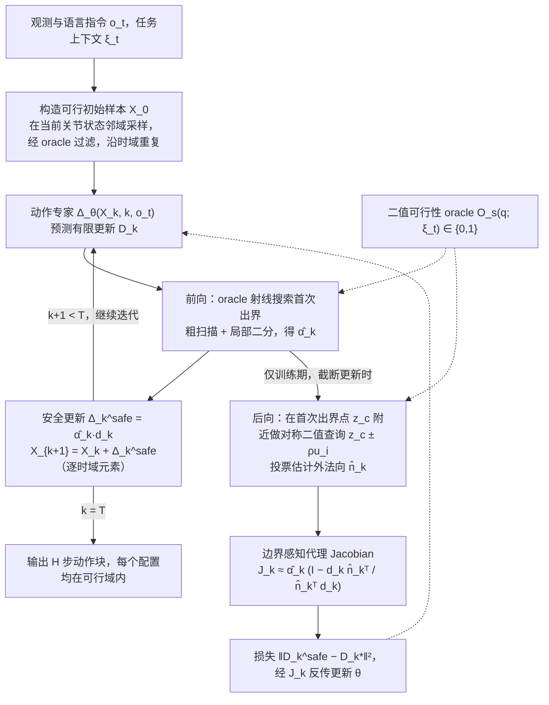

# 二值可行性安全流匹配：通过二值可行性判定学习安全 Flow Matching 机器人策略

**二值可行性安全流匹配**（*Learning Safe Flow-Matching Robot Policies from Binary Feasibility Oracles*，[arXiv:2610.40075](https://arxiv.org/abs/2610.40075)）收录于 senlanke「具身运控lab」10-26–10-30 前沿论文动态（Manipulation）。本页依据**周报条目 + arXiv 摘要页**整理，流程图依据论文方法部分（见参考来源），未逐页核对实验数字；指标与结论以论文为准。

## 一句话定义

**二值可行性安全流匹配：通过二值可行性判定学习安全 Flow Matching 机器人策略——提出 Oracle-Guided Differentiable Safeguard。前向传播时，通过二值可行性查询修正不安全动作；反向传播时，从局部边界信息构造约束相关梯度，使安全修正能够参与策略训练。在障碍物感知机器人操作实验中，实现 100% 的约束满足率。**

## 英文缩写速查

| 缩写 | 英文全称 | 简要说明 |
|------|----------|----------|
| VLA | Vision-Language-Action | 视觉–语言–动作模型 |
| IL | Imitation Learning | 模仿学习 |

## 为什么重要

- 周报所述待解决的问题：Flow Matching 生成的机器人动作可能违反关节限制或碰撞约束，而真实系统中的可行域不一定具有可微解析表达式。

## 流程总览

图依据：论文 §2 预备知识、§3 Oracle-Guided Differentiable Safeguard、Algorithm 1、Fig. 1、附录 B；训练与推理使用同一 safeguard。

## 核心机制

| 项 | 内容 |
|----|------|
| **arXiv** | [2610.40075](https://arxiv.org/abs/2610.40075) · [PDF](https://arxiv.org/pdf/2610.40075) |
| **作者（arXiv）** | Ma, Jianming, Jin, Rongjun, Chen, Yizhi, Gao, Yue |
| **机构（周报所述，未逐条核实）** | 上海交通大学、同济大学。 |
| **arXiv 评论栏** | （无） |
| **开源** | arXiv 摘要页与评论未见代码或项目页链接（仅核对 arXiv 摘要页，不代表未发布）（2026-11-02） |
| **周报所述创新点** | 提出 Oracle-Guided Differentiable Safeguard。前向传播时，通过二值可行性查询修正不安全动作；反向传播时，从局部边界信息构造约束相关梯度，使安全修正能够参与策略训练。在障碍物感知机器人操作实验中，实现 100% 的约束满足率。 |

### arXiv 摘要节选（英文原文）

> Robot foundation models increasingly rely on flow-based action generation for general-purpose manipulation, yet the generated actions are not guaranteed to satisfy physical constraints such as joint limits and collision avoidance. This problem is especially challenging when the feasible set cannot be described analytically and is accessible only through black-box feasibility oracles.

## 源码运行时序图

**不适用**：arXiv 摘要页与评论未见代码或项目页链接（仅核对 arXiv 摘要页，不代表未发布），无可对齐的官方代码流程。

## 实验与评测

- 周报与摘要给出的数字/场景已写入上表「创新点」与摘要节选；其余实验细节、基线与成功率定义请回到论文正文。
- 读法：先对齐任务设定、传感器与成功定义（仿真/真机），再解读 headline 数字，勿跨论文直接比较。

## 与其他工作对比

| 维度 | 读法 |
|------|------|
| **同周对照** | 见 [Manipulation周报技术地图](../overview/senlanke-weekly-2026-10-26-30-manipulation-technology-map.md)，按方向浏览同期论文 |
| **开源状态** | arXiv 摘要页与评论未见代码或项目页链接（仅核对 arXiv 摘要页，不代表未发布） |

## 结论

**二值可行性安全流匹配：通过二值可行性判定学习安全 Flow Matching 机器人策略。**

1. 本页是入库级摘要，复现前请核对论文正文、附录与代码仓库。
2. 指标须连同实验条件解读。
3. 关注 arXiv 版本更新与代码发布。

## 关联页面

- [senlanke-weekly-2026-10-26-30-manipulation-technology-map](../overview/senlanke-weekly-2026-10-26-30-manipulation-technology-map.md)
- [manipulation](../tasks/manipulation.md)
- [vla](../methods/vla.md)

## 参考来源

- [safe-flow-matching-binary-feasibility-oracles_arxiv_2610_40075.md](../../sources/papers/safe-flow-matching-binary-feasibility-oracles_arxiv_2610_40075.md)
- [wechat_senlanke_weekly_manipulation_2026-10-26_30.md](../../sources/blogs/wechat_senlanke_weekly_manipulation_2026-10-26_30.md)
- [arXiv:2610.40075](https://arxiv.org/abs/2610.40075)
- [arXiv PDF](https://arxiv.org/pdf/2610.40075)：已通读方法部分（实验与附录以略读为准）：§2 问题表述（离散时间流匹配）、§3 safeguard 前向/后向、Algorithm 1、附录 A–C

## 推荐继续阅读

- [arXiv PDF](https://arxiv.org/pdf/2610.40075)
