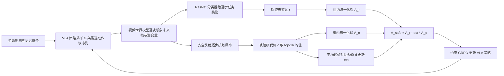

# SafeDojo（arXiv:2606.20698）

**SafeDojo**（*SafeDojo: Safe Reinforcement Learning for VLA via Interactive World Model*，[arXiv:2606.20698](https://arxiv.org/abs/2606.20698)，北京大学等，2026-06）。本页依据 [来源归档](../../sources/papers/safedojo_arxiv_2606_20698.md) 通读 arXiv v1 全文（含附录）写成；「作者自述」与「本页判断」分开标注。

## 一句话定义

**在交互式视频世界模型里对 VLA 策略做在线强化学习：想象出的帧给任务进度奖励，潜变量上的安全头给逐步碰撞代价，二者经拉格朗日约束 GRPO 平衡，避免真实世界的危险探索。**（摘要、§1）

## 英文缩写速查

| 缩写 | 英文全称 | 简要说明 |
|------|----------|----------|
| VLA | Vision-Language-Action | 视觉–语言–动作策略，本文基座为 OpenVLA-OFT |
| CMDP | Constrained Markov Decision Process | 带代价约束的 MDP，要求累计代价不超过预算 d（§3.1） |
| GRPO | Group Relative Policy Optimization | 组内相对优势、无独立 critic 的策略优化（§3.2） |
| TSR | Task Success Rate | 任务成功率 |
| SSR | Safe Success Rate | 完成任务且无障碍物碰撞的成功率，比 TSR 严格（§3.1、§5.1） |
| CAR | Collision Avoidance Rate | 整局无碰撞的比例 |
| CSC | Collision Step Count | 每局平均接触步数（含零接触局） |
| ETS | Execution Time Steps | 每局平均步数，越小越高效 |
| CBF | Control Barrier Function | 控制障碍函数，推理期安全过滤（基线 AEGIS 用之） |
| WM | World Model | 此处指动作条件视频预测模型 |

## 为什么重要

- 作者自述（§1）：VLA 要从高维视觉里推断安全边界，而物理违规不可逆；现有安全 RL 要么需真实探索，要么依赖手写安全函数，作者称 SafeDojo 是第一个面向 VLA 的基于模型的安全 RL 框架。「第一个」为作者自述，本页未独立核实。
- 本页判断：把「世界模型里做 VLA 后训练」（如 [WoVR](../entities/paper-rcl-2602-13977-wovr-world-models-as-reliable-simulators-for-pos.md)）与「CMDP 约束」接起来，给出可直接对照的 SafeLIBERO 数字；对关心「训练期安全 vs 推理期安全过滤」的读者有参考价值。

## 核心原理与流程总览

**CMDP 设定（§3.1）：** 任务奖励 r∈{0,1}，安全代价 c∈[0,1]，最大化 J^r 且 J^c ≤ d。

**三个组件（§4）：**

1. **分块交互式世界模型（§4.1）：** 基于 Wan 2.2，用交叉注意力注入动作；每个动作块 H=8 步、每步 7 维（6 自由度末端位姿增量加夹爪）；世界模型递归预测下一块的帧与潜变量；训练时以 0.05 概率使用 static-video 增强（冻结条件帧）缓解自回归曝光误差（附录 I）。
2. **解耦奖励与代价（§4.2）：** 任务奖励 f_task 是在 SafeLIBERO rollout 帧上微调的 ResNet 成功分类器（初始化自 LIBERO/WoVR 奖励模型检查点，附录 J）；安全代价 f_safe 是卷积潜变量编码器加动作条件 MLP，输出提议动作块每一步的障碍接触概率；奖励取全程均值，代价取最大 M=16 个步的均值（式 4）。
3. **拉格朗日约束 GRPO（§4.3）：** 组内分别归一化奖励与代价优势，Â_safe = Â^r − ηÂ^c，η ← [η + α(批均值代价 − d)]_+，d=0.2、α=0.05、G=16、KL 系数 β=0。

## 工程实践

- **训练配置（§5.1、附录 I）：** 世界模型在 1.5K SafeLIBERO 轨迹上微调 5000 步（学习率 1e-5，只训 DiT，VAE 固定，每样本 13 帧 256×256、5 个条件帧）；奖励分类器与安全头各训 20 epoch（学习率 1e-4、3e-4）；策略学习率 2e-5，全局 batch 8192，clip 比 0.2/0.28；策略优化用 4 节点共 32 张 A800-80GB。
- **安全标签来源（附录 J）：** 来自 SafeLIBERO 的接触碰撞审计，二值标签，按 episode 切 8:2 训练/验证。本页判断：因此「无需手写安全函数」指的是运行时不手写，训练安全头仍依赖仿真器给出的接触标签；真机部分论文未说明这些头如何获得真机标签。
- **评测（§5.1）：** SafeLIBERO 含 Spatial/Goal/Object/Long 四套件、每套件 4 个任务、两级障碍干扰（Level I 障碍靠近目标物，Level II 较远但在运动路径上）；仅用 Level I 训练，两级都测。表 4 数值均为 2 的倍数，推测每任务 50 局（论文未直接写明）。
- **公平性细节（附录 I）：** WMPO 与 SafeDojo 每任务单独 checkpoint，WoVR 每套件一个 checkpoint，训练粒度不同。
- **代码：** 论文未给出仓库或项目页，本页不设 `code:`。

## 实验与评测

- 论文 SafeLIBERO Level I 四套件平均安全成功率 SSR **53.25%**；Level II 与最优对照的安全成功率差异仅 **0.12 个百分点**，属于很小的报告差距。
- Franka 机械臂五项真实任务平均 SSR **70.00%**，每项与对照各 10 次；不能外推成已在人形全身控制中获得安全保证。
- 安全头标签由仿真器提供的接触标注监督；论文本身承认预测世界模型误差随长时 rollout 积累。

## 源码运行时序图

**不适用**：论文与配套材料未发布可核实的完整训练/推理代码入口；上方流程是论文算法图，不能视为真实软件调用图。

## 结论

**SafeDojo 用交互式世界模型在训练期评估 VLA 任务奖励和碰撞代价，但没有构成部署时的硬件安全认证。**

1. 需要区分 **SSR**（安全且完成任务）与单纯任务成功率；Level II 的小幅领先需谨慎阅读。
2. 安全标签依赖仿真接触，世界模型 rollout 会积累误差。
3. 真机结果是 Franka 桌面机械臂验证，不能直接写成已部署人形机器人全身安全控制。
4. 与 [FreeBar](./paper-freebar-barrier-guidance-async-vla.md) 的异步时间一致性、[Robo-ValueRL](./paper-robo-valuerl.md) 的任务价值筛选解决不同问题。

## 与清单说法的核对

清单一句话摘要：「Model-based safe RL for VLAs inside an interactive video world model, with imagined progress rewards and a learned safety head.」

| 清单措辞 | 论文核对 | 结论 |
|----------|----------|------|
| Model-based safe RL for VLAs | 摘要与 §1 自称首个面向 VLA 的基于模型安全 RL 框架；CMDP + 约束 GRPO（§3、§4.3） | 相符，「首个」为作者自述 |
| inside an interactive video world model | 策略优化在 Wan 2.2 微调的动作条件视频世界模型内完成（§4.1） | 相符；但世界模型、奖励头、安全头的训练数据来自 SafeLIBERO 仿真 rollout（§5.1、附录 J） |
| imagined progress rewards | ResNet 成功分类器在想象帧上给逐步任务进度奖励（§4.2、附录 J） | 相符；该分类器初始化自 LIBERO/WoVR 奖励模型检查点 |
| a learned safety head | 潜变量上的接触概率头（§4.2、附录 J） | 相符；监督信号为仿真器的二值接触标签，不是视觉判断出的「抽象安全」 |
| 清单未提及 | 仿真实验以 Level I SSR +8.25 个百分点为头条，Level II 仅领先 0.12 个百分点（表 1/2） | 摘要式的一句话无法反映领先幅度差异 |
| 清单未提及 | 真机 Franka 5 任务、每格 10 次试验（表 8） | 清单未限定仿真或真机，实际两者都有，但真机样本很小 |

## 局限

**论文自述（附录 B）：**

- 安全头只用二值碰撞标签，无法表达力阈值、接近距离等细粒度安全。
- 世界模型预测误差随 rollout 累积，影响奖励与代价评估可靠性。
- 评估限于静态障碍的桌面操作，动态障碍或有人在场仍未解决。
- 仅是训练期安全机制，推理期无硬安全保证，作者建议与 CBF 等推理期保护结合。

**本页观察到的未验证之处（判断，非论文所述）：**

- Level II 的领先很窄：SSR 49.62 对 49.50、ETS 277.00 对 277.17（表 2），报告中未给方差、随机种子数或显著性检验，难以判断是否超出噪声。
- 消融（图 4）只在 Level I Spatial Task 0 一个任务上做，且固定 η=0.3，与主实验默认 η=0.2 不同；η 扫描显示 0.2 与 0.3 在该任务上差距很大（TSR 74 对 60）。
- 真机每格 10 次试验（附录 H），单格分辨率 10%；真机所用世界模型与头的训练细节未交代。
- 并非所有套件都最优：Level I Goal 套件 TSR 为 80.00，低于 OpenVLA-OFT 的 83.50（表 1）；Long 套件 SSR 34.00 仅与 SFT 的 34.00 持平。摘要的「best aggregate」指跨套件平均。
- 优势项 Â^c 经组内归一化后均值为零，d 只通过 η 的更新起作用（式 5–7）；这是对公式的本页解读，论文未讨论其对约束满足的含义，也未报告训练后实际平均代价是否低于 d。

## 关联页面

- [Robo-ValueRL：进度价值与在线残差](./paper-robo-valuerl.md) — 价值可靠性与训练期安全代价的不同轴。
- [FreeBar：异步动作块约束](./paper-freebar-barrier-guidance-async-vla.md) — 时间一致性不等同于碰撞安全保证。

- [GRPO](../methods/grpo.md)：本文的优化骨架。
- [VLA（Vision-Language-Action）](../methods/vla.md)：基座 OpenVLA-OFT 所属方法族。
- [约束优化](../concepts/constrained-optimization.md)：拉格朗日乘子与 CMDP 的通用背景。
- [安全过滤器](../concepts/safety-filter.md)、[控制障碍函数](../concepts/control-barrier-function.md)：对照的推理期安全路线（基线 AEGIS）。
- [真实世界 RL 微调的安全问题](../concepts/safe-real-world-rl-fine-tuning.md)：同一动机的另一条路线。
- [世界动作模型](../concepts/world-action-models.md)：世界模型作为训练环境的更大图景。
- [LIBERO 基准](../entities/libero-benchmark.md)：SafeLIBERO 的底座。
- [RLinf-VLA](../entities/paper-rlinf-vla.md)：附录 I 提到使用 Wan/RLinf 的视频–动作格式。
- [WoVR](../entities/paper-rcl-2602-13977-wovr-world-models-as-reliable-simulators-for-pos.md)：本文基线与奖励模型初始化来源。
- [SafeDreamer](../entities/paper-sa-wm-482-safedreamer-safe-reinforcement-learning-with-wor.md)：论文所引的状态型模型基安全 RL。

## 参考来源

- [safedojo_arxiv_2606_20698.md](../../sources/papers/safedojo_arxiv_2606_20698.md)
- [arXiv:2606.20698](https://arxiv.org/abs/2606.20698)

## 继续阅读

- [arXiv PDF（v1）](https://arxiv.org/pdf/2606.20698v1)
- [WoVR（arXiv:2602.13977）](../entities/paper-rcl-2602-13977-wovr-world-models-as-reliable-simulators-for-pos.md)
- [GRPO 方法页](../methods/grpo.md)
