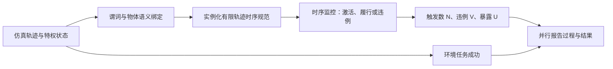
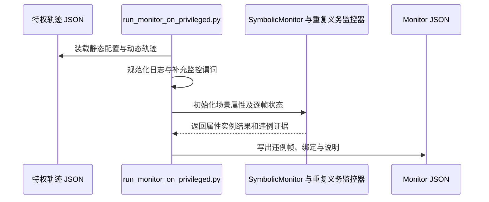

# SafeManip：机器人操作的时序安全评测 / A Property-Driven Benchmark for Temporal Safety Evaluation in Robotic Manipulation

## 一句话定义

在仿真操作轨迹中验证每次被触发的过程义务，而非只看最终目标是否达成。

## 英文缩写速查

| 缩写 | 英文全称 | 含义 |
|---|---|---|
| LTLf | Linear Temporal Logic over Finite Traces | 有限长度轨迹上的时序逻辑 |
| DFA | Deterministic Finite Automaton | 跟踪一次义务进度的确定性有限状态机 |
| VLA | Vision–Language–Action | 被评测的视觉语言动作策略之一 |

## 为什么重要

完成放置并不证明物体一直被稳定持有、安全释放，也不证明没有交叉污染。更活跃的策略会遇到更多操作机会，仅比原始违例次数会混淆活动量与每次机会的可靠性。

## 核心原理

ManipVerse 把不同仿真套件中的物体及动作映射到可复用属性。按场景绑定对象，再从特权状态得到布尔谓词。以 LTLf/DFA 追踪“何时触发、何时履行或违反”八类义务，允许同一轨迹反复产生机会。每条规则报告触发次数 N，以及 V/N（违例事件／触发）和 U/N（违例时间步／触发）；本文某些持续违例计数可超过 1，并非都可以当作概率。

## 源码运行时序图

## 工程实践

先取官方仓库 `examples/` 中已生成的监控 JSON 熟悉结果结构。如果已有按官方格式导出的特权轨迹，则可从 `SafeManip/` 运行 `python monitor/run_monitor_on_privileged.py <trajectory.json> --output <monitor.json>`。本次只核对代码，未运行完整仿真。

## 实验与局限

论文在 RoboCasa365（50 任务）与 LIBERO（40 任务）评测七个模型家族、十种策略或训练设定；每受测任务/设定做 50 回合。失败轨迹每触发风险为成功轨迹的 1.7–7 倍，但成功仍可违例。仿真内可以取得特权物体与接触状态，真机一般需要替代观测和重新校准；未触发规则意味着没有观察机会，不意味着安全。不同任务的规则覆盖也不同。

## 与其他工作对比

- [RoboChallenge Zero](paper-robochallenge-zero.md) 将真机目标完成、部分进度和开销分开；SafeManip 额外聚焦仿真过程的规则触发与暴露。
- [操作基准审计](paper-manipulation-benchmark-audit.md) 检查能力主张与评测协议是否对应；SafeManip 检查成功轨迹有没有违反预先声明的过程规则。

## 结论

结果、机会和规则风险应并列，不把某个过程分数合成成功率。

1. 报告触发数、事件违例和持续暴露；没有触发就标未覆盖。
2. 在同场景协议比较不同策略，按成功和失败分别审计。
3. 真机应用前验证可观测性和谓词阈值；评测本身不等同实时安全控制。

## 关联页面

- [具身智能体评测](../methods/embodied-agent-benchmarking.md)
- [机器人操作](../tasks/manipulation.md)

## 参考来源

- [SafeManip v3 原文](../../sources/papers/safemanip_arxiv_2605_12386.md)
- [官方源码归档](../../sources/repos/safemanip.md)

## 推荐继续阅读

- [具身评测纵深路线](../../roadmap/depth-embodied-eval.md)
