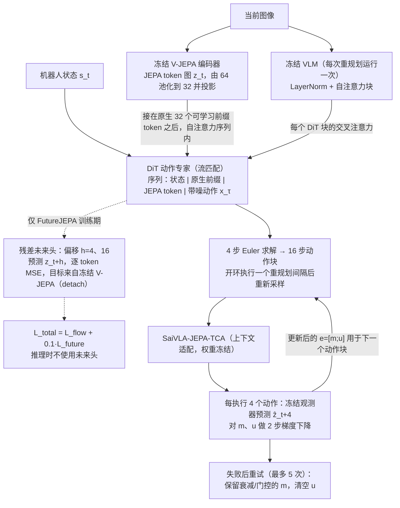

# SaiVLA-JEPA：评估 JEPA 条件化 VLA 控制中的未来潜在表示预测

**SaiVLA-JEPA**（*SaiVLA-JEPA: Evaluating Future Latent Prediction in JEPA-Conditioned VLA Control*，[arXiv:2610.38508](https://arxiv.org/abs/2610.38508)）收录于 senlanke「具身运控lab」10-26–10-30 前沿论文动态（Manipulation）。本页依据**周报条目 + arXiv 摘要页**整理，流程图依据论文方法部分（见参考来源），未逐页核对实验数字；指标与结论以论文为准。

## 一句话定义

**SaiVLA-JEPA：评估 JEPA 条件化 VLA 控制中的未来潜在表示预测——将冻结的 V-JEPA 特征引入 Flow-Based VLA，并增加两个训练期未来特征预测 Head。推理时移除辅助 Head，保持原有动作采样流程。实验发现，当前 JEPA 特征条件化使成功率从 **71.6% 提升至约 82.5%**，但额外的未来预测监督在该训练预算下没有带来可检测的总体收益。**

## 英文缩写速查

| 缩写 | 英文全称 | 简要说明 |
|------|----------|----------|
| VLA | Vision-Language-Action | 视觉–语言–动作模型 |
| IL | Imitation Learning | 模仿学习 |

## 为什么重要

- 周报所述待解决的问题：JEPA 可以学习未来视觉表示，但增加未来预测监督是否一定能改善 VLA 的闭环操作性能，仍需要直接验证。

## 流程总览

图依据：论文 §2.1–2.4、Fig. 1（SaiVLA-JEPA 架构与 FutureJEPA）、§3.1–3.2、Fig. 2（TCA 上下文通路与重试）；TPA 参数适配（§3.3）未入图。

## 核心机制

| 项 | 内容 |
|----|------|
| **arXiv** | [2610.38508](https://arxiv.org/abs/2610.38508) · [PDF](https://arxiv.org/pdf/2610.38508) |
| **作者（arXiv）** | Xiao, Rufeng, Xiao, Ruihao, Chen, Wei, Sun, Xinhai |
| **机构（周报所述，未逐条核实）** | Synthoid.ai VLA Research Team。 |
| **arXiv 评论栏** | （无） |
| **开源** | arXiv 摘要页与评论未见代码或项目页链接（仅核对 arXiv 摘要页，不代表未发布）（2026-11-02） |
| **周报所述创新点** | 将冻结的 V-JEPA 特征引入 Flow-Based VLA，并增加两个训练期未来特征预测 Head。推理时移除辅助 Head，保持原有动作采样流程。实验发现，当前 JEPA 特征条件化使成功率从 **71.6% 提升至约 82.5%**，但额外的未来预测监督在该训练预算下没有带来可检测的总体收益。 |

### arXiv 摘要节选（英文原文）

> Joint-embedding predictive architectures (JEPAs) learn to predict representations rather than pixels, offering a compact way to model how visual scenes evolve. We ask whether this predictive objective improves closed-loop control when a vision-language-action (VLA) policy already uses V-JEPA features.

## 源码运行时序图

**不适用**：arXiv 摘要页与评论未见代码或项目页链接（仅核对 arXiv 摘要页，不代表未发布），无可对齐的官方代码流程。

## 实验与评测

- 周报与摘要给出的数字/场景已写入上表「创新点」与摘要节选；其余实验细节、基线与成功率定义请回到论文正文。
- 读法：先对齐任务设定、传感器与成功定义（仿真/真机），再解读 headline 数字，勿跨论文直接比较。

## 与其他工作对比

| 维度 | 读法 |
|------|------|
| **同周对照** | 见 [Manipulation周报技术地图](../overview/senlanke-weekly-2026-10-26-30-manipulation-technology-map.md)，按方向浏览同期论文 |
| **开源状态** | arXiv 摘要页与评论未见代码或项目页链接（仅核对 arXiv 摘要页，不代表未发布） |

## 结论

**SaiVLA-JEPA：评估 JEPA 条件化 VLA 控制中的未来潜在表示预测。**

1. 本页是入库级摘要，复现前请核对论文正文、附录与代码仓库。
2. 指标须连同实验条件解读。
3. 关注 arXiv 版本更新与代码发布。

## 关联页面

- [senlanke-weekly-2026-10-26-30-manipulation-technology-map](../overview/senlanke-weekly-2026-10-26-30-manipulation-technology-map.md)
- [manipulation](../tasks/manipulation.md)
- [vla](../methods/vla.md)

## 参考来源

- [saivla-jepa-future-latent-prediction_arxiv_2610_38508.md](../../sources/papers/saivla-jepa-future-latent-prediction_arxiv_2610_38508.md)
- [wechat_senlanke_weekly_manipulation_2026-10-26_30.md](../../sources/blogs/wechat_senlanke_weekly_manipulation_2026-10-26_30.md)
- [arXiv:2610.38508](https://arxiv.org/abs/2610.38508)
- [arXiv PDF](https://arxiv.org/pdf/2610.38508)：已通读方法部分（实验与附录以略读为准）：§2 方法（共享动作路径 / 未来头 / 推理）、§3 测试时适配（TCA 上下文适配与重试；TPA 参数适配）

## 推荐继续阅读

- [arXiv PDF](https://arxiv.org/pdf/2610.38508)
