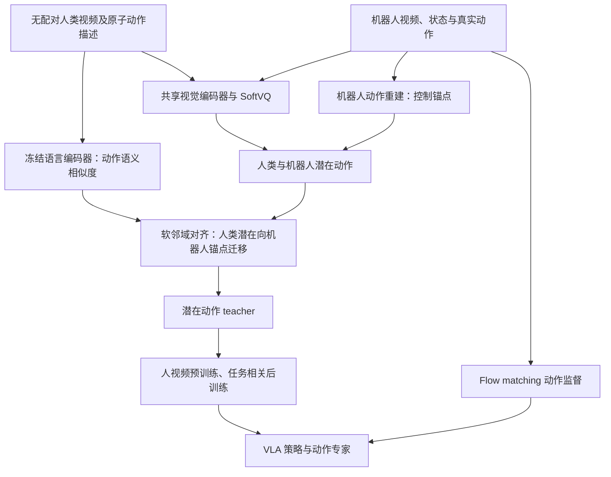

# SALA：语义对齐潜在动作实现具身模型双轴扩展
*SALA: Semantically Aligned Latent Actions Enable Dual-Axis Scaling of Embodied Foundation Models*

## 一句话定义

**SALA**：以机器人动作重建提供控制锚点，用原子动作的语言相似度把无配对人类视频潜在动作对齐到机器人潜在动作，再将无动作标签的人类视频用于 VLA 预训练与任务后训练。

## 英文缩写速查

| 缩写 | 英文全称 | 简要说明 |
|---|---|---|
| SALA | Semantically Aligned Latent Actions | 语义对齐的潜在动作方法 |
| LAM | Latent Action Model | 从视频学习潜在动作 |
| VLA | Vision-Language-Action | 视觉语言到控制动作策略 |
| SoftVQ | Soft Vector Quantization | 软向量量化 |

## 为什么重要

纯视频重建的潜在动作可能按外观聚类，未必对齐跨本体行为；语言软邻域使人类视频能监督机器人使用的动作专家。

## 核心信息

| 维度 | 核对信息 |
|---|---|
| 原始论文 | [arXiv:2611.17110v1](https://arxiv.org/html/2611.17110v1) |
| 机构 | Sharpa Robotics、上海交通大学 SJTU–Sharpa 联合实验室 |
| 论文作者 | Jiachun Jin、Zetong Zhou、Haonan Wang、Xiao Yang、Jun Zhu、Zhijie Deng |
| 官方项目 | [项目页](https://sala-vla.github.io/) |
| 开源状态（2026-11-16） | 官方项目页面显示 Code soon，尚无可运行代码链接。 |

## 核心原理

共享视觉编码器和 SoftVQ 将人类、机器人片段转成潜在动作；机器人分支用状态与真实 action chunk 做动作重建以建立可控锚点；冻结文本编码器从无配对片段的原子动作描述得到相似度软邻域，并以 stop-gradient 将人类潜在向机器人邻域对齐。训练 VLA 时，人类视频预测 teacher 潜在动作，机器人数据对动作专家施加 flow-matching 动作监督。

### 流程总览

> 图示基于论文的方法和监督流向；训练与部署路径应区分，图中模块不代表源码调用关系。

## 实验与评测

模拟使用 RoboTwin 2.0；真实数据包括 71,582 条、2,678 小时人类视频与 70,859 条、888 小时机器人数据（论文 Table 1）。作者展示通用人视频扩大预训练规模时离线动作预测误差下降，并研究任务人类示范对后训练成功率的影响；不能将离线误差曲线当作扩大规模后的真机成功率保证。

## 与其他工作对比

| 工作 | 关键接口与训练阶段 | 边界与取舍 |
|---|---|---|
| 本文 | 以机器人动作重建提供控制锚点，用原子动作的语言相似度把无配对人类视频潜在动作对齐到机器人潜在动作，再将无动作标签的人类视频用于 VLA 预训练与任务后训练。 | Tokenizer 训练依赖原子动作文字描述；Scaling 分析每种设置一次训练且最高 2,678 小时，规模外推及成功率关系尚未确立；官网标注 Code soon。 |
| [EgoX](./paper-egox-embodiment-dreaming.md) | 同领域相关研究，侧重不同的学习或动作接口 | 不能把不同基准、度量或硬件结果直接横比 |
| [STVLA](./paper-stvla-spatial-temporal-memory.md) | 从另一维度处理学习、记忆或控制问题 | 验收须按论文各自协议建立独立基线 |

## 结论

**以机器人动作重建提供控制锚点，用原子动作的语言相似度把无配对人类视频潜在动作对齐到机器人潜在动作，再将无动作标签的人类视频用于 VLA 预训练与任务后训练。 但必须按论文的实验协议和开源边界解读其效果。**

1. 语言只负责建立**无配对人机动作语义关系**，不是在线执行时的动作文本指令。
2. SoftVQ 有利于刻画连续软相似度，硬量化的对齐损失不理想。
3. 预训练人视频和后训练任务人视频是两个不同的扩展轴，不要混为同一数据实验。

## 源码运行时序图

**不适用。** 官方项目页面显示 Code soon，尚无可运行代码链接。 目前只有原论文方法流程可核验，不能把未开放的代码调用关系画成运行时序图。

## 工程实践

| 项目 | 实施与检查点 |
|---|---|
| 接入输入 | 核实论文定义的观察模态、坐标系、动作/控制接口，不能照搬其他本体 |
| 基线与指标 | 复用论文评测协议；另外记录成功率、任务进度、执行耗时和失败分布各自口径 |
| 训练/执行成本 | 区分模型预训练成本、开发期调用次数、在线决策延迟及实际通信开销 |
| 代码可得性 | 官方项目页面显示 Code soon，尚无可运行代码链接。 |
| 复现路径 | 以[官方论文](https://arxiv.org/html/2611.17110v1)与[项目页](https://sala-vla.github.io/)为准，缺失的数据/权重/控制接口需要单列阻塞 |

## 局限与风险

Tokenizer 训练依赖原子动作文字描述；Scaling 分析每种设置一次训练且最高 2,678 小时，规模外推及成功率关系尚未确立；官网标注 Code soon。

- **跨实验不可直接排名：** 论文分别使用跨本体进度、VLA 成功率、真机 episode 成功率或 RoboDojo 子集得分，不具备共同分母。
- **工程安全边界：** 真机动作链需另行评估碰撞、限位、通信中断与异常恢复；论文实验成绩不构成部署安全保证。

## 关联页面

- [EgoX](./paper-egox-embodiment-dreaming.md)
- [STVLA](./paper-stvla-spatial-temporal-memory.md)
- [VLA 学习纵深路线](../../roadmap/depth-vla.md)
- [跨本体迁移纵深路线](../../roadmap/depth-cross-embodiment.md)

## 参考来源

- [论文原文与核对归档](../../sources/papers/sala-arxiv-2611-17110.md)
- [官方项目页核对](../../sources/sites/sala-project-20261116.md)
- [arXiv HTML v1（包含实验与局限）](https://arxiv.org/html/2611.17110v1)

## 推荐继续阅读

- [官方项目页](https://sala-vla.github.io/)
- [论文 PDF](https://arxiv.org/pdf/2611.17110)
