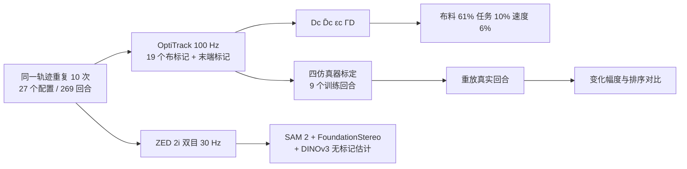

# Same Action, Different Outcome

**Same Action, Different Outcome**（arXiv:2610.10801，西班牙 IRI CSIC-UPC）是一项**测量研究**而非新算法：让两台 Franka 在四个动态布料任务上，用三种物理性质差异大的布重复执行同一轨迹，共 269 个真实回合，用动捕标记量化终态变化，再把真实回合放进四个布料仿真器比较。

## 英文缩写速查

| 缩写 | 英文全称 | 简要说明 |
|------|----------|----------|
| D̄c | Configuration dispersion | 同一配置各回合终态标记点成对距离的均值 |
| εc | Floor variability | 以被夹角点标记估计的机器人+抓取+传感噪声下限 |
| ΓD | Speed contrast | 最快速度与最慢速度的 D̄c 之比 |
| IL | Imitation Learning | 模仿学习，论文讨论的受影响对象 |
| PBD / VBD | Position / Vertex Block Descent | 基于位置 / 顶点块下降的布料求解（Genesis、Newton 所用） |
| ts | time-scale factor | 速度尺度因子，大于 1 表示更慢 |

## 为什么重要

- 模仿学习里"成功率"掩盖了名义相同执行的差异；论文给出可量化的下限（机器人重复性）和实测离散度对比。
- 布料性质是主因（解释 61% 的 log10 D̄c 方差），任务只占 10%、速度 6%，所以"在一种布上调好的策略"难以迁移。
- 它为"动态布料能否靠仿真替代真实数据"给出否定性证据：四个主流引擎都对不上变化幅度和排序。
- 与 [Point It, Strike It](./paper-point-it-strike-it.md) 同处动态柔性体问题：结果变化本身是控制设计的约束。

## 流程总览

## 方法

### 任务、布料、平台

- 任务：swing place、dynamic fold、linear inward join（新）、swing inward join（新）。
- 三种布均 0.7×0.5 m：棕羊毛 139 g、绿缎 35 g、红雪纺 27 g，悬垂刚度 9.5%、5.9%、3.1%；速度用时间尺度因子 ts 控制，任务 1 取三档，任务 2、4 两档，任务 3 一档。
- 两台 Franka Research 3；OptiTrack 100 Hz；ZED 2i 30 Hz。轨迹为遥操作演示（任务 1、2、4）与关节空间脚本（任务 3）。

### 变化度量

终态成对距离 Dc；配置离散度 D̄c；地板 εc 取被夹角点；D̄c>εc 视为不可重复；ΓD 为快慢速度之比。

### 仿真对照

Clothilde、Isaac Lab（PhysX）、Genesis（PBD）、Newton（VBD），各用 9 个训练回合做网格搜索 + 逐参数精修，每种布一组参数共用所有任务。

## 源码运行时序图

不适用：本文无训练或推理代码，项目页无分析代码仓库（只有读取单个回合的 Python 片段）。数据采集链路见上方流程图。

## 工程实践

| 项 | 内容 |
|----|------|
| 机构 | Institut de Robòtica i Informàtica Industrial（IRI），CSIC-UPC（据 arXiv HTML；institutions.json 暂无该机构，故 tags 略过） |
| 硬件 | 双 Franka Research 3、OptiTrack、ZED 2i、ArUco 标定 |
| 项目页 | [cloth-var.github.io](https://cloth-var.github.io)，归档见 [cloth-var-project.md](../../sources/sites/cloth-var-project.md) |
| 数据开放 | 部分：仅 1 个样例回合（CC BY 4.0，13 MB 核心包），完整 269 回合承诺发布但截至 2026-10-12 未提供 |
| 代码 | 无分析代码仓库 |

## 实验与评测

- **变化量**：D̄c 从 1.2 mm（棕，慢速挥动相向）到 118 mm（绿，折叠），约 96 倍；所有无重抓配置至少高出地板 2.4 倍，多数 1–3 个数量级。
- **swing place**：棕 5–9 mm，绿 23–47 mm，红 33–81 mm，地板 ≤2.1 mm。**dynamic fold**：自由角落点距目标 7–41 cm，棕离散 7–12 mm，轻布 55–118 mm。
- **速度**：ΓD 仅绿布折叠低于 1（0.97）；棕布挥动相向达 21（1.2 mm → 25.9 mm）。
- **重抓**：地板由 2–4 mm 升到 12–27 mm，结果仍高 2.6–4.2 倍，且不显著改变变化量。
- **仿真**：标定后保留回合标记误差 Clothilde 37–48、Isaac Lab 70–78、Genesis 82–90、Newton 79–94 mm；均无法同时复现幅度与排序，Clothilde 与 Genesis 最近；Isaac Lab 与 Newton 非确定性。
- **无标记视觉**：可保留趋势，折叠任务最差，不适合精确度量。

## 结论

**动态布料的执行结果由布料性质主导且远超机器人重复性，所以评估与数据规模不能只看成功率，也不能指望现有仿真器替代真机数据。**

1. **报告布料物性与离散度** — 布料占方差 61%，任务 10%，速度 6%。
2. **降速能减变化，但不总是** — 棕布挥动相向快慢差 21 倍，绿布折叠几乎无差（0.97）。
3. **重抓不是解药** — 重抓使地板升高，结果仍高 2.6–4.2 倍。
4. **别用单一仿真器代表真实布** — 四个引擎在 37–94 mm 误差下仍复现不了幅度与排序。
5. **残余变化可用来估计数据需求** — 论文建议用它推断策略何时数据饱和（论文观点，未验证）。
6. **数据目前只有样例** — 复现分析需等待完整数据集。

## 局限与风险

- 三种同尺寸布、四个任务、有限速度；轨迹为开环，仅测离散度、不测任务成功率。
- 标记标签需人工监督，有遮挡；地板估计依赖被夹角点。
- 仿真标定误差本身较大（37–94 mm）；棕布任务 4 仅 9 个回合。
- 开源：完整数据与分析代码均未发布，仅样例；项目页匿名并标注 Under review, ICRA 2027。

## 与其他工作对比

- [FolDeX](./paper-foldex-deformable-clothes-benchmark.md)：大规模真实折叠数据与评测基准；本文反向量化同动作的结果波动，二者互补。
- [ClothTransformer](./paper-clothtransformer-unified-latent-cloth-simulation.md)：学习式布料仿真；本文提供检验仿真器变化再现性的真实基准。
- [Point It, Strike It](./paper-point-it-strike-it.md)：绳的动态挥击，用 8 次真实校准缩小 sim2real 差距；本文说明布料在动态下该差距更大。
- [物理保真度缺口](../concepts/physics-fidelity-sim2real-gap.md)：本文属于其动态布料案例。

## 关联页面

- [Manipulation 周报汇总（2026-10-05 至 10-09）](../overview/frontier-manipulation-2026-10-05-10-09.md)
- [操作任务](../tasks/manipulation.md)、[双臂操作](../tasks/bimanual-manipulation.md)
- [模仿学习](../methods/imitation-learning.md)

## 参考来源

- [cloth_variability_arxiv_2610_10801.md](../../sources/papers/cloth_variability_arxiv_2610_10801.md) — 论文归档
- [cloth-var-project.md](../../sources/sites/cloth-var-project.md) — 项目页核查
- [frontier_manipulation_2026_10_05_10_09.md](../../sources/blogs/frontier_manipulation_2026_10_05_10_09.md) — 周报线索
- 论文：<https://arxiv.org/abs/2610.10801>

## 推荐继续阅读

- [项目页](https://cloth-var.github.io)
- [arXiv HTML 全文](https://arxiv.org/html/2610.10801v1)
- [FolDeX 页](./paper-foldex-deformable-clothes-benchmark.md)
