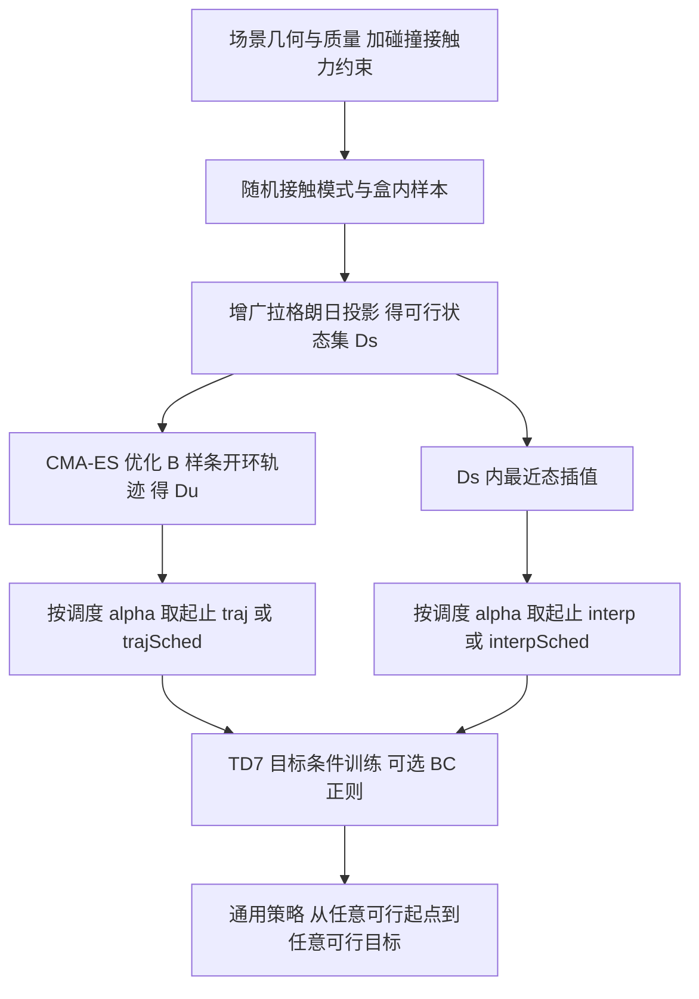

# Sample-Guided RL：约束采样引导通用操作 RL（arXiv:2602.08557）

论文 *Constrained Sampling to Guide Universal Manipulation RL*（[arXiv:2602.08557](https://arxiv.org/abs/2602.08557)，Toussaint 等，TU Berlin / LAAS-CNRS / Inria）。本页源于 CoRL 2026 Glen Berseth 阅读清单第 032 条（P1，Spotlight；清单标题为 *Combining Constrained Sampling and Reinforcement Learning for Manipulation*），以下内容以 arXiv v1 全文为准。

## 一句话定义

**把「可行静态状态」当作约束流形，用非线性约束求解器从中采样（及生成开环轨迹），并以此偏置 RL 每个 episode 的起点 / 目标分布，从而让目标条件 RL 在稀疏奖励的接触丰富操作中有信号可学；动力学仍当黑箱，实验仅在 MuJoCo 仿真。**

## 英文缩写速查

| 缩写 | 英文全称 | 简要说明 |
|------|----------|----------|
| CG-MDP | Constrained Goal-conditioned MDP | 在目标条件 MDP 上加约束，由约束集定义起止分布（第 III 节） |
| RL | Reinforcement Learning | 强化学习 |
| BC | Behavior Cloning | 行为克隆，本文作为可选正则项（式 14） |
| TD7 | TD3 with state-action representation learning (SALE) etc. | 本文使用的离策略 RL 基线框架，沿用官方实现 |
| TD3+BC | TD3 with Behavior Cloning | 在策略更新里加 BC 惩罚的做法（式 14） |
| CMA-ES | Covariance Matrix Adaptation Evolution Strategy | 零阶黑箱优化，用来求开环轨迹（式 12） |
| POA | Point of Attack | 接触力作用点，约束中的辅助变量 |
| NLP | Nonlinear Programming | 非线性规划，采样可行状态即解 NLP |

## 为什么重要

- 标准目标条件 RL 默认起止分布 p0 容易采样；但在物理场景里，采样「无碰撞、有支撑、受力平衡」的状态本身就是非凸问题（第 I 节、第 III 节）。
- 论文主张（作者自述）：对接触丰富操作，RL 的瓶颈之一是稀疏奖励下的动作噪声探索；用模型约束决定「从哪里开始练」比用专家动作做 BC 更关键（第 V-D 节 i，结论）。
- 对读者：这是一条「用经典操作规划的几何 / 接触知识引导 RL，而不依赖演示」的思路，与 reset 课程、HER 类目标采样可对照阅读。

## 核心原理与流程总览

1. **CG-MDP（III）：** 状态约束 S_c = {s : g_c(s) ≤ 0, h_c(s) = 0}，p0 = U(S_c × S_c)。约束含非碰撞 d_ij ≥ 0；接触对有接触点与力变量，要求力在库仑摩擦锥内（式 6-8）；每个无驱动物体满足静力平衡（式 9）。故起止状态都是静态的。
2. **约束采样（IV-A）：** 随机选接触模式（支撑形状 1-3 个）与盒内均匀样本，用增广拉格朗日解邻近投影问题得到可行状态集 D_s（式 10-11）。
3. **开环轨迹（IV-B）：** 在 D_s 中随机取起止，用 2 阶 B 样条控制 + CMA-ES 在黑箱仿真中优化到达目标，终端代价 ≤ 阈值才保留，得 D_u（式 12-13）。
4. **引导 RL（IV-C、IV-D，算法 1）：** TD7 训练，按块（每 100k 步）更新起止采样；五种选项：traj（轨迹中取状态）、trajSched（只取轨迹末段，α 从 0.1 线性升到 1，并把时限设为 2αT）、interp（两个约束样本插值后投影回最近可行状态）、interpSched、baseline（直接从 D_s 取起止）。

## 工程实践

- **环境（V-A）：** MuJoCo；double sphere（球形机器人 + 球物体 + 地面与墙）与 panda sphere（panda 臂用所有连杆操作球物体）。动作为相对当前参考的关节位置 B 样条控制点，20 Hz，仿真 1 kHz；奖励 1 当物体位置距目标 < 1 cm。时限 double sphere 2 s、panda 4 s。
- **训练设置（V-A、算法 1）：** TD7 超参基本不变，改 γ（0.95 / 0.99）并将探索与目标噪声减半；总 2M 步，每 100k 步换起止分布，Tsched = 1M；每方法 5 个独立运行。
- **数据与算力（V-B、V-C，图 3）：** 采样 10 000 个状态：double sphere 可行率 58.7%、总计约 2.93 分钟，panda 可行率 17.9%、约 58.4 分钟（笔记本 CPU）。轨迹优化：10 万次运行、50 进程，分别得 13 440 与 6 867 条可行轨迹（可行率 13.4% 与 6.87%，总耗时约 19.2 h 与 34.7 h，见图 3b）。
- **复现要点：** 正文未给出本文代码仓库（只给出所用 TD7 的官方实现链接），随文视频未看；复现需自实现约束求解与 CMA-ES 轨迹生成（我的判断）。

## 评测证据与清单说法的对比核对

清单一句话（据摘要由 LLM 起草）：*Constrained-manifold state sampling for resets boosts exploration in goal-conditioned RL for contact-rich non-prehensile manipulation.*

| 清单说法 | 论文核对 |
|----------|----------|
| 约束流形上的状态采样用于 reset | 基本属实，但细节更窄：起止状态由约束采样得到，真正有效的是对其「偏置」（轨迹中间状态、调度、插值投影），而**直接**从 D_s 均匀取起止的 baseline 在 panda 域几乎学不会（图 6：0.001±0.001）。 |
| 提升目标条件 RL 的探索 | 属实：panda sphere 上最佳随机起止成功率 5.1%，对比 baseline 近零（V-D iv）；double sphere 上 interpSched 83.1%，去掉球上平衡目标后 99.0%（V-D iv）。注意 5.1% 的绝对水平很低，论文自己也说「看起来偏低」。 |
| 接触丰富 | 属实（碰撞、接触、摩擦锥与静力平衡约束）。 |
| 非抓取（non-prehensile） | 论文未使用该词（全文检索无）；任务是用球形机器人 / panda 连杆推、顶、铲球，属于非抓取式，是清单的合理概括，但论文没有这样表述。 |
| （清单未提）仿真还是真机 | 仅 MuJoCo 仿真，无真机实验；作者称开环轨迹「更像概念而非真实可执行」（V-D i）。 |
| （清单未提）BC | 论文还研究了 BC 正则，结论是影响小（trajSchedBC 与 trajSched 相近，图 6）。 |
| 标题 | arXiv v1 标题为 *Constrained Sampling to Guide Universal Manipulation RL*，与清单标题不同（推测为会议版改名）；我只核对了 arXiv v1。 |

## 结论

Sample-Guided RL 用可行状态采样偏置训练分布，但静态约束可行不保证动态稳定或任务可解。

- 核对碰撞、接触与力约束后，还需验证目标是否能由当前策略与 MDP 稳定维持。
- 分别测试轨迹、插值和调度方案，并计入 CPU 集群生成成本。
- 保留 panda 域低成功率与失败案例，未有真机和视觉验证时不直接用于实际操作。

## 局限

- **论文自述：** 采样得到的球上平衡类目标不稳定、超出 MDP 与策略的控制能力，导致 double sphere 失败（V-D iv）；panda 域整体成功率仍低（5.1%，个别 traj 运行超 6%）；轨迹数据偏置强但有偏差，插值法在 panda 域方差大（V-D ii）；非调度插值表现差、方差高（V-D iii）；开环轨迹不可直接真机执行（V-D i）。
- **我看到的未验证之处：** 仅两个自设的极简仿真域，物体恒为单个球，且假设单个非驱动物体、最多 3 个支撑接触（IV-A）；没有真机、没有视觉观测、没有与其他探索 / 课程 / HER 类方法的对比（论文称比较这些方法超出范围，仅针对轨迹生成这一次要问题）；双球域的结果表中 baseline 与方法的方差也较大（如 interp 0.658±0.327），5 个种子的统计力度有限；轨迹生成的算力成本很高（约 19 至 35 小时 CPU 集群）。
- 论文无附录 / 补充材料，所有超参以正文为准；未提供本文代码链接。

## 关联页面

- [接触丰富操作](../concepts/contact-rich-manipulation.md)
- [接触动力学](../concepts/contact-dynamics.md)
- [课程学习](../concepts/curriculum-learning.md)
- [奖励设计](../concepts/reward-design.md)
- [HER（后见经验回放）](../methods/her.md)
- [TD3](../methods/td3.md)
- [CMA-ES](../methods/cma-es.md)
- [行为克隆](../methods/behavior-cloning.md)
- [模仿学习](../methods/imitation-learning.md)
- [RLinf-VLA（同为 RL 训练框架类论文，可对照）](../entities/paper-rlinf-vla.md)

## 参考来源

- [sample-guided-rl-constrained-sampling_arxiv_2602_08557.md](../../sources/papers/sample-guided-rl-constrained-sampling_arxiv_2602_08557.md)
- [arXiv:2602.08557](https://arxiv.org/abs/2602.08557)

## 继续阅读

- [arXiv PDF](https://arxiv.org/pdf/2602.08557v1)
- [TD7 官方实现](https://github.com/sfujim/TD7)
- [HER 方法页](../methods/her.md)
- [接触丰富操作](../concepts/contact-rich-manipulation.md)
