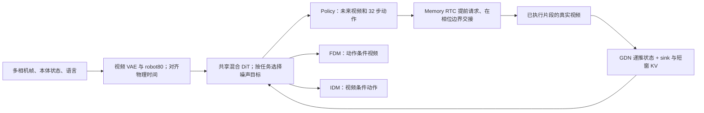
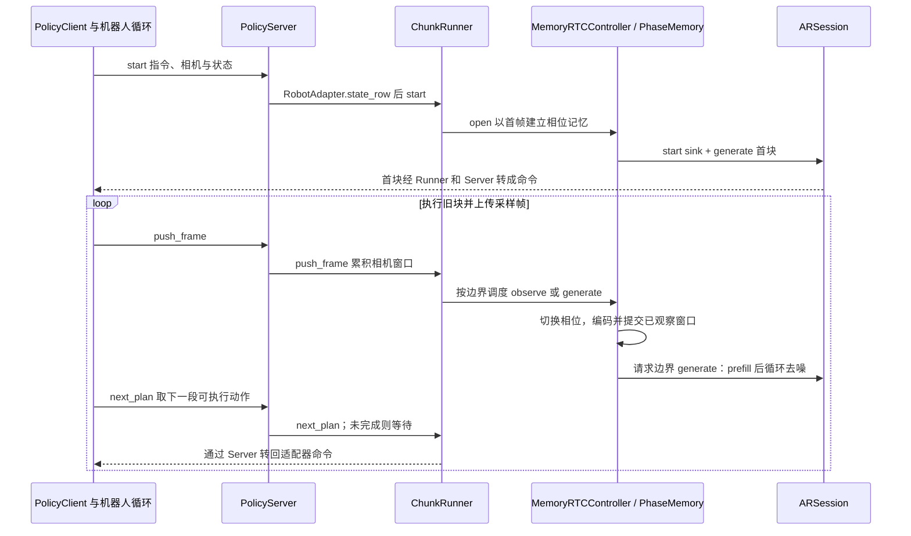

# SANA-Robot: Efficient World Action Model with Hybrid Memory | 混合记忆的高效世界动作模型

## 一句话定义

SANA-Robot 是一个 4.5B 的世界动作模型：用固定大小的全局递推状态记住过去，再用短窗口保留近期细节；输入多视角图像、本体状态和指令，策略模式联合输出未来视频与 32 步动作。

## 英文缩写速查

| 缩写 | 英文全称 | 简要说明 |
|---|---|---|
| WAM | World Action Model | 对世界变化与机器人动作共同建模 |
| GDN | Gated DeltaNet | 把历史压进固定大小的递推状态 |
| FDM | Forward Dynamics Model | 用给定动作预测未来视频 |
| IDM | Inverse Dynamics Model | 给定前后视觉状态推断动作 |
| RTC | Real-Time Chunking | 机器人执行旧动作时并行请求后一块 |
| GEMM | General Matrix Multiply | 部署中可用 FP8 或 NVFP4 加速的大矩阵乘法 |

## 为什么重要

低层策略既要记住离开视野的物体，也要准时交接动作。把历史全部重新编码会让每块请求越来越贵；直接把固定块的记忆用于错相位的异步请求，又会改变训练时看过的历史窗口。这项工作分别解决存储成本和块边界一致性。

| 机构 | 英伟达（NVIDIA）、加州大学圣迭戈分校（UC San Diego）、清华大学（Tsinghua University）、麻省理工学院（MIT）、香港大学（HKU）、Inco AI |
|---|---|

## 核心机制与组件结构

- **一个模型三种角色。** Sana-Video 2 初始化的单塔 DiT 共有 24 层 GDN 与 8 层 softmax。清洁 token 作条件，加噪 token 作流匹配目标：FDM 给动作预测视频，IDM 给未来视频预测动作，Policy 共同预测视频和动作。文字走交叉注意力；mRoPE 对齐多个相机和同一物理时间；缺失动作槽用 mask。
- **历史和当下分开。** AR 写入初始 sink 与已执行时看到的真实视频 latent。GDN 摘要整个历史，softmax 只读 sink 和最近 N 个块（默认 1）。当下图像与本体状态因果地读记忆但不持久化；也不把旧动作或想象视频写进策略历史。固定配置下成本不随回合增长，并非对所有历史保真。
- **全回合学习。** 过滤后的预训练为 19.4K 小时、23 个来源、约 133M chunks。基础阶段 8:1:1 混合三种模式；AR 继续训练以清洁历史流写记忆、加噪目标流计损失，一次前向监督窗口内所有块。下游把整回合按任务比例排列、不补齐打包，回合间隔离注意力和状态。

## 方法流程总览

## 工程实践

- **把推理预算写成控制约束：** 每块 C=32；尚余 d 步提交新请求，满足请求延迟 L ≤ d × 控制周期才可能无等待。30 Hz、d=8 给约 267 ms，稳态执行 24 个新动作，对应 4 套相位记忆（32/gcd(32,8)）。执行层 30 Hz 不等于请求层 30 Hz，也不要用均值替代尾延时部署验收。
- **区分硬件与定时：** 5090 的 FP8 135.1 ms、NVFP4 115.0 ms 来自四步三视角同步请求计时（含视频编码、预填、去噪；不含每回合一次的文字和 sink）。Thor NVFP4 288.0 ms，需要更长重叠窗口；30 Hz 动态真机演示使用 RTX PRO 6000，不能写成 Thor/5090 上同一项实测。
- **复现入口：** [固定源码归档](../../sources/repos/sana-robot.md) 给出 dataset 转换、AR 微调、模拟评测及客户端/服务端。先选与本体相容的权重、相机规格和状态/动作字段，验证闭环、执行超时和停机；开源的模板不是跨本体即插即用控制器。

## 源码运行时序图

按 `d92b529` 的 AR 部署路径：`PolicyServer.handle`、`Deployment.runner`、`ChunkRunner`、`PhaseMemory` 和 `ARSession`。同步 base 控制器不同，不画成同一调用链。

## 实验与评测

| 试验 | 论文结果 | 口径 |
|---|---|---|
| RoboDojo Memory | 52.73 分 / 52.33% | 官方评测，分数与成功率不同；自跑消融 AR 48.8% |
| RoboTwin 2.0 | Clean 91.8% / Randomized 73.3% | 在 Clean 微调，不能只报 82.6% 均值 |
| LIBERO 系列 | Plus 94.0%；原版 Pro 68.09%；Max Base/Dynamic 88.3/76.1% | 在 LIBERO 训练，零样本扰动；不是 LIBERO-Pro 2.0 |
| 真机三杯记忆 | AR（N=3）75% / base 30% | 每任务采 100 回合分别微调，20 次评测 |
| 真机空气曲棍球 | 同步/异步 BF16 命中 45/60%，块间等待 181.3/约 4 ms | 异步执行维持 30 Hz；NVFP4 命中 50% |
| FDM 世界模拟 | WorldArena 66.8；四步学生 66.2、H100 0.3 s/30 帧 | 视频协议不是控制时延；DROID 21 对均值模拟 58.3% 对真机 52.6%，非逐对准确率 |

## 与其他工作对比

- **记忆不是多塞几张图。** §8.1 在同一基座上移植 VPP2 / [InternW0-Δ](./paper-internw0-delta.md) 的稀疏帧记忆，RoboDojo 自跑记忆任务分别 28.3% / 31.4%，混合记忆 48.8%；这是记忆设计对照，不是两个完整系统的排行榜。§8.2 反向说明当前图像若与未来 token 双向读写会让模型走捷径；完全移除当前观测又降低精细操作。
- **FDM 对照。** 在 DROID 同一轮盲评中 Ctrl-World 平均 32.4%，SANA-Robot 58.3%，真机 52.6%。均值接近仍不能代替逐任务检验。
- **不同于 SANA-WM。** [SANA-WM](./paper-sa-2605-15178-sana-wm-efficient-minute-scale-world-modeling-wi.md) 是相机轨迹控制的视频世界模型；SANA-Robot 有本体状态和动作接口，并对真实机器人异步闭环做任务特定微调。

## 局限与风险

- 论文的真机结果是两个机器人平台、每项单独微调，样本量小。咖啡/汉诺塔是阶段完成比例，不是完整任务成功率；量化后动态任务可能掉点。
- 混合记忆保持固定配置的成本，不承诺长时历史不丢失；相位缓存以额外状态换对齐。低位算子、相机数、分辨率、网络与部署接口都影响端到端表现。
- 开源训练/部署代码和四类公开 AR 权重已核查；未复跑 GPU、真机或原始预训练，不把公开配方等同于全部训练数据及专用模型公开。

## 结论

决策上把 **请求时延、动作更新频率、异步余量** 分开记录；把强记忆任务、细动作精度和量化损失分别做消融。SANA-Robot 的结果支持带记忆的 WAM 在特定边端配置接入闭环，不代表任意平台和负载下都能达到 30 Hz。

## 关联页面

- [世界动作模型](../concepts/world-action-models.md) · [生成式世界模型](../methods/generative-world-models.md)
- [视觉–语言–动作模型](../methods/vla.md) · [WAM 纵深 Stage 4](../../roadmap/depth-wam.md)

## 参考来源

- [论文归档](../../sources/papers/sana-robot_arxiv_2611_28943.md)
- [官方项目页归档](../../sources/sites/sana-robot.md)
- [训练与部署源码归档](../../sources/repos/sana-robot.md)

## 推荐继续阅读

- [论文 §5：Real-Time Inference](https://arxiv.org/html/2611.28943v1#S5)
- [官方部署说明](https://github.com/NVlabs/Sana/blob/d92b52903598acc5e03d1ab0d7c7d1d46609b955/sana_robot/deploy/README.md)
