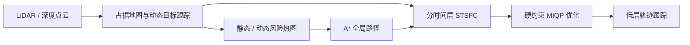
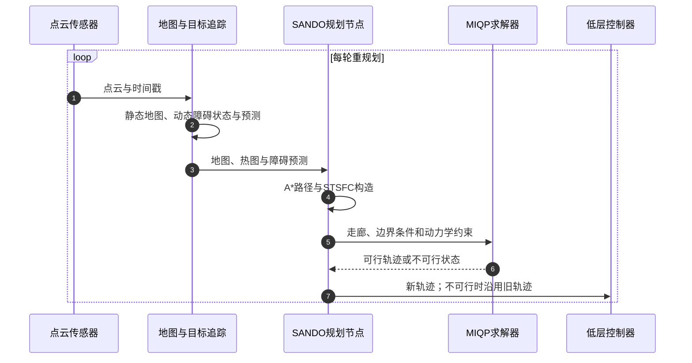

---

type: entity
project_id: sando
tags: [paper, repo, uav, multirotor, trajectory-planning, obstacle-avoidance, safety, ros2, mit-acl, mit]
status: complete
updated: 2026-10-17
arxiv: "2604.07599"
project: https://kotakondo.github.io/projects/sando/
code: https://github.com/mit-acl/sando
institutions: [mit]
related:
  - ./ego-planner-swarm.md
  - ./paper-mighty-hermite-spline-trajectory-planning.md
  - ./px4-autopilot.md
  - ../overview/multirotor-simulation-planning-control-stack.md
sources:
  - ../../sources/papers/sando_arxiv_2604_07599.md
  - ../../sources/sites/sando-project.md
  - ../../sources/repos/sando.md
summary: "SANDO（arXiv:2604.07599 v3，MIT ACL）：以时空安全飞行走廊和硬约束 MIQP 处理动态未知环境中的四旋翼规划；定理保证依赖有界障碍运动、估计误差与跟踪误差等假设，真机实验需与形式保证分开解读。"

---

# SANDO：动态未知环境中的安全轨迹规划

**SANDO**（*Safe Autonomous Trajectory Planning for Dynamic Unknown Environments*，arXiv:2604.07599）是 MIT Aerospace Controls Laboratory 提出的四旋翼规划系统：感知与跟踪动态障碍，再用时空安全飞行走廊约束轨迹优化。

## 一句话定义

**SANDO 将动态障碍的可达范围按未来时间分层，构造连续时间安全走廊，并在硬约束 MIQP 中求解可执行轨迹。**

## 英文缩写速查

| 缩写 | 英文全称 | 简要说明 |
|------|----------|----------|
| UAV | Unmanned Aerial Vehicle | 无人机，论文的飞行平台 |
| STSFC | Spatiotemporal Safe Flight Corridor | 按轨迹时间层构造的安全凸多面体序列 |
| MIQP | Mixed-Integer Quadratic Program | 带离散分配变量的二次规划，用于硬约束轨迹优化 |
| AEKF | Adaptive Extended Kalman Filter | 估计和预测动态障碍状态的自适应扩展卡尔曼滤波器 |
| T-RO | IEEE Transactions on Robotics | 作者主页和代码 README 标注的期刊状态 |

## 核心信息

| 项 | 内容 |
|----|------|
| 作者 / 机构 | Kota Kondo、Jesús Tordesillas、Juan Rached、Lili Sun、Yixuan Jia、Jonathan P. How；MIT Aerospace Controls Laboratory；Jesús Tordesillas 另属 Comillas Pontifical University / TRAIL |
| 论文 | [arXiv:2604.07599 v3](https://arxiv.org/html/2604.07599v3)，2026-09-25 |
| 项目页 | [SANDO](https://kotakondo.github.io/projects/sando/) |
| 代码 | [MIT ACL / sando](https://github.com/mit-acl/sando)，BSD 3-Clause |
| 视频 | [SANDO 演示](https://youtu.be/_T10DJiLQXg) |
| 发表状态 | 作者主页 2026 年 7 月新闻称 T-RO 有条件接收；代码 README 当前称已接收。归档保留两处措辞，未核实最终卷期 / DOI。 |

## 为什么重要

动态环境规划需要同时回答两个问题：如何快速找到绕障路径，以及如何对整条轨迹而非少量离散采样点约束碰撞。SANDO 把全局探索、时间相关的障碍膨胀和局部硬约束优化接成一个闭环，目标是在狭窄且持续变化的环境中兼顾可行性与安全性。

与 [EGO-Planner Swarm](./ego-planner-swarm.md) 和 [MIGHTY](./paper-mighty-hermite-spline-trajectory-planning.md) 等快速局部轨迹规划器相比，SANDO 的重点是动态障碍的显式预测、硬约束和带前提的连续时间安全分析；跨方法比较时应对齐环境、感知输入、求解器与安全指标。

## 核心结构 / 机制

1. **动态障碍检测与跟踪：** 时序占据栅格检测动态目标，聚类并做数据关联；AEKF 估计目标位置、速度并预测轨迹。
2. **热图全局路径：** 将静态与动态障碍风险写入热图，A* 使用硬占据约束排除被占区域，同时通过软代价偏向更宽裕的区域。
3. **STSFC 生成：** 沿空间路径和未来时间层生成凸多面体；动态障碍按对应时间层的最坏可达集膨胀，避免对整个规划时域使用同一个最大膨胀量。
4. **局部轨迹优化：** MIQP 将轨迹段分配到时空多面体并施加碰撞硬约束；变量消元减少优化维数。论文消融报告变量消元最高带来 7.4 倍优化耗时加速。
5. **轨迹执行与回退：** 输出轨迹交由低层控制器跟踪。若某轮优化不可行，继续执行旧轨迹；若没有有效轨迹剩余则悬停。

### 流程总览

## 源码运行时序图

官方仓库提供 ROS 2 Humble 下的 Docker 与原生运行入口。下图概括 README 与论文系统图中的仿真 / 规划运行时；真实传感器和低层控制器接线取决于硬件部署。

## 实验与评测

- **仿真：** 论文报告 SANDO 在森林和动态基准的所有难度等级达到 100% 成功率，且各基准中未报告约束违反；另有不依赖障碍真值的感知闭环测试。
- **消融：** 变量消元最高使优化时间加速 7.4 倍；时空走廊对高密度动态场景中的可行性重要。
- **真机：** 搭载机载规划、感知和定位的四旋翼，在静态环境完成 6 次飞行、动态环境完成 12 次飞行。动态实验没有碰撞；单障碍飞行最小实测中心距为 1.33 m。
- **计算：** 动态真机重规划平均约 18–24 ms。系统以 100 Hz 触发重规划，但新一轮须等上一轮结束，故有效频率受求解与感知时延限制。
- **指标读法：** 多障碍真机长走廊实验的最小距离来自机载跟踪器估计，并非全程动捕真值；论文指出某次障碍首次被检测时已接近无人机。

## 局限与风险

- 连续时间安全结论成立于论文明确假设：障碍速度与尺寸受界、估计误差有界，并满足对跟踪误差的相应条件；它不等于对任意未知运动的无条件保证。
- 真机估计误差约 0.30 m（行人实验 0.43 m），跟踪 RMS 误差约 0.21–0.57 m；作者指出这些实测条件并不完全满足定理假设。因此将“假设下的形式保证”和“真机无碰撞实验”分开引用。
- 移动子目标结构尚不能保证跨重规划周期的递归可行性；若障碍突然出现或预测误差较大，规划器可能短时无法产生新轨迹。
- 最坏可达集膨胀能提供保守安全边界，但密集场景会压缩可行空间。
- 官方代码要求 Ubuntu 22.04 与 ROS 2 Humble；Docker 说明需要 Gurobi WLS Academic license。复现前应核对优化器许可、传感器和飞控接口。

## 与其他工作对比

| 维度 | SANDO（本文） | [MIGHTY](./paper-mighty-hermite-spline-trajectory-planning.md) | [EGO-Planner Swarm](./ego-planner-swarm.md) |
|------|------|------|------|
| 碰撞约束 | 时空安全走廊内的硬约束 MIQP | ESDF 软惩罚（单次 NLP） | ESDF 相关障碍项的 B-spline 优化（软约束路线） |
| 动态障碍 | AEKF 跟踪预测，按时间层最坏可达集膨胀 | 页面未将动态障碍预测作为重点 | 页面未将动态障碍预测作为重点 |
| 轨迹表示 | 分段轨迹 + 多面体分配（混合整数） | 五次 Hermite 样条，联合优化段时长 | 均匀 B-spline |
| 安全表述 | 有界假设下的连续时间避碰定理 | 无硬约束保证 | 无硬约束保证 |
| 机构 / 生态 | MIT ACL，ROS 2 Humble，需 Gurobi | MIT ACL，ROS 2 Humble | ZJU FAST Lab，含多机扩展 |

- **相对 MIGHTY：** 同实验室的两条路线：MIGHTY 以软约束换求解速度和飞行时间，SANDO 以 MIQP 硬约束和时空走廊换带前提的安全保证，代价是需商业求解器且密集场景可能过保守。
- **相对 EGO-Planner Swarm：** EGO 是成熟的软约束局部规划与多机工程基线；SANDO 显式建模动态障碍未来运动，面向单机动态未知环境。
- 各文仿真基准、硬件与指标不同，数字不可横比；SANDO 的形式保证也不应与另两者的经验结果直接等价比较。

## 结论

**SANDO 的关键价值是把动态障碍预测转成时空分层的硬安全走廊，再由降维 MIQP 求解器快速生成局部轨迹；其安全性应按定理前提和实际感知 / 跟踪误差一起解读。**

1. **方法组合：** 热图 A* 负责找较宽裕的全局路径，STSFC 按时间层膨胀障碍，MIQP 在走廊内施加硬碰撞约束。
2. **主要算效改进：** 变量消元的消融最高报告 7.4 倍优化耗时加速。
3. **实验证据：** 动态四旋翼真机 12 次飞行无碰撞，但仍有重规划失败周期；回退策略会继续执行旧轨迹。
4. **安全读法：** 定理依赖速度、尺寸、估计与跟踪边界；作者明确指出这些条件未在真实平台上被完全满足。
5. **复现判断：** 源码、仿真与 ROS 2 Humble 入口公开；优化器许可及硬件接口是实际复现前置条件。

## 关联页面

- [EGO-Planner Swarm](./ego-planner-swarm.md) — B-spline 局部规划与多机扩展
- [MIGHTY](./paper-mighty-hermite-spline-trajectory-planning.md) — 同属 MIT ACL 的软约束 Hermite 轨迹优化路线
- [PX4 Autopilot](./px4-autopilot.md) — 常见飞行控制执行层
- [多旋翼仿真—规划—飞控栈总览](../overview/multirotor-simulation-planning-control-stack.md)

## 参考来源

- [SANDO 论文来源归档](../../sources/papers/sando_arxiv_2604_07599.md)
- [SANDO 项目页归档](../../sources/sites/sando-project.md)
- [SANDO 官方代码归档](../../sources/repos/sando.md)

## 推荐继续阅读

- [arXiv HTML v3](https://arxiv.org/html/2604.07599v3) — 方法、安全分析与评测细节
- [MIT ACL / SANDO](https://github.com/mit-acl/sando) — README、仿真运行方式与部署入口
- [SANDO 演示视频](https://youtu.be/_T10DJiLQXg) — 论文系统与飞行实验演示
