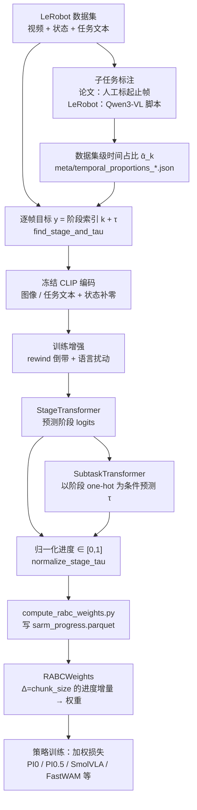
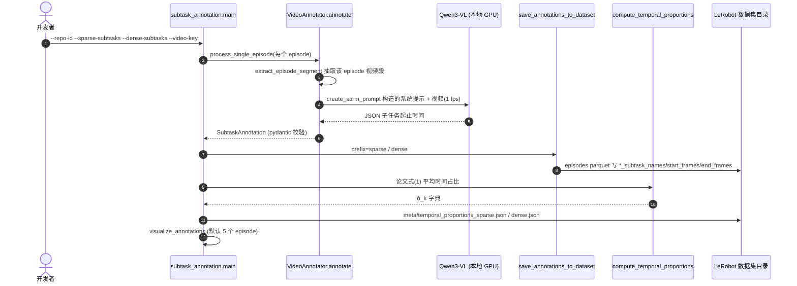
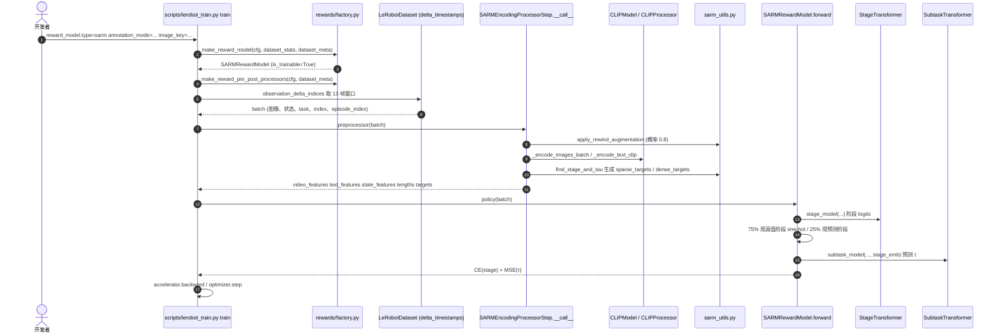
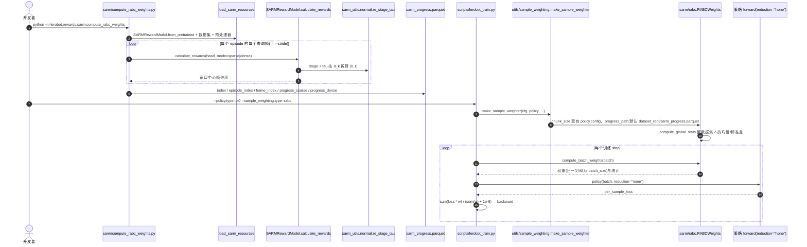

# SARM：阶段感知的长时程奖励模型（Stage-Aware Reward Modeling）

**SARM**（*SARM: Stage-Aware Reward Modeling for Long Horizon Robot Manipulation*，[arXiv:2509.25358](https://arxiv.org/abs/2509.25358)，[项目页](https://qianzhong-chen.github.io/sarm.github.io/)，ICLR 2026）由 Qianzhong Chen、Justin Yu、Mac Schwager、Pieter Abbeel、Yide Shentu、Philipp Wu 提出（Stanford University / UC Berkeley / xdof.ai）。本页同时是 LeRobot README 模型清单里「SARM」的独立详情节点（LeRobot 固定提交 `9e5ee98`，见 [lerobot 仓库归档](../../sources/repos/lerobot.md)）。

> 去重说明：库内此前 `grep -i sarm` 命中的多为 airsim / ARM 等无关词和 [GR-BC](./paper-gr-bc.md) 等页里对 SARM 作基线的引用；全库没有 arXiv:2509.25358 的独立节点，本页是该 arXiv ID 的 canonical 节点。

## 一句话定义

**SARM 把「子任务标注」变成稳定的进度标签（阶段索引 + 阶段内进度），训练一个同时预测阶段和进度的视频奖励模型，并用它算出的进度增量给示范样本加权（RA-BC），让策略少学低质量、无进展的片段。**

## 英文缩写速查

| 缩写 | 英文全称 | 简要说明 |
|------|----------|----------|
| SARM | Stage-Aware Reward Modeling | 本文奖励模型：联合预测阶段与阶段内进度 |
| RA-BC | Reward-Aligned Behavior Cloning | 用奖励模型进度增量给 BC 样本加权 |
| BC | Behavior Cloning | 行为克隆，监督模仿示范动作 |
| τ（tau） | within-stage progress | 阶段内归一化进度，取值 [0,1] |
| ᾱ_k | temporal proportion | 数据集级第 k 个子任务的平均时间占比 |
| CLIP | Contrastive Language-Image Pre-training | 论文与 LeRobot 实现均用冻结 CLIP（ViT-B/32）编码图像与任务文本 |
| VLM | Vision-Language Model | LeRobot 的自动子任务标注脚本用 Qwen3-VL（论文原为人工标注） |
| sparse / dense | 稀疏 / 稠密子任务标注 | 高层阶段（少而粗）与细粒度阶段（多而细）两套标注，各接一个头 |

## 为什么重要

- **直击标签噪声：** 长时程、接触丰富的任务（论文以 T 恤折叠为案例）里，按帧序号线性标进度会让「相同状态」得到差异很大的进度值；SARM 用子任务边界 + 数据集级时间占比，让相同语义阶段落在相近的进度区间。
- **奖励模型直接服务数据质量：** 不是只为在线 RL 提供奖励，而是先用于离线给 BC 样本加权，这条路径在 LeRobot 里已打通（`lerobot-train --sample_weighting.type=rabc`）。
- **在 LeRobot 内是「可训练」的奖励模型：** 同目录的 [TOPReward](./paper-topreward.md) 与 [Robometer](./paper-robometer.md) 在 LeRobot 中都是零样本推理端口（`is_trainable=False`），SARM 是三者中唯一能 `lerobot-train --reward_model.type=sarm` 自训的。

## 流程总览

图依据：论文 §3.1–3.2 与 `docs/source/sarm.mdx`、`src/lerobot/rewards/sarm/*`。

## 核心方法

### 1. 子任务先验与帧级目标（论文式 1–2）

- 每条轨迹按协议分割为 K 个子任务；数据集级先验 ᾱ_k = 各轨迹中子任务 k 的时长占比的平均。
- 帧 t 落在子任务 k 内，τ_t = (t−s_k)/(e_k−s_k)，进度目标 y_t = P_{k−1} + ᾱ_k·τ_t（P_{k−1} 为前 k−1 个子任务占比之和）。
- 训练目标在 LeRobot 里被编码成 **`k + τ`** 一个浮点数（整数部分是阶段，小数部分是 τ），推理时再用 ᾱ_k 还原成 [0,1] 进度。

### 2. 双模型架构（论文式 3–4，附录 A.4）

- **阶段模型**输出阶段 logits（交叉熵）；**子任务模型**以预测阶段的 one-hot 为先验输出阶段内进度 τ̂（MSE）。
- 论文输入：冻结 `clip-vit-base-patch32` 的图像嵌入 + 关节状态，投影后仅第一帧加位置偏置；8 层、12 头、隐维 768 的 Transformer（论文称整体约 60M 参数）；用 dense / sparse 两个输出头兼容两种标注协议。
- 训练增强：**rewind**（在序列末尾追加至多 4 个更早帧的反向序列，模拟「倒退/失败」）；任务描述偶尔替换成随机错误指令。论文消融：去掉 rewind，示范评测几乎不变，但真机 rollout 上模型变得过度乐观。

### 3. RA-BC：用进度增量给样本加权（论文式 5–9）

- 对每个样本，r̂ = φ(o_{t+Δ}) − φ(o_t)（Δ 为动作块长度；论文 Δ=25）。
- 软权重 w̃ = clip((r̂ − (μ−2σ)) / (4σ+ε), 0, 1)；最终 w = 1{r̂>κ} + 1{0≤r̂≤κ}·w̃（κ=0.01）；负进度权重为 0。
- 损失为 Σ w_i ℓ_i / (Σ w_i + ε)，与具体策略结构无关。

## 源码运行时序图

下面三张图都来自 LeRobot 固定提交 `9e5ee9859480e425a97a6836bb3fee479539beb5` 的源码（路径相对仓库根）。论文官方代码本次**未核实**（arXiv 摘要页只给了项目页），因此不另列官方仓库时序。

### A. 子任务标注（`subtask_annotation.py`）

- 不加任何标注参数即进入 `single_stage`：自动生成 `{"task": 1.0}` 的稀疏阶段，进度对整条 episode 线性增长；`--dense-only` 时稀疏阶段同样自动生成。

### B. 训练奖励模型（`lerobot-train --reward_model.type=sarm`）

- 默认窗口：`n_obs_steps=8`、`frame_gap=30`、`max_rewind_steps=4`，共 `1+8+4=13` 帧；20% 概率把任务文本换成随机文本，此时进度目标置 0。
- `SARMConfig` 默认优化器 AdamW、lr 5e-5、权重衰减 1e-3，余弦衰减带 500 步 warmup（`get_optimizer_preset` / `get_scheduler_preset`）。

### C. 推理 → 进度预计算 → RA-BC 训练策略

## LeRobot 实现要点

| 项 | 内容（来自源码 / 文档，固定提交 `9e5ee98`） |
|----|------|
| 入口 | 标注：`src/lerobot/data_processing/sarm_annotations/subtask_annotation.py`；训练：`lerobot-train --reward_model.type=sarm`；预计算：`python -m lerobot.rewards.sarm.compute_rabc_weights`；加权：`--sample_weighting.type=rabc` |
| 模块 | `rewards/sarm/configuration_sarm.py`（`SARMConfig`）、`modeling_sarm.py`（`SARMRewardModel`、`StageTransformer`、`SubtaskTransformer`）、`processor_sarm.py`（`SARMEncodingProcessorStep`）、`sarm_utils.py`、`rabc.py`（`RABCWeights`）、`utils/sample_weighting.py` |
| 标注模式 | `single_stage`（无需标注，线性进度）、`dense_only`（稀疏头自动为单阶段）、`dual`（稀疏 + 稠密，对应论文双头设定） |
| 依赖 | `pip install -e ".[sarm]"`（transformers、pydantic、faker、matplotlib、qwen-vl-utils） |
| 权重 | 文档未给出已发布的 SARM 检查点；需自己在数据集上训练 |
| 标注模型 | 脚本默认 `Qwen/Qwen3-VL-30B-A3B-Instruct`，脚本注释建议 30B 模型用 16GB+ 显存 |
| 策略支持 | 文档称 RA-BC 目前支持 PI0、PI0.5、SmolVLA 和 FastWAM；源码里实现了 `reduction` 参数的策略更多，但本次未逐一验证其 RA-BC 行为 |
| 其他奖励模型复用 | TOPReward / Robometer 的预计算脚本沿用同一 parquet 列名 `progress_sparse`，可喂给同一个 `RABCWeights`（见下「与 LeRobot 其他奖励模型的关系」） |

### 论文与 LeRobot 实现的差异（读源码时核对，非论文错误）

1. **标注来源：** 论文由标注员看顶视图视频记录子任务起止帧并丢弃不合规轨迹；LeRobot 用 Qwen3-VL 自动标注（脚本里 `temperature=0.7`、最多重试 3 次），标注质量取决于提示和子任务名，文档建议先可视化检查。
2. **观测窗口：** 论文附录是「episode 首帧 + 间隔 30 帧的 8 张连续帧」；LeRobot 是以目标帧为中心、前后各 4 帧的**双向**窗口（`observation_delta_indices`、`compute_absolute_indices`，越界帧复制边界），推理时取窗口中心帧的进度（`compute_rabc_weights.py` 里 `center_idx = n_obs_steps // 2`）。窗口里「加位置偏置的第一帧」是窗口第一帧，不一定是 episode 首帧。
3. **输出头：** 论文附录写每个输出头是 2 层、隐维 512 的 MLP；LeRobot 的 `heads` 是单个 `nn.Linear`，融合部分用 `LayerNorm + Linear + ReLU`。
4. **RA-BC 统计量：** 论文用在线运行统计（Welford）；LeRobot 的 `RABCWeights._compute_global_stats` 对预计算好的整份数据集一次性取均值/标准差（均值钳为非负），并把批内权重再归一到和为 batch size。
5. **75%/25% 教师强制：** `SARMRewardModel._train_step` 以 75% 概率用真值阶段、25% 用预测阶段喂给子任务模型；这个比例在论文正文中我没有检索到（未核实附录其他位置）。
6. **因果掩码：** 代码对展平后的 token 序列加上三角因果掩码（顺序是相机流、语言流、状态流、阶段流依次排列），论文正文未描述此细节（未核实）。
7. **规模：** 论文称其采用的是约 60M 参数的 8 层配置；LeRobot 默认配置同为 8 层 / 12 头 / 768 维，但我没有在固定提交里数过参数量，不引用该数字作为 LeRobot 实测值。

## 实验与评测

以下均出自论文（v4）§4 与附录；成功率为真机 12 次试验。

| 设置 | 结果 |
|------|------|
| 奖励模型（T 恤折叠，Table 5 默认 8 层） | 示范单步 MSE 0.009；真机 rollout 分类得分 ρ=0.94（成功 12/12、部分成功 11/12、失败 12/12） |
| 对最强基线 ReWiND（ρ=0.50） | 论文正文称示范上相对提升超 50%、真机 rollout 上超 80% |
| 策略 40k 步（Table 3） | Medium（展平起点）：BC-All 1/12、BC-2min 7/12、RA-BC-ReWiND 6/12、**RA-BC-SARM 10/12**；Hard（皱缩起点）：0/12、0/12、3/12、**8/12** |
| 即摘要所述 | 展平起点 83%、皱缩起点 67%，对比普通 BC 的 8% 与 0%（摘要口径） |
| 子任务数据 | D_dense 200 条、D_sparse 500 条（各留 10% 测试）；策略数据 D_all 约 200 小时 YAM 双臂 GELLO 遥操作 |
| 模型规模（Table 5） | 4 / 8 / 12 层对应 30M / 60M / 90M；8 层 ρ=0.94，12 层 0.88，4 层 0.72 |
| RL 小实验（附录 A.8） | MuJoCo 取方块的简单两阶段任务上，用 SARM 奖励接 DiffQL（RA-QL），只是小规模验证 |

- **口径提醒：** BC-All 与 BC-2min 不用重加权；BC-2min 是按「2 分钟内完成」筛出的 20 小时子集；RA-BC 的 Δ=25、κ=0.01 是针对约 90 秒、30 fps 的折叠任务调的，LeRobot 文档明确建议换数据集后按 `delta_mean`/`delta_std` 重调 κ，并观察 `sample_weight_mean_weight`（≈1 说明 κ 太低，RA-BC 退化成普通 BC）。
- **表格解读注意：** 论文 Table 1 的 pdf 抽取列顺序在我读到的文本里有歧义，所以这里只引用与 Table 5 和正文互相印证过的数字。

## 结论

**SARM 的价值在「统一的进度标签 + 增量加权」而不是更大的模型：它让变长示范里相同语义的阶段对应相同进度，再把奖励变成对 BC 样本的权重。**

1. **标注协议是成败关键** — 子任务名要具体、跨 episode 命名一致；LeRobot 的 VLM 自动标注要先可视化抽检再训练。
2. **rewind 增强对真机 rollout 不可省** — 论文消融显示它决定模型能否识别倒退/失败。
3. **κ 必须按数据重调** — 默认 0.01 只对应论文的折叠任务；看 `sample_weight_mean_weight` 与 `delta_mean/std`。
4. **数据本身已高质量时 RA-BC 收益有限** — LeRobot 文档明确提醒。
5. **先用 `single_stage` 跑通，再上 dense/dual** — 无需标注，适合快速验证流水线；复杂多阶段任务再投入标注。
6. **三种奖励模型分工不同** — 想要可训练、带阶段结构的数据加权用 SARM；想零样本打分用 [TOPReward](./paper-topreward.md) 或 [Robometer](./paper-robometer.md)。

## 局限与风险

- 论文只在 T 恤折叠和卸碟子两个任务上评测奖励模型，策略实验集中在折叠任务，跨本体泛化证据有限（附录有规模消融，但没有跨平台奖励迁移实验，据我读到的内容）。
- 依赖子任务标注：标注不准或子任务语义相近时，阶段分类会不稳。
- 阶段数在训练时固定（来自标注模式 / `temporal_proportions`），换任务需重新标注并重训。
- 本页没有读项目页与论文附录的全部图表；Table 1 个别列的数值未引用。

## 与其他工作对比（LeRobot 内其他奖励模型）

| 维度 | SARM（本页） | [TOPReward](./paper-topreward.md) | [Robometer](./paper-robometer.md) |
|------|------|------|------|
| LeRobot 内是否可训练 | **可训练**（`forward` 已实现） | 否（零样本，`config.json` 即检查点） | 否（推理限定，文档明确不含训练） |
| 骨干 | 冻结 CLIP + 自训 Transformer（论文称约 60M） | 现成 VLM（默认 Qwen3-VL-8B-Instruct，不训练） | Qwen3-VL-4B-Instruct + 3 个头（预训练检查点） |
| 输出 | 阶段 + 进度，折算 [0,1] | 完成 token 的 log-prob（预计算后做 episode 内 min-max） | 逐帧进度 + 成功概率（`compute_reward` 取末帧标量） |
| 需要标注 | 子任务标注（或 `single_stage` 免标注） | 不需要 | 不需要（预训练模型） |
| 进度 parquet | `sarm_progress.parquet` | `topreward_progress.parquet` | `robometer_progress.parquet` |

- 三者预计算脚本的 parquet 表头一致（`index`、`episode_index`、`frame_index`、`progress_sparse`），`RABCWeights` 读取时默认文件名是 `sarm_progress.parquet`，换成 TOPReward / Robometer 的输出要显式传 `--sample_weighting.progress_path`（推断自 `sample_weighting.py` 与各脚本，未实跑验证）。
- 三个预计算脚本末尾打印的 `use_rabc: true / rabc_progress_path` 是旧版配置字段；`configs/train.py` 里有向 `sample_weighting` 的迁移代码，新命令行请直接用 `--sample_weighting.*`。

## 关联页面

- [过程奖励建模](../concepts/progress-reward-modeling.md) — 接口 × 范式定位
- [Progress Reward Survey](./paper-progress-reward-modeling-survey.md) — 领域地图
- [Behavior Cloning](../methods/behavior-cloning.md) — RA-BC 的被加权对象
- [Imitation Learning](../methods/imitation-learning.md) — 示范质量与加权
- [TOPReward](./paper-topreward.md) — LeRobot 内的零样本 token 似然奖励
- [Robometer](./paper-robometer.md) — LeRobot 内的偏好 + 进度奖励模型
- [GR-BC](./paper-gr-bc.md) — 以 SARM 为进展估计基线的后续工作
- [π0](./paper-pi0.md) / [SmolVLA](./paper-smolvla.md) — LeRobot 文档点名支持 RA-BC 的策略
- [LeRobot](./lerobot.md) — 框架总览

## 参考来源

- [sarm_arxiv_2509_25358.md](../../sources/papers/sarm_arxiv_2509_25358.md)
- [lerobot.md（仓库归档）](../../sources/repos/lerobot.md)
- [arXiv:2509.25358](https://arxiv.org/abs/2509.25358) · [PDF](https://arxiv.org/pdf/2509.25358)：已通读方法（§3）、实验（§4、Table 2–3、Table 5）、附录 A.4 / A.7 / A.8
- [LeRobot `sarm.mdx`（固定提交）](https://github.com/huggingface/lerobot/blob/9e5ee9859480e425a97a6836bb3fee479539beb5/docs/source/sarm.mdx)
- LeRobot 源码（固定提交）：`src/lerobot/rewards/sarm/`、`src/lerobot/data_processing/sarm_annotations/subtask_annotation.py`、`src/lerobot/utils/sample_weighting.py`、`src/lerobot/scripts/lerobot_train.py`
