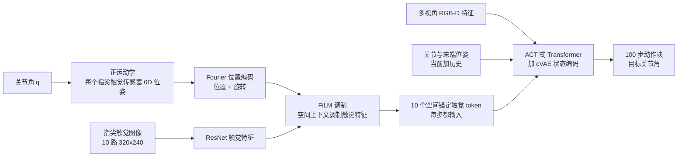

# SaTA：空间锚定的触觉感知

**SaTA**（*Spatially-anchored Tactile Awareness for Robust Dexterous Manipulation*，[arXiv:2510.14647](https://arxiv.org/abs/2510.14647)）由 Sharpa、清华大学、武汉大学与上海期智研究院的作者提出：每个指尖触觉传感器在手上「处于什么位置与朝向」，通过正运动学算出 6D 位姿并作为空间上下文，再与触觉图像特征融合；这样端到端策略不必依赖物体模型或显式位姿估计，也能在手坐标系里推断物体几何，用于接触瞬间视觉被遮挡的亚毫米精度任务。

## 一句话定义

**SaTA = 触觉 token 带上「我在手的哪个位置、朝哪个方向」的空间上下文（正运动学 6D 位姿 → Fourier 编码 → FiLM 调制 ResNet 触觉特征），再交给 ACT 式 Transformer 输出 100 步动作块。**

## 英文缩写速查

| 缩写 | 英文全称 | 简要说明 |
|------|----------|----------|
| SaTA | Spatially-anchored Tactile Awareness | 本文框架：触觉特征锚定到手运动学坐标系 |
| FK | Forward Kinematics | 由关节角算出每个指尖触觉传感器的 6D 位姿 |
| FiLM | Feature-wise Linear Modulation | 用空间上下文对触觉特征逐通道缩放与平移，替代简单拼接 |
| ACT | Action Chunking with Transformers | 骨干策略；一次输出未来 100 步动作 |
| cVAE | Conditional Variational Autoencoder | ACT 式状态编码器，吸收示范数据的多模态性 |
| URDF | Unified Robot Description Format | 论文以手的 URDF 坐标系（腕部参考系）作为锚定参考系 |
| SR / FC | Success Rate / First-Contact success rate | 成功率 / 第一次接触即对准成功的比例（衡量位姿推断精度） |

## 核心信息

| 项 | 内容 |
|----|------|
| **机构** | Sharpa（夏帕机器人）、清华大学、武汉大学、上海期智研究院（署名取自 arXiv v2 HTML 全文，摘要页不列机构） |
| **arXiv** | [2510.14647](https://arxiv.org/abs/2510.14647)；v1 2025-10-16，v2 2026-02-26 |
| **平台** | 双臂 RealMan 7-DoF + 双 Sharpa Wave 灵巧手（22 DoF）；指尖视觉式触觉 320×240、30 Hz；控制 30 Hz |
| **任务** | 双臂自由空间 USB-C 对插、卡牌扇开、灯泡安装 |
| **数据** | 每任务 200 条遥操作示范；操作员仅获振动式接触提示 |
| **开源** | 项目页与代码 **均未找到**（截至 2026-10-16；见「复现边界」） |

## 为什么重要

- **接触瞬间恰好是视觉最差的时刻。** USB-C 对插时插头会完全遮住接口，灯泡与卡牌在手指包裹下也被遮挡；亚毫米位置容差加数度角度容差，意味着只靠视觉时误差会在接触中累积。触觉是少数仍可用的信号。
- **「有触觉」不等于「会用触觉」。** 论文的基线 Tactile-Flat 同样输入十个指尖触觉，却在三任务上平均只有 43.3% 成功率，USB-C 对插为 0%；差距来自触觉 token 不知道自己在手上的位置，策略能检测接触却无法把它解释成几何调整。
- **是 Sharpa 触觉线的早期节点（文章转述）。** 文章把 SaTA 放在 Sharpa 关注「模态竞争」（任务靠视觉能做大半时模型倾向忽视触觉）的阶段；此后团队把触觉视作底层「反射弧」放进 System 0 做高频调整。读者需注意：SaTA 本身是 30 Hz 的 ACT 策略，并不是 System 0 工作，见 [Sharpa 机器人](./sharpa-robotics.md)。
- **设计可被后继工作借用。** 库内 [ADEPT](./paper-adept-dexterity.md) 的 Flexiv 学生策略写有「SaTA-style FiLM 锚定」，说明这一锚定写法已被他人复用为触觉融合模块。

## 流程总览

## 核心机制（方法）

### 1）锚定到哪个坐标系

所有触觉测量锚定在手的 URDF 坐标系（即腕部参考系），而不是世界系或相机系。论文的理由是：灵巧操作成败取决于手内的相对几何（接触点、对准角、插入方向），不管手腕怎么动、底座在哪，这些约束在手坐标系中保持不变；这既简化学习，也让在一种臂姿下学到的技能可直接迁移到新臂姿。

### 2）细粒度空间编码

对完整 6D 位姿（3D 位置 + 3D 旋转）做 Fourier 位置编码：低频分量表达「大致对准」，高频分量表达「再转 2 度」「再平移 1 mm」这类精调，使网络同时具备粗定位与精细调整能力。

### 3）FiLM 而非拼接

触觉图像里的纹理、边缘朝向、压力分布不能在空间编码时丢失。FiLM 让空间上下文去调制触觉特征：同样的边缘在拇指上意味着抓握调整，在食指上意味着旋转修正。每个触觉测量因此成为同时带感知内容与空间语义的 token。

### 4）策略与训练

骨干为 ACT：输入含机器人状态（当前与历史关节角、末端位姿）、多视角 RGB-D 视觉特征、以及全部指尖触觉 token（十指系统每步 10 个 token，不论是否接触）；用 cVAE 作状态编码器，Transformer 内的位置编码保证触觉 token 与手指对应；输出未来 100 步动作。训练为模仿学习（人类遥操作示范，每任务 200 条）。作者称锚定思想与具体策略架构无关，但本文只在 ACT 上实现。

### 5）论文给出的触觉三层作用

论文讨论中把触觉在灵巧操作里的角色分三层：门控信号（力突变触发阶段切换，信息量不超过约 3 比特）、几何推理（本文聚焦：补足被遮挡或退化的视觉，达到毫米级精度）、力主导控制（如转笔，需要连续力调制）。作者认为当前遥操作数据采集限制了第三层。

## 实验与评测

**设置（自报）：** 对比 Vision-Only（ACT，仅 RGB-D 与关节）、Tactile-Flat（每个触觉传感器一个 ResNet token，无锚定）、Tactile-Global（在 Tactile-Flat 基础上把指尖位姿并入本体感知流，而非逐触觉锚定）；所有方法用同样数据与 Transformer，只在输入表示上不同；20 epoch、batch size 64、Adam、学习率 1e-4，3 个随机种子；论文未给出每个方法的评测试验数。

**主结果（论文 Table I，自报）：**

| 任务 | 指标 | Vision-Only | Tactile-Flat | Tactile-Global | **SaTA** |
|------|------|-------------|--------------|----------------|----------|
| 卡牌扇开 | SR % | 50 | 60 | 65 | **95** |
| | FC % | 10 | 45 | 30 | **55** |
| | 时间 s | 24.9 | 16.7 | 18.5 | **12.7** |
| USB-C 对插 | SR % | 0 | 0 | 10 | **35** |
| | FC % | 0 | 0 | 0 | **30** |
| | 时间 s | – | – | 82.6 | **58.4** |
| 灯泡安装 | SR % | 45 | 70 | 65 | **100** |
| | FC % | 35 | 40 | 45 | **60** |
| | 时间 s | 272.1 | 195.8 | 160.5 | **132.7** |
| 平均 | SR % | 31.7 | 43.3 | 46.7 | **76.7** |
| | FC % | 15.0 | 28.3 | 25.0 | **48.3** |
| | 时间 s | – | – | 87.2 | **67.9** |

时间为成功试验的平均用时；成功率为 0 的格子记为「–」（按指标定义推断，论文未单独说明）。

**消融（论文 Table II，卡牌扇开，自报）：**

| 配置 | SR % | FC % | 时间 s |
|------|------|------|--------|
| SaTA 完整 | 95 | 55 | 12.7 |
| 去掉 FiLM（改拼接） | 70 | 30 | 15.9 |
| 去掉 Fourier 编码 | 70 | 35 | 22.7 |
| 世界系锚定（非手系） | 60 | 25 | 27.4 |

**失败分析（Tactile-Flat，自报）：** 灯泡安装时插入角倾斜，螺纹咬不上；卡牌扇开时拇指力垂直于牌面把牌压弯而不是沿面滑开；USB-C 对插时插头朝向错误，且从未学会拇指–食指的协同摩擦调整。

**文章转述：** 文章称 SaTA 在 USB-C 盲插、灯泡安装等亚毫米精度任务上成功率最高提升 30 个百分点，与论文摘要一致，见「常见误区」中对口径的说明。

## 与其他工作对比

| 路线 | 做法 | 与 SaTA 的差异（论文 Related Work 自述为主） |
|------|------|---------------------------------------------|
| 显式几何重建 | 触觉位姿估计、触觉 SLAM、接触面片估计 | 通常需要已知物体模型或复杂优化；SaTA 端到端、不要物体模型 |
| 点云式视触觉表征 | 把触觉转为 3D 点云（如 Robot Synesthesia、3D-ViTac） | 空间化后丢接触纹理与法向分布；SaTA 保留完整触觉图像特征 |
| 原始触觉图像直接送策略 | 每传感器一个 token（对应论文的 Tactile-Flat） | 保留丰富度但无空间定位；本文平均 SR 低 33.4 个百分点（43.3 vs 76.7，自报） |
| 位姿并入本体感知 | 对应 Tactile-Global | 信息量相同但没有逐 token 锚定；本文平均 SR 低 30 个百分点（46.7 vs 76.7，自报） |
| 视触觉 RL + 仿真触觉 | 如 [VT-Refine](./paper-sa-2510-14930-vt-refine-learning-bimanual-assembly-with-visuo.md) | 在仿真里用 RL 精炼双臂装配；SaTA 只用真机示范做模仿学习，无仿真阶段 |
| 同一平台的后继触觉工作 | [T-Rex](./paper-trex-tactile-reactive-dexterous-manipulation.md)（触觉反应式灵巧操作） | T-Rex 用触觉同步 play 数据与 VLA 做大规模策略、并指出朴素拼接触觉会损害 VLA；SaTA 是每任务 200 条示范上的单策略触觉表征设计，二者不在同一量级，不宜直接比数字 |

## 结论

**SaTA 的有效部分不是「多加一路触觉」，而是让每个触觉 token 带着手上的位置与朝向进入策略：同样的触觉输入，锚定与否把平均成功率从 43–47% 推到 76.7%（自报）。**

1. **先看锚定，再看传感器数量** — 论文内 Tactile-Flat 与 Tactile-Global 已有同样的触觉与位姿信息，成功率仍显著低于 SaTA；表征方式比信息量更关键。
2. **参考系选手系** — 世界系锚定在消融中成功率 60%，低于手系的 95%（卡牌扇开，自报）；手系还带来对臂姿变化的不变性。
3. **FiLM 与 Fourier 都不可省** — 各去掉一项，卡牌扇开成功率同降到 70%；复现时优先保证这两个模块。
4. **看 FC 指标，不只看 SR** — 首次接触对准率 48.3% 对 25.0%（最强基线），说明提升来自一次对准而非反复试错；时间缩短是副产品。
5. **USB-C 对插仍只有 35%（自报）** — 亚毫米任务离可用还远；读数字时别把「最高提升 30 个百分点」当作已解决。
6. **示范质量是天花板** — 遥操作只有振动提示，示范仍视觉主导；力主导控制需要触觉手套或真机 RL（作者自述）。
7. **复现门槛高于方法本身** — 无代码与项目页，评测试验数未披露，只能按论文描述自行实现。

## 常见误区与局限

- **误区：SaTA 就是 System 0。** 不是。它是 30 Hz 的 ACT 模仿学习策略；文章把它放在 Sharpa 触觉理解的早期阶段，System 0 是后来的高频触觉底层设想。
- **误区：「提升 30 个百分点」是相对视觉基线。** 摘要与文章的 30 个百分点对应相对每任务最强基线（卡牌 95 对 65、灯泡 100 对 70；USB-C 为 35 对 10，差 25）；三任务均值 76.7 对最强基线均值 46.7，也是 30 个百分点。相对 Vision-Only 均值（31.7）则是 45 个百分点。
- **误区：时间缩短 27%。** 摘要写 27%，正文写 28%，按表中均值行（Tactile-Global 87.2 s 对 SaTA 67.9 s）自行换算约 22%；三处口径不一致，不要当精确数引用。
- **局限（作者自述）：** 遥操作示范以视觉为主，触觉只作辅助；灯泡最后拧紧等细力控制仍弱；未达成力主导控制；仅在 ACT 上实现，向其他架构迁移只是论断。
- **局限（本页补充）：** 只在 Sharpa Wave + RealMan 一套硬件、三个任务上评测；未报告每方法的试验数与置信区间；3 个种子的方差未在主表给出。

## 复现边界

| 项 | 结论（2026-10-16 核查） |
|----|-------------------------|
| 项目页 | **未找到**（arXiv 摘要页、HTML 全文与网页检索均无） |
| 官方代码 | **未找到**；论文无代码发布声明 |
| 数据 / 检查点 | 未见发布（200 条 / 任务的遥操作示范为自采） |
| 源码运行时序图 | **不适用**（无官方可运行仓库） |
| 硬件前提 | 带视觉式指尖触觉的灵巧手（论文为 Sharpa Wave）、能由 URDF 做正运动学、双臂与多相机、遥操作示范采集链 |
| 最小可复现要点 | 触觉 token 数量等于传感器数；位姿用手 URDF 系；Fourier 编码完整 6D；FiLM 调制而非拼接；ACT 动作块 100 步 |

## 关联页面

- [夏帕机器人（Sharpa Robotics）](./sharpa-robotics.md) — SaTA 在其学术线中的位置，以及 Sharpa Wave 平台
- [ADEPT](./paper-adept-dexterity.md) — 学生策略复用了 SaTA 式 FiLM 锚定
- [T-Rex](./paper-trex-tactile-reactive-dexterous-manipulation.md) — 同一硬件平台上的触觉工作
- [VT-Refine](./paper-sa-2510-14930-vt-refine-learning-bimanual-assembly-with-visuo.md) — 视触觉双臂装配（示范 + 仿真 RL）
- [触觉传感](../concepts/tactile-sensing.md) / [视触觉融合](../concepts/visuo-tactile-fusion.md) — 触觉表征背景
- [接触丰富操作](../concepts/contact-rich-manipulation.md) — 为何接触瞬间视觉失效
- [Action Chunking](../methods/action-chunking.md) / [模仿学习](../methods/imitation-learning.md) — ACT 骨干与训练范式
- [双臂操作](../tasks/bimanual-manipulation.md) — USB-C 对插的双臂协同背景

## 参考来源

- [sata_arxiv_2510_14647.md](../../sources/papers/sata_arxiv_2510_14647.md) — 原始摘录（arXiv 摘要、v2 HTML 全文要点、文章转述）
- [wechat_sharpa_dexterous_manipulation_2026-10-16.md](../../sources/blogs/wechat_sharpa_dexterous_manipulation_2026-10-16.md) — 机器之心采访稿来源页
- [arXiv:2510.14647](https://arxiv.org/abs/2510.14647)

## 推荐继续阅读

- [arXiv PDF](https://arxiv.org/pdf/2510.14647)
- ACT 原论文（Zhao 等，arXiv:2304.13705）— SaTA 的骨干策略
- FiLM 原论文（Perez 等，arXiv:1709.07871）— 特征级调制机制
