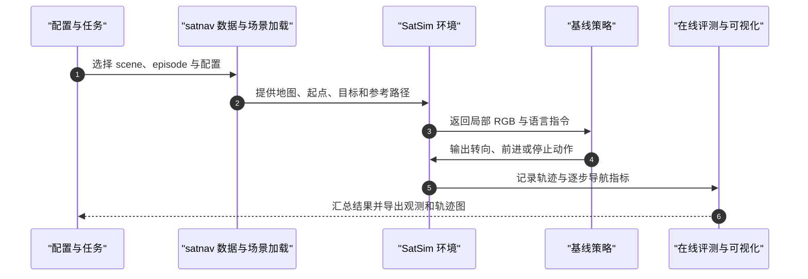

# SatNav（arXiv:2609.31507）

**一句话定义：** SatNav 是一套以高分辨率卫星影像构造城市尺度长程 UAV 视觉–语言导航任务与评测的平台；它用卫星图局部裁剪近似 UAV 下视 RGB 观测，把地理空间路线、语言指令、记忆和执行后更新放在同一 benchmark 中。

## 英文缩写速查

| 缩写 | 英文全称 | 简要说明 |
|------|----------|----------|
| UAV | Unmanned Aerial Vehicle | 无人机，本页的空中导航载体 |
| VLN | Vision-and-Language Navigation | 按语言指令和视觉观测闭环导航 |
| LVLM | Large Vision-Language Model | SatNav 对比的多模态大模型导航基线 |
| SR | Success Rate | 成功到达目标的 episode 比例 |
| SPL | Success weighted by Path Length | 同时计入成功与路径效率的指标 |
| OS | Oracle Success | 轨迹任意时刻曾到达目标半径的比例 |

## 为什么重要

传统室内 VLN 基准多依赖已重建的 3D 场景，地理覆盖和长程轨迹规模受场景生产成本限制。SatNav 将高分辨率卫星图纳入空中导航评测，提供 59 个场景、18 座城市的 118,494 条 episode，平均参考轨迹长 379 m，能直接探测跨街区路线理解、地标接地及长期进度记忆。它也将「在卫星图训练的策略能否迁到实际 UAV 观测」作为实验问题，而不是只报告静态图像理解分数。

## 方法与流程

SatNav 的核心贡献既是 benchmark，也是让场景、episode、策略训练和在线评测共用同一环境接口。

- **观测近似：** 将卫星图切成随地理位置变化的局部 crop，作为 UAV 向下看的视觉输入；环境状态包含经纬度、高度与航向等连续地理量。
- **Boundary：** 按语言要求沿某一边界巡航，追踪环路进度并返回指定位置。
- **Landmark：** 通过地标描述将语言指令接地到城市空间位置。
- **Route：** 依据路线与计数线索执行有序导航，评估长程路线记忆。
- **SwiftVLN：** 以滑动对话窗口处理局部上下文，并组合可替换的历史采样、空间提示与长期记忆压缩模块。项目页展示均匀/随机/近期偏重抽样，初始视图/相对位姿增强，以及逐帧池化、地图记忆和全局或分段 token 聚类等变体。

## 源码运行时序图

官方代码仓库可运行。README 提供合成场景参考路径示例，训练与模型评测入口按基线文档配置。

可先按仓库 README 运行 `python examples/reference_follower_example.py` 验证环境；完整训练 / LVLM 评测依赖各基线单独环境。见[官方代码与运行入口](../../sources/repos/eku127_satnav.md)。

## 实验与评测

- **基准规模：** 项目页与论文摘要给出 59 个场景、18 座城市、118K episode 和 379 m 平均轨迹长度。
- **任务覆盖：** Boundary、Landmark、Route 分别强调环路进度、地标空间接地和含计数线索的路线执行。
- **场景泛化：** 提供 train、val_seen、val_unseen；项目页结果说明按 seen / unseen 测试集报告 SR、SPL、OS、NE 与平均执行步数。
- **已公布数字的读法：** 项目页概览标注 StreamVLN* 在 Test Seen / Test Unseen 的 SR 为 67.3% / 58.4%；星号模型先从导航训练 checkpoint 初始化，再在 SatNav 微调。该值是项目页指定测试划分上的 success rate，不等同于零样本跨城部署成功率。
- **真实飞行：** 项目页展示三类任务视频，并说明用轻量视觉适配器将卫星图训练策略转到真实 UAV 观测；这证明存在实机迁移实验，不代表覆盖不同机型、传感器、城市和飞行条件的普遍泛化。

## 结论

**SatNav 的主要价值是把空中 VLN 的长程地理接地、可规模化场景和真实观测迁移纳入一套可运行评测；它不应被读成「仅靠卫星图即可解决真实城市导航」。**

1. 选择 benchmark 时，先确认任务是否需要 Boundary 环路、Landmark 接地或 Route 次序/计数；三者对应的记忆压力不同。
2. 做跨城泛化比较时应使用 unseen split，并区分训练过的 checkpoint 微调结果与零样本结果。
3. 记忆消融应同时检查 SR 与 OS；OS 高而 SR 低，可能意味着策略经过目标附近却没有及时停止。
4. 数据准备不可只看 episode 文件：高分辨率 GeoTIFF 场景需申请或自备 API 凭据生成，代码许可也不自动涵盖地图数据许可。
5. 真实 UAV 转移使用轻量视觉适配器，复现时应把适配器训练、相机视角差异与飞控执行条件纳入实验记录。

## 与其他工作对比

| 工作 | 主要设定 | 与 SatNav 的差异 |
|------|----------|----------------|
| [WorldVLN](./paper-worldvln-aerial-vln-wam.md) | 空中 VLN 上的自回归 World-Action Model，预测未来潜状态后生成航点并闭环执行 | 关注策略架构与世界预测；SatNav 关注基于卫星图的城市尺度 benchmark，也可为模型提供评测环境 |
| [Uni-LaViRA](./paper-uni-lavira.md) | 以通用 MLLM 组件统一 VLN、ObjectNav、EQA 与 Aerial-VLN | 关注统一导航 harness 与任务泛化；SatNav 聚焦长程卫星影像、记忆和跨视角验证 |
| [FSD-VLN](./paper-fsd-vln.md) | 空中长程 VLN 的快慢双系统建模 | 关注推理/动作架构；SatNav 提供场景规模、长程评测与迁移入口 |
| [ActiveFly-Bench](./paper-activefly-bench.md) | 空中具身问答、观察行为规划与语言控制评测 | 关注任务层级与主动观察；SatNav 重点评估卫星图城市导航任务及空间记忆 |

## 工程实践

| 项目 | 状态 / 使用建议 |
|------|----------------|
| 代码 | **已开源**：[Eku127/SatNav](https://github.com/Eku127/SatNav)，MIT 许可证；可用合成场景运行 reference follower |
| Episode 数据 | [SatNav-Episodes-v0.1](https://huggingface.co/datasets/Eku127/SatNav-Episodes-v0.1) 提供 118,494 条 episode 和数据集查看器 |
| 高分辨率地图 | [SatNav-Scenes-v0.1](https://huggingface.co/datasets/Eku127/SatNav-Scenes-v0.1) 需申请；也可依项目文档自备 API 凭据生成 |
| 模型 | [SatNav Baseline Model Zoo](https://huggingface.co/collections/Eku127/satnav-baseline-model-zoo) 提供基线 checkpoint 入口 |
| 指标 | 交互 demo 用 SR、OS、SPL、NE 展示单集表现；benchmark 结果按 split 求均值 |
| 条款 | 代码 MIT 与数据/地图/第三方组件的使用许可分开，使用前核对仓库 DATA_LICENSE.md 与 NOTICE |

## 局限与风险

- 卫星图 crop 是 UAV 下视图的近似，不包含真实相机的透视、姿态变化、遮挡和动态视觉细节；跨视角适配仍是关键变量。
- 公开 episode 不代表完整 GeoTIFF 场景无需审批即可获得；场景访问和地图使用条款需单独确认。
- 项目页中的 67.3% / 58.4% 对应 StreamVLN* 的特定微调设置，不能和其他 split、模型初始化或零样本结果混为一谈。
- 真实飞行演示属于特定平台与条件下的迁移证据；论文与项目页的评测协议仍是复现实验的准绳。

## 关联页面

- [视觉–语言导航（VLN）](../tasks/vision-language-navigation.md)
- [WorldVLN（空中 VLN · 自回归 WAM）](./paper-worldvln-aerial-vln-wam.md)
- [Uni-LaViRA](./paper-uni-lavira.md)
- [FSD-VLN](./paper-fsd-vln.md)
- [ActiveFly-Bench](./paper-activefly-bench.md)
- [VLN 开源复现范式](../overview/vln-open-source-repro-paradigms.md)

## 参考来源

- [arXiv:2609.31507 摘录](../../sources/papers/satnav_arxiv_2609_31507.md)
- [SatNav 项目页归档](../../sources/sites/satnav-eku127-github-io.md)
- [SatNav 官方代码仓库归档](../../sources/repos/eku127_satnav.md)

## 推荐继续阅读

- [arXiv 论文](https://arxiv.org/abs/2609.31507)
- [项目页交互 demo 与真机视频](https://eku127.github.io/SatNav/)
- [官方代码与文档](https://github.com/Eku127/SatNav)
