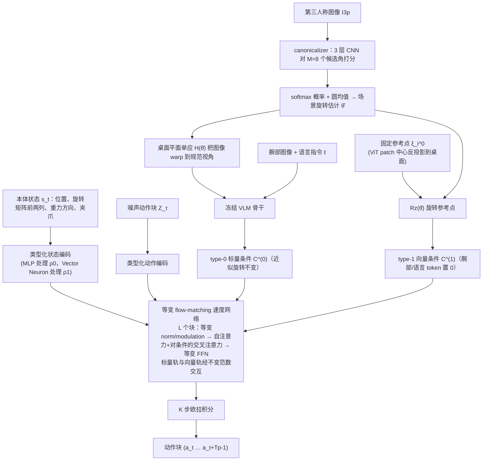

# SAVLA（arXiv:2609.16641）

**SAVLA**（*SAVLA: Symmetry-Aware Vision-Language-Action Models for Robotic Manipulation*，[arXiv:2609.16641](https://arxiv.org/abs/2609.16641)）来自 [senlanke 具身运控lab 周更盘点](../../sources/blogs/wechat_senlanke_weekly_manipulation_2026-09-14_18.md)（2026-09-14–18）。

## 一句话定义

**冻结 VLM backbone，Action Head 用 equivariant Flow Matching + learned canonicalizer；LIBERO 平均 +5.1pp，Goal 旋转测试 41.5%→90.4%。**

## 英文缩写速查

| 缩写 | 英文全称 | 简要说明 |
|------|----------|----------|
| VLA | Vision-Language-Action | 视觉–语言–动作 |
| FM | Flow Matching | 流匹配 |
| SE(3) | Special Euclidean Group | 三维刚体变换群 |

## 为什么重要

- 旋转泛化靠数据增强昂贵；结构等变比堆数据更高效。

## 流程总览

图依据：论文 §IV-A/B/C 与 Fig. 1、式 9–13

## 核心机制

| 项 | 内容 |
|----|------|
| **arXiv** | [2609.16641](https://arxiv.org/abs/2609.16641) |
| **开源** | **待发布**（步骤 2.5，2026-09-20） |
| **方法摘要** | Invariant/equivariant channels + canonicalizer + equivariant flow matching action head. |

## 源码运行时序图

**不适用**（截至 2026-09-20 未发布可运行官方代码或待核实）。

## 实验与评测

- LIBERO +5.1pp vs GR00T N1.5 avg; LIBERO-Goal rotation 90.4%（作者报告）。
- 读法：先对齐任务设定、传感器与成功定义，再解读 headline 数字。

## 与其他工作对比

| 维度 | 读法 |
|------|------|
| **同周对照** | 见对应 [周更盘点](../../sources/blogs/wechat_senlanke_weekly_manipulation_2026-09-14_18.md) 映射表，勿跨任务直接比 SR |
| **开源状态** | **待发布** — 部署前以项目页/arXiv 为准 |

## 结论

**SAVLA 用几何等变结构替代旋转数据增强，显著提升 Goal 旋转泛化。**

1. 开源：**待发布**；勿凭公众号摘要臆断可复现性。
2. 指标须连同实验条件解读（仿真/真机、平台、成功阈值）。
3. 关注 arXiv 版本更新与代码发布。

## 关联页面

- [vla](../methods/vla.md)
- [manipulation](../tasks/manipulation.md)
- [isaac-gr00t](../entities/isaac-gr00t.md)

## 参考来源

- [savla_arxiv_2609_16641.md](../../sources/papers/savla_arxiv_2609_16641.md)
- [wechat_senlanke_weekly_manipulation_2026-09-14_18.md](../../sources/blogs/wechat_senlanke_weekly_manipulation_2026-09-14_18.md)
- [arXiv:2609.16641](https://arxiv.org/abs/2609.16641)
- [arXiv PDF](https://arxiv.org/pdf/2609.16641)：已通读方法部分（实验与附录以略读为准）：§III 预备知识，§IV 方法（等变动作头、对称感知条件、canonicalization）

## 推荐继续阅读

- [arXiv PDF](https://arxiv.org/pdf/2609.16641)
