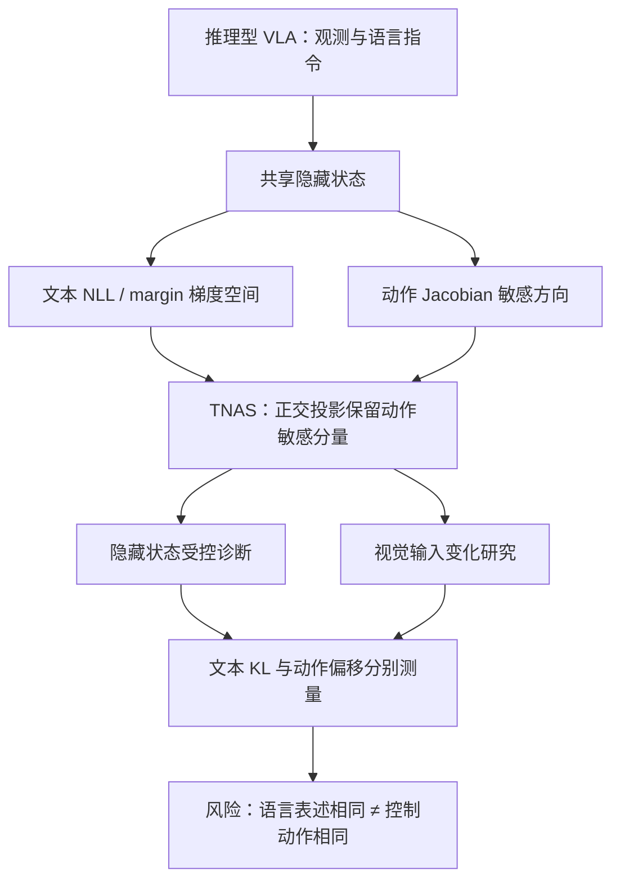

# Say the Same, Act Differently：解释不变、行为却变的 VLA 诊断

**英文题名：** Say the Same, Act Differently。官方原文：[arXiv:2611.04166v1](https://arxiv.org/abs/2611.04166v1)。已核对 v1 正文与必要附录，**未独立复现训练/真机**。

## 一句话定义
本文先在推理型 VLA 的共享隐藏状态中定位**文本损失敏感度低、动作敏感度高**的 TNAS，再以可控输入变化验证：自然语言解释相同，不保证驾驶轨迹或机器人动作相同。

## 英文缩写速查
| 缩写 | 英文全称 | 简要说明 |
|---|---|---|
| VLA | Vision-Language-Action | 视觉语言动作模型 |
| TNAS | Text-Neutral Action Subspace | 文本近中性而动作敏感的表征方向 |
| KL | Kullback-Leibler divergence | 文本分布变化度量 |
| ADE | Average Displacement Error | 航点平均位移误差 |

## 为什么重要
模型说出相同的解释，并不证明连续动作会对视觉扰动保持稳定。 论文的价值在于将这一失败模式单独建模，而非依靠笼统的端到端指标解释。

## 核心机制
1. **研究对象**：Alpamayo 驾驶与 InstructVLA 操作两个推理型 VLA，文字解释与实际动作从共享隐藏状态的不同接口读出。
2. **干预几何**：计算动作输出 Jacobian 方向与文本 NLL/target-margin 梯度张成空间，把动作高敏方向投影到文本梯度正交补得到 TNAS；与随机方向和文本梯度方向比对。
3. **隐藏状态诊断**：在匹配的文本 KL 预算下，比较动作输出变化；明确“文字不变”的测量并不自动等于计划不变。
4. **输入层确认**：在公开图像输入的研究协议中验证视觉变化的行为敏感性，分别检查 text exact-match、trajectory displacement 和离线场景风险。
5. **安全读法**：该方法是内部机制/脆弱性诊断，不是物理世界实时安全验证，也不是一个能部署的防御算法。

## 流程总览
以下为论文原文中的数据/控制流程，不表示本站运行了代码。

## 工程实践
- **诊断对象**：Alpamayo 与 InstructVLA 的研究模型、评测数据并不相同；报告对照应分别解读。
- **官方开源边界**：原文附录 A.9 说明基于公开模型/数据开展实验；**本文专门优化的视觉攻击脚本与扰动张量不发布**，因此不画未经核验的源码执行时序图。
- **部署启示**：安全检查不能只解析语言解释，应读取规划航点和实际低层控制；有关论文的攻击设置只作安全风险高层说明。

## 源码运行时序图
**不适用**：附录 A.9 明确本文优化的视觉扰动脚本/张量未公开，无法进行可核查的源码时序复原。

## 实验与评测
- **规模**：Alpamayo 200 个驾驶 clip、InstructVLA 200 个固定 Bridge 分布例子；Alpamayo 离线安全子集只含 154 个有障碍标注 clip。
- **安全指标定义**：所谓 silent collision 是**离线对数轨迹/几何重放**里，文字完全一致、攻击计划有碰撞且干净计划无碰撞的计数/154；不是公路交通事故概率。
- **独立文本预测对照（附录 A.5）**：1,181 个干净 clip 中、仅看文字 rationale 的读者预测“最终停车”总体约 84.3%，本身即非完美动作承诺。
- **核心证据**：在相同文字 KL 预算下，动作定向隐藏状态扰动明显超过随机方向的动作响应；这证明模型内部存在语言/动作可分离方向，不等于知道所有触发条件或真实风险频率。

**证据边界：** 指标均来自指定版本论文/官方材料，并非本站独立复现；具体基线、统计区间与硬件已按表号区分。

## 局限与风险
本研究基于两种指定模型、研究允许的输入干预和模型自身输出，无法推导所有 VLA 具有相同比例的风险；“文本相同”按确定的字符串/概率度量，并不代表人类读者认为语义完全一致。离线标注演员轨迹与真实闭环交互存在差距，原文也未提供可用于部署的完整安全防御。

## 与其他工作对比
- 在[九篇研究趋势地图](../overview/embodied-trends-2026-11-h1.md)中按“技术介入层”定位，不能比较跨论文不同任务、机器人和数据集的绝对指标。
- 相关基础：[VLA](../methods/vla.md)、[机器人操作](../tasks/manipulation.md)。

## 结论
**语言解释稳定不能替代动作轨迹校验。**
- 模型的动作输出对某些隐藏状态方向更敏感，而文本梯度在这些方向上响应较弱。
- 统计应分开报告文字 KL、exact-match、ADE 和离线几何碰撞。
- Alpamayo 的安全子集只有 154 条带障碍标注记录，不能将“silent collision”理解成真实交通事故率。
- 论文诊断不是产品化防御方案，真实闭环部署仍须独立安全验证。

## 关联页面
- [VLA](../methods/vla.md)
- [机器人操作](../tasks/manipulation.md)
- [2026.11 上半月九篇论文技术图](../overview/embodied-trends-2026-11-h1.md)
- [VLA 纵深路线](../../roadmap/depth-vla.md)

## 参考来源
- [论文来源核对](../../sources/papers/say-the-same-act-differently-2611-04166.md)
- [策展资料](../../sources/blogs/duomo_embodied_2026_11_first_half.md)
- [arXiv 指定版本](https://arxiv.org/abs/2611.04166v1)

## 推荐继续阅读
- [指定版本 arXiv HTML](https://arxiv.org/html/2611.04166v1)
- [VLA 纵深路线](../../roadmap/depth-vla.md)
