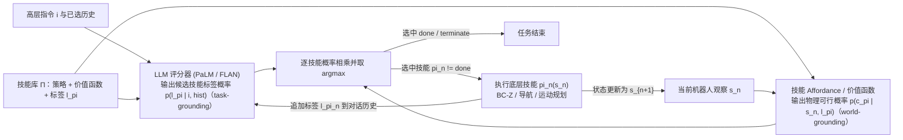

# SayCan（Do As I Can）

**SayCan（Do As I Can）**（Ahn et al., [arXiv:2204.01691](https://arxiv.org/abs/2204.01691)，[项目官网](https://say-can.github.io/)，[代码片段](https://github.com/google-research/google-research/tree/master/saycan)）将大语言模型对候选技能标签的任务相关性概率 $p(\ell_\pi \mid i, \text{history})$ 与底层技能在当前状态下的强化学习可行性价值估计 $p(c_\pi \mid s, \ell_\pi)$ 相乘，在「语义有用（Say）」与「物理可行（Can）」之间做概率分解，迭代输出可直接在机器人上执行的原子技能序列。本页合并论文全文精读与 Lumina [Embodied-AI-Guide 微信专辑](../overview/embodied-ai-guide-wechat-album-curator.md) 索引条目。

## 一句话定义

**用大语言模型的常识做任务相关性打分（Say），再用学得的强化学习价值函数作为物理可行的 affordance 过滤器（Can），两者相乘输出当前状态可执行的原子技能序列。**

## 英文缩写速查

| 缩写 | 英文全称 | 简要说明 |
|------|----------|----------|
| LLM | Large Language Model | 大语言模型；在 SayCan 中作评分式任务分解器（非自由生成文本） |
| RL / TD | Reinforcement Learning / Temporal Difference | 强化学习 / 时序差分；以稀疏 0/1 奖励训练语言条件价值函数作 affordance |
| BC | Behavioral Cloning | 行为克隆；SayCan 真机 `pick` 策略主干基于 BC-Z 架构训练 |
| IL | Imitation Learning | 模仿学习；包含遥操作演示与 BC-Z 策略训练范式 |
| VLA | Vision-Language-Action | 视觉–语言–动作端到端多模态策略路线（与 SayCan 分层规划形成对照） |

## 为什么重要

1. **LLM 物理接地的奠基范式：** 直接让 LLM 回答「可乐洒了怎么办」往往会给出「用吸尘器」等不适配当前机器人的叙事；SayCan 用固定技能文本词表和当前视觉价值函数同时约束 LLM，把开放常识推理接到有限具身系统上。
2. **首次验证 LLM 能力缩放可直接传导到真机成功率：** 在 101 条厨房指令评测中，从 FLAN（137B，Plan 70% / Execute 61%）升级到 PaLM（540B，Plan 84% / Execute 74%），规划与执行错误率约减半（且无需重新训练底层技能）。
3. **打通「分层语言规划 → 端到端 VLA」演进主轴：** SayCan 暴露了固定底层技能库与开环无状态纠错的瓶颈，直接催生了闭环反馈（Inner Monologue）以及后续将高层推理与底层动作统一在同一多模态骨干中的 RT 系列与 VLA 路线。

## 核心信息

| 项 | 内容 |
|----|------|
| **机构** | Google Research（Robotics at Google） |
| **arXiv** | [2204.01691](https://arxiv.org/abs/2204.01691) |
| **项目页** | <https://say-can.github.io/> |
| **开源状态** | **部分开源**（`google-research/tree/master/saycan` 仅提供 UR5 桌面仿真 Colab；真机移动操作栈、68k 遥操作集及 PaLM/FLAN 权重未开源） |

## 流程总览

图依据：论文 §3 SayCan（Algorithm 1 / Fig. 3）、§4 技能实现。

## 核心原理

SayCan 把「在状态 $s$ 执行技能 $\pi$ 推进指令 $i$ 成功完成」的概率建模为两项乘积（原文 Sec. 3, Algorithm 1）：

$$
p(c_i \mid i, s_n, \ell_\pi) \propto \underbrace{p(c_\pi \mid s_n, \ell_\pi)}_{\text{World-grounding (Can)}} \cdot \underbrace{p(\ell_\pi \mid i, \ell_{\pi_{n-1}}, \dots, \ell_{\pi_0})}_{\text{Task-grounding (Say)}}
$$

- **评分模式而非自由生成（Sec. 3）：** SayCan 不直接解码自由文本后再去匹配最近技能（原文 `Generative` 消融仅 74% Plan，低于 PaLM-SayCan 的 84%），而是由提示工程固定「Human / Robot: 1. ...」对话格式，对每个合法技能标签 $\ell_\pi \in \ell_\Pi$ 计算条件对数似然，从而保留显式概率分布并与 affordance 数值融合。
- **价值函数作为 Affordance 抽象（Sec. 2 & 4）：** 对于无折扣、成功奖励 $1.0$、失败奖励 $0.0$ 的有限回合任务，时序差分（TD）训练的语言条件 Q 函数 $v(s) = \max_a Q_\pi(s, a)$ 等价于技能成功完成概率。实验显示去掉 affordance（`No VF`）Plan 成功率从 84% 降至 67%（尤其 Embodiment 状态测试从 64% 暴跌到 18%）。
- **技能组合与可扩展推理（Sec. 5.2）：** 新增技能（如开/关抽屉）只需扩展候选标签集、挂接对应价值函数并在 prompt 中补入少数示例即可零微调接入；若在生成技能前先让 LLM 产出一段 `Explanation:`（Chain-of-Thought），即可显著改善「无咖啡因」「非水果」等否定与隐式约束推理。

## 主要技术路线

- **概率分解式分层规划（SayCan 本线）：** 上层冻结大语言模型做技能相关性打分，下层并行运行异构技能族（学习型 BC-Z 策略、RL 价值函数或经典规划/导航），靠统一概率接口拼接，抽象层级详见 [Foundation Policy](../concepts/foundation-policy.md)。
- **闭环状态反馈演进：** 原版 SayCan 仅在每步决策前读取当前 affordance，执行失败后不会主动重规划；后续 Inner Monologue 引入成功检测器与场景描述反馈形成语言内循环。
- **向端到端 VLA 演进：** SayCan 仍受制于固定原子技能词表，而 [Robotics Transformer](../methods/robotics-transformer-rt-series.md) 与 [VLA](../methods/vla.md) 则尝试把视觉、语言推理与连续/离散动作统一到同一端到端骨干；现代 VLM planner 如 [Vesta](./paper-vesta-generalist-embodied-reasoning.md) 也将文本子任务规划升级为含空间 grounding 与记忆的推理前级，再交由动作策略执行。

## 实验与评测

- **101 条真实厨房指令评测（Mock Kitchen）：** PaLM-SayCan（540B）取得 **Plan 84% / Execute 74%**，显著高于 FLAN-SayCan（137B，**Plan 70% / Execute 61%**）与自由文本解码基线 `Generative`（**74% Plan**）。
- **Affordance 关键消融（`No VF`）：** 去掉价值函数物理过滤后，整体 Plan 成功率从 **84% 降至 67%**，其中对机器人当前物理形态/持物状态的 **Embodiment** 家族测试从 **64% 暴跌到 18%**，直接印证「价值函数过滤器决定系统可行性上限」。
- **跨场景迁移衰减与局部技能扩展：** 真实办公厨房执行成功率从 Mock Kitchen 的 **74% 降至 60%**；新增开/关抽屉技能时规划达 **100%** 但真机执行仅 **33%**。完整子任务分级实验表以 [arXiv:2204.01691](https://arxiv.org/abs/2204.01691) 原文为准。

## 工程实践

- **异构技能与 Affordance 标定（Appendix D.2）：** 真机厨房栈（551 个设计技能、评测涵盖 15 物体 × 5 地点）并没有强求全部分支同构——`Pick` 采用 BC-Z 多任务视觉语言策略（68k 遥操作 + 12k 自主过滤轨迹，16 TPUv3 训练 ~27h）配 MT-Opt 仿真+RetinaGAN 价值函数并用经验区间 $v_{\min}^{\text{pick}}=0.2, v_{\max}^{\text{pick}}=0.5$ 线性截断；`Go to` 用已知地图导航配距离反比 affordance；`Place` 用笛卡尔运动规划并设 $p=1.0$；`Terminate` 固定为 $0.1$，并在外层逻辑禁止重复执行刚完成且已获奖励的技能。
- **Prompt 工程敏感点（Appendix D.3）：**
  1. 示例数从 0（含终止判定仅 10% Plan）增到 4 个即达 82%，17 个示例（Listing 1）在语言模拟器上达 88%。
  2. 步骤间显式加编号（`1. `, `2. `）并按换行符 `\n` 分隔、使用符合自然语法的技能词表（避免 `"a"`/`"an"` 拼写错误）、控制示例物体分布均匀，均可明显提升 LLM 评分稳定性。
- **开源复现边界（Sec. 6）：** 官方公开代码（`google-research/tree/master/saycan`）只包含 UR5 桌面仿真 Colab——用 **CLIPort** 作抓取放置策略、**ViLD** 开放词表目标检测器充当近似 affordance、**GPT-3** 作语言模型；真机移动操作控制栈、68k 遥操作集及 PaLM/FLAN 权重均未开源。

## 与其他工作对比

| 维度 | 读法 |
|------|------|
| **对照工作** | 与 [RT-2](./paper-rt-2.md) / OpenVLA 的端到端路线对照：本文输出离散子技能、需预置技能库，端到端 VLA 直接产动作；取舍是可解释性与分层复用 ↔ 技能覆盖上限 |
| **横比口径** | 成功率受预置技能库覆盖面支配，技能库不同的系统不可横比；且公开代码仅覆盖 UR5 仿真 Colab，完整栈依赖内部技能库与 68k 遥操作集，可复现范围有限 |
| **开源状态** | **部分开源（google-research 子目录；非完整内部栈）** — 复现前以项目页 / 官方仓实际链接为准 |

## 局限与风险

- **技能库天花板与迁移衰减：** 论文自述系统主要瓶颈在底层技能覆盖面与执行鲁棒性（真实办公厨房执行率从 Mock Kitchen 的 74% 降至 60%；新增抽屉任务规划 100% 但执行仅 33%）。
- **开环失败恢复弱：** 若某技能虚高报告了 affordance 却中途执行失败，原版 SayCan 缺乏显式失败检测与回退机制（需结合重规划/闭环监控）。
- **语言模型固有缺陷：** 实测规划误差中 **65% 来自 LLM 侧**（长程任务提前输出 `"done"`、否定约束与模糊指代错误），另 **35% 来自 affordance 误判**（例如未能识别薯片袋或海绵可抓取）；且对每个候选技能都需计算 LLM 对数概率，技能词表极大时推理延迟会线性膨胀。

## 结论

**SayCan 确立了 LLM + 机器人分层接地的标准分工：常识规划在上、affordance 物理裁剪在中、异构技能执行在下。**

- 不要把 SayCan 当成端到端 VLA 的前身——其输出仍是预置词表上的离散子技能，技能库覆盖上限决定真机物理表现。
- `No VF` 消融（Embodiment 64% → 18%）表明：**价值函数 / 成功率估计器是能否物理落地的关键**，仅有更大的 LLM 参数规模无法避免不可行计划。
- `Say`（PaLM 540B vs FLAN 137B）与 `Generative` 消融证明：概率式词表打分叠加规模化语言推理可显著降低任务拆解错误（Plan 84% vs 70%）。
- 工程上需正视开环无状态纠错与延迟随技能数线性膨胀两项结构限制；复现起点应精读 Appendix D.2/D.3 与 `google-research` UR5 Colab 示例。

## 源码运行时序图

**不适用（无独立可运行真机全栈官方仓库；`google-research/tree/master/saycan` 仅为基于 CLIPort + ViLD + GPT-3 的桌面仿真 Colab 示例，真机移动操作栈依赖内部技能库与未公开权重）。**

## 关联页面

- [机器人本体（Embodiment）](../concepts/embodiment.md) — 理解 Embodiment 类任务为何需要当前身体与状态的可行性约束
- [PaLM-E](./paper-palm-e-embodied-language-model.md)
- [RT-2](./paper-rt-2.md)
- [Vesta 通用具身推理](./paper-vesta-generalist-embodied-reasoning.md)
- [Foundation Policy](../concepts/foundation-policy.md)
- [VLA](../methods/vla.md)
- [Robotics Transformer（RT 系列）](../methods/robotics-transformer-rt-series.md)
- [LLM Robotics Control Interfaces](../concepts/llm-robotics-control-interfaces.md)
- [操作任务（Manipulation）](../tasks/manipulation.md)
- [Embodied-AI-Guide 微信专辑](../overview/embodied-ai-guide-wechat-album-curator.md)
- [VLA History（RT-1 to MolmoAct）技术地图](../overview/vla-history-rt1-to-molmoact-technology-map.md)

## 参考来源

- [SayCan 论文全文与项目页核对归档（arXiv:2204.01691v2）](../../sources/papers/saycan_arxiv_2204_01691.md)（主要原文：通读全文 Sec. 1–8、Appendix A–E.6 及 `say-can.github.io`）
- [Ted Xiao 具身智能三时代一手索引](../../sources/blogs/ted_xiao_embodied_three_eras_primary_refs.md)
- [Lumina 具身实践连载（LLM Planner 部分）](../../sources/blogs/wechat_lumina_embodied_practice_part1_llm_planner_2026-09-20.md)
- [VLA History RT-1 to MolmoAct 2 梳理](../../sources/blogs/x_starlitmatcha_vla_history_rt1_to_molmoact2_2026-11-01.md)
- [arXiv PDF](https://arxiv.org/pdf/2204.01691)：§1–8、Appendix A–E.6

## 推荐继续阅读

- Ahn et al., *Do As I Can, Not As I Say: Grounding Language in Robotic Affordances*（<https://arxiv.org/abs/2204.01691>）
- 项目官网与视频：<https://say-can.github.io/>
- 开源桌面仿真 Colab：<https://github.com/google-research/google-research/tree/master/saycan>
- SayCan Dataset v0（CC BY 4.0）：<https://github.com/say-can/say-can.github.io/tree/main/data>
- 后续闭环演进：Huang et al., *Inner Monologue: Embodied Reasoning through Planning with Language Models*（<https://arxiv.org/abs/2207.05608>）

## Awesome Agentic Robots 导航补充

- **论文入口：** [arXiv:2204.01691](https://arxiv.org/abs/2204.01691)。
- **项目或官方发布入口：** [项目页](https://say-can.github.io/)。
- **清单记录：** `survey_ax_2204_01691`。
