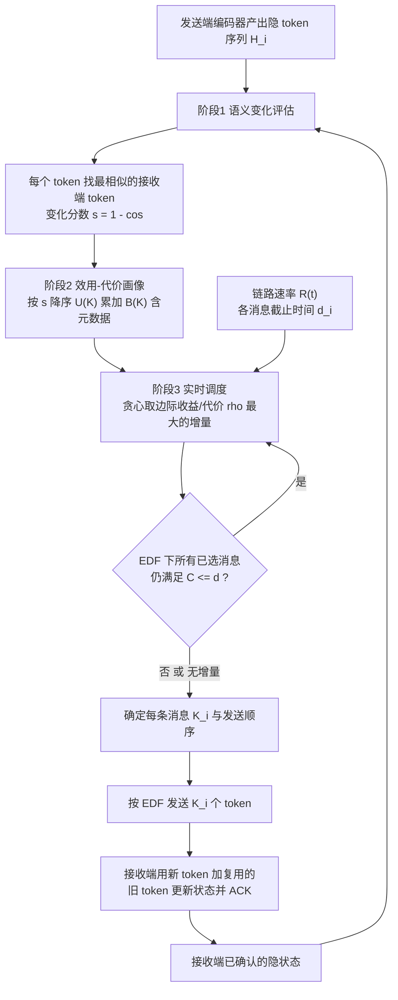

# SCALE: Real-Time Latent Communication for Cyber-Physical Agents

## 一句话定义

**SCALE（[arXiv:2611.08390](https://arxiv.org/abs/2611.08390)，Washington University in St. Louis 与 Nexcepta Inc.）** 是一种面向信息物理系统（CPS）智能体的实时隐表示通信方法：先用时空连续性找出接收端已有的相似 token 来复用，再按「语义收益 / 通信代价」与任务截止时间，联合决定发送哪些待发消息、每条消息发多少个隐 token。它不是强化学习方法，也不训练新模型，作用在现有编码器输出的 token 上（论文 §1）。

## 英文缩写速查

| 缩写 | 英文全称 | 简要说明 |
|------|----------|----------|
| CPS | Cyber-Physical System | 信息物理系统，论文用来指带传感器、通过网络协作的物理智能体 |
| EDF | Earliest Deadline First | 最早截止时间优先的发送顺序 |
| OT | On-Time rate | 消息在截止时间前送达的比例，分母含未送达消息（§5.3） |
| AP | Average Precision | 检测精度，IoU 阈值 0.5（§5.2） |
| mIoU | mean Intersection over Union | BEV 语义分割指标 |
| BEV | Bird's-Eye View | 鸟瞰视角表示 |
| LIBERO | Lifelong robot learning benchmark | 语言条件操作基准，见 [libero-benchmark](./libero-benchmark.md) |
| VLA | Vision-Language-Action | 视觉-语言-动作模型，文中 LIBERO 用 SmolVLA |
| ACK | Acknowledgement | 接收端对已更新状态的确认，发送端据此只复用已确认的信息 |

## 为什么重要

- 机器人间或机器人到边缘服务器传感器特征时，链路带宽有限且时变，不同任务截止时间不同；论文把「多任务隐消息共享一条链路、有 firm deadline」明确建模出来（§3），这是它和 LLM 隐通信、单任务协同感知两类工作的差别（§1、§2）。
- 评测里一个有用的观察（作者自述，§5.2 LIBERO）：Uniform 压缩的按时率在 3.4 Mbps 下与 SCALE 接近（74.47% 对 77.76%），但成功率为 0，说明「按时送达」不等于「任务成功」，需要同时看语义内容。
- 与机器人强化学习的关系较远：本文不涉及策略训练，只在 LIBERO 上用已有 SmolVLA 做推理，通信方法在策略外层。引用它做「带宽 / 时延约束下的多机协同」背景比引用成「RL 方法」更合适（本页判断）。

## 流程总览

图依据：论文 §4.1–§4.4、式 (3)–(7)、算法 1、图 2。

## 核心原理

- **问题（§3）：** 每条待发消息 i 有 N_i 个 token，选 K_i ≤ N_i（K_i=0 表示不发）。目标是最大化截止前送达的总语义收益（式 2），约束是链路带宽。采用 firm deadline：错过截止的消息贡献为零。
- **语义变化评估（§4.2）：** 逐 token 做「最优匹配」而非固定位置比较，理由是物体或视角运动会让固定位置的比较高估语义变化；匹配对象是接收端 **已确认** 的状态，保证复用的信息接收端确有。相似度 ≥ 阈值 τ 才可复用（τ 取值在正文未找到）。
- **效用-代价画像（§4.3）：** 把变化分数当作「新信息量」，降序累加得 U(K)；代价 B(K) = K·b_tok + 元数据（token 索引、对应关系、参考状态版本）。
- **调度（§4.4、附录 A）：** 从 K_i=0 起每次给某条消息加一个 token，只接受使 EDF 排序下各消息完成时间 C 仍 ≤ d 的增量，其中 C 用当前链路速率 R(t) 估计（式 7），在可行增量里选 ρ 最大者。这是贪心启发式，论文没有给出最优性保证（本页判断：正文与附录未出现此类证明）。
- **作者自述的定位（§1）：** 轻量、不改动底层模型、支持不同模态与任务。附录 C 表 6 给出每条消息总开销 0.813–0.884 ms（i9-13900K、4 核，CooperScene）。

## 工程实践

- **输入前提：** 需要发送端与接收端都用同一套编码器 / 隐 token 格式，接收端维护并确认参考状态，发送端维护对方状态版本（§4.3、§4.4）。
- **评测设置（§5.1、附录 B 表 5）：** CooperScene（真实，3,936 检测 + 18,693 预测目标）、OPV2V（仿真，528 检测 + 265 分割）、LIBERO（SmolVLA，单个语言条件任务，每设置 45 episode）。带宽取完整隐传输所需带宽的一部分（CooperScene 约 118.5 Mbps、OPV2V 约 153.0、LIBERO 约 13.46，均为按验证或标定数据估计）以及时变链路（每 2 秒在高低速率间切换，§5.1）。
- **实验结果（表 1–4，均为论文数字）：**

| 场景 | 设置 | SCALE | 对照 |
|------|------|-------|------|
| CooperScene 检测（表 1a） | 20 Mbps | AP 51.53，OT 80.36% | CoSDH AP 31.34，OT 48.02%；Full-send OT 0.00% |
| CooperScene 预测（表 1b） | 固定 15–30 Mbps | 成功率 60.82–60.85%，OT ≥ 99.82% | Uniform 59.49–59.87% |
| OPV2V 分割（表 2b） | 15 Mbps | mIoU 47.14，OT 97.09% | Where2comm 37.17，OT 7.82% |
| OPV2V 检测（表 2a） | 8 Mbps | AP 83.41，OT 37.74% | CooperTrim AP 84.25，OT 0.73%；Uniform OT 46.49% |
| LIBERO（表 3） | 3.4 / 5.0 / 10.1 Mbps | 成功率 44.44% / 86.67% / 97.78% | Full-send 0.00% / 24.44% / 88.89%；Uniform 0.00% / 0.00% / 42.22% |
| 蜘蛛机器人检测（表 4） | 1 / 2 / 8 Mbps | 成功率 77.62% / 91.67% / 100%，OT 100% / 96.43% / 100% | Raw RGB 与 Full-send 在 1、2 Mbps 均为 0，8 Mbps 均为 100% |

- **蜘蛛机器人案例（§5.4）：** 树莓派蜘蛛机器人，检测任务通信截止 1,000 ms，超声测距作为背景流量，路线 55.4 秒。
- **代码：** 匿名评审仓库，README 称含 `method/scale/`（特征选择、调度、状态复用）、`benchmark/`（共享模拟器与三个基准的适配和 `results.csv`）、`tests/`；README 自述 demo 在合成特征上运行，不复现论文精度表，完整神经网络实验需要外部数据集、权重与特征缓存，未随仓库提供。本页只静态读了 README，未运行、未核对 CSV 与论文表是否一致。

## 局限与风险

- **作者自述：** (a) 节省依赖时空冗余，场景突变时可复用信息减少、需要更多通信才能维持性能；(b) 调度按当前链路速率判可行性，无法应对短于最小调度间隔的突发带宽下降（Limitations）。
- **本页观察（均为未验证或论文未覆盖）：**
  - 论文没有做场景突变的受控实验，局限 (a) 只是文字承认。
  - LIBERO 只测单个任务；蜘蛛机器人案例只有检测一种时间敏感任务，样本规模论文未给出统计（仅给百分比）。
  - 基线（CoSDH、V2X-ViT、CooperTrim、Where2comm）原本不是面向「多任务 + 截止时间」设计，论文统一给它们加 EDF 顺序；与 LLM 隐通信方法（如 KVComm）没有实验对比。
  - 表 1a 中 Full-send 在固定带宽下按时率 0.00% 而 AP 仍为 22.77，论文未解释该值如何产生（推测：未送达时退化为接收端本地结果，论文未说明）。
  - OPV2V 检测 8 Mbps 下 SCALE 的 AP 和按时率都不是最优（见上表），结论「几乎所有设置最高」需带着此例外读。
  - τ 的取值、ACK 的延迟与丢失处理在正文中未找到说明；代码为匿名仓库，完整实验不可一键复现（README 自述）。
  - 论文 v1，未见同行评审结论；致谢与 AI 使用声明见附录 D（作者称 AI 用于代码实现调试与文字润色，并已复核）。

## 关联页面

- [目标导向通信与物理 AI](./paper-goal-oriented-comms-physical-ai.md)：同属「带宽受限下按任务价值传信息」的相邻工作
- [最小充分通信](./paper-minimum-sufficient-communication.md)：多智能体通信量与任务充分性的相邻讨论
- [SmolVLA](./paper-smolvla.md)：本文 LIBERO 实验使用的 VLA 策略
- [LIBERO 基准](./libero-benchmark.md)：本文操作评测的基准
- [机器人板载通信架构](../concepts/robot-onboard-communication-architecture.md)：机器人内部通信的背景
- [VLA 方法页](../methods/vla.md)：VLA 总览

## 参考来源

- [sources/papers/scale-realtime-latent-communication_arxiv_2611_08390.md](../../sources/papers/scale-realtime-latent-communication_arxiv_2611_08390.md)：原文通读归档（核对范围见该文件）
- [arXiv PDF v1](https://arxiv.org/pdf/2611.08390v1)
- [匿名代码仓库](https://anonymous.4open.science/r/SCALE-4E80/)：只读 README，未运行

## 推荐继续阅读

- 论文：<https://arxiv.org/abs/2611.08390>
- 论文引用的相邻工作：Where2comm（NeurIPS 2022）、CooperTrim（ICLR 2026）、CoSDH（CVPR 2025）、KVComm（ICLR 2026）等，以原文参考文献为准
