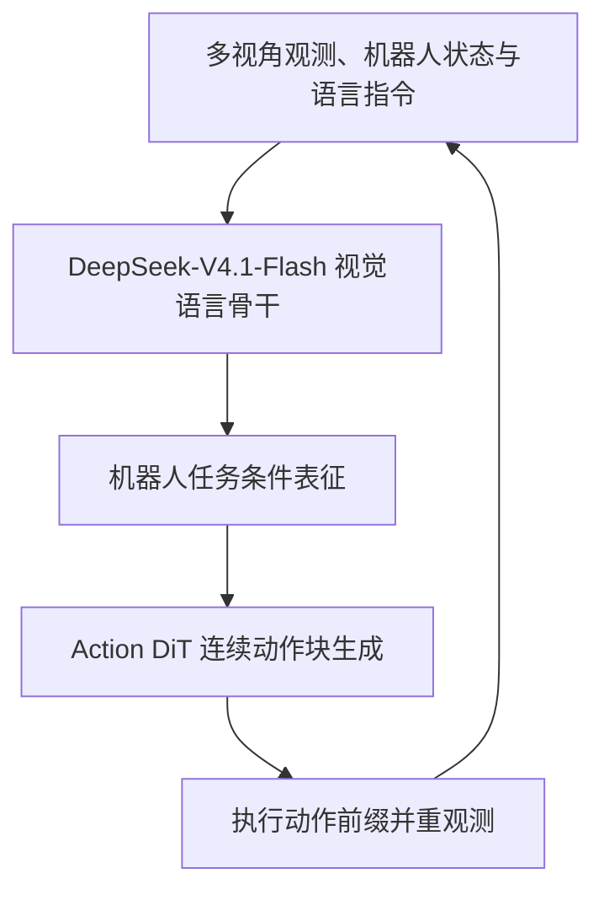

# ScaleVLA: Scaling Vision-Language-Action Models to 552 Billion Parameters / 把视觉–语言–动作模型扩展到 5520 亿参数

## 一句话定义

**ScaleVLA**：ScaleVLA 在 DeepSeek-V4.1-Flash 的 552B 总参数骨干上接 Action DiT，研究超大骨干如何在少样本机器人操作中迁移；十条演示的 LIBERO-Goal 87.8%，LIBERO-PRO 45.1%，216 ms 为单动作块推理中位延迟。

## 英文缩写速查

| 缩写 | 英文全称 | 简要说明 |
|---|---|---|
| VLA | Vision-Language-Action | 视觉与语言条件驱动动作输出 |
| DiT | Diffusion Transformer | 预测动作块的去噪 Transformer |
| LIBERO | Lifelong Benchmark for Robot Learning | 机器人操作评测套件 |
| LoRA | Low-Rank Adaptation | 参数高效适配的相关方法 |

## 为什么重要

通用语言骨干扩展到数千亿参数，并不直接等于机器人端到端控制能力。关键问题是如何让庞大的视觉语言表征和低时延动作生成衔接，以及低演示预算下是否真正提高成功率。

## 核心原理

1. 架构采用 DeepSeek-V4.1-Flash 级别语言视觉骨干和独立 Action DiT；将任务描述、视觉观测与机器人状态转为动作条件。论文的 552B 口径是基础模型规模，不等于每次动作都激活全部参数。
2. 冻结大规模语言骨干的主要部分，用动作专家完成连续动作块生成；以动作监督而非文本解码为控制目标。必须区分 backbone 的稀疏激活参数和总参数量。
3. 单段动作的推理延迟依赖 GPU 数量、动作块长度、并行设置与测量边界；不应把 216 毫秒解释为所有真机配置的闭环周期。

## 流程总览

## 源码运行时序图

**不适用**：截至 2026-11-18，官方项目主页未提供可核实的完整可运行训练或推理入口；不能将论文方法图冒充源码运行时序图。

## 工程实践

- 部署前固定相同观察窗口、动作块长度、采样步数和精度，分别测 token 编码、动作生成与机器人执行排队。
- 硬件资源规划应单列总参数、每 token 激活参数、显存 / 通信瓶颈和推理时间，不以“552B”直接推断边缘机算力需求。
- 少样本比较统一演示条数、任务集合和随机种子；在机器人部署中增加成功率之外的恢复与安全测试。

## 实验与评测

- LIBERO-Goal：在指定十条示范的少样本协议下，成功率 87.8%；不是所有 LIBERO 子集统一指标。
- LIBERO-PRO：所报告评测配置的成功率 45.1%；该数值不能与 LIBERO-Goal 直接混为同一难度的提升。
- 动作块中位推理延迟 216 ms（论文配置）；不是每个关节位置环的采样周期。

## 结论

**ScaleVLA 的价值应以相同任务协议、训练数据与推理测时边界判断，不能仅依据宣传规模或单一成功率。**

1. 架构采用 DeepSeek-V4.1-Flash 级别语言视觉骨干和独立 Action DiT；将任务描述、视觉观测与机器人状态转为动作条件。论文的 552B 口径是基础模型规模，不等于每次动作都激活全部参数。
2. 冻结大规模语言骨干的主要部分，用动作专家完成连续动作块生成；以动作监督而非文本解码为控制目标。必须区分 backbone 的稀疏激活参数和总参数量。
3. 部署前固定相同观察窗口、动作块长度、采样步数和精度，分别测 token 编码、动作生成与机器人执行排队。
4. 硬件资源规划应单列总参数、每 token 激活参数、显存 / 通信瓶颈和推理时间，不以“552B”直接推断边缘机算力需求。

## 与其他工作对比

| 对照 | 关键差异 |
|---|---|
| ThinkWAM | 不是扩大骨干，而是增加执行前未来潜变量修正以提高动作可靠性。 |
| ResWAM | 训练未来表征残差和动作分支，强调世界监督的计算效率。 |

## 局限与风险

- 论文中的少样本评测和 216 ms 测时不代表单卡消费级 GPU 可复现。
- 项目主页未提供可核实的可运行官方训练/推理入口（截至 2026-11-18）；代码运行时序图不适用，不能自造部署命令。

## 关联页面

- [动作分块](../methods/action-chunking.md)
- [行为克隆](../methods/behavior-cloning.md)
- [机器人操作](../tasks/manipulation.md)
- [ThinkWAM](./paper-thinkwam-2611-21258.md)
- [ResWAM](./paper-reswam-2611-19559.md)
- [VLA 纵深路线](../../roadmap/depth-vla.md)

## 参考来源

- [论文全文归档](../../sources/papers/scalevla-2611-21607.md)
- [arXiv 原文 v1](https://arxiv.org/html/2611.21607v1)
- [官方项目页归档](../../sources/sites/scalevla-2611-21607.md)

## 推荐继续阅读

- [ScaleVLA: Scaling Vision-Language-Action Models to 552 Billion Parameters](https://arxiv.org/abs/2611.21607)
- [官方项目页](https://galaxygeneralrobotics.github.io/scalevla/)

