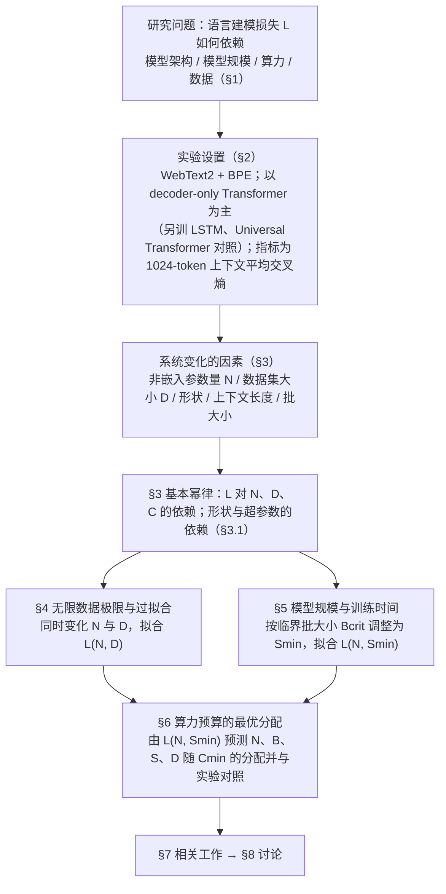

# Scaling Laws for Neural Language Models｜神经语言模型的规模法则

**Scaling Laws for Neural Language Models**（Kaplan et al.，[arXiv:2001.08361](https://arxiv.org/abs/2001.08361)，OpenAI 2020）系统测量 **自回归语言模型** 的 cross-entropy 如何随 **参数量 N、数据集大小 D、训练算力 C** 变化，发现 **跨 7+ 数量级的幂律**，并分析 **固定算力下模型规模、batch 与训练步数的最优分配**。

## 一句话定义

**用幂律 $L(N,D,C)$ 把「堆模型 / 堆数据 / 堆算力」从玄学变成可外推的工程曲线，并解释何时更大模型更 compute-efficient。**

## 英文缩写速查

| 缩写 | 英文全称 | 简要说明 |
|---|---|---|
| LM | Language Model | 自回归语言模型 |
| CE | Cross-Entropy | 逐 token 测试交叉熵 |
| BPE | Byte-Pair Encoding | WebText2 使用的 tokenizer |
| FLOPs | Floating Point Operations | 估计训练计算量 |
| C_min | Minimum Compute | batch 校正后的最低算力 |
| B_crit | Critical Batch Size | 训练速度与计算效率的折中 batch |
| VLA | Vision-Language-Action | 具身对照领域；非本论文实验 |

## 为什么重要

- **实测 Scaling 而非口号：** 同时分析非 embedding 参数量 N、训练集规模 D、训练算力 C_min 对 LM 测试损失的影响。
- **区分数据约束与算力最优：** 避免过拟合的 D 与一次 compute-efficient 训练所用 tokens 是不同问题。
- **具身研究方法论：** [Embodied Scaling Laws](../concepts/embodied-scaling-laws.md)、[Light-O1](./light-o1.md) 可借鉴变量控制和拟合方式，但不应照搬本文指数。

## 论文身份与来源

| 字段 | 核对信息 |
|---|---|
| 原题 / 中文名 | Scaling Laws for Neural Language Models / 神经语言模型的规模法则 |
| 作者 | Jared Kaplan、Sam McCandlish、Tom Henighan、Tom B. Brown 等 10 人 |
| 机构 | 约翰斯·霍普金斯大学（Johns Hopkins University）、OpenAI |
| 日期、版本 | 2020-01-23 / arXiv:2001.08361v1 |
| 数据与指标 | WebText2，约 22.9B BPE tokens；1024-token test cross-entropy（nats/token） |
| 官方介绍 | [OpenAI 2020-01-23 Publication](https://openai.com/index/scaling-laws-for-neural-language-models/) 仅列摘要、作者与论文链接，没有额外实验表 |

## 流程总览

图依据：实证研究设计图，论文 §1.3 记号、§2 Background and Methods、§3–§6 各节开头的研究设计叙述；不含结论数字。

## 核心原理

**记号：** N 是非 embedding 参数数目，D 是独立训练数据 tokens，B 是每步训练 token 数，S 为更新步数。训练 FLOPs 粗估 **C≈6NBS**；C_min 是按临界 batch 效率校正后的最低计算量，并非任意 run 的 C。

### 三轴幂律（§1.2、§3、附录 A）

| 实验前提 | 经验公式 | 指数 |
|---|---|---|
| 数据充分、模型容量受限 | L(N)≈(N_c/N)^α_N | **α_N≈0.076** |
| 大模型、数据受限并早停 | L(D)≈(D_c/D)^α_D | **α_D≈0.095** |
| 算力受限、计算分配最优 | L(C_min)≈(C_c_min/C_min)^α_C_min | **α_C_min≈0.050** |

指数是 WebText2 和论文 tokenization / 训练协议下的拟合，**不是普适常数**。§4 联合拟合 Table 2 的 α_D=0.103，与以上单轴拟合 0.095 不同，不能混为一谈。

### 联合数据、参数与过拟合（§4）

- **L(N,D)=[(N_c/N)^(α_N/α_D)+D_c/D]^α_D** 描述两个瓶颈叠加。
- 防止明显过拟合（论文选定阈值）约需 **D≳5×10³ N^0.74**（式 4.4）；这是达到近收敛时的**数据约束**，不是固定 FLOPs 的最优模型:数据比例。
- 固定非 embedding 参数量后，一般宽、深、注意力头数对测试损失的影响相对小，极端形状和极小网络除外。

### 批大小与 compute-efficient 前沿（§5–6）

- **B_crit(L)≈B_*/L^(1/α_B)**，其中 α_B≈0.21；临界批大小附近平衡串行时间与计算效率。
- **L(N,S_min)≈(N_c/N)^α_N+(S_c/S_min)^α_S**，α_S≈0.76；S_min 是 batch 校正后的最小步数而非实际训练更新 S。
- 固定 C_min 的经验最优分配 **N_opt∝C_min^0.73，B_crit∝C_min^0.24，S_min∝C_min^0.03**；不重复数据的单 epoch 近似下，使用的训练 tokens **D∝C_min^0.27**（附录 A Table 6）。
- **边界：** 防过拟合的 D∝N^0.74 与 compute-efficient 的 D∝C_min^0.27 在远大于本论文实验规模的外推上发生矛盾（§6.3），作者明确认为定律必将失效。

## 实验与评测

- **对象：** 主要是 decoder-only Transformer，另比较 LSTM 与 Universal Transformer；参数扫描约 **768–1.5B 非 embedding 参数**，数据约 **22M–23B tokens**。
- **评价：** 1024-token 预测交叉熵；还在 Books、Common Crawl、Wikipedia 等文本分布测试。跨分布损失大致跟随本域改善，但不表示任务成功率遵循相同规律。
- **算力效率：** 附录 B.3 的模型拟合推导：在相同 loss 目标下，计算高效方案约 **2.7× 更大模型、7.7× 更少更新步、65% 更少训练 FLOPs**；并非真实硬件性能实测。
- **未覆盖：** 多模态策略、动作损失、机器人成功率、闭环控制周期与推理延迟。

## 结论

**Kaplan 2020 提供可核验的语言模型损失幂律与训练预算模型，不构成跨任务通用的规模处方。**

1. **比较前控制变量：** 同 tokenization、数据分布与 CE 定义下分别拟合 N、D、C_min。
2. **不要混淆两类 D：** 防过拟合约束 D∝N^0.74 不等于固定算力下最优训练 tokens。
3. **模型规模与早停：** N_opt∝C_min^0.73 和 S_min∝C_min^0.03 只在原文设定及实验域下成立。
4. **辨认模型推断：** batch 校正及 2.7× 模型等效率数字来自拟合推算，实际算力与硬件时间需测量。
5. **具身再验证：** 迁移到 VLA 时须单独建立 held-out action loss、真机成功率与推理时延的曲线。

## 与其他工作对比

| 维度 | Kaplan 2020 原论文 | OpenAI 官方介绍 | 具身 Scaling |
|---|---|---|---|
| 证据 | 自回归 LM 实验及拟合、附录 | 摘要、作者与论文入口 | 跨研究控制变量和测量，见 [Embodied Scaling Laws](../concepts/embodied-scaling-laws.md) |
| 指标 | Text cross-entropy | 未提供新实验 | action loss、运动误差、闭环成功率等，必须单独定义 |
| 指数可否迁移 | 适用于原论文设置 | 未提供新拟合 | **不可照搬**，必须重新实测 |

## 工程实践

- 固定数据、tokenizer、模型范式、context、优化器与早停规则，分别扫描 N、D、C，比较不同种子的 loss 和估计 FLOPs。
- 同 FLOPs 比较模型尺寸与训练数据量时还应记录训练墙钟时间、显存和硬件吞吐，不能只比参数。
- 机器人迁移须分别绘制 action loss、闭环成功率及 p99 推理时延随数据规模/模型规模的曲线，并锁定本体和控制频率。

## 源码运行时序图

**不适用。** OpenAI 官方 Publication 页仅给摘要与论文入口，未见可核验的官方运行脚本或代码仓库；不可把论文研究流程冒充源码执行时序。

## 局限与风险

- 论文附录 C 说明缺乏幂律的系统理论推导；极小数据、不同正则化与学习率、临界 batch 的域外推广均存在风险。
- C≈6NBS 省略与上下文长度相关的部分计算；超长上下文时不能照搬估计。
- §6.3 明确指出大规模外推时数据需求与最优计算规律会冲突，远距离预测高度不确定。
- 原文仅评价 **language-modeling cross-entropy**，不能据此声称具身模型的 success rate 有相同指数。

## 关联页面

- [Embodied Scaling Laws](../concepts/embodied-scaling-laws.md)
- [模型架构纵深路线 Stage 5](../../roadmap/depth-model-architecture.md)
- [VLA](../methods/vla.md)
- [EgoScale](../methods/egoscale.md)
- [Light-O1](./light-o1.md)
- [Dyna-2](./dyna-2.md)
- [A Fix for Softmax and Cross-Entropy](./paper-softmax-cross-entropy-fix.md) — 交叉熵训练损失的浮点数值问题（高置信度梯度坍缩、蒸馏相消）与修正实现

## 参考来源

- [Kaplan 原文归档（正文 §1–8、附录 A–D）](../../sources/papers/kaplan_scaling_laws_arxiv_2001_08361.md)
- [OpenAI 官方发表页归档](../../sources/sites/openai-scaling-laws-neural-language-models.md)
- [arXiv v1 HTML 全文](https://arxiv.org/html/2001.08361v1)
- [OpenAI：Scaling laws for neural language models](https://openai.com/index/scaling-laws-for-neural-language-models/)

## 推荐继续阅读

- [论文 PDF](https://arxiv.org/pdf/2001.08361)
- [Embodied Scaling Laws 概念页](../concepts/embodied-scaling-laws.md)
