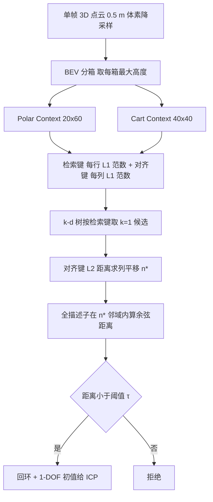

# Scan Context++：抗旋转与横向变化的结构化地点识别

*Scan Context++: Structural Place Recognition Robust to Rotation and Lateral Variations in Urban Environments*（Giseop Kim、Sunwook Choi、Ayoung Kim，[arXiv:2109.13494](https://arxiv.org/abs/2109.13494)，v1 为 2021-09-28；署名机构 KAIST / NAVER LABS / 首尔国立大学；IEEE T-RO 2022 的发表信息来自任务说明，v1 页眉卷期为占位，未核对）。

## 一句话定义

在前作 Scan Context（IROS 2018）上，新增抗**横向平移（lateral）**的 Cart Context，并加入检索键、对齐键两个一维子描述子与描述子增强，使单帧激光雷达既能做拓扑回环检索，又给出 1 自由度（偏航或横向）的半度量初值。

## 英文缩写速查

| 缩写 | 英文全称 | 简要说明 |
|------|----------|----------|
| SCD | Scan Context Descriptor | 论文统称的二维鸟瞰描述子（每箱存最大高度） |
| PC | Polar Context | 极坐标版：方位角为对齐轴，旋转变为列平移 |
| CC | Cart Context | 笛卡尔版：横向 y 为对齐轴，横向平移变为列平移 |
| A-PC / A-CC | Augmented PC / CC | 带虚拟位姿或翻转增强的版本 |
| A-axis / R-axis | Aligning axis / Retrieval axis | 对齐轴（列方向）与检索轴（行方向） |
| BEV | Bird's-Eye View | 鸟瞰投影 |
| PR / DR | Precision-Recall / Distribution-Recall | 精度召回曲线 / 论文提出的召回分布曲线（基于 KL 散度） |
| KL-D | Kullback-Leibler Divergence | 检出回环分布与真值回环分布的差异度 |
| ICP | Iterative Closest Point | 点云精配准，对初值敏感 |
| ATE | Absolute Trajectory Error | 绝对轨迹误差 |

## 为什么重要

- 激光雷达 SLAM 的回环与全局重定位需要不依赖里程计先验的地点识别；论文指出 LiDAR 全局描述子往往缺乏对朝向和平移变化的不变性（§II-B）。
- 城市道路上反向重访与换道经常同时出现，论文据此设计了旋转与横向两条不变轴（§IV-A）。
- 模块是单个 C++ 头文件加源文件，论文称可直接接入关键帧位姿图 SLAM，并给出 SC-LeGO-LOAM（§VII-F）。
- 本库的 [LeGO-LOAM](lego-loam.md)、[LIO-SAM](lio-sam.md)、[FAST-LIO](fast-lio.md) 等里程计 / 建图系统都需要一个回环模块，Scan Context 系是常见的外挂选择（此句为本页判断，论文只展示了 LeGO-LOAM 集成）。

## 核心机制

### 流程总览

### 方法栈（论文章节）

1. **描述子（§IV）**：下采样点云投到鸟瞰，按坐标分箱，箱值取最大高度，空箱为 0。PC 参数 20×60（4 m、6°，范围 0–80 m、0–360°）；CC 参数 40×40（5 m、2 m，纵向 ±100 m、横向 ±40 m）（Table II / Fig. 3）。
2. **距离（§IV-E）**：逐列余弦距离取平均（式 2），再对查询描述子做列循环移位取最小值（式 3）。
3. **子描述子（§IV-F）**：检索键是每行的 L1 范数，必须对行内置换不变（Requirement 2），所以旋转或换道造成的列平移不会改变它；对齐键是每列的 L1 范数。
4. **三阶段识别（§V）**：k-d 树检索 → 对齐键预对齐得到列平移 → 全描述子验证。论文实测只取 k=1 最好（§V-A、Table VII）。
5. **增强（§V-D）**：PC 缺平移分量，A-PC 在 ±2 m 横向位置各生成一个虚拟根位姿的描述子；CC 缺旋转分量，A-CC 对两轴各翻转一次。增强描述子与原描述子同一棵 k-d 树。
6. **复杂度（§V-E）**：朴素比较 O(NA·NR·NA)，预对齐后 O(NA·NR)；作者近似为 O(N^3) 到 O(N^2)。

### 关于「平移不变」的精确含义（对照综述说法）

- 论文标题与全文用词是 **rotation and lateral variations**，即**横向（垂直于行驶方向）平移**，不是任意方向平移。
- 单个描述子只在**一个方向**不变：PC 抗旋转、CC 抗横向，CC 并不抗旋转（§V-D：「PC loses the translational component, CC lacks the rotational component」；§VIII-H-1：「natively invariant in one direction」）。
- 复合变化（反向加换道）靠增强得到**伪不变性**（pseudo-invariance），范围在设计上只覆盖约 2 m 车道间距的虚拟偏移和 180° 翻转（Table II）。
- 前提假设：车辆近似平面运动、横滚俯仰不大（引言称例如 10° 以下）、城市道路结构（§IV-A）。

### 关于「提升速度」的精确含义

- 作者自述（§I）：前作用暴力搜索；本作用检索键 k-d 树去掉逐像素比较，再用对齐键预对齐，"expedited the process by the order of magnitude"。
- 论文给出的证据：平均 7.36 ms（KITTI 00）与 7.31 ms（Pangyo），Fig. 18，含周期性 k-d 树重建；全描述子暴力检索 4500 帧约 1 秒（§VIII-B）；复杂度式（§V-E）。
- 论文**没有**给出新旧版本的并列耗时表：Table V 的 Ours (PC) 8.3 ms、A-PC 11.5 ms，对比对象是 M2DP（5.8 ms）、SegMatch（796.0 ms）、PointNetVLAD（34.0 ms，需 GPU）；其中 M2DP 比 Scan Context++ 更快（Table V，作者在 MATLAB 下测得）。所以「提升速度」应读作「相对暴力搜索版本的算法复杂度与检索代价下降」，而不是「比其他描述子快」。
- 我的判断：前作公开仓库 README 就写有「ring key-based KD tree for fast candidate proposal」（见仓库 README，已核对文字），说明前作并非纯暴力；"暴力"主要指全描述子的逐候选列移位比较。本页未读源码，未能核对二者代码层面的差异。

## 实验结果速览

| 项 | 数值 / 结论 | 出处 |
|---|---|---|
| 判对阈值 | 查询与候选相距小于 8 m（约三车道） | §VI-B |
| KITTI 08 | 全为反向重访，PC 明显优于 CC 与 M2DP | §VII-B-1 |
| Riverside 02 | 同向多次换道，CC 大幅领先 | §VII-B-2 |
| Oxford | 未增强的 PC / CC 召回在约 43% 非同向重访处出现陡降，增强后改善 | §VII-C-1 |
| Pangyo | A-CC 在复合变化下表现最好，A-PC 在纯旋转最好 | §VII-C-2 |
| 半度量初值 | A-PC 平均 1.03°，A-CC 平均 0.84 m | §VII-E |
| ATE（Table IV） | KAIST 03 平移 20.7/42.7 → 3.4/8.8 m；Riverside 02 47.7/130.5 → 15.2/50.5 m（LeGO-LOAM → SC-LeGO-LOAM，均值/最大） | §VII-F |
| 建议（§VIII-G） | 城市道路用 CC / A-CC，通用环境与重视半度量定位用 PC / A-PC | §VIII-G |

## 工程实践

- 代码：作者仓库 [gisbi-kim/scancontext](https://github.com/gisbi-kim/scancontext)，README 说明 C++ 实现为单头文件加源文件（`Scancontext.h/.cpp`）、依赖 nanoflann、API 为 `makeAndSaveScancontextAndKeys` 与 `detectLoopClosureID`，并列出 SC-A-LOAM、SC-LeGO-LOAM、SC-LIO-SAM、FAST_LIO_SLAM 等集成仓库。该 README 未出现 Scan Context++ 字样，仓库代码是否含 CC / 增强 / 对齐键，**未核实**（只读了 README，未读源码）。
- 许可：README 声明 CC BY-NC-SA 4.0，非商业。
- 参数：论文基线分辨率 PC 20×60、CC 40×40，且低分辨率表现更好（§VIII-A、Table VI），因为粗分箱削弱动态物体与局部噪声影响。
- 只取 k=1 且在对齐键给出的 n* 处取单点验证是论文的经验选择（§V-C、§VIII-B），换传感器或场景需自行验证。
- 与 ICP 配合：对齐键的 1D 结果可作为 ICP 初值，但另外几个自由度仍要靠 ICP 精化；论文也建议用全描述子距离评估定位质量（Fig. 17）。

## 局限

论文自述：

- 原生仅一个方向不变，复合变化靠增强（§VIII-H-1）。
- 横滚俯仰扰动下所有方法性能下降，作者称这是尚少研究的方向（§VIII-D）。
- 走廊类感知混叠与近处高大遮挡物会导致失败（Fig. 22，§VIII-F）。
- 建图与定位使用不同雷达或不同安装高度的场景不在范围内（§IV-C、§VIII-H-5）。
- 在非城市环境（室内、自然场景）最强项发挥不出，需要额外通道（§VIII-H-3）。

我的判断（未验证之处）：

- 评测集中在轮式车辆数据，手持数据只有一条（KA Urban Campus 1，§VIII-D）；腿式、无人机等大姿态变化平台未覆盖。
- 增强的横向偏移固定为 ±2 m、判对阈值 8 m，对更宽的偏移或不同道路宽度的泛化论文没有直接测试。
- 与 SegMatch 对比时给了真值里程计，对 SegMatch 有利；与学习方法比较只用了作者发布的预训练权重（§VIII-E），属于有限比较。
- 耗时数据在 MATLAB 与 i9 CPU 两种设置下测得（Table V、Fig. 18），换平台需重测。

## 与综述说法的核对

综述原文：「Scan Context++是Scan Context的改进版，在Scan Context的旋转不变性基础上，增加了平移不变性，并且提升了速度」。

- 「改进版」：成立，作者本人署名的 T-RO 扩展版（含前作 IROS 2018 内容）。
- 「增加了平移不变性」：需限定为**横向平移**，且由 Cart Context 单独提供；CC 本身不抗旋转，两者合用靠增强，不是一个描述子同时对所有平移不变。
- 「提升了速度」：成立但需限定为相对暴力搜索（检索键加对齐键，O(N^3) 到 O(N^2)）；论文自己的计时里 M2DP 更快。

## 关联页面

- [LeGO-LOAM](lego-loam.md)：论文集成实验用的里程计（SC-LeGO-LOAM）
- [LIO-SAM](lio-sam.md)：作者仓库列出的另一个集成对象（仓库 README 级信息）
- [FAST-LIO](fast-lio.md)：同上，FAST_LIO_SLAM
- [LVI-SAM](paper-lvi-sam.md)：同属激光-视觉-惯性位姿图系统，可作回环模块的对照
- [Cartographer](cartographer.md)：另一类基于扫描匹配的回环方案
- [LiDAR 感知](../concepts/lidar-sensing.md)
- [状态估计](../concepts/state-estimation.md)

## 参考来源

- [scan-context-plus-plus_arxiv_2109_13494.md](../../sources/papers/scan-context-plus-plus_arxiv_2109_13494.md)
- [arXiv:2109.13494](https://arxiv.org/abs/2109.13494)
- [gisbi-kim/scancontext README](https://github.com/gisbi-kim/scancontext)

## 推荐继续阅读

- [arXiv PDF（v1）](https://arxiv.org/pdf/2109.13494v1)
- 前作：G. Kim and A. Kim, Scan Context: Egocentric spatial descriptor for place recognition within 3D point cloud map, IROS 2018（论文参考文献 [1]，本页未读）
- [LeGO-LOAM](lego-loam.md)
