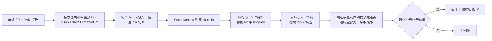

# Scan Context：以自我为中心的 LiDAR 位置识别描述符

## 一句话定义

**Scan Context** 是 Kim 与 Kim（KAIST）提出的非直方图全局描述符：以传感器为中心把一帧 3D 点云分成「方位角 × 半径」的 bin，每个 bin 只保留最大高度，得到一个 Nr × Ns 的矩阵；回环检测时先用旋转不变的 ring key 在 KD 树里取候选，再用带列平移的列向余弦距离精排（第三节，式 3 至 10）。

## 英文缩写速查

| 缩写 | 英文全称 | 简要说明 |
|------|----------|----------|
| SC | Scan Context | 本文描述符，Nr × Ns 的最大高度矩阵 |
| LiDAR | Light Detection and Ranging | 激光雷达 |
| SLAM | Simultaneous Localization and Mapping | 同步定位与建图 |
| KD tree | k-dimensional tree | 用于最近邻检索的空间划分树，这里索引 ring key |
| ICP | Iterative Closest Point | 点云配准，论文用 SC 的偏航估计给它做初值（IV-C） |
| M2DP | Multiview 2D Projection | 对比的全局点云描述符，192 维（II） |
| ESF | Ensemble of Shape Functions | 对比的直方图类描述符 |
| PR | Precision-Recall | 精度-召回曲线，论文主要评价方式（Fig. 5） |
| KITTI / NCLT | 数据集名 | 与 Complex Urban LiDAR 一起构成论文三个评测集（Table I） |

## 为什么重要

- 回环检测用来消除累计漂移，是大范围激光 SLAM 的必要模块（引言）。论文指出此前 LiDAR 全局描述符多基于直方图，只给出场景的统计指标，难以刻画结构细节，易产生误检（引言，作者自述）。
- 它不用训练，描述符与检索流程都很简单，并且保留各 bin 的绝对位置信息，因而可在匹配时对齐视角，使反向重访也能被检出（作者自述，见 KITTI 08 结果）。
- 匹配附带的列平移量 n* 可作为偏航初值交给 ICP 做精配准（III-B、IV-C）。后续许多激光 SLAM 的回环模块沿用这一类描述符，但论文本身不涉及这些后续系统，此处不展开，推测。

## 核心原理

### 流程总览

### 描述符（III-A）

- 划分：等间隔的 Ns 个 sector（中心角 2π/Ns）和 Nr 个 ring（间隔 Lmax/Nr）；论文设 Ns = 60、Nr = 20、Lmax = 80 m，即 6° 与 4 m（IV-A）。
- 编码：bin 内点的最大 z（式 3）。作者给出的理由是该值概括周围结构的垂直形状、计算轻，并与城市设计中「可见性」分析相关；因不计点数，对密度和法向变化不敏感（引言、III-A）。远处 bin 物理面积更大，但与近处 bin 同占一个像素，作者称这相当于弥补远处稀疏，并把近处动态物体当作稀疏噪声（III-A）。
- 平移：对点云做 Ntrans = 8 个平移增强版本并一起存储（root shifting），论文承认路口突然出现新空间时假设不成立（III-A）。

### 相似度与两阶段检索（III-B、III-C）

- 距离：逐列余弦距离的均值（式 5），对候选做全部 Ns 种列平移取最小（式 6、7）。列方向比较被作者称为对动态物体更有效，因为参考的是各 sector 的整体一致性。
- ring key：每行的非零占用率（式 9），不随偏航旋转变化；KD 树只索引这个 Nr 维向量，不索引完整矩阵。top-k 候选再用式 6 精排，取最近且小于阈值 τ 者（式 10）。论文称这是为了避免与整个数据库做昂贵的逐对比较。
- 注意：「KD 树」查的是 ring key，而不是整张二维数组；「选取代表性点」实际是每个 bin 的最大高度这个标量，而不是挑选点。

## 实验结果（第四节，作者自述为主）

| 项 | 论文内容（出处） |
|----|------------------|
| 数据集 | KITTI 00/02/05/08（08 全为反向回环）、NCLT 四序列、Complex Urban LiDAR 00/01/02/04（Table I） |
| 判定 | 位姿真值距离小于 4 m 为真阳性，排除最近 50 个相邻节点（IV-A） |
| 对比方法 | M2DP、Z-projection、ESF（IV-A） |
| 主要结论 | scan context 在各序列 PR 曲线总体优于对比方法，scan context-50 优于 -10（IV-B，图，无数值表） |
| 反向回环 | KITTI 08 上明显更好，M2DP 无法检出反向回环（IV-B） |
| 偏航初值 | KITTI 08 上给 ICP 提供初值后，反向回环可配准，并减少耗时与 RMSE（IV-C，Fig. 7、8，曲线图） |
| 耗时（Matlab，KITTI 00） | 描述符 0.1291 s（含平移增强，不含约 0.0143 s），搜索 0.0807 s（-10）与 0.3331 s（-50）；M2DP 搜索 0.0032 s（IV-D，Table II） |

## 工程实践

- 参数：论文取 Ns = 60、Nr = 20、Lmax = 80 m，下采样体素 0.6 m³，候选数 10 或 50，真阳性半径 4 m，排除相邻 50 个节点；阈值 τ 是唯一随 PR 曲线变化的参数（IV-A）。这些是 KITTI 一类室外车载数据上的设置，换传感器与场景需重新调，推测。
- 接入 SLAM：把本方法放在位姿图前端的回环候选环节，通过后用 n* 作偏航初值做 ICP 配准再加回环约束（IV-C 的做法，系统集成细节论文未写）。本库中的激光 SLAM 系统可对照阅读 [LeGO-LOAM](lego-loam.md)、[LIO-SAM](lio-sam.md)、[LVI-SAM](paper-lvi-sam.md)；选型见 [激光 SLAM 与 LIO/VIO 选型](../comparisons/lidar-slam-lio-vio-selection.md)。
- 代码：官方仓库 irapkaist/scancontext 本次未能访问，上面的实现细节只来自论文，不代表仓库当前实现（未核实）。

## 局限

论文自己承认的：

- 依赖垂直高度变化，室内等高度变化不明显的环境表现受限；NCLT 含狭窄室内路段，低召回段精度与召回均偏低（IV-B）。
- 窄路加重复结构（Complex Urban 02）对所有方法都难，scan context 虽然仍占优但性能下降明显；作者把「加入语义等其他编码层」列为未来工作（IV-B、V）。
- 搜索时间长于 M2DP、Z-projection、ESF，且候选数过少（如 10/3000 以上）在相似结构多时易漏检（IV-B、IV-D）。
- 平移增强的假设在路口等新空间突然出现时不成立（III-A）。

本页读后看到的未验证之处（我的判断，不是论文结论）：

- 论文没有设计专门的噪声或遮挡实验：对噪声、局部遮挡的鲁棒性只有设计动机上的论述（空 bin 记 0、最大高度对密度不敏感），没有受控的消融。
- 评测只在三个数据集的 12 个序列上，节点数最多 4661；论文没有测更大规模数据库下 KD 树检索与精排的耗时随规模变化。
- 论文的耗时在 Matlab 上测得，也没有给出内存占用；PR 结果只以曲线给出，没有 AP 或最大 F1 等汇总数值。
- 仅最大高度这一种编码，对「高度相同、形状不同」的区分能力有限，论文自己也在 Complex Urban 上看到这一点。

## 与「激光雷达 SLAM 最新综述」说法的对照

该综述（刘铭哲等，转载于公众号「新机器视觉」，2026-11-11）称 Scan Context「非直方图的全局描述符，分割每帧点云为若干区域，选取具有代表性的点保存到二维数组中，通过 kd-tree 查找历史描述子进行相似度计算；低计算复杂度、较高鲁棒性，能处理不同视角、噪声和局部遮挡，并在大规模环境中高效回环」。对照原论文：

| 综述说法 | 与原论文是否一致 |
|----------|------------------|
| 非直方图全局描述符 | 一致（摘要） |
| 分割点云为区域 | 一致（60 sector × 20 ring） |
| 选取代表性点存入二维数组 | 不精确：存的是每个 bin 的最大高度值（标量），不是挑选的点 |
| 通过 kd-tree 查历史描述子算相似度 | 不精确：KD 树索引的是旋转不变的 ring key，相似度用候选精排的列向余弦距离，且含列平移搜索 |
| 低计算复杂度 | 论文并未这样声称：自述搜索比 M2DP 等更慢，只说「在合理范围」（IV-D，Table II） |
| 不同视角 | 一致（列平移、反向回环 KITTI 08），但表述为偏航视角，不涉及俯仰 / 横滚（论文未涉及） |
| 噪声、局部遮挡 | 论文只在方法层面论述，未做专门实验，不能算验证 |
| 大规模环境高效回环 | 论文未直接论证；最大节点数 4661，搜索慢于其他描述符 |

另，综述同段把 Scan Context++ 写成「增加平移不变性」的改进版，那是另一篇工作，不在本论文范围内，本页未核对。

## 关联页面

- [激光雷达感知](../concepts/lidar-sensing.md)
- [状态估计](../concepts/state-estimation.md)
- [LeGO-LOAM](lego-loam.md)
- [LIO-SAM](lio-sam.md)
- [LVI-SAM](paper-lvi-sam.md)
- [FAST-LIO](fast-lio.md)
- [Cartographer](cartographer.md)
- [NeuroGPR：类脑位置识别](paper-neurogpr-brain-inspired-place-recognition.md)
- [激光 SLAM 与 LIO/VIO 选型](../comparisons/lidar-slam-lio-vio-selection.md)

## 参考来源

- [scan-context_iros_2018.md](../../sources/papers/scan-context_iros_2018.md)
- G. Kim, A. Kim, *Scan Context: Egocentric Spatial Descriptor for Place Recognition within 3D Point Cloud Map*, IROS 2018，[作者版 PDF](https://gisbi-kim.github.io/publications/gkim-2018-iros.pdf)

## 继续阅读

- [作者版 PDF](https://gisbi-kim.github.io/publications/gkim-2018-iros.pdf)
- [官方代码仓库（未核实）](https://github.com/irapkaist/scancontext)
- [激光 SLAM 与 LIO/VIO 选型](../comparisons/lidar-slam-lio-vio-selection.md)
