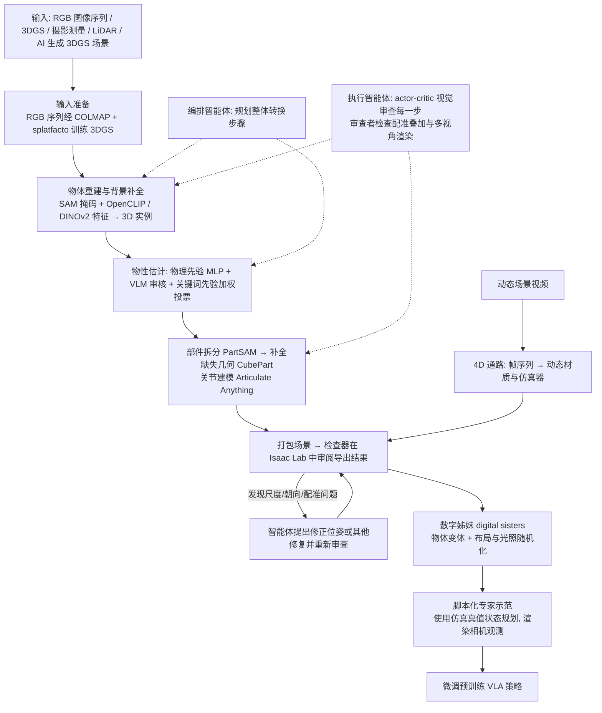

# SceneAgent（arXiv:2610.34745）

**SceneAgent**（*SceneAgent: An Agentic Pipeline from 3D and 4D Captures to Simulation Environments*，[arXiv:2610.34745](https://arxiv.org/abs/2610.34745)，[项目页](https://computationalrobotics.seas.harvard.edu/SceneAgent/)）来自 [具身智能小站 2026-10-28 盘点](../../sources/blogs/wechat_embodied_station_59_papers_human_video_to_robot_experience_2026-10-28.md)，属「数据采集与示范迁移」组。

## 一句话定义

**组织重建、物性估计、部件拆分与关节建模，并在仿真中检查和修复中间错误。**

## 英文缩写速查

| 缩写 | 英文全称 | 简要说明 |
|------|----------|----------|
| SceneAgent | SceneAgent: An Agentic Pipeline from 3D and 4D Captures to Simulation Environments | 本文方法 / 基准的简称 |
| 3D | 3D | 三维 |

## 为什么重要

- 把视觉采集修成可交互仿真。支持多类三维与动态输入；真实策略迁移仍属初步展示，应区分重建指标与控制收益。
- 开源结论：**待发布**（步骤 2.5，2026-10-28）。项目页 HTTP 200，未列 GitHub，页面含 soon 字样（脚本扫描）。
- 同期同组工作见 [潜在动作、免渲染事件仿真与机器人评测：具身智能小站 10-28 期 59 篇阅读坐标](../overview/embodied-station-2026-10-28-59-papers-technology-map.md)。

## 流程总览

图依据：论文 §3 / Fig.2、§3.1（智能体编排与验证）、§3.2–3.4、§3.6、§3.8、§3.10。

## 核心机制

| 项 | 内容 |
|----|------|
| **arXiv** | [2610.34745](https://arxiv.org/abs/2610.34745) |
| **开源** | **待发布** |
| **要点** | 组织重建、物性估计、部件拆分与关节建模，并在仿真中检查和修复中间错误。 |
| **文内指标** | 公众号转述：支持多类三维与动态输入；真实策略迁移仍属初步展示，应区分重建指标与控制收益。 |

## 源码运行时序图

**不适用（待发布）** — 项目页 HTTP 200，未列 GitHub，页面含 soon 字样（脚本扫描）。 不编造运行脚本；代码公开后再补。

## 实验与评测

- 公众号转述：支持多类三维与动态输入；真实策略迁移仍属初步展示，应区分重建指标与控制收益。
- **读法：** 本页为索引级摘要，依据公众号转述的官方摘要与仓库信息整理；逐项数字与 baseline 以原文 PDF 为准。

## 与其他工作对比

- 横向索引见 [潜在动作、免渲染事件仿真与机器人评测：具身智能小站 10-28 期 59 篇阅读坐标](../overview/embodied-station-2026-10-28-59-papers-technology-map.md)；同 arXiv 不重复造页。

## 结论

**把视觉采集修成可交互仿真：支持多类三维与动态输入；真实策略迁移仍属初步展示，应区分重建指标与控制收益。**

1. 开源边界：**待发布** — 项目页 HTTP 200，未列 GitHub，页面含 soon 字样（脚本扫描）。
2. 核心机制：组织重建、物性估计、部件拆分与关节建模，并在仿真中检查和修复中间错误。
3. 复现与选型前核对任务协议、硬件与基准口径，勿直接横比公众号摘录数字。

## 关联页面

- [embodied-data-collection-four-layers-taxonomy](../concepts/embodied-data-collection-four-layers-taxonomy.md)
- [teleoperation](../tasks/teleoperation.md)
- [imitation-learning](../methods/imitation-learning.md)
- [embodied-station-2026-10-28-59-papers-technology-map](../overview/embodied-station-2026-10-28-59-papers-technology-map.md)

## 参考来源

- [sceneagent_arxiv_2610_34745.md](../../sources/papers/sceneagent_arxiv_2610_34745.md)
- [wechat_embodied_station_59_papers_human_video_to_robot_experience_2026-10-28.md](../../sources/blogs/wechat_embodied_station_59_papers_human_video_to_robot_experience_2026-10-28.md)
- [arXiv:2610.34745](https://arxiv.org/abs/2610.34745)
- [arXiv PDF](https://arxiv.org/pdf/2610.34745)：已通读方法部分（实验与附录以略读为准）：§3 概述、§3.1 智能体编排与验证、§3.2 输入准备、§3.3 物体重建（开头）、§3.4 物性/部件/关节、§3.6 从 3D 到 4D（开头）、§3.8 数字姊妹、§3.10 示范生成（开头）、Fig.2；§4 起实验略读

## 推荐继续阅读

- [arXiv PDF](https://arxiv.org/pdf/2610.34745)
- [项目页](https://computationalrobotics.seas.harvard.edu/SceneAgent/)
