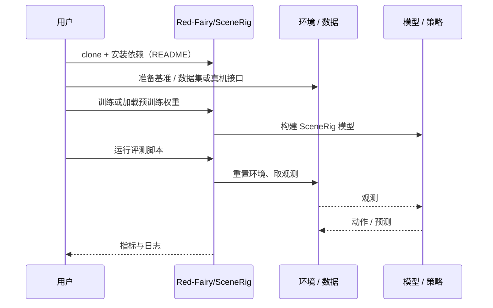

# SceneRig（arXiv:2610.28585）

**SceneRig**（*SceneRig: An Agentic System for Simulation-Ready 3D Scene Reconstruction from Single Images*，[arXiv:2610.28585](https://arxiv.org/abs/2610.28585)，[项目页](https://red-fairy.github.io/SceneRig/)，[代码](https://github.com/Red-Fairy/SceneRig)）来自 [具身智能小站 2026-10-31 盘点](../../sources/blogs/wechat_embodied_station_50_papers_scenerig_photo_to_sim_2026-10-31.md)，属「世界模型与仿真重建」组。

## 一句话定义

**真实场景搬进仿真后，物体看起来相似，却可能一碰就倒、抓取位置错位。**

## 英文缩写速查

| 缩写 | 英文全称 | 简要说明 |
|------|----------|----------|
| SceneRig | SceneRig: An Agentic System for Simulation-Ready 3D Scene Reconstruction from Single Images | 本文方法 / 基准的简称 |
| 3D | 3D | 三维 |

## 为什么重要

- 让照片重建经得起机器人操作。SceneRig把几何对齐与物理验证纳入重建循环，并进一步检查能否预测真实策略表现、复现操作轨迹，适合关心仿真评测与数据生产的团队深读。
- 开源结论：**已开源**（步骤 2.5，2026-10-31）。仓库可达（git ls-remote）。项目页 HTTP 200。
- 同期同组工作见 [单图重建仿真、VLA 适配评测与跨形态世界模型：具身智能小站 10-31 期 50 篇阅读坐标](../overview/embodied-station-2026-10-31-50-papers-technology-map.md)。

## 核心机制

| 项 | 内容 |
|----|------|
| **arXiv** | [2610.28585](https://arxiv.org/abs/2610.28585) |
| **开源** | **已开源** |
| **要点** | 真实场景搬进仿真后，物体看起来相似，却可能一碰就倒、抓取位置错位。 |
| **文内指标** | 公众号转述：五项任务、两种策略共 100 次真实回合的对应仿真中，成败一致率 SceneRig 为 69%、SimFoundry 为 54%（非机器人任务成功率）；25 条成功真机示范直接回放，SceneRig 完成 20/25、SimFoundry 为 9/25（重建均使用标定深度和相机参数）；当前主要面向桌面刚体场景，尚不恢复物体关节与形变。 |

## 源码运行时序图

以下为按仓库入口（`Red-Fairy/SceneRig`）推断的通用运行链路；入库日仅核实仓库可达，未逐文件阅读，具体脚本名以 README 为准。

## 实验与评测

- 公众号转述：五项任务、两种策略共 100 次真实回合的对应仿真中，成败一致率 SceneRig 为 69%、SimFoundry 为 54%（非机器人任务成功率）；25 条成功真机示范直接回放，SceneRig 完成 20/25、SimFoundry 为 9/25（重建均使用标定深度和相机参数）；当前主要面向桌面刚体场景，尚不恢复物体关节与形变。
- **读法：** 本页为索引级摘要，依据公众号转述的官方摘要与仓库信息整理；逐项数字与 baseline 以原文 PDF 为准。

## 与其他工作对比

- 横向索引见 [单图重建仿真、VLA 适配评测与跨形态世界模型：具身智能小站 10-31 期 50 篇阅读坐标](../overview/embodied-station-2026-10-31-50-papers-technology-map.md)；同 arXiv 不重复造页。

## 结论

**让照片重建经得起机器人操作：当前主要面向桌面刚体场景，尚不恢复物体关节与形变。**

1. 开源边界：**已开源** — 仓库可达（git ls-remote）。项目页 HTTP 200。
2. 核心机制：真实场景搬进仿真后，物体看起来相似，却可能一碰就倒、抓取位置错位。
3. 复现与选型前核对任务协议、硬件与基准口径，勿直接横比公众号摘录数字。

## 关联页面

- [world-action-models](../concepts/world-action-models.md)
- [generative-world-models](../methods/generative-world-models.md)
- [simulation-evaluation-infrastructure](../concepts/simulation-evaluation-infrastructure.md)
- [sim2real](../concepts/sim2real.md)
- [embodied-station-2026-10-31-50-papers-technology-map](../overview/embodied-station-2026-10-31-50-papers-technology-map.md)

## 参考来源

- [scenerig_arxiv_2610_28585.md](../../sources/papers/scenerig_arxiv_2610_28585.md)
- [wechat_embodied_station_50_papers_scenerig_photo_to_sim_2026-10-31.md](../../sources/blogs/wechat_embodied_station_50_papers_scenerig_photo_to_sim_2026-10-31.md)
- [arXiv:2610.28585](https://arxiv.org/abs/2610.28585)

## 推荐继续阅读

- [arXiv PDF](https://arxiv.org/pdf/2610.28585)
- [项目页](https://red-fairy.github.io/SceneRig/)
- [https://github.com/Red-Fairy/SceneRig](https://github.com/Red-Fairy/SceneRig)
