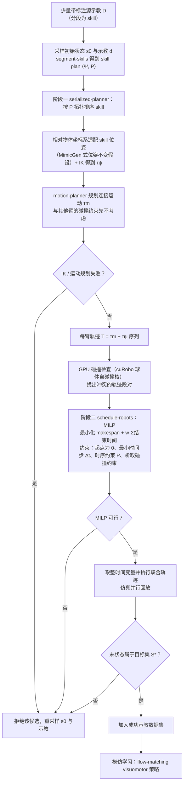

# ScheduleGen（arXiv:2610.39429）

**ScheduleGen**（*ScheduleGen: Demonstration Generation via Skill Scheduling for Multi-Arm Imitation Learning*，[arXiv:2610.39429](https://arxiv.org/abs/2610.39429)，[项目页](https://schedulegen.github.io/)）来自 [具身智能小站 2026-10-30 盘点](../../sources/blogs/wechat_embodied_station_28_papers_event2reward_progress_rewards_2026-10-30.md)，属「示范数据与评测」组。

## 一句话定义

**ScheduleGen 联合技能迁移、连接运动规划和多臂调度，减少忽略协同约束带来的无效示范。**

## 英文缩写速查

| 缩写 | 英文全称 | 简要说明 |
|------|----------|----------|
| ScheduleGen | ScheduleGen: Demonstration Generation via Skill Scheduling for Multi-Arm Imitation Learning | 本文方法 / 基准的简称 |

## 为什么重要

- 生成多臂示范时，把碰撞与时序一起安排。研究覆盖仿真与真机迁移，数据生成成功率与策略成功率需要分开看。
- 开源结论：**项目页未列 GitHub**（步骤 2.5，2026-10-30）。项目页 HTTP 200，未列 GitHub，也无 coming soon 字样（脚本扫描）。
- 同期同组工作见 [进度奖励、接触监督与规划验证：具身智能小站 10-30 期 28 篇阅读坐标](../overview/embodied-station-2026-10-30-28-papers-technology-map.md)。

## 流程总览

图依据：论文 §3（问题描述）、§4 与 Algorithm 1/2、Fig. 2；末端“模仿学习”一步取自 §5.1。

## 核心机制

| 项 | 内容 |
|----|------|
| **arXiv** | [2610.39429](https://arxiv.org/abs/2610.39429) |
| **开源** | **项目页未列 GitHub** |
| **要点** | ScheduleGen 联合技能迁移、连接运动规划和多臂调度，减少忽略协同约束带来的无效示范。 |
| **文内指标** | 公众号转述：研究覆盖仿真与真机迁移，数据生成成功率与策略成功率需要分开看。 |

## 源码运行时序图

**不适用（项目页未列 GitHub）** — 项目页 HTTP 200，未列 GitHub，也无 coming soon 字样（脚本扫描）。 不编造运行脚本；代码公开后再补。

## 实验与评测

- 公众号转述：研究覆盖仿真与真机迁移，数据生成成功率与策略成功率需要分开看。
- **读法：** 本页为索引级摘要，依据公众号转述的官方摘要与仓库信息整理；逐项数字与 baseline 以原文 PDF 为准。

## 与其他工作对比

- 横向索引见 [进度奖励、接触监督与规划验证：具身智能小站 10-30 期 28 篇阅读坐标](../overview/embodied-station-2026-10-30-28-papers-technology-map.md)；同 arXiv 不重复造页。

## 结论

**生成多臂示范时，把碰撞与时序一起安排：研究覆盖仿真与真机迁移，数据生成成功率与策略成功率需要分开看。**

1. 开源边界：**项目页未列 GitHub** — 项目页 HTTP 200，未列 GitHub，也无 coming soon 字样（脚本扫描）。
2. 核心机制：ScheduleGen 联合技能迁移、连接运动规划和多臂调度，减少忽略协同约束带来的无效示范。
3. 复现与选型前核对任务协议、硬件与基准口径，勿直接横比公众号摘录数字。

## 关联页面

- [embodied-data-collection-four-layers-taxonomy](../concepts/embodied-data-collection-four-layers-taxonomy.md)
- [imitation-learning](../methods/imitation-learning.md)
- [simulation-evaluation-infrastructure](../concepts/simulation-evaluation-infrastructure.md)
- [bimanual-manipulation](../tasks/bimanual-manipulation.md)
- [embodied-station-2026-10-30-28-papers-technology-map](../overview/embodied-station-2026-10-30-28-papers-technology-map.md)
- [Query：具身大模型评测基准选型](../queries/embodied-eval-benchmark-selection-loop.md)

## 参考来源

- [schedulegen_arxiv_2610_39429.md](../../sources/papers/schedulegen_arxiv_2610_39429.md)
- [wechat_embodied_station_28_papers_event2reward_progress_rewards_2026-10-30.md](../../sources/blogs/wechat_embodied_station_28_papers_event2reward_progress_rewards_2026-10-30.md)
- [arXiv:2610.39429](https://arxiv.org/abs/2610.39429)
- [arXiv PDF](https://arxiv.org/pdf/2610.39429)：已通读方法部分（实验与附录以略读为准）：§1–§4（含 Algorithm 1/2、MILP 公式）、§5.1 实验设定

## 推荐继续阅读

- [arXiv PDF](https://arxiv.org/pdf/2610.39429)
- [项目页](https://schedulegen.github.io/)
