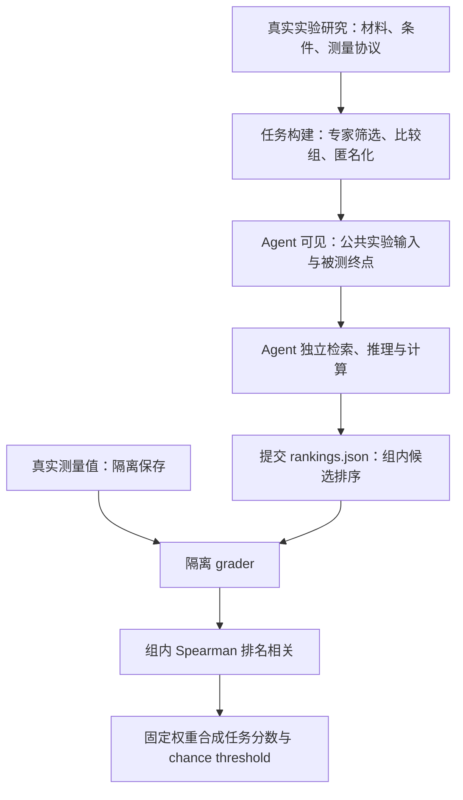
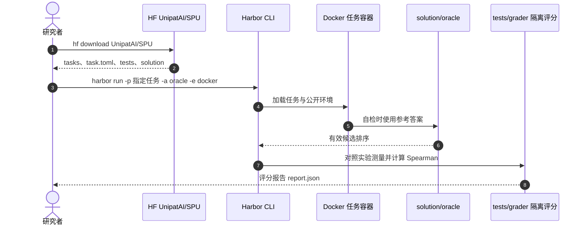

# Science Prediction Universe（SPU）：科学预测宇宙 / 隐藏湿实验结果预测

**一句话定义：** SPU 是一个面向 AI 科研智能体的真实实验结果预测基准：给出实验方案、候选条件与测量终点，隐藏真实测量值，让智能体预测候选的**相对排序**，再由隔离评分器验收。

## 英文缩写速查

| 缩写 | 英文全称 | 简要说明 |
|------|----------|----------|
| SPU | Science Prediction Universe | 对隐藏真实湿实验结果进行排序预测的 benchmark |
| AI | Artificial Intelligence | 本研究中执行独立检索、计算与实验推断的 agent |
| LLM | Large Language Model | 13 组被测 agent 配置的基础模型 |
| H20 | NVIDIA H20 | 原始评测运行容器可用 GPU |
| VHH | Variable domain of Heavy-chain-only antibodies | 私有任务中纳米抗体变体的一类 |
| NMR | Nuclear Magnetic Resonance | 实验终点之一：核磁共振测定的反应产率 |

## 为什么重要

- **从会答题到会预测：** 很多科学 agent 基准验证现有答案或代码交付，SPU 把正确性锚定到真实湿实验的测量结果，而非模型评委或代理自述。
- **区分工具使用和科学判断：** 长时间搜索、写脚本或跑量子化学计算仍可能选错支配真实终点的量。论文显示更多运行时长不自动转化为更高准确率。
- **对机器人研究的可借鉴处：** 提醒我们将「会运行仿真/工具」与「能预测实际物理后果」分开评测；**SPU 并未测试机器人或具身策略**，只能作为评测设计方法论参照。对 Agent 评测的一般框架见 [AI Agent 评测](../concepts/ai-agent-evaluation.md)。

## 核心信息

| 项 | 论文与官方发布口径 |
|----|--------------------|
| 机构 | UniPat AI（牵头），联合多所高校顾问与湿实验合作者；论文附录 A 列完整机构 |
| 论文 | [Tu et al., arXiv:2611.15049v1](https://arxiv.org/abs/2611.15049)，2026-11-11 |
| 任务 | 100 项公开（85 篇 Nature Portfolio 论文）+ 16 项未发表湿实验，四学科 |
| 输出 | 各比较组从低到高的候选名次，不要求预测绝对值 |
| 指标 | 真实名次与预测名次的 Spearman 相关；组间按固定权重求和 |
| 原始执行资源 | 8 CPU 核、16 GiB、NVIDIA H20、单任务最长 8 小时 |
| 公开资源 | [GitHub 任务贡献仓](https://github.com/UniPat-AI/SPU)、[Harbor 数据与 grader](https://huggingface.co/datasets/UnipatAI/SPU) |
| 开放边界 | 公开 100 项任务含参考结果；16 项私有任务不发布，论文原始审计网络工具亦未公开 |

## 核心原理

### 任务构建与定义

**输入：** 实验共同协议、材料与可选条件、结构或生物序列、被测指标、比较组。候选经过匿名化，来源研究标题与真实值不得向 agent 透露。

**输出：** `rankings.json`：每个比较组的完整且不重复的候选排序。不是传统回归绝对数值，也不是让 agent 自己执行真实实验。

公开数据先由跨学科专家筛选量化测量充分的原始论文，去掉严格单调或在噪声范围内难分辨的比较组，独立复审后挑选覆盖 29 个子领域的 100 个任务。

### 流程总览



### 评分数学与统计读法

对比较组 `g`，测量名次为 `r_i`（并列采用平均名次），预测名次为 `r_hat_i`，计算

\[
\rho_g = \mathrm{corr}(r_i, \hat r_i),\qquad S_t = \sum_g w_g \rho_g, \quad \sum_g w_g=1 .
\]

- 完全吻合约为 +1；随机合法排序期望为 0；整文件错误记 -1、单组无效则该组记 -1。
- 33 项公开任务包含并列测量值，其任务理论可达最大值可能小于 1。
- 每任务抽样 4,000 个随机排序，用得分的第 95 百分位数确定 chance threshold；多组加权不要漏算。
- 公共实验结论可能被检索出来，因此论文运行使用隔离评分器、匿名化、审计检索和禁直接接触来源结果的策略，并设计 16 项私有实验减轻泄漏风险。

## 源码运行时序图

实际公开可执行入口来自 [HF SPU 数据卡](https://huggingface.co/datasets/UnipatAI/SPU)（Harbor 0.25.0、Docker）；[GitHub 仓](https://github.com/UniPat-AI/SPU)主要供新任务投稿及审阅。下图**仅复现官方 oracle 自检**，不冒充论文全部 13 种 agent harness：



**复现命令：**

```bash
hf download UnipatAI/SPU --repo-type dataset --local-dir SPU
cd SPU
harbor run -p tasks/fluorene-dehydration-concentrations -a oracle -e docker \
  --override-gpus 0 --override-cpus 1 --override-memory-mb 1024 -o ../jobs
```

这条命令是**评分管线 oracle smoke test**，不运行任一论文参评模型。真实 agent 跑题时必须隔离 `tests/`、`solution/`、`SOURCES.json`，只能看到 `instruction.md` 和 `environment/public/`；公开发布不含论文原始审计搜索/检索工具，不能声称直接复现原表格。

## 工程实践

| 操作 | 读法与验收 |
|------|------------|
| 查看公开任务 | `task_cards.parquet` 索引，`tasks/<task_id>/` 包含任务、容器、测量与 grader |
| 自检 grader | 先运行官方 `-a oracle`，确认任务环境、提交格式、`report.json` 可用；本页未在本地执行 |
| 测 agent | 固定模型版本、harness、推理强度及预算；公开参考答案可能泄漏，应单列评测协议 |
| 报告指标 | 同时报公开任务已评分数量、平均分、随机阈值以上的比例和拒绝/无效提交数量 |
| 用于机器人研发 | 仅可迁移「真实 outcome / 隔离 scorer / 轨迹审计」三原则，不能将 SPU 分数等同于 Sim2Real 或真机成功率 |

## 实验与评测

### 数据与模型

- 全集 116 任务：化学 42 / 材料 31 / 生物 31 / 医学 12；其中公开 100 项为 39 / 29 / 20 / 12，另有 16 项未公开。
- 共有 4,207 个实验、517 个 comparison groups；公开部分对应 3,947 个实验和 489 组。
- 12 个模型、13 种模型×推理强度×harness 配置；1,155 条可评分的公开 agent 运行轨迹用于过程分析。

### 关键结果（公开任务、task-adjusted mean）

| 配置 | 有效评分任务 | 相关均值 |
|------|-------------:|---------:|
| Claude Opus 5.5 | 44/100 | 0.478 |
| GPT-6 Astra Medium | 100/100 | 0.431 |
| Claude Opus 5 | 99/100 | 0.424 |
| GPT-6 Astra Max | 100/100 | 0.409 |
| Claude Sonnet 5.5 | 97/100 | 0.393 |

**注意：** Opus 5.5 与另一部分配置有大量安全拒绝；0.478 **不是全 100 题原始均值**。最佳配置之间的细微名次不宜由单次运行直接推断显著性。论文按共同可评分任务进行配对检验，并按任务调整均值。

### 轨迹发现与消融

- Astra Max 比 Medium 中位运行时间约高 **4.8 倍**，但未观察到有统计说服力的平均分收益。
- agent 间排序相关约 **0.52**，与真实测量的相关仅约 **0.33**；很多系统共享简化的单调先验。
- 典型错误是为计算方便选了无关的物化代理指标；「多算」并不代替对实验终点机制的辨别。
- 16 项私有任务上，12/13 配置依作者检验显著高于随机，但其统计样本量小；不能外推为通用自主科学发现。

## 结论

**SPU 表明，能自主调用工具并长时间计算，与能准确预判真实科学测量，是两种需要分别验证的能力。**

1. **评估真实后果而非自述：** 用实验测量排序与隔离 grader 验收，减少文字说服力带来的虚高。
2. **看有效覆盖率：** 0.478 的配置只在 44 项公开任务得到有效分；需与 100/100 的 0.431 区分。
3. **别用推理耗时替代科学理解：** 4.8 倍运行时间的对照并未带来可确认收益。
4. **先找控制指标的机制：** 相关代理计算很多，却可能没有解释真实的产率、性能或亲和力。
5. **复现先守隐藏答案边界：** 已发布的 100 项任务含 oracle 与实验值，公开重跑必须披露污染与审计工具缺失风险。

## 与其他工作对比

| 对照 | 主要区别 |
|------|----------|
| [AI Agent 评测](../concepts/ai-agent-evaluation.md) | 通用 outcome-first 评分框架；SPU 具体用湿实验结果进行 rank-based 评分 |
| ScienceAgentBench / Terminal-Bench-Science | 主要评程序、科学工作流 artifact 或确定性单测；SPU 评未知湿实验测量 |
| BrainBench / SciPredict / AssayBench | 同属科学结果预测，但通常缺少可长时间用工具的 agent 运行与审计 |
| [AI Auto-Research](../concepts/ai-auto-research.md) | 研究流程自动化广义方法；SPU 专门约束「实验前预测」的科学判断 |
| [Claude-shaped science](./claude-shaped-science.md) | 科学问题是否有价值、可验证；SPU 用现实测量暴露方法与评价目标的错位 |

## 局限与风险

- **公开泄漏：** 公开实验源自已发表文献，现已释放参考答案；发布后的新模型评测不能再宣称绝对隐藏。
- **16 项私有样本有限：** 私有任务局限于四组实验，学科扩展与采样不确定性仍然明显。
- **harness 与模型耦合：** 分数是模型、预算与执行系统的联合结果，非纯模型参数能力。
- **拒绝与失效污染比较：** 安全拒绝和 JSON 格式失败都要与科学排序误差区分；均值与有效覆盖率缺一不可。
- **公开复现不等于论文完整复现：** 官方分发 Harbor 任务和参考解，**未**分发所有审计基础设施。
- **机器人外推：** 未进行任何 VLA、WAM、机器人运动或 Sim2Real 实验；相关价值是评测设计启发，不是机器人性能证明。

## 关联页面

- [AI Agent 评测](../concepts/ai-agent-evaluation.md) — outcome、isolated grader、覆盖率与 agent/harness 口径
- [AI Auto-Research](../concepts/ai-auto-research.md) — 科研自动化从执行到判断的链路
- [Claude-shaped science](./claude-shaped-science.md) — 专家对科学终点的判断不可替代
- [ScienceDiscovery](./sciencediscovery.md) — 科学工具执行平台，与 SPU 的实测预测能力是两条轴

## 参考来源

- [论文全文核读归档](../../sources/papers/science_prediction_universe_arxiv_2611_15049.md)
- [SPU 官网入口归档](../../sources/sites/science-prediction-universe.md)
- [官方 GitHub 及运行入口归档](../../sources/repos/unipat-ai-spu.md)
- [论文 arXiv:2611.15049v1](https://arxiv.org/html/2611.15049v1)
- [官方数据卡（开放范围与复现限制）](https://huggingface.co/datasets/UnipatAI/SPU)

## 推荐继续阅读

- [Science Prediction Universe 项目](https://spu.unipat.ai/)
- [公开任务、评分器、oracle（HF）](https://huggingface.co/datasets/UnipatAI/SPU)
- [社区任务贡献与质量审核（GitHub）](https://github.com/UniPat-AI/SPU)
