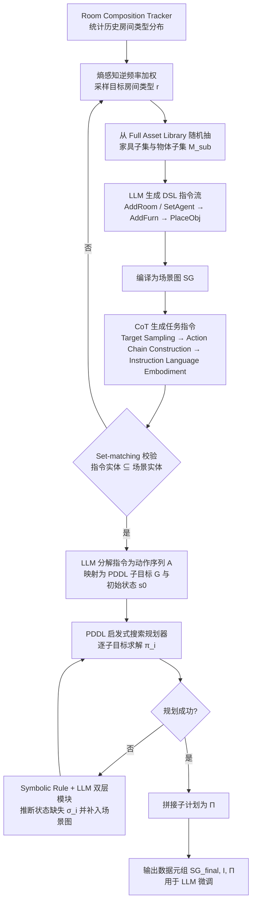

# SCOPE（arXiv:2610.31518）

**SCOPE**（*SCOPE: Scene-graph Construction Optimized by Plan Error-correction for Robot Long-term Planning Datasets*，[arXiv:2610.31518](https://arxiv.org/abs/2610.31518)，[项目页](https://scope-page.github.io/)）来自 [具身智能小站 2026-10-29 盘点](../../sources/blogs/wechat_embodied_station_58_papers_diverse_demonstrations_2026-10-29.md)，属「VLA、智能体与策略后训练」组。

## 一句话定义

**SCOPE结合场景多样性度量与规划反馈纠错，清理自动生成数据中的逻辑矛盾；仿真实验显示下游规划收益，重点是可执行性而非只追求文本丰富度。**

## 英文缩写速查

| 缩写 | 英文全称 | 简要说明 |
|------|----------|----------|
| SCOPE | SCOPE: Scene-graph Construction Optimized by Plan Error-correction for Robot Long-term Planning Datasets | 本文方法 / 基准的简称 |

## 为什么重要

- 让规划失败反过来修正场景图数据。
- 开源结论：**待发布**（步骤 2.5，2026-10-29）。项目页 HTTP 200，CODE 标注 Coming Soon（脚本扫描）。
- 同期同组工作见 [多样成功示范、触觉工具链与预见式感知：具身智能小站 10-29 期 58 篇阅读坐标](../overview/embodied-station-2026-10-29-58-papers-technology-map.md)。

## 流程总览

图依据：论文 §III（A–D）/ Fig.2 / Algorithm 1

## 核心机制

| 项 | 内容 |
|----|------|
| **arXiv** | [2610.31518](https://arxiv.org/abs/2610.31518) |
| **开源** | **待发布** |
| **要点** | SCOPE结合场景多样性度量与规划反馈纠错，清理自动生成数据中的逻辑矛盾；仿真实验显示下游规划收益，重点是可执行性而非只追求文本丰富度。 |
| **文内指标** | 公众号未给具体数字，本页不引用。 |

## 源码运行时序图

**不适用（待发布）** — 项目页 HTTP 200，CODE 标注 Coming Soon（脚本扫描）。 不编造运行脚本；代码公开后再补。

## 实验与评测

- 公众号未给具体数字，本页不引用。
- **读法：** 本页为索引级摘要，依据公众号转述的官方摘要与仓库信息整理；逐项数字与 baseline 以原文 PDF 为准。

## 与其他工作对比

- 横向索引见 [多样成功示范、触觉工具链与预见式感知：具身智能小站 10-29 期 58 篇阅读坐标](../overview/embodied-station-2026-10-29-58-papers-technology-map.md)；同 arXiv 不重复造页。

## 结论

**让规划失败反过来修正场景图数据：SCOPE结合场景多样性度量与规划反馈纠错，清理自动生成数据中的逻辑矛盾；仿真实验显示下游规划收益，重点是可执行性而非只追求文本丰富度。**

1. 开源边界：**待发布** — 项目页 HTTP 200，CODE 标注 Coming Soon（脚本扫描）。
2. 核心机制：SCOPE结合场景多样性度量与规划反馈纠错，清理自动生成数据中的逻辑矛盾；仿真实验显示下游规划收益，重点是可执行性而非只追求文本丰富度。
3. 复现与选型前核对任务协议、硬件与基准口径，勿直接横比公众号摘录数字。

## 关联页面

- [vla](../methods/vla.md)
- [imitation-learning](../methods/imitation-learning.md)
- [reinforcement-learning](../methods/reinforcement-learning.md)
- [llm-robotics-control-interfaces](../concepts/llm-robotics-control-interfaces.md)
- [embodied-station-2026-10-29-58-papers-technology-map](../overview/embodied-station-2026-10-29-58-papers-technology-map.md)

## 参考来源

- [scope_arxiv_2610_31518.md](../../sources/papers/scope_arxiv_2610_31518.md)
- [wechat_embodied_station_58_papers_diverse_demonstrations_2026-10-29.md](../../sources/blogs/wechat_embodied_station_58_papers_diverse_demonstrations_2026-10-29.md)
- [arXiv:2610.31518](https://arxiv.org/abs/2610.31518)
- [arXiv PDF](https://arxiv.org/pdf/2610.31518)：已通读方法部分（实验与附录以略读为准）：摘要、§I 引言、§III 方法（A–D，含 Algorithm 1）、§IV-A 实验设定

## 推荐继续阅读

- [arXiv PDF](https://arxiv.org/pdf/2610.31518)
- [项目页](https://scope-page.github.io/)
