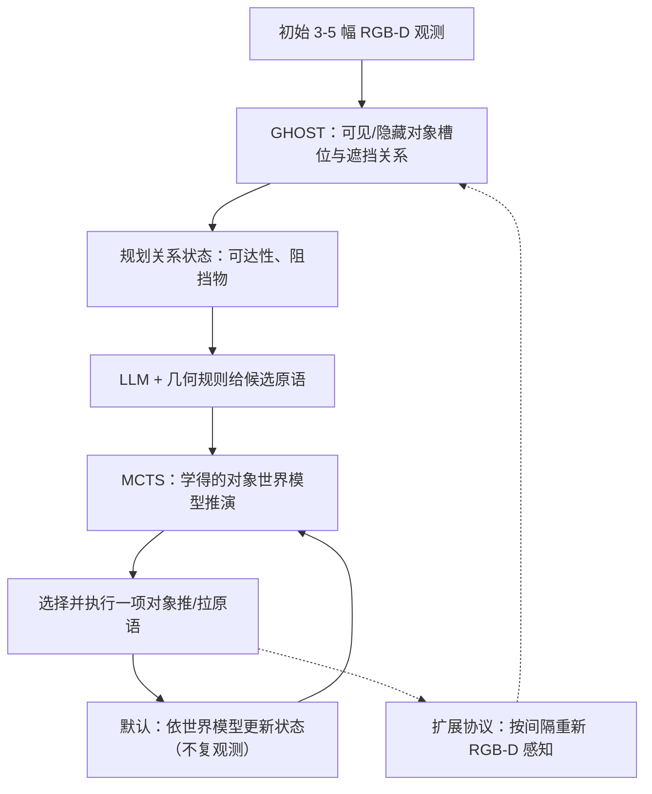

# SCOUT：遮挡场景的对象中心世界模型规划

**英文题名：** Scout: Planning under Occlusion via Object-Centric World Model Rollouts。官方原文：[arXiv:2611.01600v1](https://arxiv.org/abs/2611.01600v1)。已核对 v1 正文与必要附录，**未独立复现训练/真机**。

## 一句话定义
Scout 从少量 RGB-D 视角用 GHOST 重建可见/被遮挡对象及关系图，LLM 给出操作候选，再由学得的对象级世界模型与 MCTS 评估“先移开哪个阻挡物”。

## 英文缩写速查
| 缩写 | 英文全称 | 简要说明 |
|---|---|---|
| VLA | Vision-Language-Action | 视觉语言动作策略 |
| MCTS | Monte Carlo Tree Search | 蒙特卡洛树搜索 |
| RGB-D | Red-Green-Blue-Depth | 彩色与深度图 |
| GHOST | 论文使用的隐状态重建模块名称 | 对象级遮挡场景估计 |

## 为什么重要
货架操作常需先移除阻挡物或改变视角，不能仅选择当前可见的抓取动作。 论文的价值在于将这一失败模式单独建模，而非依靠笼统的端到端指标解释。

## 核心机制
1. **初始感知**：稀疏 RGB-D 视角重建对象槽位、隐藏对象、接触/遮挡关系和可达性；GHOST 把几何位姿和关系编码为可规划状态。
2. **动作建议**：Qwen2.5-7B-Instruct 基于对象关系提出阻挡对象/方向；几何启发式补充候选，最终行动的物理可行性由后续搜索检查，LLM 不直接控制机械臂。
3. **世界模型**：对象 token 自注意力模型估计动作后的位移、是否移动及有效性；先从仿真 oracle 状态训练，后对 GHOST 重建状态微调（附录 A.5）。
4. **MCTS**：基于 PUCT 选取四类离散对象推/拉动作 `shift_left/right/back` 与 `pull_forward`，每决策 32 次搜索，深度 2，最大 12 原语；回报关注可见性、可达性、遮挡数和有效性。
5. **感知协议区别**：默认论文核心对照是**首次 3–5 个视角后执行期间不重新观测**，根据学得世界模型更新状态；附录 A.7 另设**执行后主动复观测并重规划**的闭环版本。

## 流程总览
以下为论文原文中的数据/控制流程，不表示本站运行了代码。

## 工程实践
- **仿真与真实接口**：四个有限离散对象原语，动作最大 8 cm；不具备旋转操作、任意抓取或连续接触调度的普适实现。
- **计算**：附录 A.6 指单张 L40S 上 LLM 候选中位延时 0.42s、MCTS 每步平均 0.68s、世界模型单步前向平均 4.8ms，不能把 4.8ms 单独当作端到端实时控制周期。
- **开源状态**：截至本次原文核验未取得可确认的官方可运行仓库入口；论文具体世界模型和原语控制流程不等于已开源源码。

## 源码运行时序图
**不适用**：论文列明算法、数据与超参，但未核验到已发布可运行官方源码入口，不能用猜测脚本模拟执行序列。

## 实验与评测
- **ManiSkill2 货架任务**：默认 8–16 个物体、Reveal/Reveal_Multi/Place/Place_Multi 四组；初始视角协议下平均成功率 **80.8±3.5%**，强基线 ParticleFormer 72.8%；每条件 500 rollout，三随机种子误差条。
- **闭环复观测（附录 A.7）**：每项原语后复观测 86.3±3.0%，相同条件不复观测 80.8±3.5%；隐场景失败率可下降，但事件耗时也增长（10.4s→24.2s）。
- **Spot Arm 实物（附录 A.8）**：Boston Dynamics Spot + Spot Arm，RGB/ToF 深度相机，每任务 Reveal/Place 各 10 次，共 20 次，成功 **12/20=60%**，其中 Reveal 7/10、Place 5/10；8 次失败中执行 3、感知重建 3、预测不匹配 2。
- **感知局限证据**：多视角 GHOST 隐藏物体召回 72.6%，遮挡关系 F1 0.81；替换为真实 oracle 几何可把仿真成功率 80.8→87.8，表明建图误差是主要瓶颈之一。

**证据边界：** 指标均来自指定版本论文/官方材料，并非本站独立复现；具体基线、统计区间与硬件已按表号区分。

## 局限与风险
货架静态环境、固定四种对象级推拉原语与 12 步预算限制适用范围；世界模型与重建误差可累积，实际接触滑移/转动、Spot 的跟踪偏差使仿真结论不能直接外推其他末端执行器。**默认只初始感知**，部署复观测是附加实验，不能错误描绘为默认全程视觉闭环。

## 与其他工作对比
- 在[九篇研究趋势地图](../overview/embodied-trends-2026-11-h1.md)中按“技术介入层”定位，不能比较跨论文不同任务、机器人和数据集的绝对指标。
- 相关基础：[VLA](../methods/vla.md)、[机器人操作](../tasks/manipulation.md)。

## 结论
**Scout 的主要价值是用被遮挡对象假设和可验证推演，替代视觉可见目标上的一步贪心操作。**
- GHOST 提供对象和遮挡关系状态，LLM 只提出候选，最终行动由世界模型/MCTS 验证选定。
- 仿真默认不重建；在额外复观测协议下性能提高，但推理/感知开销也增长。
- 真实 Spot Arm 仅 20 次测试、60% 任务成功，且 8 次失败有明确原因，不能夸大成熟度。
- 本论文有限动作库未覆盖广义的灵巧操作与连续接触规划。

## 关联页面
- [VLA](../methods/vla.md)
- [机器人操作](../tasks/manipulation.md)
- [2026.11 上半月九篇论文技术图](../overview/embodied-trends-2026-11-h1.md)
- [VLA 纵深路线](../../roadmap/depth-vla.md)

## 参考来源
- [论文来源核对](../../sources/papers/scout-2611-01600.md)
- [策展资料](../../sources/blogs/duomo_embodied_2026_11_first_half.md)
- [arXiv 指定版本](https://arxiv.org/abs/2611.01600v1)

## 推荐继续阅读
- [指定版本 arXiv HTML](https://arxiv.org/html/2611.01600v1)
- [VLA 纵深路线](../../roadmap/depth-vla.md)
