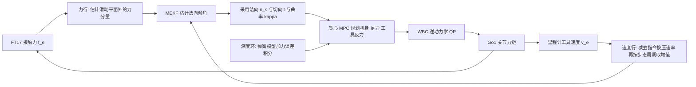

# SCRUB：无机械臂四足的接触式表面坐标系估计（arXiv:2611.06649）

**SCRUB**（*Surface Contact Regulation Using the Body*；论文题 *SCRUB: Contact-Based Surface-Frame Estimation for Force-Motion Control with an Armless Quadruped*，[arXiv:2611.06649](https://arxiv.org/abs/2611.06649) v1，2026-11-04）作者 Sourav Selvaraj、Juan Pablo Espinosa Chessal、Mahdi Agheli，机构为伍斯特理工学院（Worcester Polytechnic Institute）机器人工程系；论文脚注称已投 IEEE，待发表。论文没有公开代码或项目页。

## 一句话定义

**不靠地图或视觉，只用接触力和工具运动，在线估计「当前该往哪个方向压、往哪个方向滑」的表面坐标系，让没有机械臂的四足用躯干固定的工具在近竖直表面上做力—运动控制。**

## 英文缩写速查

| 缩写 | 英文全称 | 简要说明 |
|------|----------|----------|
| SCRUB | Surface Contact Regulation Using the Body | 本文方法名（引言） |
| MEKF | Multiplicative Extended Kalman Filter | 乘性扩展卡尔曼滤波，状态是估计法向到真法向的小倾角（III） |
| MPC | Model Predictive Control | 模型预测控制，这里是质心 MPC（IV-A） |
| WBC | Whole-Body Control | 全身控制，逆动力学 QP 把规划转成关节力矩（IV-C） |
| EKF | Extended Kalman Filter | 里程计用接触辅助不变 EKF（II） |
| FT17 | IIT FT-17 six-axis force/torque sensor | 工具与躯干之间的串联力 / 力矩传感器 |
| OSB | Oriented Strand Board | 定向刨花板，平墙材料（V-A） |
| RMSE | Root-Mean-Square Error | 均方根误差，文中法向角误差与力误差的指标 |
| $\hat n$、$\hat t$、$\hat b$ | normal / tangent / binormal | 表面坐标系的法向、沿滑切向、跨滑副法向（Fig. 1） |

## 为什么重要

- 擦墙、打磨、检测都要「沿法向压、沿表面滑」，法向未知时只能靠先验或视觉；论文指出软硅胶保险杠还会遮住接触面片，视觉看不到，所以改从接触估计（I）。
- 已有的不需摩擦系数的法向估计器（[12][13][14]）都假定瞬时工具速度与表面相切，而行走的步态纹波和控制器进退工具会破坏这一点（摘要、I）。SCRUB 针对的正是这个缺口。
- 无臂四足省质量与成本，但躯干和支撑腿要同时负责移动工具、抵抗接触力和保持平衡，法向错了会直接改变腿要平衡的接触力旋量（I）。

## 核心机制

流程对应论文 Fig. 2：估计层（III）建立局部表面图 S，控制层（IV）用 MPC、深度参考和 WBC 把 S 变成关节力矩。

1. **接触模型（II）：** $f_e = F_n n - F_t u_{slip} + \eta_f$，库仑摩擦，摩擦力沿真实滑动方向反向（Assumption 1）；表面近竖直、曲率有界（Assumption 2）；每次试验从大致垂直的接触开始（Assumption 3）。
2. **力行（III-A）：** 摩擦只会把力在真滑动平面内倾斜，所以力在「估计滑动平面」之外的分量 $r_f=-\hat m^\top f_e$ 反映横滑倾角 $\theta_m$。Proposition 1：当速度落在真法向与滑动方向所在平面内时，$r_f=0$ 当且仅当 $\hat m^\top n=0$，与摩擦系数无关，且允许速度有法向分量。摩擦系数仍用于力行噪声方差（式 3）、初始协方差、$\hat n_f$ 和 MPC。
3. **速度行（III-B）：** 逐样本更新抹不掉步态纹波，因为纹波同时调制残差和灵敏度。做法是减去指令按压速率 $v_n^c=-\dot\delta^\star$，再对残差与灵敏度分别在 $T_w=0.5$ s（一个步态周期）窗口内取均值（式 4），把窗口均值当作沿表面，用来观测沿滑倾角 $\theta_u$。
4. **融合（III-C）：** 力行主要观测 $\theta_m$，速度行主要观测 $\theta_u$；预测步按滑动距离增大协方差来吸收曲率；里程计漂移使单方向滑动时只有沿滑倾角与漂移角之和可观测，因此在每次速度行更新后把沿滑标准差保持在漂移角以上；滤波器按 15° / 3° / 10° 的阈值做临时 / 确认 / 解除「武装」，临时武装时把 MPC 与 WBC 用的法向从 $\hat n_f$ 切到 $\hat n^+$。
5. **路径与曲率（III-D）：** 切向取指令滑动方向在法向垂直面上的投影；锚点由对近期工具尖位置的二次最小二乘拟合给出；曲率是拟合二阶导数与随机游走 EKF 的逆方差平均。
6. **MPC（IV-A）：** 在 [24][25] 的质心 MPC 上把工具反力 $\lambda=[\lambda_n\ \lambda_t\ \lambda_b]$ 加入状态（27 状态 / 27 输入），带一阶滞后 $\tau_F=0.05$ s、拖曳代价（拉向库仑拖曳 $\mu_k\lambda_n$）、切向锥 $|\lambda_t|\le\mu_k\lambda_n$ 与副法向锥 $|\lambda_b|\le\mu_b\lambda_n$（$\mu_b=0.02$），使 MPC 在推墙之前就预先布置机身与足力。
7. **深度环（IV-B）：** 力和沿法向的运动不能独立设定，所以主要通过调深度参考 $\delta^\star$ 调力：弹簧模型 $\hat\delta_0+f/\hat k$ 加力误差积分修正（式 6），$\hat k$ 由递推最小二乘在线拟合。
8. **WBC（IV-C）：** 逆动力学 QP，把规划反力作为已知外力前馈，并加工具法向加速度目标。

关键设定（Table II）：爬行步态 0.5 s 周期，MPC 100 Hz / 1.0 s 视域，控制与估计 1 kHz，$\mu_k=0.24$，速度行窗口 0.5 s，等效独立样本数 30。

## 实验与结果

所有数字来自 V 节与 Table III、IV，除注明外为每个条件 5 次试验的中位数。

| 项 | 内容 |
|----|------|
| 平台（V-A） | Unitree Go1，PETG 工具体，FT17；系留离线 PC 上求解 MPC（单次约 8.3 ms） |
| 表面 | 向后倾 10° 的 OSB 平墙；半径 0.303 m 的石膏板圆柱 |
| 名义工况 | 水平滑动 12 mm/s，任务载荷 10 N；完成判据为约 1 m 或一整圈 |
| 墙（Table III） | 完成 5/5，跌倒 0；法向 RMSE 2.29°，力 RMSE 2.97 N，±2 N 带内 63.2% |
| 柱（Table III） | 完成 5/5，跌倒 0，扫过 360.1°；法向 RMSE 2.48°，力 RMSE 2.06 N，带内 81.2% |
| 速度 × 载荷扫描（V-B） | 8 / 12 / 16 mm/s × 5 / 10 / 15 N，两表面各 5 次共 90 次，完成 89 次，1 次 5 N 圆柱跌倒 |
| 估计器消融（Table IV，柱） | 固定法向 0/5，摩擦补偿法向 0/5，瞬时速度行 0/5，去速度行 0/5，去力行 0/5 |
| 规划器消融（Table IV，柱） | Scalar MPC 2/5，No tool force 0/5（扫过 102.5° 后丢失接触） |

作者的读法（V-C）：在 SCRUB 的闭环里，更新后的法向、两个线索、步态平均和规划的工具反力各自都是必需的。

我的读法（与作者自述分开）：

- 力行与速度行各自缺失都使圆柱轨道 0/5，说明两路线索在这套闭环里互补，这是消融证据，不是理论保证。
- 瞬时速度行与 SCRUB 的差别只有「是否按步态周期取均值」，对应的 5 次试验中 2 次跌倒、扫过角中位数 214.0°（Table IV），是论文里支撑「步态平均」这一创新点的最直接对照。

## 工程实践

- **需要的硬件：** 躯干前方约 0.35 m 处刚性安装的工具、串联六维力传感器、带腿式运动学的接触辅助里程计（论文用 [29] 的不变 EKF）。
- **软件栈：** 质心 MPC 基于 OCS2 / legged_control（[24][25]，见 [OCS2](../entities/ocs2.md)），WBC 基于 Zapolsky–Drumwright 的 QP 逆动力学 [26]。
- **调参事实：** 每个对照条件都单独调参，`µk` 固定为 0.24（在先前未计分的 SCRUB 圆柱运行上拟合），墙上实测拖曳载荷比中位数为 0.53，超过 `µk` 锥（V-B）；论文正文说明力行误差随拖曳 / 载荷比升高而变大（III-A）。
- **运行方式：** 开始前手动放置工具并清零力传感器，每次试验电池在 70–100%（V-A）。
- **复现性：** 论文未给代码，复现需自行实现估计器与 MPC 扩展（我的判断）。

## 局限

论文自己承认的（V-B 讨论、VI）：

- 速度与 `µk` 取自 SCRUB 自己的运行，且 SCRUB 的试验块先跑，可能有利于 SCRUB。
- 估计器假设样本独立，可能高估自身精度；没有里程计漂移状态；力行噪声未含步态纹波速度；未检查力行增益保持为正。
- 估计器运行在 MPC 之外；MPC 的反力没有接触力矩；工具模型忽略保险杠剪切。
- 两个规划器消融同时改变了 WBC 前馈，不能单独说明 MPC 反力模型的贡献。
- 只测了水平滑动、近竖直表面、一种步态与 8–16 mm/s 的低速；变曲率、非平面路径、变化摩擦与更快步态是未来工作。

我看到的未验证之处（我的判断）：

- 正式比较只有圆柱上的单一工况（12 mm/s、10 N、每条件 5 次），完成率的 Clopper–Pearson 区间很宽（5/5 的下界为 0.48，V-A）；
- 5 N 的 15 次墙面试验被操作员在约 0.95 m 处停止并计为完成，摩擦补偿基线只是对 [14] 摩擦补偿部分的重实现，不是原方法；
- 真值法向来自卷尺测量的表面模型加里程计位置，并扣除了墙的倾角，精度受里程计漂移影响（V-A）；
- 实验是系留离线计算，没有机载实时结果；任务是滑动刚性工具尖，没有真正的擦拭或打磨材料去除评测。

## 与周报说法的核对

对照「具身运控lab」周报（eiBI）条目逐条核对：

| 周报说法 | 论文核对 |
|----------|----------|
| 机构：伍斯特理工学院 | 与论文首页一致（Worcester Polytechnic Institute，机器人工程系） |
| 用躯干固定工具擦拭或打磨未知墙面 | 论文任务是滑动躯干前方的刚性尖端工具，表面为 OSB 平墙与石膏板圆柱；擦拭 / 打磨是应用动机，没有做真实的擦拭或打磨 |
| 需要估计表面法向；步态振动使瞬时工具速度不再沿着表面 | 一致（摘要、I）；论文还点出控制器进退工具这一第二个原因 |
| 融合摩擦系数无关的力线索 | 有条件成立：仅在摩擦与运动方向相反且速度在真法向与滑动方向平面内时力行零点与摩擦系数无关（Proposition 1）；方法其余部分（噪声方差、`n_f`、MPC）仍用摩擦值 |
| 按步态周期平均的速度线索，并扣除主动压紧速度 | 一致（III-B 式 4） |
| Go1 在墙面横移和圆柱环绕实验中全部完成任务 | 名义工况墙 5/5、柱 5/5（Table III）；速度 × 载荷扫描为 89/90，不是全部；5 N 墙面试验在约 0.95 m 被停止计为完成 |
| 论文未被周报提到的一点 | 估计器之外还有含工具反力的 MPC 扩展，规划器消融显示去掉工具反力后柱 0/5 |

## 关联页面

- [腿足移动操作任务](../tasks/loco-manipulation.md)
- [力位混合控制](../concepts/hybrid-force-position-control.md)
- [力控制基础](../concepts/force-control-basics.md)
- [接触估计](../concepts/contact-estimation.md)
- [状态估计](../concepts/state-estimation.md)
- [质心动力学](../concepts/centroidal-dynamics.md)
- [MPC 与 WBC 集成](../concepts/mpc-wbc-integration.md)
- [全身控制](../concepts/whole-body-control.md)
- [卡尔曼滤波](../formalizations/kalman-filter.md)
- [OCS2](../entities/ocs2.md)
- [四足机器人](../entities/quadruped-robot.md)
- [接触辅助不变 EKF（腿足）](../entities/paper-notebook-contact-aided-invariant-ekf-for-legged-robots.md)
- [四足本体力估计](../entities/paper-proprioceptive-force-estimation-for-quadruped.md)

## 参考来源

- [sources/papers 归档：SCRUB（arXiv:2611.06649）](../../sources/papers/scrub-surface-frame-estimation-armless-quadruped_arxiv_2611_06649.md)
- [arXiv:2611.06649](https://arxiv.org/abs/2611.06649)
- 周报原文说法（二手资料，仅作核对对象）：具身运控lab 周报 eiBI 第 01 条

## 继续阅读

- [arXiv PDF（v1）](https://arxiv.org/pdf/2611.06649v1)
- 论文引用的最近相关工作：Focchi 等的滑动足法向估计 [13]、Karayiannidis 等的在线接触点估计 [12]、Nasiri 与 Wang 的摩擦补偿法向 [14]（均见论文参考文献）
- [力位混合控制](../concepts/hybrid-force-position-control.md)
