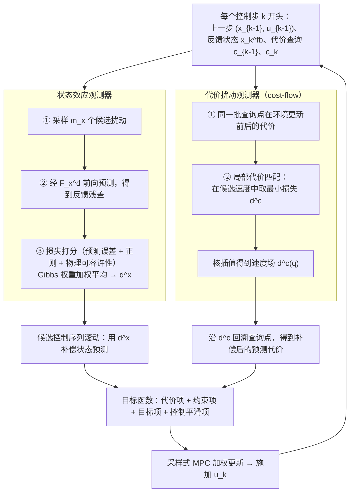

# SDOB（arXiv:2610.04896）

**SDOB**（*Tackling Sim-to-Real Mismatch Through Sampling-Based Disturbance Observers: From Analytical Models to Learned World Models*，[arXiv:2610.04896](https://arxiv.org/abs/2610.04896)，[项目页](https://sampling-based-dob.github.io/)）来自 [具身智能小站 2026-10-13 盘点](../../sources/blogs/wechat_embodied_station_34_papers_mulligan_2026-10-13.md)，属「世界模型与仿真」组。

## 一句话定义

**通过状态预测或代价查询估计扰动，使传统观测器适用于仿真器与学习模型；前提含可观测性与缓变扰动。**

## 英文缩写速查

| 缩写 | 英文全称 | 简要说明 |
|------|----------|----------|
| DOB | Disturbance Observer | 扰动观测器 |
| MPC | Model Predictive Control | 模型预测控制 |
| WM | World Model | 世界模型 |

## 为什么重要

- 采样式控制器需要扰动补偿缩小模型与现实差异。
- 开源结论：**待发布**（步骤 2.5，2026-10-14）。项目页列出 GitHub 链接（sampling-based-dob/sampling-based-dob），入库日 ls-remote 不可达，按待发布处理。
- 同期同组工作见 [失败导向采集与可组合世界动作模型：具身智能小站 10-13 期 34 篇阅读坐标](../overview/embodied-station-2026-10-13-34-papers-technology-map.md)。

## 流程总览

图依据：论文 §4.2–4.5（式 16–32、Algorithm 1）与 Fig. 6。

## 核心机制

| 项 | 内容 |
|----|------|
| **arXiv** | [2610.04896](https://arxiv.org/abs/2610.04896) |
| **开源** | **待发布** |
| **要点** | 仿真与真机验证。 |
| **文内指标** | 以原文为准。 |

## 源码运行时序图

**不适用（待发布）** — 项目页列出 GitHub 链接（sampling-based-dob/sampling-based-dob），入库日 ls-remote 不可达，按待发布处理。 不编造运行脚本；代码公开后再补。

## 实验与评测

- 以原文为准。
- **读法：** 本页为索引级摘要，依据公众号转述的官方摘要与仓库信息整理；逐项数字与 baseline 以原文 PDF 为准。

## 与其他工作对比

- 横向索引见 [失败导向采集与可组合世界动作模型：具身智能小站 10-13 期 34 篇阅读坐标](../overview/embodied-station-2026-10-13-34-papers-technology-map.md)；同 arXiv 不重复造页。

## 结论

**DOB 思想可推广到黑箱仿真器与世界模型，但依赖扰动缓变假设。**

1. 开源边界：**待发布** — 项目页列出 GitHub 链接（sampling-based-dob/sampling-based-dob），入库日 ls-remote 不可达，按待发布处理。
2. 核心机制：仿真与真机验证。
3. 复现与选型前核对任务协议、硬件与基准口径，勿直接横比公众号摘录数字。

## 关联页面

- [sim2real](../concepts/sim2real.md)
- [model-predictive-control](../methods/model-predictive-control.md)
- [physics-fidelity-sim2real-gap](../concepts/physics-fidelity-sim2real-gap.md)
- [embodied-station-2026-10-13-34-papers-technology-map](../overview/embodied-station-2026-10-13-34-papers-technology-map.md)

## 参考来源

- [sdob_sampling_based_disturbance_observers_arxiv_2610_04896.md](../../sources/papers/sdob_sampling_based_disturbance_observers_arxiv_2610_04896.md)
- [wechat_embodied_station_34_papers_mulligan_2026-10-13.md](../../sources/blogs/wechat_embodied_station_34_papers_mulligan_2026-10-13.md)
- [arXiv:2610.04896](https://arxiv.org/abs/2610.04896)
- [arXiv PDF](https://arxiv.org/pdf/2610.04896)：已通读方法部分（实验与附录以略读为准）：§1 Introduction、§3 Preliminaries、§4 Sampling-Based Disturbance Observer（4.1–4.5）、§5.1 首个仿真任务

## 推荐继续阅读

- [arXiv PDF](https://arxiv.org/pdf/2610.04896)
- [项目页](https://sampling-based-dob.github.io/)
