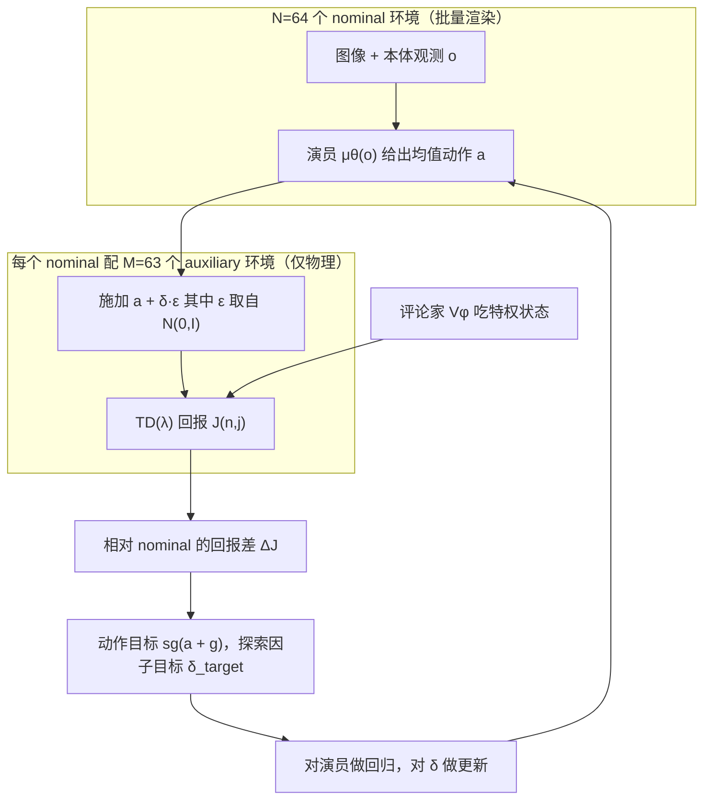

# SDPG（随机解耦策略梯度 · 视觉 RL）

**SDPG**（**S**tochastic **D**ecoupled **P**olicy **G**radient，[arXiv:2605.26478](https://arxiv.org/abs/2605.26478)，*Efficient On-policy Visual-RL via Stochastic Decoupled Policy Gradient*，You、Liu 等，Yale / SJTU / Sydney，cs.RO，v1 2026-05-26）：在 Genesis 仿真里，用「对动作序列加高斯扰动、比较回报」估计轨迹梯度，演员对观测做 stop-gradient，并把渲染环境压到 64 个。项目页：[haoxiangyou.github.io/sdpg-website](https://haoxiangyou.github.io/sdpg-website/)；代码：[HaoxiangYou/SDPG](https://github.com/HaoxiangYou/SDPG)。

> **同名消歧：** 缩写 SDPG 亦指 UCLA 的 LLM **Self-Distilled Policy Gradient**（[arXiv:2606.04036](https://arxiv.org/abs/2606.04036)）→ [paper-sdpg-self-distilled-policy-gradient](./paper-sdpg-self-distilled-policy-gradient.md)。

> **阅读依据：** 本页依据 arXiv v1 全文通读（含附录，见 [来源归档](../../sources/papers/sdpg_visual_rl_arxiv_2605_26478.md) 的「核对范围」）。「作者自述」与「本页判断」分开标注；章节号为论文内编号。

## 一句话定义

SDPG 是一种 on-policy 的视觉 RL 算法：用 M 个高斯扰动动作序列的回报差得到平滑的轨迹梯度（§3.1 式 1），把它写成对演员的回归目标（Prop.1 / 式 3），并让只做物理的 auxiliary 环境承担扰动 rollout、只有 nominal 环境渲染（§4.2、附录 C.1）。

## 英文缩写速查

| 缩写 | 英文全称 | 简要说明 |
|------|----------|----------|
| SDPG | Stochastic Decoupled Policy Gradient | 本文方法（勿与 LLM 自蒸馏 SDPG 混用） |
| RL | Reinforcement Learning | 强化学习 |
| PG | Policy Gradient | 直接优化策略参数的梯度法 |
| PPO | Proximal Policy Optimization | 高并行 on-policy 基线（视觉版显存高） |
| DAgger | Dataset Aggregation | 蒸馏路线里 student 模仿 teacher 的在线模仿学习 |
| TD(λ) | Temporal-Difference(λ) | 评论家的自举回报目标（式 9） |
| SHAC | Short-Horizon Actor-Critic | 可微仿真一阶 RL 的代表方法（论文引用 [31]） |
| SAPO | — | 论文 Fig.3 里对比梯度尖峰的一阶方法（[27]） |
| Sim2Real | Simulation to Real | 仿真策略零样本部署真机 |
| RGB | Red Green Blue | 彩色图像观测 |

## 为什么重要

- **问题（作者自述，§1）：** 视觉 RL 比状态 RL 费算力和显存；DrQv2 / TD-MPC2 / DreamerV3 需要大量序贯更新；PPO 类方法需要大量并行批渲染环境；蒸馏有信息不对称与分布偏移；可微仿真的一阶 RL 有梯度不稳、软接触与非可微奖励受限、仿真器支持差等问题。
- **本文主张：** 把需要渲染的环境数从 4096 降到 64（§5.1 Results），显存约 10 GB，与 DrQv2 / DreamerV3 / 蒸馏同量级（Table 1）。
- **对本库读者（本页判断）：** 它给了一个「不依赖可微仿真、也不需要几千路渲染」的视觉 on-policy 基线，适合与 [GR00T Visual Sim2Real](./gr00t-visual-sim2real.md)（蒸馏路线）对照读；代价见「局限」。

## 核心原理与流程总览

### 1. 平滑梯度（§3.1）

- 对当前策略产生的动作序列 A，采样 M 个扰动 E^j，用 (J(A+δE^j) − J(A))/σ · E^j 的平均近似 ∇J_smooth（式 1）；σ 是回报标准差，δ 是探索因子。
- Theorem 1（附录 B.2 证明）：∇J_smooth = (δ/σ) ∇_A J_δ(A)，J_δ 是高斯噪声下的期望回报，即平滑代理目标的梯度。
- 作者称好处：更新更平滑（Fig.3，对比 SAPO 的梯度尖峰）、不要求可微、省掉反向传播（称计算时间减半）。

### 2. 解耦与监督式重写（§2.2、§3.1）

- Decoupled：a_t = π(·|sg(o_t), θ)，梯度不穿过渲染与观测路径（沿用 You et al. 2025，论文引用 [15]）。
- Prop.1：「θ += β(∂A/∂θ)ᵀ d(A)」等价于对 ½‖A − sg(A+d(A))‖² 做梯度下降，所以实现上是对演员做回归（式 3），避免似然比。

### 3. 与已有方法的关系（§3.2）

- 经典策略梯度（式 5，基线取均值动作回报）是 M=1 的特例，分母 δ 在 SDPG 中换成 σ（脚注 6）。
- Theorem 2（来自 [15]）：decoupled PG 等于行为克隆损失（式 7）的负梯度；Fig.5 按「每批 rollout 的轨迹搜索与 BC 迭代数」把 GPS、SHAC、REINFORCE、A2C、SDPG 归在一张图里。作者称这个视角可把「搜索超参」与「表征学习」分开调。

### 4. 实用设计（§4、附录 C）

- 演员–评论家：评论家吃低维特权状态，演员吃真机可得观测（§4.1、E.1）；短 horizon 段（Table 6 里 H 取 16–64）。
- 学习探索因子 δ（式 10，log δ 参数化）、熵正则与温度自整定（C.2）；推荐配置为状态无关的探索因子加演员端熵正则（C.2 Recommendations）。
- 动作经 tanh，前置裁剪以免饱和（C.4）；因果回报与资格迹被报告为「影响可忽略」（C.3），但 C.5 与 E.2 又说默认开启，二者并存，本页不展开解释。

## 工程实践

| 项 | 内容（出处） |
|----|------|
| 环境数 | N=64 nominal + M=63 auxiliary/每个，共 4096 个物理环境，其中仅 64 个批渲染（Table 5、E.2）；AlohaInsertion 用 N=48 |
| 仿真器 | Genesis；Visual MuJoCo 四任务在 Genesis 中重实现（§5.1、E.1） |
| 硬件 | 单张 RTX 4080（Abstract、§5.1） |
| 演员输入 | MuJoCo 套件：三帧 84×84 第三人称 RGB，无本体感知；egocentric 套件：本体 + 机载相机（E.1） |
| 图像编码 | DrQV2 风格 CNN，输出 128 / 256 维，ALOHA 腕部相机 32 维（E.2） |
| 通用超参 | Adam、γ=0.99、λ=0.95、评论家 batch 4096、每 epoch 评论家 2 次 / 演员 1 次（Table 5） |
| 代码 | [HaoxiangYou/SDPG](https://github.com/HaoxiangYou/SDPG)，Hydra + Genesis，入口 `scripts/run.py`（见 [repo 归档](../../sources/repos/sdpg-haoxiangyou.md)，非本次通读范围） |
| 调参建议（作者） | 先用低维状态输入调搜索相关超参，再加 CNN 编码器迁移到视觉；同超参下视觉需 2–4 倍迭代（§5.1、Fig.11） |

## 与清单说法的核对

对象：Glen Berseth《My CoRL 2026 Reading List》第 007 条（P0，RL Algorithms & Exploration）。该清单由作者用自己的研究兴趣模型打分排序，摘要为 LLM 据摘要起草，排序不代表论文质量。清单原句：「On-policy visual RL that estimates policy gradients from perturbed rollouts, training visuomotor policies in hours on one GPU, with sim-to-real.」

| 清单说法 | 与论文对照 |
|----------|------------|
| On-policy visual RL | 成立，论文自称 on-policy，同时 §6 承认 rollout 每次迭代后丢弃，更像早期 A2C，不复用样本 |
| 由扰动 rollout 估计策略梯度 | 成立：Abstract 与式 (1)(4)。细节：扰动加在动作上，且在仅物理的 auxiliary 环境中执行（C.1），不是参数空间扰动 |
| 数小时、单 GPU 训练 visuomotor 策略 | 基本成立（Abstract：单张 RTX 4080、数小时）。限定：Fig.8 横轴读图约为 Hopper / Walker 1.5 h、Ant 3 h、Humanoid 约 20 h；G1 hurdle 的 Fig.10 横轴更长（读图）；Go2 为 2 小时内（§5.3）。「hours」包含约 20 小时的任务 |
| 有 sim-to-real | 成立但范围窄：只有 Unitree Go2 + RealSense 深度的地形 / 楼梯（§5.3、Fig.12、附录 Fig.14），零样本；没有真机操作任务，也没有成功率等定量指标 |
| （清单未提）端到端 / 显存 | 论文强调：显存约 10 GB 对 PPO† 约 48–50 GB，但 PPO 数字是估计值，不是实测（Table 1 脚注） |
| （清单未提）基线比较 | 论文只在 Visual MuJoCo 四任务上与 DrQv2、DreamerV3、蒸馏比；egocentric 套件只给 SDPG 自身曲线（附录 D.1） |

## 局限

**论文自述（§6）：**
- 总成本仍由物理仿真主导，rollout 用后即弃，样本效率不如能复用样本的 PPO。
- 对随机种子敏感，偶发训练不稳定。

**本页看到的未验证之处（判断）：**
- 显存对比中 PPO 为按 4096 环境估计的值（Table 1†），且 PPO 的「视觉版」没有出现在 Fig.8 的训练曲线里；这一对比只是估算。
- 论文称「最高回报、与状态策略持平」（§5.1），但正文没有给出种子数与数值表，依据主要是 Fig.8 曲线；本页未能从图中取精确数值。
- 与 You et al.（可微仿真版 decoupled PG）没有直接对比（§5.1 给出理由：Genesis 当时无刚体可微）。
- 真机只有 Go2 深度地形任务，且仅为定性照片 / 视频，没有真机成功率、重复次数与失败案例。
- 官方实现依赖 Genesis；换到 Isaac Lab 等需自行移植（推测，论文只说方法兼容常见仿真器的设计目标）。
- 4096 个物理环境中 4032 个是 auxiliary，物理仿真成本与 PPO 同量级，节省的主要是渲染与显存。

## 关联页面

- [Reinforcement Learning](../methods/reinforcement-learning.md)
- [Policy Optimization](../methods/policy-optimization.md)
- [PPO](../methods/ppo.md)（视觉 PPO 显存对照）
- [DAgger](../methods/dagger.md)（蒸馏路线的基础）
- [可微仿真](../concepts/differentiable-simulation.md)（一阶 RL 路线）
- [特权训练](../concepts/privileged-training.md)（评论家吃特权状态）
- [Sim2Real](../concepts/sim2real.md)
- [Genesis 仿真器](./genesis-sim.md)
- [GR00T Visual Sim2Real](./gr00t-visual-sim2real.md)（蒸馏路线对照）
- [SDPG（LLM 自蒸馏）](./paper-sdpg-self-distilled-policy-gradient.md)（同名消歧）

## 参考来源

- [sources/papers/sdpg_visual_rl_arxiv_2605_26478.md](../../sources/papers/sdpg_visual_rl_arxiv_2605_26478.md)
- [sources/repos/sdpg-haoxiangyou.md](../../sources/repos/sdpg-haoxiangyou.md)
- [sources/sites/sdpg-haoxiangyou-website.md](../../sources/sites/sdpg-haoxiangyou-website.md)
- 论文：<https://arxiv.org/abs/2605.26478>（v1 PDF）

## 继续阅读

- 项目页：<https://haoxiangyou.github.io/sdpg-website/>
- GitHub：<https://github.com/HaoxiangYou/SDPG>
- 前作（可微仿真版 decoupled PG）：You et al., *Accelerating visual-policy learning through parallel differentiable simulation*（NeurIPS 2025，论文引用 [15]）
