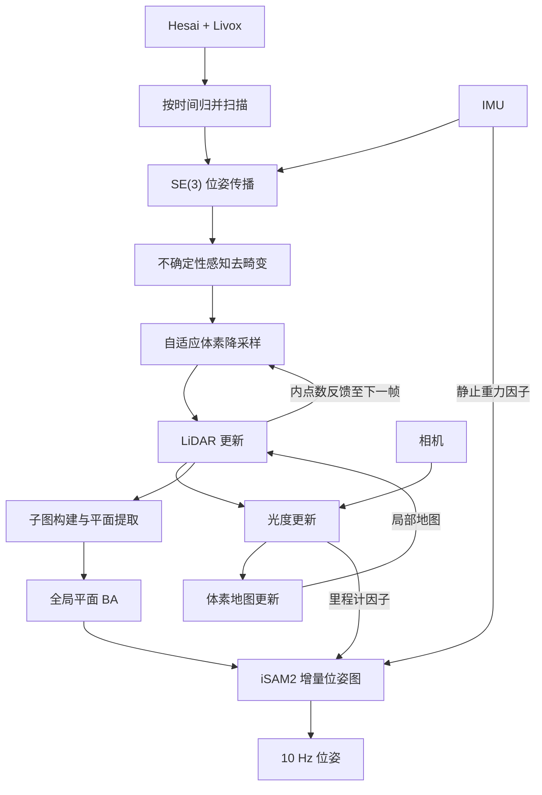
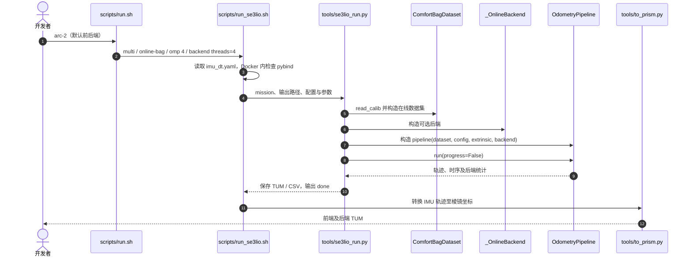

# SE(3)-LIVOM：自适应多激光雷达–惯性–视觉里程计与建图

**SE(3)-LIVOM: Adaptive Multi-LiDAR-Inertial-Visual Odometry and Mapping**（arXiv:2611.22047v1，2026-11-17）。

## 一句话定义

以多雷达互补几何、惯性联合传播和视觉光度约束构建在线状态估计，在前端计算预算可控的同时异步修正长程漂移。

## 英文缩写速查

| 缩写 | 英文全称 | 简要说明 |
|---|---|---|
| LIO | LiDAR-Inertial Odometry | 激光惯性里程计 |
| IMU | Inertial Measurement Unit | 惯性测量单元 |
| ATE | Absolute Trajectory Error | 绝对轨迹误差 |
| RMSE | Root Mean Square Error | 均方根误差 |
| BA | Bundle Adjustment | 此处为平面约束子图优化 |
| iSAM2 | Incremental Smoothing and Mapping 2 | 增量位姿图求解 |

## 为什么重要

腿式机器人在狭长通道可能失去沿通道的几何约束，而户外稠密点云又可能拖慢前端。固定降采样难以兼顾二者，局部配准也会累积漂移。

## 核心信息

| 项 | 内容 |
|---|---|
| 机构 | 韩国科学技术院（KAIST） |
| 作者 | Gunhee Shin、Seungjae Lee、Daebeom Kim、Seoyeon Jang、Hyun Myung |
| 论文 | [PDF](https://arxiv.org/pdf/2611.22047) / [HTML](https://arxiv.org/html/2611.22047) |
| 开源 | [官方代码](https://github.com/url-kaist/se3-livom-comfort)，GPL-2.0 |
| 前序工作 | [SE(3)-LIO](https://arxiv.org/abs/2603.16118)，不是本篇 |

## 核心原理

1. Hesai XT32 与下视 Livox Mid-360 的点按时间归并，保留各自噪声模型。IMU 在 SE(3) 上耦合传播旋转和平移；去畸变时考虑运动预测不确定性。
2. 雷达更新后，利用 FAST-LIVO2 的稀疏直接光度误差对同一状态做相机更新，再维护体素地图。
3. 当前扫描的有效内点数决定下一帧体素边长：目标 N=2000，比例 r=clip((n/N)^(1/1.5), 0.8, 1.05)，新边长 clip(l*r, 0.1 m, 0.5 m)。内点过多则加粗网格，过少则细化。
4. 每 25 扫描按前端位姿拼接子图并以 0.2 m 降采样；每新增 4 子图，使用 1 m 体素提取平面并优化子图位姿。
5. iSAM2 结合 10 扫描滑窗里程计因子、静止重力因子、BA 子图间相对位姿因子，输出 10 Hz 位姿。后端慢时校正延迟到达，前端不会等待。

### 流程总览

## 源码运行时序图

依据官方运行脚本与 Python 入口核查，具体 C++ 内部算法见论文流程与源码；未实际执行 GrandTour benchmark。

## 工程实践

- `bash docker/build_docker.sh` 构建 ROS1 容器；设置 DATA 为 mission 目录，运行 `bash scripts/run.sh arc-2`。加 frontend 参数仅运行前端。
- 复现实验配置为 i9-13900 的 8 核，前后端各 4 线程；配置每任务 IMU 时间偏移，记录 timing.csv、latency.csv 与 backend_rounds.csv。
- 使用 tools/to_prism.py 对齐棱镜坐标，tools/eval.py 在有验证真值时评测。测试真值由服务器隐藏。
- 官方源码开放范围与入口见[源码归档](../../sources/repos/se3_livom_comfort.md)。

## 实验与评测

表 I：GrandTour ATE RMSE（cm，刚体对齐不缩放；均为作者报告）。

| 方法 | 六验证场景均值 | 六测试场景均值 |
|---|---:|---:|
| FAST-LIVO2 | 1.87 | 2.16 |
| SE(3)-LIVOM 前端 | 1.35 | 1.66 |
| 完整系统 | 1.20 | 1.40 |

- 双雷达使 ARC 通道方向连续退化最长时间从 19 s 降至 3 s。
- 图 2：自适应前端耗时约 35 ms；固定 0.1 m 在开阔场景常超过 100 ms，固定 0.5 m 在 CON-3 误差约增至三倍。
- 表 II：六测试场景均值 27.8–42.3 ms/扫描；CON-4 有 10 扫描超过 100 ms，后端单轮最长 19.4 s，峰值内存 16.7 GB。

## 结论

**多视场几何补足、内点反馈降采样和异步全局优化是该系统在复杂环境维持定位质量的关键。**

- 先排查几何退化方向，再决定增加雷达还是其他模态。
- 以内点数和扫描耗时共同衡量降采样参数，不能只比较平均 ATE。
- 分开记录前端输出延迟和后端校正延迟。
- 复现时保持相同传感器外参、时间偏移和评测坐标定义。

## 局限与风险

- 论文的单配置存在逐任务 IMU 时间偏移例外；不能将结果推广为无需时钟标定。
- CON-4 的后端超出 10 s 周期，作者将大型场景加速列为未来工作。
- 1.40 cm 是给定基准上的轨迹位置误差，而非逐时刻定位保证。未独立复现；GPL-2.0 商业集成需审查许可。
- 本文未报告关节运动学融合或高频运控闭环评测，不能与 [KILVO](./paper-kilvo.md) 的 1 kHz 输出直接等价比较。

## 关联页面

- [里程计与激光雷达融合定位](../methods/lidar-odometry-fusion.md)
- [LiDAR / LIO / VIO 选型](../comparisons/lidar-slam-lio-vio-selection.md)
- [FAST-LIO](./fast-lio.md)
- [KILVO](./paper-kilvo.md)
- [导航纵深路线](../../roadmap/depth-navigation.md)

## 参考来源

- [论文原文归档](../../sources/papers/se3_livom_arxiv_2611_22047.md)
- [官方源码归档](../../sources/repos/se3_livom_comfort.md)

## 推荐继续阅读

- [SE(3)-LIVOM 全文](https://arxiv.org/html/2611.22047)
- [SE(3)-LIO 前序工作及项目页](https://gunheeshin.github.io/se3-lio/)
- [GrandTour 数据集论文](https://arxiv.org/abs/2602.18164)
