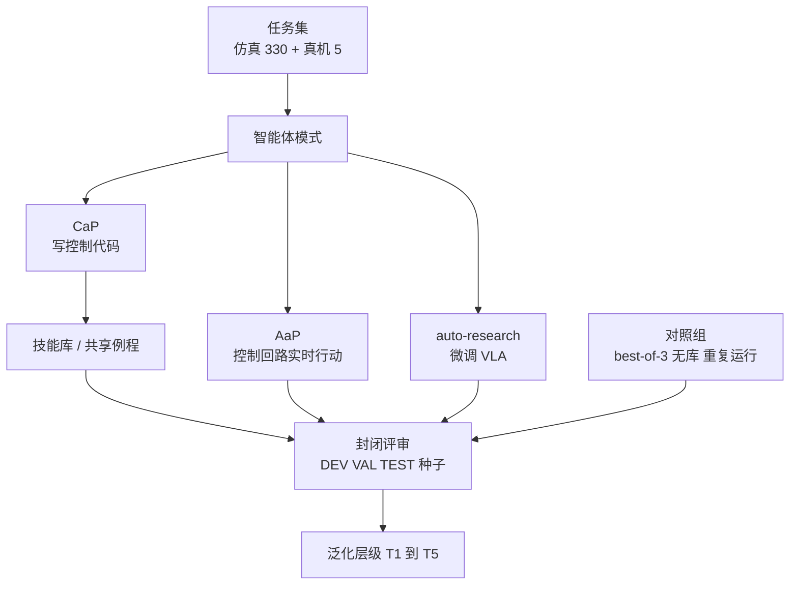

# SEAR：机器人智能体到底有没有在学习

**SEAR 是一个框架加基准：让语言模型智能体以写控制代码、在控制回路中实时行动、或微调 VLA 三种方式改进机器人行为，并用对照组把「保留下来的经验」与「重复尝试、熟悉任务、特权状态、更大预算、运气」拆开。**

论文 *SEAR: Self-Evolving Agentic Robotics*（[arXiv:2610.18792](https://arxiv.org/abs/2610.18792)，[代码](https://github.com/Self-Evolving-Agentic-Robotics/SEAR)，[项目页](https://sear.bot/)）。

## 英文缩写速查

| 缩写 | 英文全称 | 简要说明 |
|------|----------|----------|
| CaP | Code-as-Policy | 模型写控制代码，冻结后即策略 |
| AaP | Agent-as-Policy | 模型在控制回路中实时行动 |
| VLA | Vision-Language-Action | auto-research 模式下被微调的策略（论文用 π0.5） |
| OPAL | Open Physical AI Lab | 项目页所述所属实验室，隶属 Luma AI |

## 为什么重要

- 「自进化」叙事常把更多重试误读为学习；SEAR 用同预算 best-of-3 重启、无库 Vanilla 等对照把二者拆开。
- 同一任务集同时覆盖三种改进路径，可比较「写代码」「实时决策」「微调模型」各自适合什么场景。
- 提供 T1–T5 泛化层级，直接回答「学到的东西能迁移到哪一层」。

## 核心信息

| 项 | 内容 |
|----|------|
| **机构** | Luma AI（论文 HTML 唯一署名；项目页称 OPAL） |
| **平台** | 仿真：robosuite、LIBERO、LIBERO-PRO、LIBERO-RIG、RoboLab（Isaac Sim）共 330 任务；真机：两台 YAM-Ultra 臂 5 任务；Sharpa Wave 手 + Flexiv 臂的键盘演示 |
| **模型** | 7 个前沿语言模型，累计超过四年智能体运行时间（论文摘要） |
| **开源** | **宣称将开源，当前仅占位**（2026-10-17 核查）：[仓库](https://github.com/Self-Evolving-Agentic-Robotics/SEAR)只有 README、LICENSE（MIT）与图片，项目页标注 "Code coming soon"，见 [仓库归档](../../sources/repos/sear.md) |

## 核心原理

### 流程总览

智能体在预算内反复练习，产出可复用的库或策略，再由封闭评审在留出种子上打分；对照组改变其中一个因素（预算、重启、有无库）来归因。

- 层级：T1 新初始状态，T2 条件变化，T3 同仿真器新任务，T4 新仿真器，T5 实体机器人。
- 真机练习每任务最长 12 小时，连续 10 次成功即停。

## 源码运行时序图

**不适用**：官方仓库截至 2026-10-17 无代码（仅 README、LICENSE、assets），无可对齐的训练或评测入口；代码发布后再补。

## 与其他工作对比

| 维度 | SEAR（本文） | [ASENA](./paper-asena-self-evolving-agents.md) | [Agentic Coding Agent](./paper-agentic-coding-manipulation.md) |
|------|------|------|------|
| 定位 | 框架 + 基准：检验"自进化"是否真学习 | 人形机器人上的自进化 coding agent 系统 | 本地 coding agent 写/调试代码控制机械臂 |
| 改进方式 | 三种模式：CaP 写代码、AaP 实时行动、auto-research 微调 VLA | 固定权重，经验沉淀为可执行工作区（程序与笔记） | 固定原语 + Skills 文档，agent 写脚本执行 |
| 对照设计 | 同预算 best-of-3 重启、无库 Vanilla、重复运行 | 工作区多轮演进，重复相同任务集，未见同等对照组 | 页面未述对照组 |
| 规模 | 330 仿真 + 5 真机任务，7 个模型 | R2R/RxR/EQA 仿真 + G1 四个定性演示 | UR3e 9 个玩具任务、45 次试验 |
| 开源 | 仓库仅占位 | 页面未注明 | 未开源 |

- **相对 ASENA：** ASENA 报告工作区演进后重复任务成功率上升，但评测重复相同任务集；SEAR 正是要把这类收益与"多试几次 / 熟悉任务"拆开，可视为对此类声明的检验工具。
- **相对 Agentic Coding Agent：** 后者是单模型、单平台的 code-as-policy 演示；SEAR 在同一任务集上横向比较多模型与三种改进模式，并给出 T1–T5 泛化层级。
- 各文任务、平台与模型不同，成功率数字不可横比。

## 工程实践

| 项 | 建议 |
|----|------|
| 源码运行时序图 | **不适用**（仓库占位） |
| 复现判断 | 不能直接复现；论文称将发布基准与代码库，需跟进仓库发布清单 |
| 自建评测 | 借鉴设计：同预算 best-of-N 重启做对照、无库基线、种子分 DEV/VAL/TEST、评审封印 |
| 验证器风险 | 智能体自写成功验证器可能严重失真：某次 Opus 运行的验证器在 699 个 rollout 中 91% 判错 |
| 真机时间成本 | 实时 AaP 的 episode 中位 12.8 分钟，冻结代码策略为 3.8 分钟 |

## 实验与评测

- **库的效果依赖基线：** 基线 >80% 时库增益 +0.9，30–80% 时 +12.0，<30% 时 +3.0。RoboLab 上 GPT-5.6-sol 无库 46.9%、自带库 42.4%、用 Opus 的库 60.6%；Kimi-k3 自带库 30.1% → 51.9%。
- **auto-research 对 code：** LIBERO 94.0 对 94.4，LIBERO-PRO 90.6 对 91.8；robosuite 61.0 对 97.1，RoboLab 47.2 对 68.0。LIBERO-RIG 相机移动后 code 降到 9%，VLA 保持 69%。
- **泛化（code-as-policy TEST 均值）：** T1 到 T5 为 87.8 / 59.7 / 33.3 / 28.7 / 35.6（%）。
- **真机：** 冻结代码 Fable 5.1 70.2%、GPT-6-astra 41.4%、Opus 5 35.6%；实时 Fable 5.1 66.4%、GPT-6-astra 88.0%。
- **灵巧手演示：** 2.5 小时内超过 5 键/秒；三次输入 π 的前 100 位，速率 5.1 键/秒，共错 1 位。
- **文本 vs 多模态：** DeepSeek-v4-flash（纯文本）RoboLab 无库 23.1%，Gemini-3.6-flash 18.3%。

## 结论

**SEAR 的价值在于评测方法：在没有对照组时，机器人智能体的「自进化」收益无法与多试几次区分。**

1. **先做对照** — 同预算重启、无库基线、重复运行应成为自进化声明的标配。
2. **难任务才吃长会话** — 论文称难任务受益于更长会话，简单任务重复短尝试效果相近。
3. **迁移有选择** — 控制代码与共享例程可跨任务、跨仿真器，任务专属解不可；真机上新颖人工布置场景表现低于智能体自设计的练习场景。
4. **模式各有所长** — code 在固定相机的 robosuite、RoboLab 上更强，VLA 在相机移动（LIBERO-RIG）上更稳。
5. **验证器要审计** — 智能体自写验证器与评审封印都可能被绕过或失真。

## 局限与风险

- 每模型仅 3 次运行，榜单不稳，运行间波动常大于模型间差距（论文自述）。
- 硬件结果每模型一次练习、每任务 5 个布置场景，样本小。
- 灵巧手演示只说明框架可迁移到新机器人，不证明技能跨机器人迁移；仿真孪生难建。
- 部分模型因下线只覆盖部分任务（DeepSeek-v4-flash RoboLab 仅 58 任务）；A.8 完整局限未核实。
- 代码未发布，结果无法独立复现；模型名称与分数均来自论文，未经本库复核。

## 关联页面

- [AI 自动科研](../concepts/ai-auto-research.md) — 智能体自主做研究循环的总体框架
- [递归自改进](../concepts/recursive-self-improvement.md) — 自进化声明的上位概念
- [AI Agent 评测](../concepts/ai-agent-evaluation.md) — 对照组设计思路的相关讨论
- [具身大模型评测基准选型闭环](../queries/embodied-eval-benchmark-selection-loop.md) — SEAR 的对照组思路对应「策略任务成功率」层：区分真学习与多试几次，再谈 sim↔real 校准
- [LIBERO 基准](../entities/libero-benchmark.md) — 论文用到的仿真基准之一
- [LLM 机器人控制接口](../concepts/llm-robotics-control-interfaces.md) — 模型写代码控制机器人的接口层

## 参考来源

- [sear_arxiv_2610_18792.md](../../sources/papers/sear_arxiv_2610_18792.md) — 论文摘录与开源核查
- [sear-project.md](../../sources/sites/sear-project.md) — 项目页归档
- [sear.md](../../sources/repos/sear.md) — 仓库归档（占位）
- [arXiv:2610.18792](https://arxiv.org/abs/2610.18792) — 原文

## 推荐继续阅读

- [SEAR 项目页](https://sear.bot/)
- [论文 HTML](https://arxiv.org/html/2610.18792)
