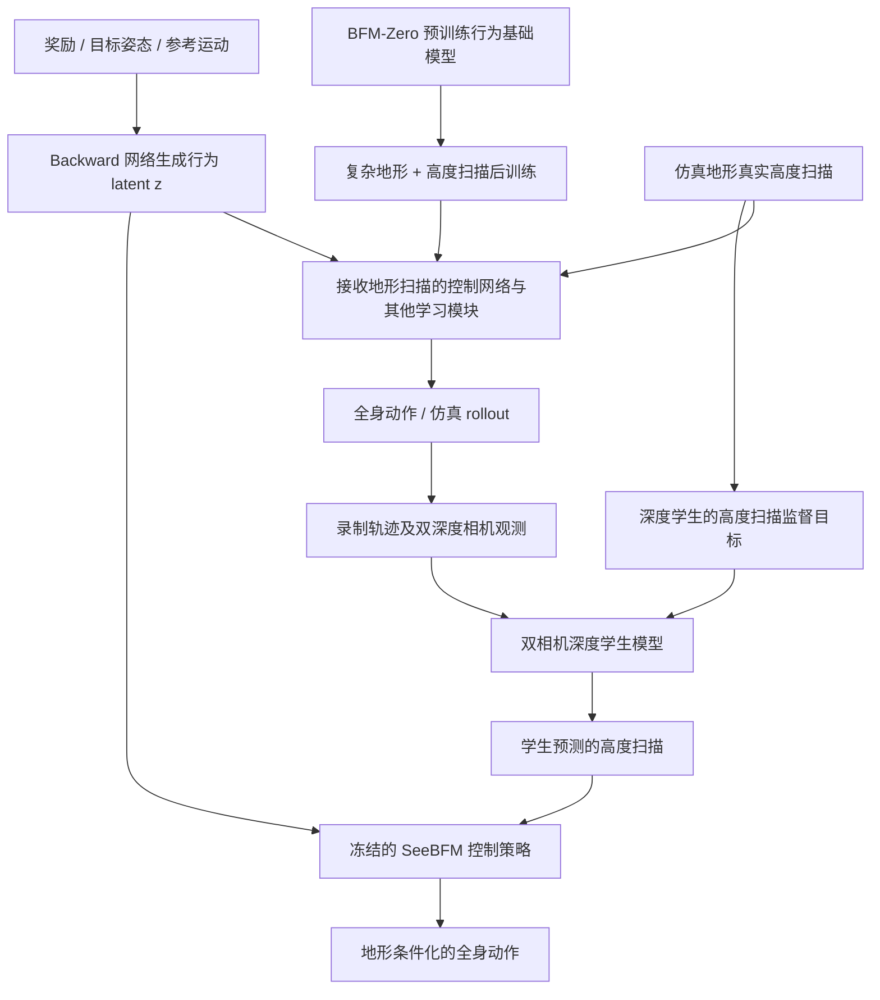
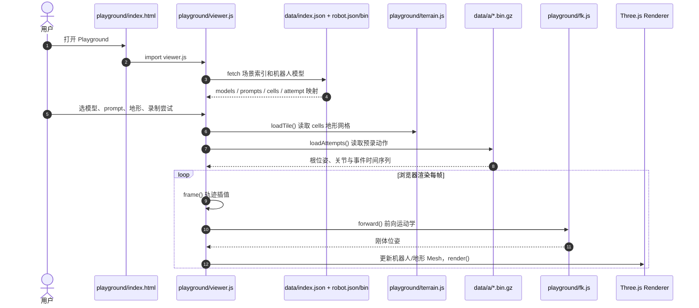

# SeeBFM：能“看”的行为基础模型 / Behavior Foundation Model That Sees

**项目身份：** SeeBFM（2026，作者主页标记 *under review*）；作者 Thanh Ly、Truong-Duy Dang、Hung Nguyen、Duy M. H. Nguyen、Vien Anh Ngo、An T. Le。研究单位（按官方演示片头）：VinRobotics、UC San Diego、DFKI、University of Stuttgart、IMPRS-IS、CAIR（VinUniversity）、IAS（TU Darmstadt）。

**一手资料：** [项目主页](https://capfab.github.io/seebfm-media/) · [官方仿真回放](https://capfab.github.io/seebfm-media/playground/) · [作者论文列表](https://anindex.github.io/) · [网站与回放源码](https://github.com/capfab/seebfm-media)。

> **通读状态：项目原始网页已逐节读完，论文尚未发布。** [项目首页](https://capfab.github.io/seebfm-media/) 在 2026-11-11 明确写有 `arXiv (coming soon)`；作者 [An Thai Le 主页](https://anindex.github.io/) 将其标记为 *Under review · 2026*。已通读官网方法/数值表/局限、15 段讲解和可读网页源码；但没有论文 PDF/附录供通读，**本页仍为 draft，不把项目页当论文正文冒充原文**。

## 一句话定义

**SeeBFM 用高度扫描让预训练 BFM-Zero 在楼梯、箱体等地形下调整动作，同时保持奖励、目标姿态与运动参考所表示的行为意图；再用双深度相机学生模型预测扫描，替换仿真中直接提供的地形输入。**

## 英文缩写速查

| 缩写 | 英文全称 | 简要说明 |
|---|---|---|
| SeeBFM | Behavior Foundation Model That Sees | 以地形扫描进行后训练、以深度相机感知输入部署的行为模型 |
| BFM | Behavioral Foundation Model | 复用多种提示接口与全身行为的基础模型 |
| FB | Forward–Backward Representation | 将未来状态与行为意图映射进共享 latent；本文保持 backward 网络不读取地形 |
| RL | Reinforcement Learning | 地形后训练延续 BFM-Zero 的强化学习框架 |
| G1 | Unitree G1 | 作者计划用于真实部署测试的人形平台 |

## 为什么重要

在平地学到的行为 prompt（例如“以 0.7 m/s 向前走”或“达到目标姿态”）不包含台阶高度、落脚点、避障净空等信息。若控制器只能读自身状态，同一个意图到了楼梯就可能摔倒。SeeBFM 的设计问题不是再定义一次“向前走”，而是**让当前地形改变动作实现方式，而不改变 prompt 原本要实现的目标**。

## 核心原理

### 1. BFM-Zero 的可提示行为意图

原 BFM-Zero 的 forward–backward（FB）表征支持由 reward、goal pose、motion 获得行为 latent，并由一个条件化全身控制策略执行。SeeBFM 从这个预训练控制器继续学习，而不是将它替换为单一上楼梯策略。

### 2. 地形扫描后训练与条件化边界

官方视频解释：在复杂地形继续训练 BFM-Zero 时，各相关网络输入地面高度扫描，**唯独将 reward / goal pose / motion 转换为 prompt 的 backward 网络不读地形扫描**。因此相同奖励/目标映射出的行为意图不因局部地形改变；策略可通过扫描调整步态、摆动腿抬高与躯干动作。

这一网络位置的选择是论文主张之一，不能误读为“所有网络都拼接相机图像”或“通过语言理解直接决定落脚点”。**官方主页新增技术数据：** SeeBFM 报告使用 379 h 运动数据（其中 78 h 为地形运动），BFM-Zero 对照为 2.4 h；高度扫描在机器人附近包含 **598 点**，网页称 **97.7%** 的下一次落脚位置落在扫描区域内。该口径来自作者项目页，完整数据构建、扫描分布与 FB 损失函数仍须论文核实。\n\n**关键消融：** 若让 backward prompt 网络也读取地形扫描，作者在地形运动跟踪实验中报告误差由 1.14 上升至 1.31（官网未标注该处单位）。另外作者指出需要去掉 prompt 网络的平均项，否则不同 prompt 易偏向同一行为、侧行近乎停止；具体实现待论文/源码公开。

### 3. 深度学生替换特权高度扫描

离线录制 SeeBFM 在仿真地形上的控制轨迹，渲染两个深度摄像头观测并训练学生预测相应地形高度扫描。推理时由学生预测值替代真实高度扫描，**已有控制策略保持冻结**。这是“感知估计器 → 高度扫描接口 → 控制策略”的模块化替换，并不是有了深度相机就自动完成 Sim2Real。

### 4. Typed prompt 的边界\n\n官网 Credits 说明语言系统用 **Qwen3-8B** 选择对应运动、**all-MiniLM-L6-v2** 对输入句子做匹配。作者在平地报告被选中的运动完成率 99.6%；这意味着失败更多来自语言选择，而不是平地动作执行，但不表示开放词汇真机成功率。\n\n**网页 Playground 与研究系统应区分：** 公开的浏览器程序用 MiniLM 向量检索最接近的已录制句子/动作，展示对应预录仿真；`match.js` 默认阈值 0.48。因此网页可交互**不代表**控制策略实时接受任意语言指令。

## 流程总览

以下模块关系来自已完整读取的官方解说；图中未填入无法从公开材料验证的损失函数、网络层数及训练超参数。

**关键设计：** 高度扫描进入控制路径，但不进入 backward prompt 表征；感知学生训练独立于已冻结的控制策略。流程表示项目公开材料可核实的阶段，不承诺开放源码中存在可运行的对应入口。

## 工程实践

| 环节 | 已公开信息 | 复现现状 |
|---|---|---|
| 行为接口 | reward / goal pose / motion；视频另有 typed 指令演示 | 可在网页查看提示效果；算法接口代码待公开 |
| 地形输入 | 官网公开 **598 点**附近地形高度扫描；声称覆盖 97.7% 下一次落脚位置 | 扫描点空间布局、更新频率、噪声模型仍待论文/代码 |
| 视觉输入 | 两个深度摄像头，学生回归高度扫描 | 没有查到可下载学生权重/训练入口 |
| 控制器 | BFM-Zero 后训练得到的 SeeBFM，摄像头替换时冻结 | 没有找到 SeeBFM 策略实现与权重 |
| 评测 | 官网记录 **19,232 次**仿真尝试，包含跌倒、停滞和穿越 | Playground 可重复播放录制结果，不是实时物理仿真或真机 |
| 运动数据 | 官网称共 379 h（78 h 地形运动），BFM-Zero 对照 2.4 h | 未公开完整采集/预处理清单与数据包 |\n| 真机 | 作者计划在 G1 上用深度学生做测试 | 2026-11-11 尚无完成验证的官方证据 |

### 公开演示代码的定位

[capfab/seebfm-media](https://github.com/capfab/seebfm-media) 目前含静态项目网页、`media/`、`slides/`、`playground/`、`playground/data/`，其中 `viewer.js`/ `terrain.js`/ `fk.js` 只用于将**预录的仿真**机器人轨迹显示成 3D 场景；它不是策略 actor、critic、相机学生的训练或推理代码。

## 源码运行时序图

**控制策略训练/推理的源码时序图：不适用（相关官方运行入口未公开）。** 下图仅为已读取的**项目网站 Playground 回放源码**的真实调用路径，不能当作 SeeBFM 策略推理流程。

重现网页交互仅需访问 `playground/index.html` 并使用公开素材，**不能**复现高度扫描后训练、相机学生训练或真实机器人执行。

## 实验与评测

**实验范围：** 以下是官方视频 `slides/spec.js` 与字幕 `media/overview.vtt` 所报告的仿真结果，口径为“穿越地形（crossing）”，与“未摔倒（upright）”或“按要求完成目标动作”不是同一个指标。对照组包含原 BFM-Zero 与高度扫描消融。

| 地形（六个 locomotion prompts） | SeeBFM 穿越率 | BFM-Zero 穿越率 |
|---|---:|---:|
| 上楼梯 | 54.4% | 0% |
| 箱体 | 41.0% | 0% |
| 下楼梯 | 68% | 5% |

**另一组评测口径（官网 P-BFM 对照表）：** 官网以 **0.10–0.15 m 台阶、关闭训练扰动** 的设置，单独报告“向前 0.7 m/s”和四种 walking prompts 汇总的跨越率与跌倒率。这组不能与上面“六个 prompts 汇总 54.4%”混用：

| 模型（感知方式） | 向前 0.7 m/s 穿越 上/箱/下 | 四种 walking prompt 穿越 上/箱/下 | 四种 walking prompt 跌倒 上/箱/下 |
|---|---|---|---|
| SeeBFM（高度扫描） | 100.0 / 81.2 / 97.0% | 33.6 / 35.6 / 38.5% | 0.9 / 13.5 / 1.4% |
| SeeBFM（双深度相机学生） | 98.3 / 85.4 / 97.2% | 43.7 / 35.0 / 43.0% | 24.3 / 35.0 / 16.3% |
| P-BFM（仅 prompt） | 3.5 / 92.4 / 99.3% | 2.5 / 42.7 / 62.7% | 10.7 / 15.9 / 6.0% |
| P-BFM（附加 velocity command） | 97.2 / 84.7 / 93.1% | 38.6 / 39.5 / 71.4% | 27.5 / 41.7 / 15.3% |

该表顺序均为 **上楼梯 / 箱体 / 下楼梯**。**比较限制：** 官网明确称两种工作在**各自模拟器**上评估，且 P-BFM 依赖额外全局速度/方向指令的变体与 SeeBFM 单纯 prompt 不是完全相同控制接口；不能说某方法全面优于另一个。深度学生虽然在单一前进指令上保持接近的穿越率，但在四种行走提示的跌倒比例明显增加，尤其下楼梯值得关注。

- **消融：** 上楼梯 SeeBFM 为 54.4%；将地形扫描固定为水平面时 4.0%；训练时省略扫描为 0%（官方演示值）。
- **速度保持：** 官方示例跨地形的 forward / turn / sideways / backward prompt 对应 76% / 72% / 42% / 12% 的速度保留比例；向后行走明显趋于停滞，不能用“没有跌倒”替代任务完成率。
- **目标姿态：** 在地形上保持相同目标姿态 prompt，终点相对平地额外偏离约 2–4 cm（官方解说口径）。
- **障碍边界（两处官方描述不同）：** 项目主页 Limitations 称高于约 **25 cm** 的方块不能越过；另一个官方讲解示例是 45 cm 方块前停住、并声称高于 35 cm 不尝试。两者测量维度（不能越过 vs 不尝试）不同、阈值也不一致，**不能擅自合并为唯一高度上限**。
- **语言行为：** 官方解说称上/下楼梯及箱体的常见 typed request 约一半尝试可完成；未从论文获取更细粒度表格或测试分布。

以上数字未经完整论文正文、附录和独立实验复核；**不能据此报告真实世界成功率**。

## 结论

**SeeBFM 的可迁移设计是固定行为意图的解释层，让地形仅改变执行策略，并通过扫描预测学生将特权地形输入替换成双相机输入；当前验证仍主要是仿真展示。**

1. **表征边界先行：** backward 网络不接地形，减少同一 reward 或动作指令在不同地形语义漂移。
2. **模块化视觉替代：** 先训地形 scan 控制器，再以双深度学生估计 scan；可以冻结控制器，而非联合重训全部网络。
3. **“越过”和“站稳”分开评价：** 同时计 crossing、stayed short、fell，防止策略靠停下“刷出”稳定结果。
4. **prompt 类型不能视作等价：** 前进/转向迁移较好；侧走/后退速度保持下降，应逐类评估。
5. **部署结论留白：** 现有公开演示尚无 G1 搭载深度学生的真实部署结果，也未提供算法训练入口；待论文全文与实现开放后复核。

## 与其他工作对比

| 工作 | 地形适配入口 | 保持行为语义的方式 | 公开验证状态 |
|---|---|---|---|
| [BFM-Zero](./paper-bfm-zero.md) | 主要是平地、依赖本体状态 | FB latent 统一 reward / goal / motion | 原工作含真机；直接上复杂地形受限 |
| **SeeBFM** | 后训练接入高度扫描；双相机学生回归 scan | backward 不读地形，其他网络可据地形执行 | 已公开仿真演示，G1 视觉部署待测 |
| [P-BFM](./paper-p-bfm.md) | 深度条件化无监督 RL + 显式根指令 ERI | 区分地形无关意图与条件化执行 | 原文给出 G1 仿真与真机 |
| [Perceptive BFM / PMT](./paper-perceptive-bfm.md) | 通过地形一致运动参考和感知校正 | 保留原始 motion reference 接口 | 原论文为不同的训练与跟踪路线 |

## 局限与风险

- **全文缺失：** 作者主页目前只有 under review 状态；论文 PDF、数学推导、完整实验表与附录尚未取得，本页 status 保持 `draft`，健康度原文项不计分。
- **算法未开源：** `capfab/seebfm-media` 为网站/数据可视化源码，不可当作 SeeBFM 的训练代码、checkpoints、深度估计学生或可上机 runtime。
- **仅仿真证据：** G1 搭载双深度学生的真机验证处于筹备阶段；缺少真实相机延迟、遮挡、动态地形、Sim2Real 成功率测量。
- **停滞模式：** 对较高障碍和向后移动出现“停在前方而不跌倒”；官方主页另提示楼梯参考动作 257 段仅跟踪 68 段。任务完成、跌倒和稳定性应分别报告。
- **数字可比性：** 官网的六 prompt 汇总、特定 forward prompt、四 walking prompt 聚合有不同的分母/设置；P-BFM 使用另一模拟器；论文 PDF 尚未上线，无法验证独立 seed、精确计数和误差区间，不能推断统计显著性。

## 关联页面

- [BFM-Zero](./paper-bfm-zero.md) — SeeBFM 继承的 promptable FB 基座
- [P-BFM](./paper-p-bfm.md) — 同样关注感知地形适配，但引入显式根指令
- [Perceptive BFM / PMT](./paper-perceptive-bfm.md) — 感知运动跟踪路线对照
- [Behavior Foundation Model 概念](../concepts/behavior-foundation-model.md) — 总体分类与主干知识
- [BFM 纵深路线](../../roadmap/depth-bfm.md) — 学习路径
- [机器人视觉感知栈选型闭环](../queries/robot-perception-stack-selection-loop.md) — 深度感知输入在感知栈中的选型位置

## 参考来源

- [SeeBFM 论文来源与待补核查](../../sources/papers/seebfm_preprint_2026.md)
- [SeeBFM 官方项目页逐节阅读、实验表格与口径差异](../../sources/sites/seebfm-project-page.md)
- [SeeBFM 网页回放源码核查](../../sources/repos/seebfm-media-page-source.md)
- [作者主页](https://anindex.github.io/) — 作者、状态与项目入口
- [官方视频分镜/字幕](https://github.com/capfab/seebfm-media/blob/main/slides/spec.js) — 方法讲解、实验示例与口播数值

## 推荐继续阅读

- [SeeBFM 官方项目与 Playground](https://capfab.github.io/seebfm-media/) — 地形和 prompt 的公开仿真演示
- [BFM-Zero 原始论文（arXiv:2511.04131）](https://arxiv.org/abs/2511.04131) — FB prompt 与预训练基座
- [P-BFM 原始论文（arXiv:2610.15833）](https://arxiv.org/abs/2610.15833) — 独立的感知行为基础模型路线
