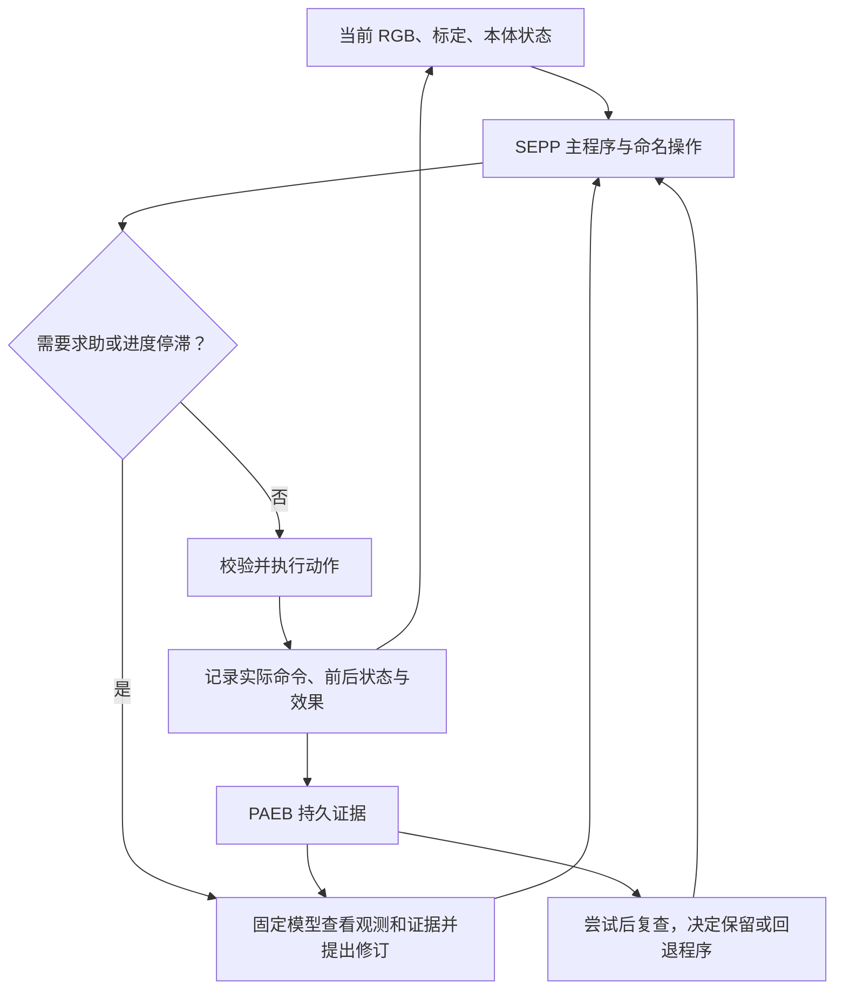
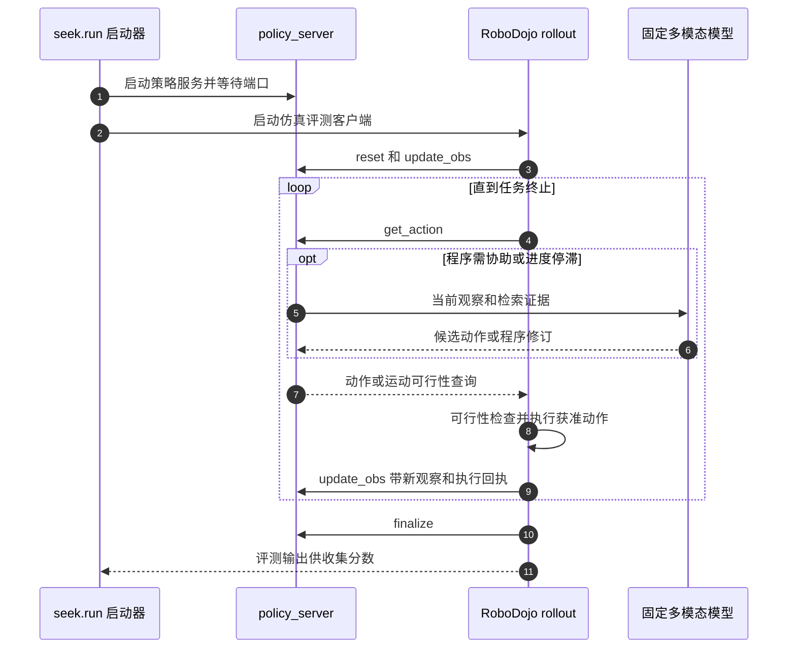

# SEEK：用执行知识跨次改进机器人操作 / SEEK: Self-Evolution through Execution Knowledge for Agentic Robot Manipulation

## 一句话定义

SEEK 用当前观测驱动可执行操作程序，把每步真实测得的动作效果跨次保存，让固定的多模态模型只在需要修订程序或协助决策时介入。

## 英文缩写速查

| 缩写 | 英文全称 | 含义 |
| --- | --- | --- |
| SEPP | Self-Evolving Programmatic Policy | 主任务程序与可复用命名操作 |
| PAEB | Persistent Action-Effect Bank | 带上下文和出处的持久动作效果记录 |
| SR | Success Rate | 任务成功率 |
| IK | Inverse Kinematics | 从末端约束解关节运动 |

## 核心信息

| 项目 | 内容 |
| --- | --- |
| 作者 | Zeyang Guan、Qihao Zhao、Rui Gong 等 |
| 机构 | 南洋理工大学、微软研究院、新加坡国立大学 |
| 版本 | arXiv:2611.33915v1，2026-11-25 |
| 实验平台 | RoboDojo 双臂仿真；Franka Emika Panda 单臂真机 |

## 为什么重要

重复尝试如果只重放旧轨迹，就无法响应物体位置变化；如果每次重新让模型看图并规划，又会重复犯错。SEEK 将「该如何根据当前场景重新算动作」和「上次实际发生了什么」作为两种可复用知识，避免把历史命令当成对现场状态的证明。

## 核心机制

1. **SEPP 主程序与命名操作**：从指令进入主程序，命名操作按当前观测计算目标、执行动作及验证成功。对象角色可由 RGB 图像框触发 SAM 3 分割，再按时序跟踪；若对应失效则重新定位，无法确认的测量记为缺失，不把命令值冒充实测值。
2. **PAEB 可检索证据**：记录实际执行的命令、前后状态、测得的效果与出处；成功和失败都保存。视觉几何按需用多相机三角化或射线与已知平面相交，残差可约束候选对应关系。
3. **两层修订**：尝试内，程序求助或固定监视器检测停滞、振荡等异常时，才用当前观测和检索证据请求模型；候选动作、角色绑定、记录引用与程序校验通过后才安装。尝试后，复查轨迹及结果，选择保留、替换或回退；下一场景重新感知角色和局部状态，而不是重放上一次的指令。

## 流程总览

## 实验与评测

| 作者报告的协议 | 结果 |
| --- | --- |
| RoboDojo 42 项，GPT-6 Astra、10 次积累、同样未见布局；对照不跨次保留知识，但仍可在单次内调整 | 得分 27.0→54.4，SR 19.7%→48.0%，42 项中 37 项分数提高 |
| RoboDojo 另一个协议：34 项非 Open 任务，GPT-6.2 Astra xhigh，每任务 5 个演化布局、10 个未见评测回合，基线为同模型直接执行 | 得分 49.6→80.1、SR 40.7%→75.0%；每回合 63.2→14.1 次模型请求，减少 77.6% |
| 9 个分析任务的跨次复用消融，表 4 | 无复用 30.3，只复用 SEPP 47.5，只复用 PAEB 57.3，两者同时复用 70.4（10 次） |
| Panda 单臂真机四个桌面任务；每任务 5 次积累、10 个未见布局回合 | 与 GPT-6 Astra xhigh 直接执行对比，人工按规约评分的均值 66.9→83.3，每回合请求 52.2→34.4 |

首次四十二任务评测的 Long-Horizon 分数 44.2 低于论文所列 VPP2 的 56.3，不能将平均优势外推到每一类任务。

## 与相关工作对比

与 [RoboEvo²](paper-roboevo2-2611-34675.md) 的 harness 与策略交替更新相比，SEEK 主要把改进写入可执行程序和外置效果库而不更新多模态骨干。对照指标要考虑是否冻结跨轮知识和何时提供检索。

## 结论

在作者的独立布局协议内，可修订程序与动作效果证据互补；这里的「自演化」是复用和改写执行知识，不是模型参数更新。

- 对照时让无跨次记忆组仍可在当回合内调整，否则会混淆两种适应。
- 每个布局从同一冻结快照重新启动，评测期的回合内修订不写回跨次快照。
- 同时报得分、SR 和模型请求，别把 API 请求下降当成端到端延迟下降。
- 用目标测量和执行回执区分抓空、未到位、目标丢失；不要只存最终一次得分。

## 源码运行时序图

运行入口是 `runtime/seek/run.py`，策略 RPC 和动作回执可对照 `runtime/seek/rollout.py`；尝试后复查另见 `runtime/tools/review.py`。时序按公开提交静态核对，不代表已连仿真、模型端点或真机。

## 工程实践

- 官方公开 MIT 仿真运行时、复查工具、配置和两种协议的逐回合日志。[源码归档](../../sources/repos/seek.md)标注固定提交、入口与依赖。
- 复现需要 Isaac Sim 5.1 兼容 Linux/NVIDIA 环境、仿真/策略/分割三种 Python 环境、RoboDojo 外部资产、SAM 3 权重与可流式调用的模型端点。源代码公开与端点/资源零成本可用不是一回事。
- 仓库给了仿真运行通路和离线测试；真机结果及平台见原论文，不据此宣称发布了完整 Panda 接入栈。

## 局限与风险

研究的能力上限仍受固定观测工具、执行接口和感知准确性制约。知识按任务积累；硬件评测是单臂四项桌面任务，未验证轮式或人形机器人的长期泛化。跨任务迁移、陈旧证据管理及规模增长仍待验证。

## 关联页面

- [递归自我改进纵深路线](../../roadmap/depth-rsi.md)

- [RoboDojo](./robodojo.md)：同一操作基准，从任务布局和任务原生评分理解协议。
- [操作任务](../tasks/manipulation.md)：当前观测闭环下的末端动作和夹爪控制。
- [Agentic 操作策略](../methods/agentic-manipulation-policies.md)：区分逐步推理、代码程序与控制工具。
- [智能体规划与反馈](../methods/agent-planning-feedback.md)：动作后的实测证据如何反哺下一次决策。

## 参考来源

- [论文全文归档](../../sources/papers/seek_arxiv_2611_33915.md)
- [项目页归档](../../sources/sites/seek.md)
- [源码归档](../../sources/repos/seek.md)

## 推荐继续阅读

- [官方 method-to-code 对照](https://github.com/ZeyangGuan/SEEK-Agentic-Robot-Manipulation/blob/318cef0e3c22a8e4a72a980df9a65af807c36bfb/docs/METHOD.md)：把论文符号映射到解释器及证据接口。
