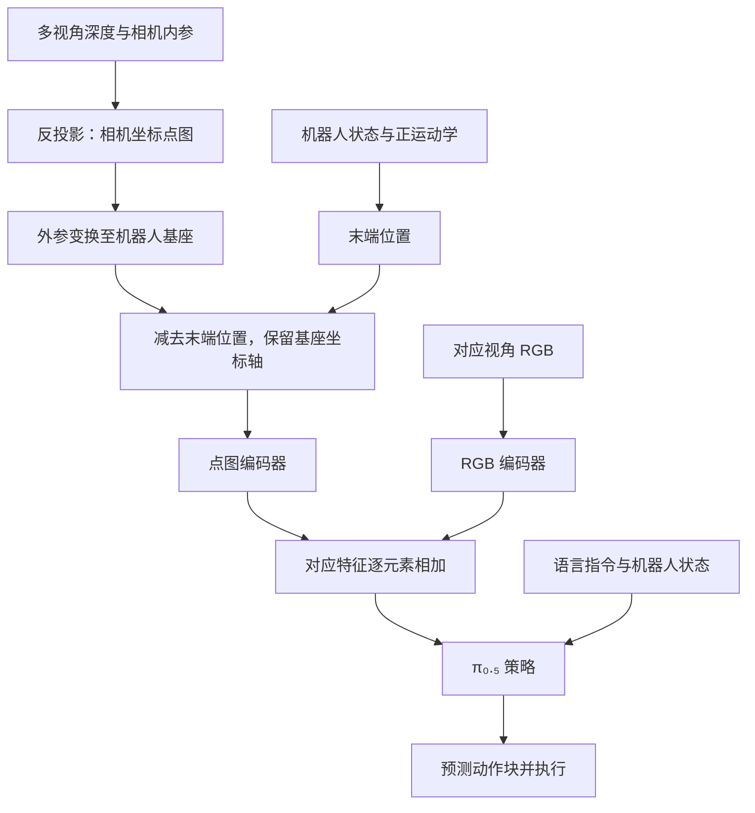

# See like a Robot：机器人中心点图与 SeeR-VLA

## 一句话定义

SeeR-VLA 将每个像素的三维位置表示为相对末端的位移，以机器人基座方向为坐标轴，再与图像特征融合以辅助操作策略。

## 英文缩写速查

| 缩写 | 英文全称 | 简要说明 |
|------|----------|----------|
| VLA | Vision-Language-Action | 视觉语言动作模型 |
| RGB-D | Red Green Blue and Depth | 彩色图像及对应深度 |
| EE | End Effector | 机器人末端执行器 |
| SR | Success Rate | 任务成功率 |

## 核心信息

| 项目 | 内容 |
|------|------|
| 论文 | [arXiv:2607.11498v2](https://arxiv.org/abs/2607.11498v2)，2026-09-21 修订 |
| 作者 | Byungkun Lee、Dongyoon Hwang、Dongjin Kim、Hojoon Lee、Hyunseung Kim、Jaegul Choo、Minho Park |
| 机构 | 韩国科学技术院人工智能学院（KAIST AI）、Holiday Robotics、KRAFTON AI |
| 基础模型 | 预训练 π₀.₅；消融使用从 PaliGemma 初始化的同类架构 |

## 流程总览

## 方法与原理

对像素坐标 $[u,v,1]^T$，先以深度 $D$ 和内参 $K$ 得到相机坐标 $P=D K^{-1}[u,v,1]^T$；再用相机到基座外参 $R,t$ 与末端位置 $t_{EE}$ 得到 $P^r=RP+t-t_{EE}$。**原点随末端移动，但坐标轴不随手腕旋转。**各视角点图保留图像网格和 RGB 的位置对应关系。

点图编码器使用 RGB 编码器的预训练权重初始化，两个编码器都在训练中更新；两路对应 token 相加，视觉 token 数不增加。策略沿用 π₀.₅ 的语言、机器人状态和流匹配目标，预测 50 步并执行 25 步后重新规划。token 数不增加不代表计算开销为零：额外编码器仍需计算。

## 源码运行时序图

**不适用：**截至 2026-11-01，项目页未提供可运行官方代码入口，无法核对运行时调用链；代码开放后再补图。

## 实验与评测

- **主实验：**24 个 RoboCasa 任务，每任务 50 条示范、三个随机种子、每任务每种子 50 次评测。真机为 Franka Research 3，四项任务共 320 条示范，来自八个外部相机视角；每任务评测 20 次，评测视角为训练视角之一。
- **成功率：**RGB π₀.₅ 与 SeeR-VLA 在仿真中分别为 55.1% 和 61.5%，真机分别为 37.5% 和 70.0%；复现的 PointVLA 分别为 58.0% 和 46.3%。差值为百分点，不是相对百分比。
- **消融：**基座原点/基座轴为 34.4%，末端原点/末端轴 34.9%，末端原点/基座轴 36.8%；消融采用不同初始化设置，不应与主实验绝对值直接比较。
- **表征与融合：**基座坐标系下，深度加 Plücker 射线 31.7%，点图加法 34.4%；点图 token 拼接 30.3%，通道拼接 31.6%。点云对照还改变了编码器，无法单独归因于点密度。
- **视角与依赖：**训练视角变化增大时，与 RGB 基线差距由 5.4 扩大到 12.3 个百分点；遮蔽机器人和目标的点图区域使八个抓放任务成功率从 52.9% 降至 42.1%。

## 结论

在论文所测试的操作场景中，夹爪相对、基座定向的显式几何与逐位置特征融合提升了策略成功率。

1. 相机内外参与末端位姿要准确且同步；方法需要度量深度。
2. 真机每任务只有 20 次评测，且使用训练视角，结果不能直接证明未见视角或新机器人泛化。
3. 基线中多个 3D 方法由作者在同一骨干上重新实现，应按论文的协议理解比较。
4. 项目页尚无官方代码、权重及数据链接，复现与部署耗时仍需自行验证。

## 关联页面

- [机器人操作](../tasks/manipulation.md)
- [视觉语言特征融合](../concepts/vision-language-feature-fusion.md)

## 参考来源

- [论文归档：v2 全文](../../sources/papers/see_like_a_robot_arxiv_2607_11498.md)
- [项目页归档](../../sources/sites/seer-vla.md)

## 推荐继续阅读

- [论文全文](https://arxiv.org/html/2607.11498v2)
- [项目主页与演示](https://davian-robotics.github.io/pointmap/)
