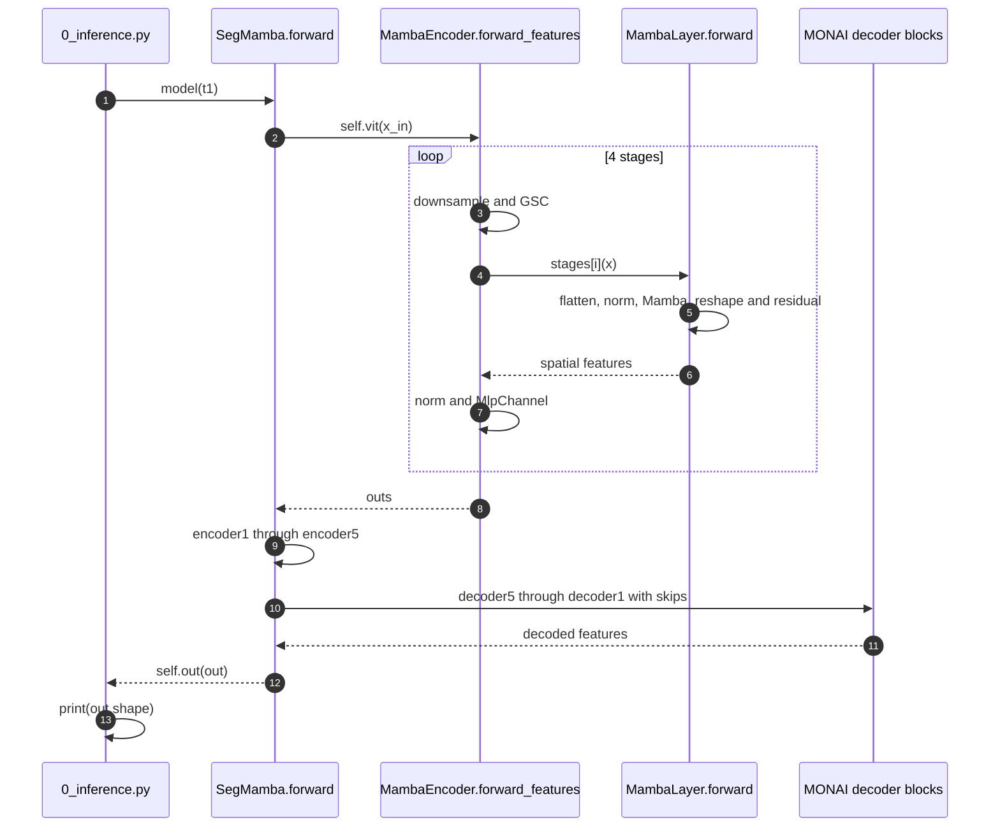

# SegMamba: Long-range Sequential Modeling Mamba For 3D Medical Image Segmentation（长程序列建模的三维医学图像分割）

## 一句话定义

以多尺度三向 Mamba 编码器和卷积解码器处理三维医学体数据，输出体素级分割结果。

## 英文缩写速查

| 缩写 | 英文全称 | 简要说明 |
|---|---|---|
| SSM | State Space Model | 状态空间模型 |
| GSC | Gated Spatial Convolution | 门控空间卷积 |
| ToM | Tri-orientated Mamba | 三向序列建模 |
| FUE | Feature-level Uncertainty Estimation | 特征级不确定性估计 |
| HD95 | 95% Hausdorff Distance | 边界距离评价指标 |

## 为什么重要

三维特征展开后序列很长，直接全局注意力的计算与存储成本较高。本文把长程建模与多尺度空间分割结合；对机器人三维感知的借鉴属于工程推断，并非论文实验结论。

## 核心信息

| 项目 | 内容 |
|---|---|
| 论文 | arXiv:2401.13560v4，2024-09-15 |
| 机构 | 香港科技大学（广州）、北京智源人工智能研究院、香港科技大学 |
| 作者 | Zhaohu Xing、Tian Ye、Yijun Yang、Guang Liu、Lei Zhu |
| 代码 | [官方仓库](https://github.com/ge-xing/SegMamba) |
| 任务 | 三维医学图像分割 |

## 核心原理

论文 §2：stem 先缩小体素特征的空间分辨率；多尺度 TSMamba 利用 GSC 保留局部空间关系，将三维特征展开为正向、反向和跨切片序列，分别进行状态空间建模，再融合并恢复三维布局。FUE 依据通道均值经 sigmoid 后的单项不确定性度量重加权跳跃特征，不能直接当作经校准的预测概率。

## 流程总览

## 源码运行时序图

实际阅读入口为官方 main 的 `0_inference.py`（blob e7f2b453）和 `model_segmamba/segmamba.py`（blob b53e4940），以下是随机输入测试路径，而非带权重的临床推理。

## 实验与评测

v4 Table 2：BraTS2023 的平均 Dice 为 91.32%，HD95 为 3.56；AIIB2023 的 IoU 为 88.59%。CRC-500 的 Dice 为 48.46%。作者采用随机 70/10/20 划分，不等同挑战赛官方榜单。Table 9 的自注意力对照发生 OOM，TSMamba 则完成计算；该结果不代表所有硬件和高效注意力实现。

## 与其他工作对比

- **对比 3D 卷积与自注意力分割基线（v4 Table 2 / Table 9）：** 在作者随机 70/10/20 划分的 BraTS2023 设置下，SegMamba 取得平均 Dice **91.32%**、HD95 **3.56**，优于同设置的 UX-Net（89.69% / 4.81）；在 Table 9 的高分辨率 3D 体积测试中，自注意力配置发生显存溢出（OOM），而 TSMamba 三向扫描可完成计算（仍须注意不同注意力核优化的影响）。
- **对比 [U-Mamba](./u-mamba.md) 与经典 [U-Net](../methods/unet.md)：** 相比直接沿单向展平或嵌入 2D/3D 混合块的 U-Mamba，SegMamba 在多尺度编码器中使用门控空间卷积（GSC）与正/反/跨切片三向 Mamba（ToM），并在跳跃连接引入 FUE 重加权；但实际阅读公开代码可见 `GSC.forward` 采用相加而非论文乘法门控、`SegMamba.forward` 未显式调用 FUE，工程对比应以核对后版本为准。

## 结论

本文验证了多尺度三维分割中的长程序列建模价值。

- 对三维大体积输入需评估序列长度、显存和吞吐。
- 对比时保持训练划分、分辨率和评价指标一致。
- 实际复现须核对论文与公开代码版本差异，不将随机张量测试当作准确率验证。

## 工程实践

官方仓库提供预处理、训练、推理及指标脚本；入口 `python 0_inference.py` 创建四通道随机体数据并打印输出形状。代码中的 GSC 分支相加而论文式 (2) 为相乘；公开 forward 未见 FUE 的显式调用，因此方法图和源码图分开。未实际执行 GPU 代码。

## 局限与风险

医学数据访问有条款；论文结果不证明机器人闭环控制能力。公开实现与论文 v4 不完全一致，需先核对版本再复现实验。

## 关联页面

- [机器人视觉感知栈选型闭环](../queries/robot-perception-stack-selection-loop.md) — 作为三维分割架构的跨域参考；医学体数据实验不构成机器人在线感知性能证据。

- [U-Mamba](./u-mamba.md)：独立的医学分割方法。
- [U-Net](../methods/unet.md)：编码器解码器与跳跃连接。
- [FCN](../methods/fcn-semantic-segmentation.md)：密集分割输出。
- [课程策展](./transformer-cv-curriculum.md)：第 7 章作业 6。

## 推荐继续阅读

- [论文全文 v4](https://arxiv.org/html/2401.13560v4)
- [官方推理入口](https://github.com/ge-xing/SegMamba/blob/main/0_inference.py)

## 参考来源

- [论文归档](../../sources/papers/segmamba_arxiv_2401_13560.md)
