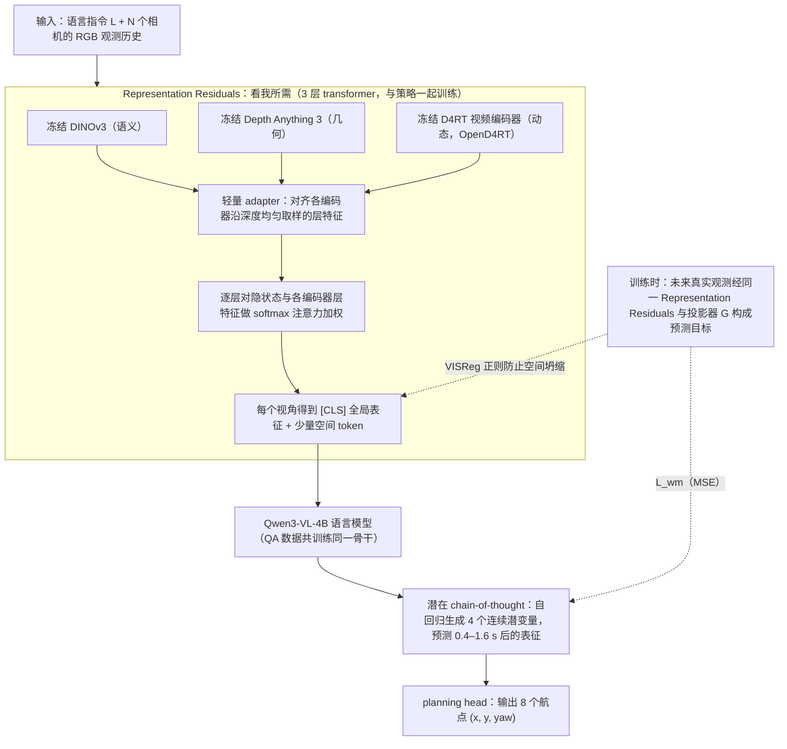

# Self-Constructed Navigation Space（arXiv:2610.31762）

**Self-Constructed Navigation Space**（*See What I Need, Dream What I Want: A Navigation Foundation Model on a Self-Constructed Representation Space*，[arXiv:2610.31762](https://arxiv.org/abs/2610.31762)，[项目页](https://wang-yinxi.github.io/representnav/)）来自 [具身智能小站 2026-10-29 盘点](../../sources/blogs/wechat_embodied_station_58_papers_diverse_demonstrations_2026-10-29.md)，属「导航、规划与定位」组。

## 一句话定义

**RepresentNav跨视觉模型层级重组特征，并在行动前预测潜在未来；语言导航、跟踪和真机实验均有验证，核心启发是让导航目标决定视觉接口。**

## 英文缩写速查

| 缩写 | 英文全称 | 简要说明 |
|------|----------|----------|
| Self-Constructed Navigation Space | See What I Need, Dream What I Want: A Navigation Foundation Model on a Self-Constructed Representation Space | 本文方法 / 基准的简称 |

## 为什么重要

- 导航策略自己选择该看的表征。
- 开源结论：**待发布**（步骤 2.5，2026-10-29）。项目页 HTTP 200，Code 标注 Coming soon（脚本扫描）。
- 同期同组工作见 [多样成功示范、触觉工具链与预见式感知：具身智能小站 10-29 期 58 篇阅读坐标](../overview/embodied-station-2026-10-29-58-papers-technology-map.md)。

## 流程总览

图依据：论文 §3 / §3.1 / §3.2 / Fig.2。

## 核心机制

| 项 | 内容 |
|----|------|
| **arXiv** | [2610.31762](https://arxiv.org/abs/2610.31762) |
| **开源** | **待发布** |
| **要点** | RepresentNav跨视觉模型层级重组特征，并在行动前预测潜在未来；语言导航、跟踪和真机实验均有验证，核心启发是让导航目标决定视觉接口。 |
| **文内指标** | 公众号未给具体数字，本页不引用。 |

## 源码运行时序图

**不适用（待发布）** — 项目页 HTTP 200，Code 标注 Coming soon（脚本扫描）。 不编造运行脚本；代码公开后再补。

## 实验与评测

- 公众号未给具体数字，本页不引用。
- **读法：** 本页为索引级摘要，依据公众号转述的官方摘要与仓库信息整理；逐项数字与 baseline 以原文 PDF 为准。

## 与其他工作对比

- 横向索引见 [多样成功示范、触觉工具链与预见式感知：具身智能小站 10-29 期 58 篇阅读坐标](../overview/embodied-station-2026-10-29-58-papers-technology-map.md)；同 arXiv 不重复造页。

## 结论

**导航策略自己选择该看的表征：RepresentNav跨视觉模型层级重组特征，并在行动前预测潜在未来；语言导航、跟踪和真机实验均有验证，核心启发是让导航目标决定视觉接口。**

1. 开源边界：**待发布** — 项目页 HTTP 200，Code 标注 Coming soon（脚本扫描）。
2. 核心机制：RepresentNav跨视觉模型层级重组特征，并在行动前预测潜在未来；语言导航、跟踪和真机实验均有验证，核心启发是让导航目标决定视觉接口。
3. 复现与选型前核对任务协议、硬件与基准口径，勿直接横比公众号摘录数字。

## 关联页面

- [locomotion](../tasks/locomotion.md)
- [vision-language-navigation](../tasks/vision-language-navigation.md)
- [sim2real](../concepts/sim2real.md)
- [embodied-station-2026-10-29-58-papers-technology-map](../overview/embodied-station-2026-10-29-58-papers-technology-map.md)

## 参考来源

- [self_constructed_navigation_space_arxiv_2610_31762.md](../../sources/papers/self_constructed_navigation_space_arxiv_2610_31762.md)
- [wechat_embodied_station_58_papers_diverse_demonstrations_2026-10-29.md](../../sources/blogs/wechat_embodied_station_58_papers_diverse_demonstrations_2026-10-29.md)
- [arXiv:2610.31762](https://arxiv.org/abs/2610.31762)
- [arXiv PDF](https://arxiv.org/pdf/2610.31762)：已通读方法部分（实验与附录以略读为准）：§3 概述、§3.1–§3.4

## 推荐继续阅读

- [arXiv PDF](https://arxiv.org/pdf/2610.31762)
- [项目页](https://wang-yinxi.github.io/representnav/)
