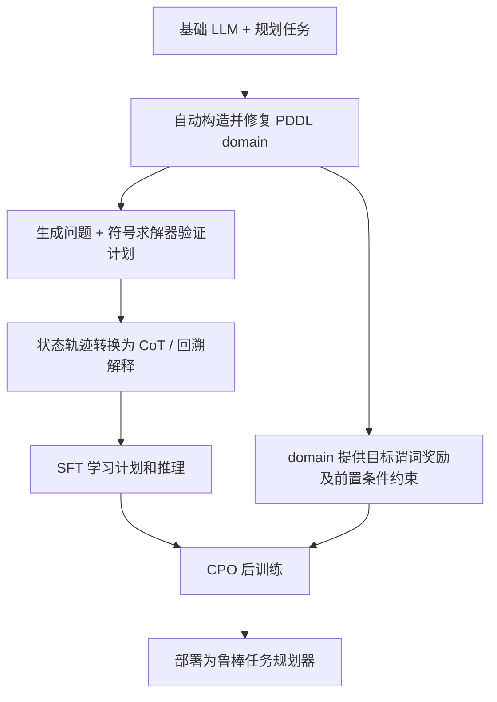
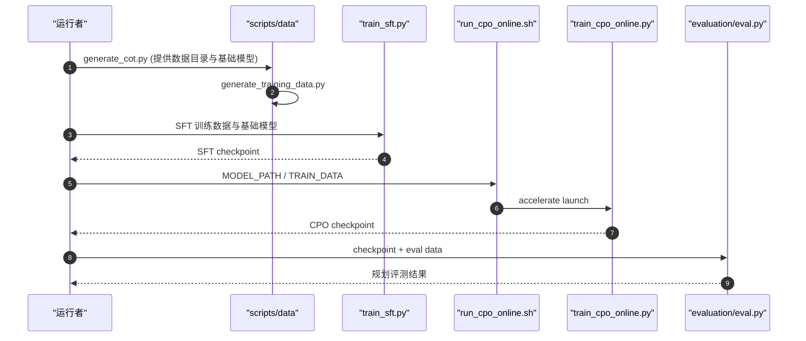

# Self-CriTeach｜自教与自我批判的机器人符号规划

[论文英文标题：LLM Self-Teaching and Self-Critiquing for Improving Robotic Planning via Automated Domain Generation](https://arxiv.org/abs/2509.21543) · **ICML 2026（PMLR 306）** · [项目页](https://markli1hoshipu.github.io/Plan_LLM/) · [代码](https://github.com/markli1hoshipu/Plan_LLM/)

## 一句话定义

通过 LLM **自生成规划域**，让同一份 PDDL 既产生可验证的计划与 CoT 数据用于 SFT，又成为 RL 的步骤奖励与约束，从而把符号规划能力学进语言模型。

## 英文缩写速查

| 缩写 | 英文全称 | 简要说明 |
|---|---|---|
| PDDL | Planning Domain Definition Language | 机器可求解的谓词、前置条件与动作效果 |
| CoT | Chain-of-Thought | 从符号状态变化变换来的解释轨迹 |
| SFT | Supervised Fine-Tuning | 让模型学习计划与解释的有监督微调 |
| CPO | Constrained Policy Optimization | 对违规前置条件施加成本约束的 RL 更新 |
| LLM | Large Language Model | 自教、自我评价及最终推理的主体 |

## 为什么重要

- 直接 prompting 的长计划容易积累状态错误；纯 PDDL planner 又依赖较准确的感知谓词。
- 手写 CoT 和人工 RL reward 代价高；本文将机器验证的 domain 同时转化成**数据引擎 + 结构化反馈**。
- 与 [RoboHarness](./paper-robo-harness.md) 的策略编排互补：Self-CriTeach 改善**上层规划器本身**，而非跨策略交接的状态分布。

## 核心原理与流程总览

原文 §5：自写 domain 的 PRE / ADD / DELETE 效果先由求解器检验，再作为高密度监督。CPO 的奖励来自目标谓词已满足比例；约束成本覆盖前置条件违反和非法状态，而非人工给每个任务写一份 reward。

## 源码运行时序图

**边界：** 该时序图仅覆盖官方仓已给出的 CLI。仓库 README 自述自动化 domain generation 尚未集成，图中没有虚构对应源码入口。

## 工程实践

| 事项 | 实际可执行路径 |
|---|---|
| 数据/模型 | HF `Self-CriTeach/pddl-planning-data`、`Self-CriTeach/SCT`（子目录区分 Qwen / Llama） |
| 训练 | `generate_cot.py` → `generate_training_data.py` → `train_sft.py` → `run_cpo_online.sh` |
| 评测 | `scripts/evaluation/eval.py`；Pass@k 另有三阶段评估入口 |
| 机器人 | UR5e；逻辑状态来自规则分类器或 Qwen3-VL，底层通过 UR5e 控制 API |
| 开源限制 | 部分开源，暂不能端到端自动生成全部符号规划域 |

## 实验与评测

- 数据口径：SFT 训练为 **5,807** 条符号规划示例；测试包含多个 BlocksWorld 及 1,400 个未见任务实例（§6、附录 A.2–A.3）。
- 论文表 3：SCT-4B 的整体计划成功率 **0.46**，基础 Qwen3-4B **0.26**；仅 SFT 为 **0.43**，仅 CPO 为 **0.31**。这是**规划成功率**，不是实机端到端成功率。
- 论文表 5：UR5e 上在规则感知条件下，Room / Lab 成功率为 **0.80 / 0.90**，PDDL solver 为 **0.70 / 0.70**；每项 10 次试验。
- 论文报告改善未见任务泛化与推理 token 效率；不能把更少推理 token 直接等同于机器人操作更快。

## 结论

**domain 的价值不限于给求解器用：它还可生成监督和约束，让 LLM 内化规划规律。**

1. 优先检查 domain 中谓词 / 前置条件的正确性，否则生成数据和奖励会同步出错。
2. SFT 更直接改善完整计划成功；CPO 补充约束一致性，评测须同时看 success / progress。
3. 实机有噪声感知时，必须区分「状态识别」与「计划生成」两个误差源。
4. 开源仓可尝试已有训练和评测链路，不能当作论文全系统可复现。

## 与其他工作对比

- [RoboHarness](./paper-robo-harness.md) 重在组合异构策略、处理 handoff；本研究重在增强符号任务规划器自身。
- [StageGuard](./paper-stageguard.md) 用解释蒸馏解决**何时切换子任务**；本研究解决**如何产生更可靠的计划**。

## 局限与风险

- 依赖足够强的基础 LLM 生成合理规划域；规划域可错误、过拟合。
- 连续接触 / 形变 / 精细几何不容易被 PDDL 符号化。
- 官方源码为部分实现；无论文全流程从零复现承诺。

## 关联页面

- [RoboHarness 异构策略编排](./paper-robo-harness.md)
- [StageGuard 子任务切换](./paper-stageguard.md)
- [VLA](../methods/vla.md)

## 参考来源

- [论文原文核对](../../sources/papers/self_criteach_arxiv_2509_21543.md)
- [官方项目](../../sources/sites/self-criteach.md)
- [官方源码核查](../../sources/repos/self-criteach-plan-llm.md)

## 推荐继续阅读

- [PMLR 正式发表](https://proceedings.mlr.press/v306/huang26v.html)
- [arXiv HTML v4](https://arxiv.org/html/2509.21543)
- [Plan_LLM 代码](https://github.com/markli1hoshipu/Plan_LLM)
