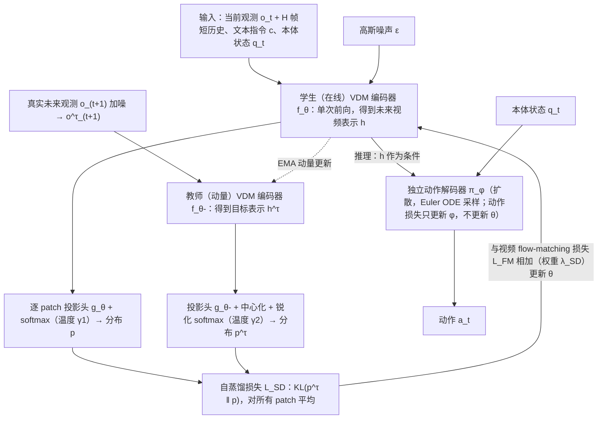

# Self-Distilling WAM：面向世界动作模型的未来视频表示自蒸馏

**Self-Distilling WAM**（*Self-Distilling Future Video Representations for World Action Models*，[arXiv:2610.30320](https://arxiv.org/abs/2610.30320)）收录于 senlanke「具身运控lab」10-19–10-23 前沿论文动态（Manipulation）。本页依据**周报条目 + arXiv 摘要页**整理，流程图依据论文方法部分（见参考来源），未逐页核对实验数字；指标与结论以论文为准。

## 一句话定义

**Self-Distilling WAM：面向世界动作模型的未来视频表示自蒸馏——研究未来视频表示的自蒸馏，使模型通过蒸馏学习未来视觉特征，并将这些表示用于世界动作建模。**

## 英文缩写速查

| 缩写 | 英文全称 | 简要说明 |
|------|----------|----------|
| WAM | World Action Model | 世界–动作联合建模 |
| VLA | Vision-Language-Action | 视觉–语言–动作模型 |

## 为什么重要

- 周报所述待解决的问题：WAM 需要利用未来视觉变化学习动作，但完整视频预测会带来较高计算成本。如何保留未来信息中的控制相关特征，是提高模型效率的重要问题。

## 流程总览

图依据：论文 §3.1–§3.2 / Fig.2、Eq.1–4。

## 核心机制

| 项 | 内容 |
|----|------|
| **arXiv** | [2610.30320](https://arxiv.org/abs/2610.30320) · [PDF](https://arxiv.org/pdf/2610.30320) |
| **作者（arXiv）** | Huiwon Jang, Suhyeok Jang, Hyeonmo Kang, Seungku Kim, Jinwoo Shin, Sihyun Yu |
| **机构（周报所述，未逐条核实）** | 待核实（作者：Huiwon Jang、Suhyeok Jang、Jinwoo Shin、Sihyun Yu）。 |
| **arXiv 评论栏** | 27 pages; Project page: this https URL |
| **开源** | arXiv 摘要页/评论给出项目页或外链（https://huiwon-jang.github.io/FRED/）；未发现代码仓库链接（2026-10-26） |
| **周报所述创新点** | 研究未来视频表示的自蒸馏，使模型通过蒸馏学习未来视觉特征，并将这些表示用于世界动作建模。 |

### arXiv 摘要节选（英文原文）

> World Action Models (WAMs) have emerged as a promising approach to learning generalist robot policies using rich spatiotemporal priors from pre-trained video diffusion models. A recent line of WAMs improves inference efficiency by conditioning a separate action decoder on intermediate future video representations extracted from a single denoising step, avoiding costly iterative denoising required for video generation.

## 源码运行时序图

**不适用**：arXiv 摘要页/评论给出项目页或外链（https://huiwon-jang.github.io/FRED/）；未发现代码仓库链接，无可对齐的官方代码流程。

## 实验与评测

- 周报与摘要给出的数字/场景已写入上表「创新点」与摘要节选；其余实验细节、基线与成功率定义请回到论文正文。
- 读法：先对齐任务设定、传感器与成功定义（仿真/真机），再解读 headline 数字，勿跨论文直接比较。

## 与其他工作对比

| 维度 | 读法 |
|------|------|
| **同周对照** | 见 [Manipulation周报技术地图](../overview/senlanke-weekly-2026-10-19-23-manipulation-technology-map.md)，按方向浏览同期论文 |
| **开源状态** | arXiv 摘要页/评论给出项目页或外链（https://huiwon-jang.github.io/FRED/）；未发现代码仓库链接 |

## 结论

**Self-Distilling WAM：面向世界动作模型的未来视频表示自蒸馏。**

1. 本页是入库级摘要，复现前请核对论文正文、附录与代码仓库。
2. 指标须连同实验条件解读。
3. 关注 arXiv 版本更新与代码发布。

## 关联页面

- [senlanke-weekly-2026-10-19-23-manipulation-technology-map](../overview/senlanke-weekly-2026-10-19-23-manipulation-technology-map.md)
- [manipulation](../tasks/manipulation.md)
- [vla](../methods/vla.md)

## 参考来源

- [self-distilling-future-video-representations-wam_arxiv_2610_30320.md](../../sources/papers/self-distilling-future-video-representations-wam_arxiv_2610_30320.md)
- [wechat_senlanke_weekly_manipulation_2026-10-19_23.md](../../sources/blogs/wechat_senlanke_weekly_manipulation_2026-10-19_23.md)
- [arXiv:2610.30320](https://arxiv.org/abs/2610.30320)
- [arXiv PDF](https://arxiv.org/pdf/2610.30320)：已通读方法部分（实验与附录以略读为准）：§3.1–§3.2、§4.1 实现细节

## 推荐继续阅读

- [arXiv PDF](https://arxiv.org/pdf/2610.30320)
