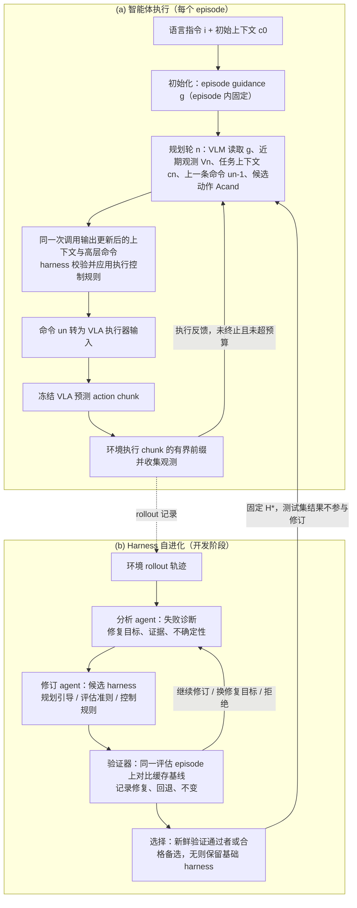

# Self-Evolving Harness：从视觉语言规划器到机器人智能体：面向历史依赖操作的自演化执行框架

**Self-Evolving Harness**（*From VLM Planners to Robotic Agents: Self-Evolving Harnesses for History-Dependent Manipulation*，[arXiv:2610.29560](https://arxiv.org/abs/2610.29560)）收录于 senlanke「具身运控lab」10-19–10-23 前沿论文动态（Manipulation）。本页依据**周报条目 + arXiv 摘要页**整理，流程图依据论文方法部分（见参考来源），未逐页核对实验数字；指标与结论以论文为准。

## 一句话定义

**Self-Evolving Harness：从视觉语言规划器到机器人智能体：面向历史依赖操作的自演化执行框架——研究自演化机器人执行框架，使视觉语言规划能力与历史信息管理、动作执行和反馈更新结合，支持持续的任务决策。**

## 英文缩写速查

| 缩写 | 英文全称 | 简要说明 |
|------|----------|----------|
| VLA | Vision-Language-Action | 视觉–语言–动作模型 |
| IL | Imitation Learning | 模仿学习 |

## 为什么重要

- 周报所述待解决的问题：历史依赖操作需要根据过去的观测、动作和执行结果进行决策。单次视觉语言规划难以持续处理任务状态变化。

## 流程总览

图依据：论文 §3.1–§3.3 / Fig.2

## 核心机制

| 项 | 内容 |
|----|------|
| **arXiv** | [2610.29560](https://arxiv.org/abs/2610.29560) · [PDF](https://arxiv.org/pdf/2610.29560) |
| **作者（arXiv）** | Tingwen Du, Haoyu Guo, Hanxue Zhang, Xuanxu Wang, Junting Dong, Chao Gao, Mingfei Han, Tao Lu, Mulin Yu, Chunhua Shen, Xiaojun Chang, Zhihui Li |
| **机构（周报所述，未逐条核实）** | 待核实（作者：Tingwen Du、Chunhua Shen、Xiaojun Chang 等）。 |
| **arXiv 评论栏** | （无） |
| **开源** | arXiv 摘要页与评论未见代码或项目页链接（仅核对 arXiv 摘要页，不代表未发布）（2026-10-26） |
| **周报所述创新点** | 研究自演化机器人执行框架，使视觉语言规划能力与历史信息管理、动作执行和反馈更新结合，支持持续的任务决策。 |

### arXiv 摘要节选（英文原文）

> Vision-language-action (VLA) models achieve strong performance across embodied manipulation tasks by unifying visual understanding, language conditioning, and action generation. However, long-horizon tasks can involve non-Markovian dependencies: successful decisions may require retaining task progress and past interaction outcomes, while partial observability and execution errors compound over time.

## 源码运行时序图

**不适用**：arXiv 摘要页与评论未见代码或项目页链接（仅核对 arXiv 摘要页，不代表未发布），无可对齐的官方代码流程。

## 实验与评测

- 周报与摘要给出的数字/场景已写入上表「创新点」与摘要节选；其余实验细节、基线与成功率定义请回到论文正文。
- 读法：先对齐任务设定、传感器与成功定义（仿真/真机），再解读 headline 数字，勿跨论文直接比较。

## 与其他工作对比

| 维度 | 读法 |
|------|------|
| **同周对照** | 见 [Manipulation周报技术地图](../overview/senlanke-weekly-2026-10-19-23-manipulation-technology-map.md)，按方向浏览同期论文 |
| **开源状态** | arXiv 摘要页与评论未见代码或项目页链接（仅核对 arXiv 摘要页，不代表未发布） |

## 结论

**Self-Evolving Harness：从视觉语言规划器到机器人智能体：面向历史依赖操作的自演化执行框架。**

1. 本页是入库级摘要，复现前请核对论文正文、附录与代码仓库。
2. 指标须连同实验条件解读。
3. 关注 arXiv 版本更新与代码发布。

## 关联页面

- [senlanke-weekly-2026-10-19-23-manipulation-technology-map](../overview/senlanke-weekly-2026-10-19-23-manipulation-technology-map.md)
- [manipulation](../tasks/manipulation.md)
- [vla](../methods/vla.md)

## 参考来源

- [self-evolving-harness-history-dependent-manipulation_arxiv_2610_29560.md](../../sources/papers/self-evolving-harness-history-dependent-manipulation_arxiv_2610_29560.md)
- [wechat_senlanke_weekly_manipulation_2026-10-19_23.md](../../sources/blogs/wechat_senlanke_weekly_manipulation_2026-10-19_23.md)
- [arXiv:2610.29560](https://arxiv.org/abs/2610.29560)
- [arXiv PDF](https://arxiv.org/pdf/2610.29560)：已通读方法部分（实验与附录以略读为准）：§1、§2、§3.1–§3.3（§4 实验与附录 B 未读）

## 推荐继续阅读

- [arXiv PDF](https://arxiv.org/pdf/2610.29560)
