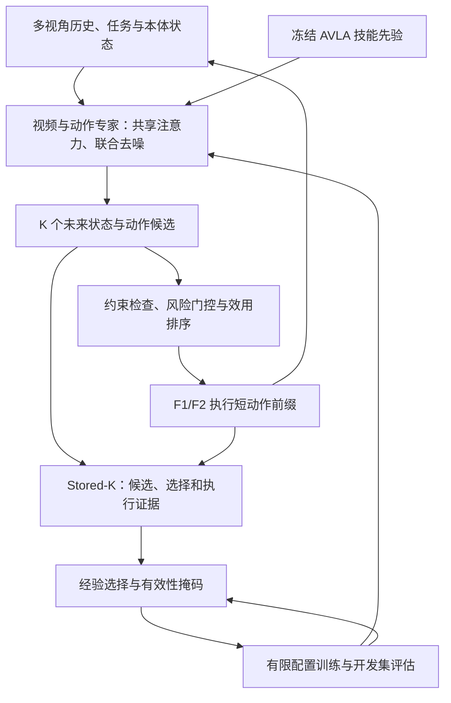

# Self-Evolving WAM：自演化世界动作模型

## 一句话定义

未来不远的 **Self-Evolving WAM** 将未来状态与机器人动作联合生成，用真实交互和训练结果改进模型及经验选择策略。

## 英文缩写速查

| 缩写 | 英文全称 | 简要说明 |
|------|----------|----------|
| WAM | World Action Model | 联合建模未来状态与动作 |
| AVLA | Action Vision Language Action | 报告使用的技能先验名称 |
| VLM | Vision-Language Model | 编码视觉与任务语义 |
| RSI | Recursive Self-Improvement | 通过训练反馈调整有限学习策略 |
| MoE | Mixture of Experts | 按技能组织的专家混合结构 |

## 流程总览

## 核心机制

- **联合生成：** 视频专家由 Wan2.2-TI2V-5B 初始化；未来视觉 latent 与动作 token 在共享注意力中双向交互。动作采用末端位姿增量与末端控制命令，F1/F2 通过各自接口适配。
- **技能与候选：** 冻结的 1.1B AVLA 包含 12 个技能专家，为动作流提供条件。独立评估器评估价值、风险与不确定性；约束和风险不通过的候选不能参与效用排序，无可行候选时重规划或停止。
- **异步控制：** 云端预测较长窗口，机器人只执行短前缀并并行请求下一轮；过期或状态偏差过大的结果丢弃，本地控制器负责高频跟踪与急停。
- **Stored-K：** 保存各候选的预测、评分、选择及实际执行记录。真实监督只覆盖动作对应且观测有效的执行窗口；未执行候选不能直接继承选中动作的结果。
- **有限自改进：** Evolution Judge 根据误差、覆盖、候选分歧及冗余选择有效经验；Training Agent 比较有限配置的采样与损失权重。各分支共用起始模型、冻结经验池、预算和每轮固定的独立评估器；配置选择与模型上线分别验收。报告中的 RSI 限于这个有限配置空间。

## 数据与评测

报告称训练使用超过 **10,000 小时**自有第一人称视频和 **30,000 小时** F1/F2 交互数据。无动作标签的视频提供视觉监督；失败片段可用于世界预测及风险学习，但不作为正向动作示范。

| 完整演示 | 第 0 轮 | 第 30 轮 |
|---|---:|---:|
| 叠衣服 | 54.6% | 96.8% |
| 晾衣服 | 46.2% | 91.2% |
| 制作意面 | 42.7% | 89.5% |
| 辣椒炒肉 | 38.2% | 68.9% |

口径为整次演示的自主完整成功率；接管后完成不计成功，超时与失败留在分母。报告固定 K=4，30 轮指外循环尝试次数，拒绝的更新也计入。

## 结论

该系统将候选预测、真实执行和后续训练连接起来；报告的演示成功率随迭代上升，但尚不能据此单独证明自改进机制的因果贡献。

1. 比较方法时，应区分联合世界动作生成、在线候选筛选与离线训练策略反馈。
2. 未执行候选只能从独立检查获得相应范围的弱标签，不能当作真实成败样本。
3. 需要同时评估云端延迟、异步调度与控制误差，不能把所有失败归因于世界模型。
4. 报告尚未提供各表格单元格的试验次数和置信区间；21 项子任务的独立评测、泛化与机制消融列为后续工作。

## 源码运行时序图

不适用：截至 2026-11-05，官方报告页未列出可运行实现或权重入口，无法核实实际调用关系。

## 关联页面

- [World Action Models](../concepts/world-action-models.md)
- [Manipulation](../tasks/manipulation.md)
- [VLA](../methods/vla.md)

## 参考来源

- [Self-Evolving WAM 官方技术报告归档](../../sources/sites/futuring-self-evolving-wam-report.md)

## 推荐继续阅读

- [Self-Evolving WAM 技术报告全文](https://m.futuringrobot.com/feasibility-report)
