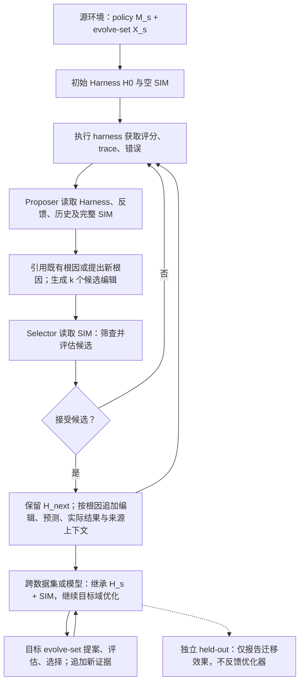

# SIM：自改进记忆让递归自我改进得以延续 / Self-Improvement Memory Enables Continual Recursive Self-Improvement

**论文：** Xin Yu 等（Google Cloud AI、Google DeepMind、Penn State），2026-11-13，arXiv:2611.18856v1（预印本）。[arXiv HTML](https://arxiv.org/html/2611.18856v1) · [PDF](https://arxiv.org/pdf/2611.18856v1) · [作者项目页](https://lucasxinyu.github.io/sim/)。

## 一句话定义

**SIM（Self-Improvement Memory）**把 Agent **harness（提示、工具、上下文与执行编排）**历次优化的**根因、修改理由、预期与实测结果及评测上下文**存成可累积的结构化记录，让 harness 在更换任务数据或底座策略模型后继续优化，形成 **CRSI（Continual Recursive Self-Improvement）**；策略模型权重保持冻结。

## 英文缩写速查

| 缩写 | 英文全称 | 简要说明 |
|---|---|---|
| SIM | Self-Improvement Memory | 给 harness 优化器（proposer/selector）用的结构化改进经验 |
| CRSI | Continual Recursive Self-Improvement | 换模型或任务数据后，沿用并继续优化可执行 harness |
| RSI | Recursive Self-Improvement | 迭代改写下一轮继续执行任务的系统自身 |
| TB2.1 / TB4 | Terminal-Bench 2.1 / Terminal-Bench 4 | coding 域的源/目标评测 |
| AHE | Automated Harness Engineering | 本文 coding 基线之一 |
| MCP | Model Context Protocol | workspace 中的工具网关协议，不是 SIM 算法本身 |

## 为什么重要

- **继承代码不等于继承原因：** 为 Claude Opus 优化的 harness 在 Gemini 上可能反而退化。没有之前的失败诊断、预测与验证，继续优化会误删有用规则或重复错误尝试。
- **把“为什么这样改”纳入优化状态：** 只记根因不足以重建修改的适用条件；SIM 把同一问题的多次尝试和正反结果串起来，使下一轮决定保留、改写或废弃旧修改。
- **可检验的迁移收益：** 作者比较同一已演化 harness 的「无记忆 / 仅根因 / 完整 SIM」十轮继续优化，并在 coding 的十组独立源运行上做配对分析。
- **对机器人研发的意义属工程推论：** 训练脚本、仿真评测和实验管理 Agent 可记录“问题→修改→假设→指标→模型/数据/环境版本”，但论文**没有**验证真实机器人策略自我改进。

## 核心原理

### 1. 优化谁：Policy 与 Harness 分开

- **策略模型 M** 执行任务；在论文的 harness RSI 过程里其**权重固定**。
- **Harness H** 决定上下文、工具和执行过程，可以通过 proposer 提案与 selector 评估进行迭代修改。
- 一个设置记为 `(M, X)`，其中 `X` 拆成 evolve-set 和互斥的 held-out evaluation set；只有 evolve-set 的 trace/分数进入提案、选择和 SIM 更新。
- 跨数据集：`M` 不变、`X` 改变；跨模型：`M` 改变、`X` 及拆分不变。**前提是源/目标 harness 执行接口兼容**。

### 2. SIM 记什么：问题根因 + 按时间追加的多次尝试

论文 §3.2 的记忆条目为 `m_i = (c_i, [(a_ij, o_ij, p_ij)]_j)`：

| 字段 | 含义 | 阅读时要问 |
|---|---|---|
| `c_i` | 根因假设（如提前宣布完成） | 目标任务还发生同类失效吗？ |
| `a_ij` | 第 j 次编辑、修改理由 | 本次需要保留的是动机还是代码形式？ |
| `o_ij` | 评测前预测与评测后结果 | 哪些任务修好了，哪些没修好？ |
| `p_ij` | 域、基准、策略模型与轮次 | 经验何时适用，何时存在分布偏移？ |

附录 D 给出的真实数据结构是一个持续追加的 JSON：`problems[].attempts[]` 包含 `what`、`files`、`predicted`、`fixed`、`missed`、`passed/total` 等；`carried_from` 与 `aliases` 记录来源迁移与合并身份。**只有 selector 选中的改动写入 SIM；若预测未兑现，其实测负结果同样留下。** 如本轮未接受任何修改则不新增记录。

### 3. 原论文机制流程图（不是源码调用图）

**运行机制：** proposer 与 selector 每轮读取**完整 SIM**（未做检索/截断），新目标环境可保留旧诊断并调整具体检查逻辑。论文采用 **10 轮 × 每轮 5 个候选**，被预筛掉的候选没有执行评分；不要误读成 50 次成功修改。

## 工程实践

| 对象 | 可操作建议（由论文延伸，非作者真机实测） |
|---|---|
| 日志模型 | 每项根因固定记录：`problem_id`、配置版本、编辑 diff、假设、预测任务、观测 pass/fail、模型与数据版本 |
| 优化流程 | 把记录同时供给提案与选择阶段；保留失败实验及废弃编辑的依据，不能仅留下最新 `AGENTS.md` 或 prompt |
| 迁移验证 | 换任务集或模型时从**同一演化版本**分别运行「仅 harness」与「harness + SIM」，固定轮数、候选和评测拆分 |
| 评分隔离 | 优化阶段只能看 evolve-set；held-out 分数用于最终比较而不是回写提示与记忆，防止 reward hacking |
| 成本与安全 | 长期运行需给 SIM 限长、版本索引和 token 成本预算；如果进入机器人研发，应先在离线代码与仿真验证，真机执行须独立安全门与回滚 |

与 [Coding Agent 验证闭环](../methods/coding-agent-verification-loops.md)、[Claude Code 动态工作流](../methods/claude-code-dynamic-workflows.md) 相比，SIM 的新增约束是让**改变工作流的理由和验证证据**随版本一起传递。

## 实验与评测

**跨模型迁移：Claude Opus 5.5 演化 harness → Gemini 3.8 Flash 继续优化（论文 Table 6，held-out，10 轮）。**

| 目标任务 | 仅 Harness 最终 | Full SIM 最终 | 差额 |
|---|---:|---:|---:|
| Coding / AHE | 18.18 | 21.82 | +3.64 |
| Text classification / FewShotAll | 80.20 | 83.80 | +3.60 |
| Agentic workspace / ReAct | 73.42 | **84.75** | **+11.33** |
| Engineering design / ReAct | 42.61 | 50.43 | +7.82 |

- Workspace 上未经目标优化的 Gemini 原始 seed harness 是 **73.89**；Opus 已改好的 harness 直接迁移后只有 **68.41**，即起点 **-5.48** 分。完整 SIM 与仅 Harness 都从 **68.41** 出发，最后分别为 84.75 与 73.42；不是 84.75 对 73.42 的十组独立重复。
- 四域十种设置（6 个跨数据集、4 个跨模型）中，Full SIM 在列出的单次优化运行均领先。Problem-Only 对照在不同设置中有正有负，说明不能把增益简单解释为「有了根因标签」。

**十组独立编程配对（论文 Table 3）：** Terminus-2 经 TB2.1 源优化后，分别从同一源 harness 在 TB4 延续 10 轮；平均初始 **18.36**、无 SIM 最终 **19.33**、有 SIM **21.70**，按原始精度求配对平均差为 **+2.36** 分，**9/10** 组更好（1 组 **-0.61**）；95% CI **[1.05, 3.68]**、双侧配对 t 检验 **p=0.003**。小数经独立四舍五入，故 21.70−19.33 与 2.36 有 0.01 显示误差。

**反例：** 在 Gemini 代际串行迁移的 4 Argon 阶段（Table 1），CRSI **94.8** 不及 Fresh RSI **95.6**；作者没有宣称每次迁移必胜。

## 结论

**SIM 的有效证据是：在兼容接口、冻结策略权重和受控候选预算下，把已测试的改进理由与结果同 harness 一起迁移，可以帮助后续继续优化；它不是模型权重自进化或真机自改进的证明。**

1. 保存“问题 → 预期 → 修改 → 实测 → 运行上下文”，而非只保存最终补丁。
2. **记录不成功的预测和被后来取代的修改**，因为它们能避免错误重试。
3. 判断可迁移性时，分清继承的是**问题诊断**还是具体实现；模型或任务换代后要重新核查。
4. 评测中区分**独立优化种子**与同一次运行的多条 rollout。
5. 每个新环境都验证同起点、同预算的消融，并独立衡量 source retention。
6. 机器人方向先落地离线 harness 版本、仿真测试与人工安全否决，不能将上述分数视作真机收益。

## 源码运行时序图

**不适用。** 截至 2026-11-21，作者 [SIM 项目页](https://lucasxinyu.github.io/sim/) 明确未提供公开可运行实现；附录 D 的 JSON 结构和 prompt 描述**不是**源码入口，不据此编造 `sequenceDiagram`。

## 局限与风险

- **统计外推有限：** 编程做了十组独立源种子配对；其他域每条件只有一轮完整优化实验，单任务多次 rollout 不是独立 RSI 重复。Workspace 用 Gemini judge 可能有评分偏差。
- **并非成本完全匹配：** 论文固定每轮候选数与轮数，但未严格控制总 token / wall-clock；完整 SIM 每轮加载，长期记忆成本可能增加。
- **仅测试兼容接口：** 当工具协议、评估器或运行接口不兼容时，论文不证明能迁移；模型代际有一组 Fresh RSI 反超。
- **改对评分器不等于改对任务：** 优化 harness 可迎合 verifier/judge，需冻结检查规则并隔离 held-out。
- **不等于自训练：** policy model 权重没有变；没有机器人接触操作、Sim2Real、在线安全验证或物理控制实验；工程延伸是建议而非实验结论。

## 关联页面

- [递归自我改进（RSI）](../concepts/recursive-self-improvement.md) — 改进层级：记忆、权重、评分器、harness、研究过程
- [Agent 记忆与 dreaming](../concepts/agent-memory-and-dreaming.md) — SIM 存的是**优化过程**而非面向下次用户任务的偏好/事实记忆
- [Harness²](./paper-harness2.md) — 另一个跨任务复用改进经验的 harness 优化体系，不能混成同一论文
- [AIDE²](./paper-aide2-recursive-self-improvement-ai-research-agents.md) — 同属优化 agent harness，但重点在固定研发预算与外部任务
- [Coding Agent 验证闭环](../methods/coding-agent-verification-loops.md)
- [Claude Code 动态多 Agent 工作流](../methods/claude-code-dynamic-workflows.md)
- [RSI 纵深路线 Stage 4](../../roadmap/depth-rsi.md)

## 参考来源

- [论文一手精读归档](../../sources/papers/self_improvement_memory_arxiv_2611_18856.md)
- [作者项目页核对归档](../../sources/sites/self-improvement-memory-sim.md)
- [论文 arXiv v1 HTML（方法 §3、实验 §4、附录 B–F）](https://arxiv.org/html/2611.18856v1)
- [SIM 官方项目页](https://lucasxinyu.github.io/sim/)

## 推荐继续阅读

- [原论文 PDF（包括根因记录字段和任务级案例）](https://arxiv.org/pdf/2611.18856v1)
- [RSI 纵深路线：从修改 harness 到验证迁移](../../roadmap/depth-rsi.md)
