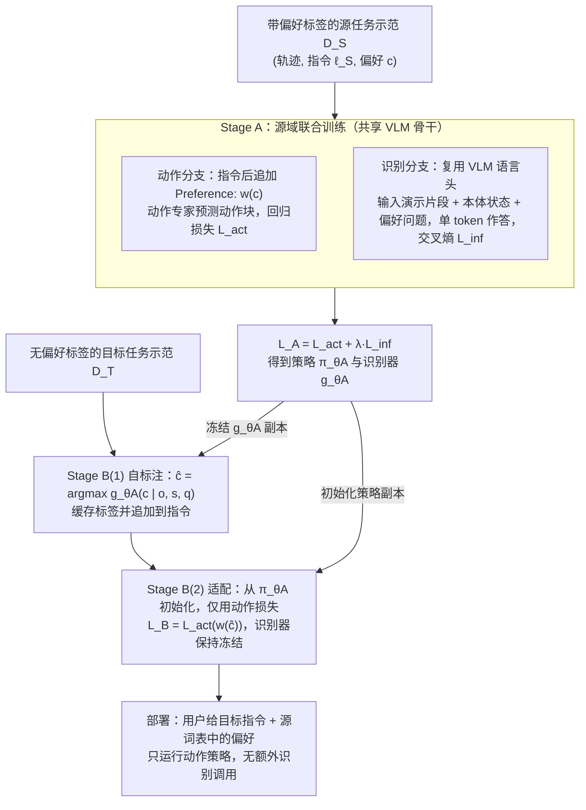

# SPT 自标注偏好迁移：面向可控机器人操作的自标注偏好迁移

**SPT 自标注偏好迁移**（*Self-Labeled Preference Transfer for Steerable Robot Manipulation*，[arXiv:2610.38000](https://arxiv.org/abs/2610.38000)）收录于 senlanke「具身运控lab」10-26–10-30 前沿论文动态（Manipulation）。本页依据**周报条目 + arXiv 摘要页**整理，流程图依据论文方法部分（见参考来源），未逐页核对实验数字；指标与结论以论文为准。

## 一句话定义

**SPT 自标注偏好迁移：面向可控机器人操作的自标注偏好迁移——提出 Self-Labeled Preference Transfer（SPT）。首先联合训练偏好识别器和偏好条件策略，然后冻结识别器，为新任务的未标注示范自动生成偏好标签。在真实机器人任务迁移中，偏好遵循率由 **52.5% 提升至 92.5%**。**

## 英文缩写速查

| 缩写 | 英文全称 | 简要说明 |
|------|----------|----------|
| VLA | Vision-Language-Action | 视觉–语言–动作模型 |
| IL | Imitation Learning | 模仿学习 |

## 为什么重要

- 周报所述待解决的问题：VLA 可以从标注示范中学习抓取位置、绕障路径等执行偏好，但迁移到新任务后，普通微调容易提高任务成功率，却破坏原有偏好控制能力。

## 流程总览

图依据：论文 §IV Methods（Stage A / Stage B / Deployment）、Fig. 2、式 (3)–(5)。

## 核心机制

| 项 | 内容 |
|----|------|
| **arXiv** | [2610.38000](https://arxiv.org/abs/2610.38000) · [PDF](https://arxiv.org/pdf/2610.38000) |
| **作者（arXiv）** | Hong, Kaiwen, Peng, Shaoting, Zeng, Xiangyu, Wang, Pengcheng, Tian, Boyuan, Chen, Haonan, Zhu, Yifan, Wang, Yixiao et al. |
| **机构（周报所述，未逐条核实）** | 伊利诺伊大学厄巴纳-香槟分校、加州大学伯克利分校等。 |
| **arXiv 评论栏** | （无） |
| **开源** | arXiv 摘要页与评论未见代码或项目页链接（仅核对 arXiv 摘要页，不代表未发布）（2026-11-02） |
| **周报所述创新点** | 提出 Self-Labeled Preference Transfer（SPT）。首先联合训练偏好识别器和偏好条件策略，然后冻结识别器，为新任务的未标注示范自动生成偏好标签。在真实机器人任务迁移中，偏好遵循率由 **52.5% 提升至 92.5%**。 |

### arXiv 摘要节选（英文原文）

> Vision-language-action (VLA) policies can learn to follow execution preferences, such as where to grasp an object or how to move around an obstacle, from demonstrations annotated with preference labels. Providing these annotations for every new task, however, is costly.

## 源码运行时序图

**不适用**：arXiv 摘要页与评论未见代码或项目页链接（仅核对 arXiv 摘要页，不代表未发布），无可对齐的官方代码流程。

## 实验与评测

- 周报与摘要给出的数字/场景已写入上表「创新点」与摘要节选；其余实验细节、基线与成功率定义请回到论文正文。
- 读法：先对齐任务设定、传感器与成功定义（仿真/真机），再解读 headline 数字，勿跨论文直接比较。

## 与其他工作对比

| 维度 | 读法 |
|------|------|
| **同周对照** | 见 [Manipulation周报技术地图](../overview/senlanke-weekly-2026-10-26-30-manipulation-technology-map.md)，按方向浏览同期论文 |
| **开源状态** | arXiv 摘要页与评论未见代码或项目页链接（仅核对 arXiv 摘要页，不代表未发布） |

## 结论

**SPT 自标注偏好迁移：面向可控机器人操作的自标注偏好迁移。**

1. 本页是入库级摘要，复现前请核对论文正文、附录与代码仓库。
2. 指标须连同实验条件解读。
3. 关注 arXiv 版本更新与代码发布。

## 关联页面

- [senlanke-weekly-2026-10-26-30-manipulation-technology-map](../overview/senlanke-weekly-2026-10-26-30-manipulation-technology-map.md)
- [manipulation](../tasks/manipulation.md)
- [vla](../methods/vla.md)

## 参考来源

- [self-labeled-preference-transfer-steerable-manipulation_arxiv_2610_38000.md](../../sources/papers/self-labeled-preference-transfer-steerable-manipulation_arxiv_2610_38000.md)
- [wechat_senlanke_weekly_manipulation_2026-10-26_30.md](../../sources/blogs/wechat_senlanke_weekly_manipulation_2026-10-26_30.md)
- [arXiv:2610.38000](https://arxiv.org/abs/2610.38000)
- [arXiv PDF](https://arxiv.org/pdf/2610.38000)：已通读方法部分（实验与附录以略读为准）：§III 问题设定、§IV 方法（Stage A 联合训练 / Stage B 自标注与适配 / 部署）、§V 实验设定

## 推荐继续阅读

- [arXiv PDF](https://arxiv.org/pdf/2610.38000)
