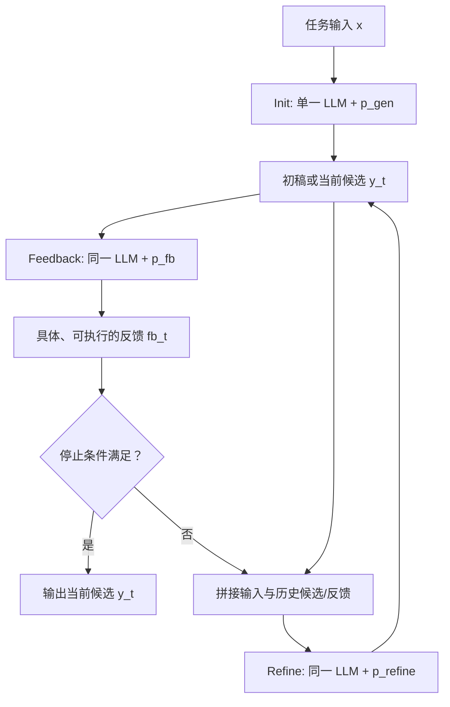
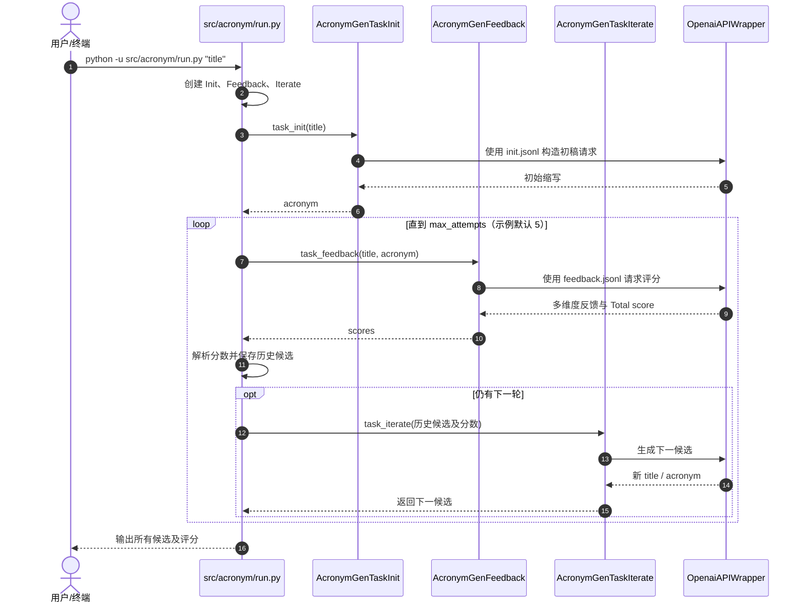

# Self-Refine：基于自反馈的迭代改进 / Iterative Refinement with Self-Feedback

## 一句话定义

**Self-Refine**（Aman Madaan 等，NeurIPS 2023）是一种 **无需更新模型权重** 的推理期改写方法：同一个大语言模型先生成答案，再给出可执行反馈，最后结合此前答案与反馈历史逐轮修订，直至满足任务定义的停止条件或迭代预算。

## 英文缩写速查

| 缩写 | 英文全称 | 简要说明 |
|---|---|---|
| LLM | Large Language Model | 三个阶段共用的底层语言模型 |
| ICL | In-Context Learning | 初稿、反馈、改稿均使用上下文示例或指令 |
| NL | Natural Language | 反馈主要是可执行的自然语言建议 |
| GSM8K | Grade School Math 8K | 论文数学推理评测使用的数据集 |
| PIE | Performance Improving Edits | 论文代码优化评测使用的任务/数据集 |

## 为什么重要

- **把改进从训练转到推理流程。** 不需要额外监督训练或 RL，只有多次 LLM 调用与任务专属提示词；适合输出可检查、允许二次编辑的文本/代码任务。
- **关键瓶颈是反馈质量。** 反馈要定位具体错误、说明修改动作，否则多轮迭代可能只是在重复生成。
- **区分「有界自改写」和 RSI。** 对照 [递归自改进](../concepts/recursive-self-improvement.md) 与 [RSI 全谱系综述](./paper-rsi-survey-2607-07663.md)：这里优化一次请求的候选输出，不改模型权重，也不设计后继模型。

## 核心信息

| 项目 | 经原文核对的事实 |
|---|---|
| 标题 | Self-Refine: Iterative Refinement with Self-Feedback（自反馈驱动的迭代改进） |
| 来源 | [arXiv:2303.17651v2](https://arxiv.org/abs/2303.17651v2)，2023-05-25；NeurIPS 2023 |
| 作者 | Aman Madaan、Niket Tandon、Prakhar Gupta 等（16 人） |
| 机构 | 卡内基梅隆大学（CMU）、艾伦人工智能研究所（AI2）、华盛顿大学、英伟达（NVIDIA）、加州大学圣迭戈分校、Google Research / Brain Team |
| 主页 | [selfrefine.info](https://selfrefine.info/) |
| 官方代码 | [madaan/self-refine](https://github.com/madaan/self-refine)，**已开源**，任务级脚本/提示词/数据 |
| 训练方式 | 无额外训练；同一模型充当生成器、反馈器、修订器 |
| 评测设置 | 七类生成任务；GPT-3.5、ChatGPT、GPT-4，部分代码任务还用 Codex |

## 核心原理

设输入为 x、固定语言模型为 M，三种任务提示为 p_gen、p_fb、p_refine：

1. **初稿：** y₀ = M(p_gen ∥ x)。
2. **自反馈：** fbₜ = M(p_fb ∥ x ∥ yₜ)，要求给出具体可执行的修改意见。
3. **迭代改稿：** yₜ₊₁ = M(p_refine ∥ x ∥ y₀ ∥ fb₀ ∥ … ∥ yₜ ∥ fbₜ)。
4. **终止：** 论文 Algorithm 1 可按反馈输出的停止信号或固定最大轮次停止；输出最终候选。多指标任务可按评分比较各轮候选，不能预设质量单调提升。

这是 **同一底层模型的不同提示角色**，并非三套分别训练的网络。

### 流程总览（按论文 §2 / Algorithm 1）

## 源码运行时序图

以下严格对应官方 [src/acronym/run.py](https://github.com/madaan/self-refine/blob/main/src/acronym/run.py) 的 **缩写生成实例**（不是虚构的通用 Agent 类）；三个角色分别由 task_init.py、feedback.py、task_iterate.py 实现，均经 OpenaiAPIWrapper 调用底层模型。

**源码边界：** 此缩写脚本按 max_attempts 固定次数执行；没有实现论文 Algorithm 1 的反馈触发提前停止。文件内的 total_score >= 0 也不是「只保留比历史最佳更好」的严格阈值。源码归档见 [sources/repos](../../sources/repos/self-refine-madaan.md)。

## 实验与评测

论文表 1 的 **GPT-4 同模型对照**（指标随任务变化；以下是百分点变化，不是统一口径成功率）：

| 任务 | 单轮生成 | +Self-Refine | 提升 |
|---|---:|---:|---:|
| Sentiment Reversal（人工/GPT-4 偏好） | 3.8 | 36.2 | +32.4 |
| Dialogue Response（偏好） | 25.4 | 74.6 | +49.2 |
| Code Optimization（程序优化比例） | 27.3 | 36.0 | +8.7 |
| Code Readability（可读性指标） | 27.4 | 56.2 | +28.8 |
| Math Reasoning（解题率） | 92.9 | 93.1 | +0.2 |
| Acronym Generation（偏好） | 30.4 | 56.0 | +25.6 |
| Constrained Generation（约束覆盖） | 15.0 | 45.0 | +30.0 |

- **反馈消融（表 2）：** 在 ChatGPT 的代码优化任务中，具体反馈 27.5、通用反馈 26.0、无反馈 24.8；精确反馈更有价值。
- **迭代收益：** 多轮可以继续提高质量，但边际收益递减；缩写生成可能出现前进一项、退步另一项的非单调现象。
- **自评局限：** 数学推理的自反馈往往无法定位微小错误；论文分析中引入外部正确性反馈会显著增加改进空间。
- **证据边界：** 这些是论文作者在 2023 年的英文语言和代码数据集结果，**没有**提供机器人真机、操控成功率或实时闭环安全的实验数据。

## 结论

**Self-Refine 值得作为输出质量优化的轻量方法，但质量上限来自模型能否识别自己的错误；反馈难验证时不能把更多轮数当作可靠性证明。**

1. **先设计反馈维度**：必须指出具体缺陷与可执行修正，不要只写「请再优化」。
2. **迭代预算要有限**：每轮增加模型调用成本，并可能边际收益递减。
3. **保存历史、评估回退**：多指标输出不保证单调改进，必要时留住得分较高的先前候选。
4. **数学/代码要外部验证**：单一模型的自检不足以替代单测、执行结果或形式校验。
5. **复现以任务入口为准**：项目是多个任务脚本，不能把论文算法理想化描述替代实际代码。
6. **不要直接外推到具身控制**：论文并未评估真实机器人的动作闭环或安全约束。

## 与其他工作对比

| 维度 | Self-Refine | 有界外部验证迭代 | 开放式 RSI |
|---|---|---|---|
| 改进对象 | 当前输出候选 | 当前程序/计划等可执行对象 | 可能包含模型、训练与评估机制 |
| 反馈来源 | 同模型自然语言自反馈 | 测试/环境/验证器 | 自评估与学习闭环共同演进 |
| 权重更新 | 不需要 | 通常不需要 | 可能发生 |
| 核心局限 | 模型自检错误与非单调性 | 验证覆盖度 | 开放目标、安全与控制 |

与 [RSI Survey](./paper-rsi-survey-2607-07663.md) 对照，Self-Refine 属于有界的 deployment-time output refinement，不能等同 [AI Auto-Research](../concepts/ai-auto-research.md) 的实验执行与研究目标选择。

## 工程实践

- **最短入门：** 按 README 安装 reasoning-machines/prompt-lib，并运行 python -u src/acronym/run.py "Using language models of code for few-shot commonsense"；模型 API 与依赖版本需自行配置。
- **实现拆分：** 维护独立 init、feedback、iterate prompt；为反馈设计可解析的评分字段（例：Total score），记录每轮候选与分数。
- **停止/监控：** 结合明确迭代上限、任务级评分和外部验证器；若部署到机器人工作流，应额外设置执行权限、人类审批和回滚（属于工程建议，非论文验证）。
- **源码提醒：** 官方示例固定使用历史模型名，2026 年 API 兼容性未经本次运行确认；不可宣称已复现论文结果。

## 局限与风险

- 模型需要足够的 ICL 与指令遵循能力；弱模型/错误反馈可能导致改稿退化。
- 原研究依赖非开源收费 LLM，只做英文数据集；跨语言、跨模型和成本曲线未直接验证。
- 自反馈不是可验证的外部真值；尤其在数学正确性问题上几乎没有增益。
- 原论文没有额外的安全控制；循环次数增加也不意味着结果永远提高。
- 官网和代码公开不等于模型权重开放；复现需要第三方 API，并可能涉及版本兼容问题。

## 关联页面

- [递归自改进（RSI）的边界](../concepts/recursive-self-improvement.md)
- [RSI Survey：从有界自改写到自主研究闭环](./paper-rsi-survey-2607-07663.md)
- [AI Auto-Research](../concepts/ai-auto-research.md)
- [具身大模型评测基准选型闭环](../queries/embodied-eval-benchmark-selection-loop.md) — 自反馈改写只是推理期自评；外部基准与 evaluator 选型见此

## 参考来源

- [论文原文归档（arXiv v2，含附录）](../../sources/papers/self_refine_arxiv_2303_17651.md)
- [官方项目主页归档](../../sources/sites/self-refine.md)
- [官方 GitHub 源码与入口审计](../../sources/repos/self-refine-madaan.md)

## 推荐继续阅读

- 论文全文：<https://arxiv.org/html/2303.17651v2>
- NeurIPS 2023：<https://papers.nips.cc/paper/2023/hash/91edff07232fb1b55a505a9e9f6c0ff3-Abstract-Conference.html>
- 官方代码：<https://github.com/madaan/self-refine>
