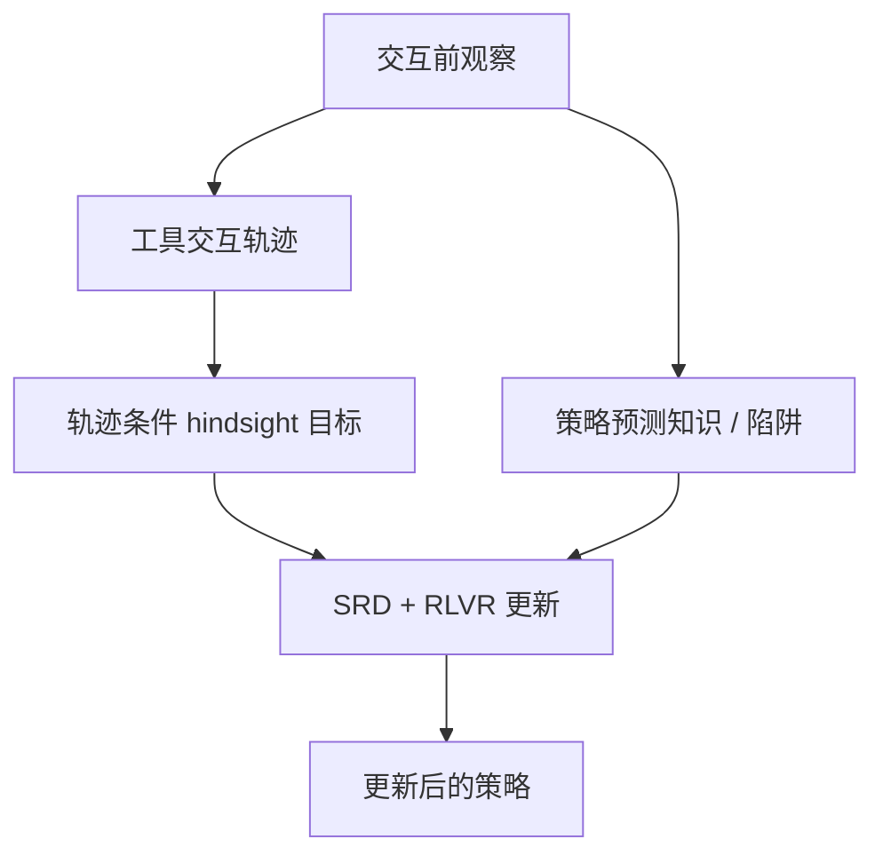

# Self-Retrospection Distillation：将事后经验蒸馏为事前预见

SRD 把完成轨迹中揭示的知识和陷阱蒸馏回同一策略，使策略训练时学会预测需求，而非推理时额外运行反思模型。

## 英文缩写速查

| 缩写 | 英文全称 | 简要说明 |
|------|----------|----------|
| SRD | Self-Retrospection Distillation | 用事后轨迹监督事前预测的训练方法 |
| RLVR | Reinforcement Learning with Verifiable Rewards | 通过可验证结果构造强化学习反馈 |
| GRPO | Group Relative Policy Optimization | 按同题 rollout 组内相对奖励更新策略 |
| KL | Kullback–Leibler Divergence | 衡量训练时策略分布差异 |

## 为什么重要

当同组 rollout 奖励一致时，group-relative 目标难以区分好坏，但轨迹仍揭示任务需求和失败原因。SRD 利用这些辅助信息，以训练时监督补足终局奖励信号。

## 方法栈与训练流程

交互前策略预测可能需要的知识和陷阱；rollout 完成后，stop-gradient 副本读取轨迹形成 hindsight 目标，再以蒸馏损失更新原策略。foresight 只作训练目标，推理时无需额外生成。

## 评测与结果

论文覆盖 10 项工具集成推理与长时程 agent 任务，最高报告提升 24.2 个百分点。37–98% rollout groups 奖励一致时仍能利用轨迹；2B 设置中 98% group 全失败，RLVR 成功率 0%，加入 SRD 达 60.6%（同一论文设置及 rollout budget）。

## 结论

**SRD 从终局奖励之外提取轨迹信息，尤其针对奖励缺乏区分度的训练组。**

1. 当 rollout 奖励常同值时，检验轨迹辅助目标是否提供额外学习信号。
2. Foresight 是训练靶，不需推理期额外 token；与显式反思 agent 分开核算成本。
3. 使用相同 rollout budget 比较 RLVR-only、SRD 组合与自蒸馏对照。
4. 大幅提升需按任务、规模、奖励一致率分层复核，不应外推为具身任务保证。
5. 隔离事后信息，防止未来轨迹泄漏到部署输入。
6. SRD 缩写不唯一，应以 arXiv ID 区分不同研究。

## 与其他工作对比

[RealCompanion](./paper-realcompanion.md) 是真实纵向对话理解 benchmark；SRD 是从交互轨迹学习 foresight 的训练方法。[Cross-Tokenizer OPD](./paper-cross-tokenizer-opd.md) 关注异构 tokenizer 监督对齐，两篇蒸馏方法所作用的信号不同。

## 工程实践

记录奖励方差、全同奖/全失败比例、辅助 loss 贡献和轨迹数据；检查 hindsight 目标的 stop-gradient 隔离。**源码运行时序图：** 不适用（arXiv 页面未列官方可运行代码仓库）。

## 局限与风险

只报告 10 项工具推理/长时任务；具身机器人迁移需单独实验。效果依赖 rollout 采样、奖励判定与工具可靠性。缺少公开运行入口时，计算成本和细节仍不可独立核验。

## 关联页面

- [RealCompanion](./paper-realcompanion.md) — 长期用户理解的真实对话基准
- [Cross-Tokenizer OPD](./paper-cross-tokenizer-opd.md) — token 级蒸馏对齐

## 参考来源

- [论文摘录](../../sources/papers/self_retrospection_distillation_arxiv_2610_08077.md)
- [arXiv:2610.08077v2](https://arxiv.org/abs/2610.08077v2)

## 推荐继续阅读

- [arXiv:2610.08077v2](https://arxiv.org/abs/2610.08077v2)
