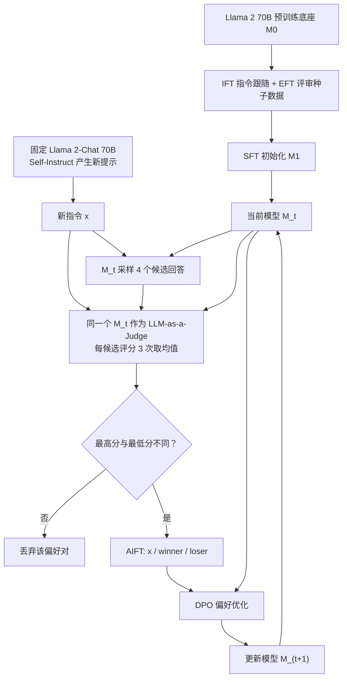

# Self-Rewarding Language Models：自奖励语言模型 / 自评判驱动的迭代偏好优化

## 一句话定义

**Self-Rewarding Language Models（Yuan 等，ICML 2024）**让**同一个 LLM**同时担任回答生成器与 LLM-as-a-Judge：自己给候选评分、构造偏好对，并用 **Iterative DPO** 更新下一轮模型权重，目标是同步改善指令遵循与自评判能力。

## 英文缩写速查

| 缩写 | 英文全称 | 简要说明 |
|---|---|---|
| LLM | Large Language Model | 生成回答、提供自评分的同一底座模型 |
| IFT | Instruction Fine-Tuning | 指令跟随的监督训练种子数据 |
| EFT | Evaluation Fine-Tuning | 评审能力的监督训练种子数据 |
| AIFT | AI Feedback Training | 模型自评分产生的偏好训练数据 |
| DPO | Direct Preference Optimization | 使用优/劣回答对训练下一轮模型 |
| SFT | Supervised Fine-Tuning | M0 到 M1 的初始化训练 |
| RLAIF | Reinforcement Learning from AI Feedback | 与基于 AI 反馈、固定外部奖励器的路径对照 |

## 为什么重要

- **把奖励学习做成模型内部的一项任务。** 与固定外部奖励模型的 RLHF/RLAIF 不同，评审器和回答器随同一模型训练而改变。
- **区分两种自改进。** [Self-Refine](./paper-self-refine-2303-17651.md) 只在推理期迭代输出、**不更新权重**；Self-Rewarding 则把自评分偏好数据送入下一轮 DPO 更新参数。
- **在 RSI 版图中的定位。** 它是有界的 **training-time self-iteration + self-evaluation**，而非自主选研究目标、重写改进机制的完整 RSI。见 [RSI 全谱系综述](./paper-rsi-survey-2607-07663.md) 和 [Stage 3 打分器与验证锚](../../roadmap/depth-rsi.md)。

## 核心信息

| 项 | 经一手原文核对的事实 |
|---|---|
| 英文标题 | Self-Rewarding Language Models |
| 中文标题 | 自奖励语言模型 |
| 作者 | Weizhe Yuan、Richard Yuanzhe Pang、Kyunghyun Cho、Xian Li、Sainbayar Sukhbaatar、Jing Xu、Jason Weston |
| 机构 | Meta（Meta AI）、纽约大学（New York University） |
| 来源版本 | [arXiv:2401.10020v3](https://arxiv.org/abs/2401.10020v3)，2025-03-28；ICML 2024 |
| 论文正式版 | [PMLR Vol.235, pp.57905–57923](https://proceedings.mlr.press/v235/yuan24d.html) |
| 模型 | Llama 2 70B，M0→M1（SFT）→M2/M3（自奖励 DPO） |
| 官方源码 | 论文、ICML 页及共同作者公开研究页未列本论文专属可运行仓库；**未核实到官方实现** |
| 适用范围 | 英文指令遵循与语言评审；未进行机器人闭环实验 |

## 核心原理

### 1. 初始化：回答能力与评判能力一起学（§2.1）

- **IFT：** 从 Open Assistant 取 3,200 条高排名的英文首轮指令/回答做 SFT。
- **EFT：** 由已有人工排名筛选并构造 1,630 条训练、541 条评估样本，训练模型解释评分理由并输出 0–5 分；评分规则按关联性、覆盖度、实用性、清晰度、专业性五项累加。
- **M1：** 从预训练 Llama 2 70B 的 M0 在 IFT+EFT 上 SFT；EFT 是提高评审能力的关键种子，不能说训练完全无需人工信息。

### 2. 自构造偏好 → DPO（§2.2–§2.4）

1. **新指令：** 主实验用**固定**的 Llama 2-Chat 70B / 8-shot Self-Instruct 生成新提示（不是每轮由 M_t 重新生成；后者仅在附录 A.5 检查）。
2. **候选生成：** 当前 M_t 对每条提示采样 4 个不同回答。
3. **自奖励：** **同一个 M_t** 根据五维 rubric 评判各回答，采样三次取平均分。
4. **生成偏好对：** 选最高分回答为 winner、最低分为 loser；分数持平就丢弃，得到 AIFT(M_t)。
5. **迭代更新：** 对偏好对执行 DPO，得到 M_(t+1)。M2 用 AIFT(M1) 的 3,964 对；M3 用 AIFT(M2) 的 6,942 对。

注意：这里**自评判不是环境返回的客观奖励**，DPO 也不要求一个独立训练、冻结的 reward model。

### 流程总览（依据原文 Figure 1 与 §2）

**循环边界：** 方法的实际训练序列到 M3；M1 是种子 SFT，M2 与 M3 是两次偏好优化，不能把它解释为无限验证过的自我演化。

## 源码运行时序图

**不适用（未核实到可运行的官方实现）。** 已检查论文 v3、ICML/PMLR 正式页面及共同作者 [公开研究列表](https://yzpang.github.io/research/)；本论文条目没有给出明确的官方 GitHub 入口。流程图来自论文算法而非源码调用图；通用 DPO 库或第三方复现不可冒充官方运行入口。

## 实验与评测

论文作者在 **Llama 2 70B** 上报告如下结果；均非本库独立复现：

| 指标 | M1（IFT+EFT） | M2（首轮 DPO） | M3（次轮 DPO） | 口径 |
|---|---:|---:|---:|---|
| AlpacaEval 2.0 win rate | 9.94% | 15.38% | 20.44% | GPT-4 判评、与 GPT-4 Turbo 对比 |
| MT-Bench 总分 | 6.78 | 7.01 | 7.25 | 10 分制 |
| 与人工排名一致的 pairwise accuracy | 78.7% | 80.4% | 81.7% | Open Assistant 独立评估集 |

- **EFT 消融：** 只用 IFT 的 SFT baseline 评审准确率为 65.1%，IFT+EFT 的 M1 为 78.7%；IFT-only 迭代的有效偏好对更少。
- **生成长度：** M1 / M2 / M3 的平均回答长度分别为 1,092 / 1,552 / 2,552；长度偏好可能解释部分 AlpacaEval 增益。
- **任务差异：** 数学、代码与推理等类别提升相对较小；NLP 常规基准大致维持而非普遍上升。
- **偏好对的重要性（附录 A.4）：** 只增加 11,254 个模型给满分的 SFT 正样本，在测试的设置下没有带来同等改进。

## 结论

**Self-Rewarding 的主要证据是“自生成偏好对能同时改善回答与评审”，而不是“模型已能无限自改进”或“获得可靠的物理任务奖励”。**

1. **初始化评审能力：** EFT 使模型能稳定输出有区分度的评分，不可跳过 seed 质量门。
2. **保留成对偏好训练：** 该文消融中只保留满分正例不足以替代 DPO。
3. **评测不能只看自评分：** 同时检查外部人工排名和独立评审器；监测自我确认。
4. **控制长度混杂：** 迭代中响应变长，必须进行长度敏感的对照评测。
5. **迁移到机器人须更换验证锚：** 动作成功率、碰撞、时延等外部指标必须独立验收；论文未测试这类任务。

## 与其他工作对比

| 路线 | 谁提供反馈 | 改什么 | 与本论文差别 |
|---|---|---|---|
| 传统 RLHF | 人类偏好 → 固定奖励模型 | 模型参数 | 奖励模型训练后冻结 |
| RLAIF + 独立 judge | 外部 AI judge / 奖励模型 | 模型参数 | judge 通常不随生成器一起改进 |
| [Self-Refine](./paper-self-refine-2303-17651.md) | 同模型文字反馈 | 当前回答（推理期） | 不用偏好对训练权重 |
| **Self-Rewarding** | 当前模型自评候选 | 模型参数（Iterative DPO） | 生成器与评审器合一 |
| [开放式 RSI](../concepts/recursive-self-improvement.md) | 需可信外部验证与治理 | 可能包含改进机制和后继模型设计 | 本论文没有证明自主设目标/自治设计后继者 |

## 工程实践

- **复现实验变量（来自原文）：** 候选数量 N=4；回答采样 temperature=0.7、top-p=0.9；评审对同一候选采样三次取平均；DPO beta=0.1、batch=16。论文主实验生成提示的模型保持固定。
- **数据审计：** 为每个提示保存候选、每次评审分数、最高/最低偏好对和弃对比例；监控评分坍缩与生成长度漂移。
- **验收建议（工程延伸）：** 在 held-out 指令与人类偏好标注集上测一致率；用于机器人控制研究时应另有物理环境 verifier，不把语言评分当接触安全奖励。
- **运行边界：** 未发现官方训练/推理代码入口；本页只静态核对论文与可公开页面，未执行 GPU 训练或复现实验。

## 局限与风险

- 只考察单一 70B 语言模型、有限 M1–M3 序列，不能断言持续多轮改进不会饱和。
- 自奖励存在同源评委的偏差、reward hacking、长度激励风险，原文亦未充分评估安全。
- 主实验的提示生成器是**外部固定模型**；不能误称全流程无外部模型或无任何人工种子。
- 语言偏好评审和机器人真实奖励属于不同信号；未报告 Sim2Real、真机成功率或可靠动作执行。

## 关联页面

- [RSI 纵深路线：Stage 3 打分器与验证锚](../../roadmap/depth-rsi.md)
- [RSI 全谱系综述](./paper-rsi-survey-2607-07663.md)
- [递归自我改进](../concepts/recursive-self-improvement.md)
- [Self-Refine：推理期自反馈](./paper-self-refine-2303-17651.md)
- [RSI 四层标准与边界](../queries/rsi-four-tier-five-pushes.md)

## 参考来源

- [Self-Rewarding Language Models v3 原文通读归档](../../sources/papers/self_rewarding_language_models_arxiv_2401_10020.md)
- [arXiv v3 HTML 原文与附录](https://arxiv.org/html/2401.10020v3)
- [ICML 2024 PMLR 正式论文](https://proceedings.mlr.press/v235/yuan24d.html)
- [共同作者研究列表（核对官方资源入口）](https://yzpang.github.io/research/)

## 推荐继续阅读

- [Direct Preference Optimization（DPO）原始论文](https://arxiv.org/abs/2305.18290)
- [Meta-Rewarding Language Models（后续扩展）](https://arxiv.org/abs/2407.19594)
