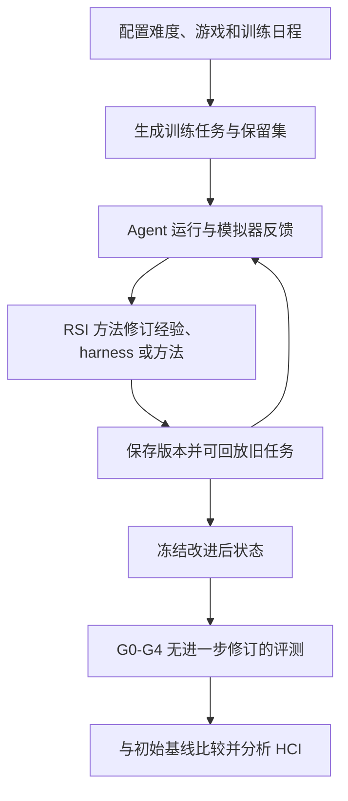
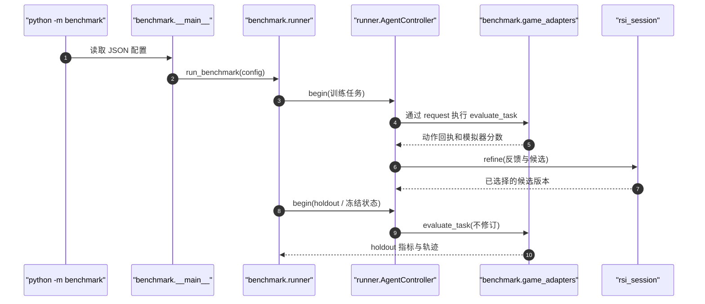

# SelfImprove-Bench: Evaluating Generalization in Self-Improving Agents｜自我改进智能体的泛化评测

## 一句话定义

SelfImprove-Bench 衡量智能体在反馈驱动自我改进之后，收益是否能从已见实例迁移到新实例、新难度和跨任务场景。

## 英文缩写速查

| 缩写 | 英文全称 | 简要说明 |
|---|---|---|
| AI | Artificial Intelligence | 生成/执行被评内容的人工智能 |
| LLM | Large Language Model | 基准中的语言智能体或评分模型 |
| API | Application Programming Interface | 运行模型或裁判的程序接口 |
| RSI | Recursive Self-Improvement | 通过经验反馈修改自身的方法 |
| HCI | Headroom-Closure Index | 对比初始与最终性能的改善指标 |

## 为什么重要

- **五级泛化阶梯**：G0 同一实例重放；G1 同难度新实例；G2 同任务的新难度；G3 同一能力类别的其他任务；G4 跨能力类别任务。难度随层级增加，但不同游戏分数不可无条件横比。

对 [AI Agent 评测](../concepts/ai-agent-evaluation.md) 的价值是将笼统的“成功”拆为可审计且有复现边界的评价对象，而不把模型声明成功当作真实结果。

## 流程总览

## 核心原理

任务生成器生成 train/replay/holdout 池；同一 RSI 方法连续执行任务并从反馈中优化自身。保留改进快照后，在不同 G0–G4 的未见环境中冻结改进进行评测，比较初始与最终能力。

- **五级泛化阶梯**：G0 同一实例重放；G1 同难度新实例；G2 同任务的新难度；G3 同一能力类别的其他任务；G4 跨能力类别任务。难度随层级增加，但不同游戏分数不可无条件横比。
- 覆盖 **6 个游戏**：Farm、Combat、Sweepmine、Hero's Journey、Minecraft、Astray，组织在探索、规划和推理等能力类别下。
- 对比 **ACE**（经验层）、**AHE**（harness 层）与 **HyperAgents**（元层）等 RSI 方法，也提供 Codex、Claude Code 等固定系统基线。
- 训练阶段采用任务序列和中途反馈；holdout 使用独立任务且**不继续自我修改**，防止将测试学习当作泛化。
- 通过同配置初始框架与改进后框架的对照、HCI 与轨迹归因分析，检查改进是不是稳定和可迁移。

## 源码运行时序图

基于已核对的公开 README 和下列模块入口静态整理；未执行端到端实验。图描述已检查的调用职责，不是对每条内部调用的动态跟踪。

对应源码位置参见 [官方仓库归档](../../sources/repos/selfimprove-bench.md)。

## 评测与结果

- G0–G4 五层分别检验重放、新实例、难度迁移、任务迁移和跨能力迁移。
- 公开 README 提供 18 套六游戏×三 RSI 方法的主要实验配置；训练、holdout 与初始框架比较需要保持种子、任务范围和模型后端一致。
- 论文报告 18 个方法-游戏组合里 16 个在 G1 改善，但 8 个 G0 回放退步；G1 的提升不能保证更高难度和跨能力迁移。
- 没有在本次环境跑实测任务，因此不将论文结果冒充本机复现。

## 论文全文复核要点（v1）

- **能力与范围（§3.2、附录 B）：** 三项主能力为 Exploration、Reasoning、Planning；六类游戏 Farm、Combat、Sweepmine、Hero's Journey、Minecraft、Astray。前四种支持难度 1–5，后两种使用 GameWorld 固定保留任务。
- **五层泛化（§3.3）：** G0 对相同历史实例的 replay 比较（不触发 refine）；G1 同难度新实例；G2 同游戏更高难度；G3 同能力类别中另一游戏；G4 跨类别迁移。**不要把 G0 称为未见实例泛化**。
- **保持测试独立（§3.1、附录 A.1–A.3）：** 训练候选验证只使用 held-in 任务；held-out 仅测试已保存的改进状态，禁止在其上修订。Replay 由 interval 和 lag 定义，不计入训练任务数；不同种子控制实例生成，去重是 descriptor/hash 层面的而非游戏真实状态严格唯一。
- **主结果（§4.2，表 2）：** 18 个方法×游戏组合中，**8 个 G0 复测低于历史表现**，但 **16 个 G1 HCI 为正**；G1 改善不能保证 G2–G4 改善。Hero→Sweepmine 能改善而反方向退步，说明 transfer 方向敏感。HyperAgents 在跨能力八个方向中五个 HCI 为正。
- **修订归因（§3.4、§4.3）：** 对最终保留的 915 条 refinement opinions 按语义、适用范围、目标功能、修改面标注；ACE、AHE、HyperAgents 中类别通用/通用的比例分别为 14.2%、7.8%、36.5%。主实验保留修改中 87.9% 指向 prompt/memory、12.1% 指向 harness，未观察到对 improver 本身的改写。
- **消融（§4.4）：** 随机中等难度训练在部分 Combat/Hero 的更难 holdout 上优于逐级增难；直接修订 DeepSeek Harness 的 HyperDSH 是探索性实验，和主实验元级修改对象不同。
- **证据限制（附录 A.4）：** 100 条样例的人工辅助复核是带机器标签的事后审阅，Scope 88%、Surface 99% 等一致性**不是盲测分类准确率**。

## 结论

**任务生成器生成 train/replay/holdout 池，评价边界与复现设置同样重要。**

1. 至少报告 G1/G2/G3/G4，单看 G0 重放容易高估方法泛化。
2. holdout 必须禁止继续 refine，并与训练池隔离；对比初始与改进后的相同任务。
3. 区分经验、harness 与元级修改，追踪修改作用范围及计算成本。
4. GameWorld 与第三方算法许可证各异，商业复现不能只依据主仓 MIT。

## 与其他工作对比

DeliverBench 关心项目最终多文件交付质量，SelfImprove-Bench 关心**反馈后自修改能力的跨任务迁移**；AmbiHTMLBench 关心视觉到 HTML 的重建与裁判一致性。

共同评测原则见 [AI Agent 评测](../concepts/ai-agent-evaluation.md)；机器人工作流的代码与实验验收可参照 [RLE-Bench](rle-bench.md)，但不能直接移植这三项榜单的数字。

## 工程实践

1. 参照主仓 README 使用 Python 3.13.12 建环境；AHE 还需要 Linux bubblewrap，GameWorld 需 Playwright，HyperAgents 需 Docker。
2. 训练 ACE Farm 示例：`python -m benchmark configs/main/farm_ace.json`。
3. 用同一配置运行 `python -m benchmark configs/main/farm_ace.json --initial`，固定 holdout 种子比较初始/改进状态。
4. 使用 `python -m benchmark.hci --trained outputs/main/farm/ace --initial outputs/main/farm/ace_initial --output analysis/farm_ace_hci.json`，并按游戏/难度报告而非仅给全局平均值。

## 局限与风险

- 这是一套以游戏环境为主的 RSI 评测，不能直接推出机器人真机泛化；HyperAgents 内嵌代码有非商业许可，主仓 MIT 不覆盖全部三方依赖。
- 已核对论文正文与附录，详见论文一手归档的核对范围；这不代表独立重跑模型实验。
- 本次仅静态阅读公开仓库和入口，尚未安装完整环境或独立复现实验成绩。

## 关联页面

- [AI Agent 评测](../concepts/ai-agent-evaluation.md) — agent 的评测任务、grader、隔离与判据原则。
- [RLE-Bench](rle-bench.md) — 与机器人学习工程交付相关的 Agent 评测。
- [DeliverBench](paper-deliverbench.md) — 区分被评对象与评价指标。
- [AmbiHTMLBench](paper-ambihtmlbench.md) — 区分被评对象与评价指标。

## 参考来源

- [论文一手归档](../../sources/papers/selfimprove-bench_arxiv_2611_02797.md)
- [官方项目页归档](../../sources/sites/selfimprove-bench.md)
- [官方源码归档](../../sources/repos/selfimprove-bench.md)

## 推荐继续阅读

- [作者项目主页](https://theseus-labs-rsi.github.io/SelfImprove-Bench/)
- [原始论文](https://arxiv.org/abs/2611.02797)
- [官方 GitHub 源码](https://github.com/theseus-labs-rsi/SelfImprove-Bench)
