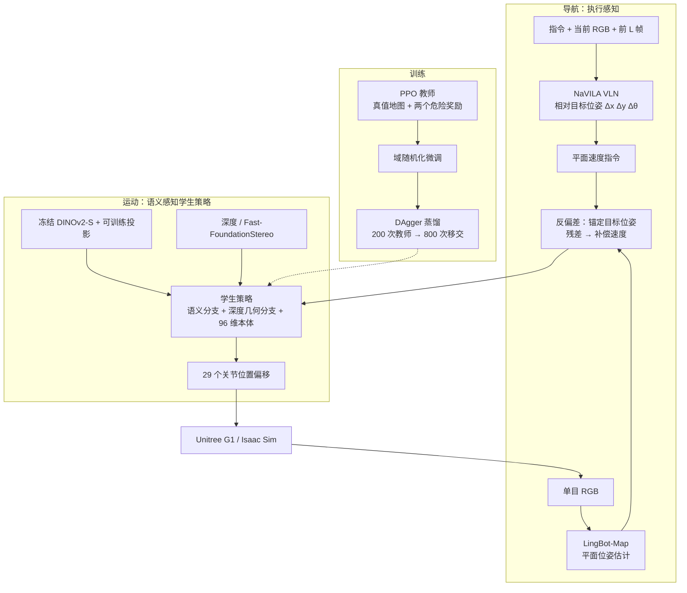
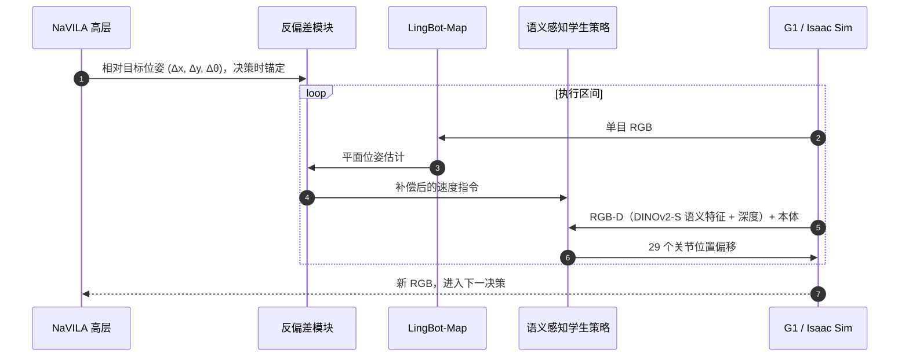

# 高程图看不到什么：语义感知运动与执行感知导航

**What the Elevation Map Cannot See**（[arXiv:2610.07396](https://arxiv.org/abs/2610.07396)，Yao 等）指出人形 VLN 的两个常被忽略的假设：危险都能在高程图里看见，且机器人会如实执行指令。论文给出一个包含 **几何不可见危险 + 物理扰动** 的 Isaac Sim 基准，并提出 **语义感知运动策略**（在 AME 上加 DINOv2 语义分支）和 **执行感知（反偏差）导航**（用单目位姿估计补偿速度指令），运动策略在 Unitree G1 上做了真机验证。

## 英文缩写速查

| 缩写 | 英文全称 | 简要说明 |
|------|----------|----------|
| VLN | Vision-Language Navigation | 按自然语言指令导航，本文高层沿用 NaVILA |
| AME | Attention-based Map Encoding | 本文运动策略的预训练基座，吃高程图 |
| HCR | Hazard Contact Rate | 危险接触率，越低越好 |
| SR / SPL | Success Rate / Success weighted by Path Length | 导航成功率与路径加权成功率 |
| DAgger | Dataset Aggregation | 教师→学生蒸馏，教师前 200 次迭代控制后移交 |
| DINOv2-S | Self-distillation ViT (small) | 冻结的语义特征提取器 |

## 为什么重要

- **指出评测盲区**：手机、水/油渍几乎在高程图里不存在；只用几何的策略在不平地面上 SR 仅 9.4，对不可见危险的接触率 21.1%。
- **把“指令 ≠ 实际位移”纳入导航**：执行偏差会累积，反偏差补偿使碰撞率从 35.93% 降到 12.26%。
- **真机与仿真闭环**：运动策略在 G1 上与 elevation-only、盲视的 SONIC 对比，而不只是仿真。

## 流程总览

## 方法

**基准**：场景来自 NaVILA 的 VLN-CE-Isaac 训练与未见验证划分，脚本放置障碍（40% 在参考路径上，60% 在路径 1.0 m 内）。危险按高程图可见性分三档：可见（crate 0.06–0.24 m 高、box 0.05–0.18 m）、模糊（倒下的瓶子 0.071 m）、不可见（手机 0.014 m、水/油渍 0 m）；正文称六类、表中仅五行。扰动（强度 1.0）含摩擦 0.4–1.0、负载 ±2 kg、推力 ±0.8 m/s、深度噪声 σ=2 cm、光照 450–1250、相机平移 ±5 mm/旋转 ±4°、相机延迟 60–100 ms。

**语义感知运动策略**：在预训练 [AME](./paper-ame-attention-based-map-encoding.md) 上加语义分支；学生输入腰部 RGB-D + 96 维本体，输出 29 个关节位置偏移；语义分支使用冻结 DINOv2-S 特征经可训练投影，几何分支吃深度（部署用 Fast-FoundationStereo 双目深度）。三步训练：①带真值地图与两个危险奖励项的 PPO 教师；②域随机化微调；③DAgger 蒸馏（[DAgger](../methods/dagger.md) 思路，前 200 次迭代教师控制，之后 800 次迭代移交）。奖励常数：δ=0.02 m、k=4、ε=0.03 m、D=0.20 m、v_s=1.0 m/s，探针 {0, 0.08, 0.16} m，速度门 0.1。地形含不平地面、楼梯、桩、石桥各三档。

**执行感知导航**：高层沿用 NaVILA，把指令与历史 RGB 映射为相对目标位姿并转为平面速度指令。反偏差在决策时锚定目标位姿，用 [LingBot-Map](./paper-lingbot-map.md) 从同一单目 RGB 估计平面位姿，残余位置/航向误差映射成补偿速度并替换送入运动策略的指令；控制增益原文未给。

## 源码运行时序图

不适用：论文与 arXiv 页面均未列项目页或 GitHub，2026-10-12 未核实到公开仓库，没有可对照的目录或脚本。下图为论文描述的 **一个决策周期** 的算法级交互：

## 工程实践

- **开源状态（2026-10-12 核查）**：论文页未列项目页或代码仓库，也未找到官方实现；因此无 `sources/sites`、`sources/repos` 归档，复现需自行基于 NaVILA、AME、LingBot-Map 组合。
- **部署依赖**：真机用 Fast-FoundationStereo 提供深度；反偏差的定位在仿真中来自 LingBot-Map，真机是否采用同一方案原文未明确。
- **调参提示**：反偏差控制增益、固定保持间隔等关键值原文未给。

## 实验与评测

**运动（仿真，SR / 进度，无扰动）**

| 方法 | L1 | L2 | L3 |
|------|------|------|------|
| Oracle | 99.0 / 99.7 | 95.6 / 98.2 | 95.0 / 98.1 |
| Elevation-only | 47.9 / 77.7 | 32.7 / 68.7 | 25.2 / 62.8 |
| Ours | 71.5 / 87.0 | 61.2 / 79.4 | 51.0 / 74.7 |

L3 且扰动 1.5× 时 Ours 为 22.7% SR / 56.7% 进度。

**不平地面（无扰动）**

| 方法 | SR | HCR 可见 | HCR 模糊 | HCR 不可见 | 跌倒率 |
|------|------|------|------|------|------|
| Oracle | 93.6 | 2.2 | 1.7 | 1.9 | 0.6 |
| Elevation-only | 9.4 | 27.8 | 41.4 | 21.1 | 0.3 |
| Ours | 50.6 | 24.7 | 17.2 | 6.1 | 1.4 |

扰动 1.0× 时 SR 为 44.2 / 9.7 / 86.9（Ours / Elevation-only / Oracle），1.5× 时 28.1 / 6.7 / 72.8，Ours 跌倒率 11.9。

**G1 真机（每方法每表面 5 次，clean SR）**：塑料地面 Elevation-only 0 / Sonic 20 / Ours 40；木板 0 / 0 / 60；塑料布 0 / 0 / 60；Ours 无跌倒。扰动下 Ours clean SR：无扰动 60，2000 lm 手电 40，加 1 kg 负载 40，海绵棒敲击 60。

**导航（仿真）**：语义分支使 Safe SR 提高 3.34–12.26 点（如 5 障碍尺度 0.5：35.38 vs 23.12）；反偏差消融：Safe SR 23.68 vs 11.98，SR 29.80 vs 19.50，SPL 0.256 vs 0.169，碰撞率 12.26 vs 35.93，危险侵入 12.81 vs 18.38，平均进度 43.20 vs 46.12（略降）。

## 结论

**语义分支主要降低高程图“看不见”的危险接触，反偏差主要降低碰撞；但与 Oracle 仍有大差距且真机样本很小。**

1. **收益集中在不可见/模糊危险** — HCR 不可见 21.1 → 6.1，模糊 41.4 → 17.2；可见危险只从 27.8 到 24.7。
2. **成功率仍远低于 Oracle** — 不平地 50.6 vs 93.6，且两者观测与训练角色不同，不能全归因于感知。
3. **扰动下代价明显** — 1.5× 扰动时 Ours 跌倒率 11.9，高于 Oracle 5.8，作者推测与相机对光照的敏感有关。
4. **反偏差对导航贡献更直接** — 碰撞率 35.93 → 12.26，代价是平均进度略降。
5. **真机只能说明趋势** — 每条件 5 次，Ours 最高 60% clean SR，盲视 SONIC 离开走廊 80–100%。
6. **无公开实现** — 需要自行组装 NaVILA + AME + LingBot-Map。

## 与其他工作对比

| 对照 | 差异读法 |
|------|----------|
| [AME](./paper-ame-attention-based-map-encoding.md) | 本文的运动基座，仅依赖高程图；本文补语义分支 |
| [NaVILA](./paper-notebook-navila-legged-robot-vision-language-action-model.md) | 提供 VLN 高层与 VLN-CE-Isaac 场景；本文补执行偏差与难见危险 |
| [LingBot-Map](./paper-lingbot-map.md) | 被用作反偏差的单目位姿源 |
| [SONIC 运动跟踪](../methods/sonic-motion-tracking.md) | 真机对照中盲视、由人给速度指令的全身控制器 |
| [阶梯/障碍感知运动](../tasks/stair-obstacle-perceptive-locomotion.md) | 以几何感知为主；本文补语义风险 |

## 局限与风险

- **适用边界**：导航结果仅仿真；危险种类有限（表中 5 类）；真机每条件 5 次。
- **归因风险**：Oracle 与 Ours 接口、角色不同；“VLM”识别的具体组成、导航回合数原文未说明。
- **开源状态**：截至 2026-10-12 未列项目页与代码，无法复现。

## 关联页面

- [人形/四足周报汇总（2026-10-05 至 10-09）](../overview/frontier-humanoid-quadruped-2026-10-05-10-09.md)
- [视觉语言导航](../tasks/vision-language-navigation.md)
- [阶梯/障碍感知运动](../tasks/stair-obstacle-perceptive-locomotion.md)
- [Teacher-Student DAgger 训练](../methods/teacher-student-dagger-training.md)

## 参考来源

- [semantic_locomotion_nav_arxiv_2610_07396.md](../../sources/papers/semantic_locomotion_nav_arxiv_2610_07396.md) — 论文来源归档
- [frontier_humanoid_quadruped_2026_10_05_10_09.md](../../sources/blogs/frontier_humanoid_quadruped_2026_10_05_10_09.md) — 周报线索
- 论文：<https://arxiv.org/abs/2610.07396>

## 推荐继续阅读

- [论文 HTML 全文](https://arxiv.org/html/2610.07396v1)
- [NaVILA（arXiv:2412.04453）](https://arxiv.org/abs/2412.04453)
- [DINOv2（arXiv:2304.07193）](https://arxiv.org/abs/2304.07193)
