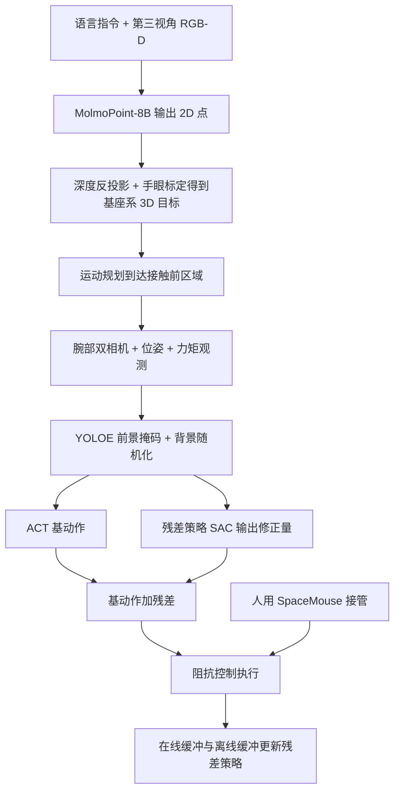

# Semantics-to-Contact（S2C，arXiv:2611.07532）

**S2C**（*Semantics-to-Contact: A Stagewise Framework for Robust Contact-Rich Manipulation*，[arXiv:2611.07532](https://arxiv.org/abs/2611.07532)，[项目页](https://edem-ai.github.io/S2C/)）来自香港中文大学（深圳）、DexForce 与深圳回环区研究院（论文首页），投稿格式为 NeurIPS 2026。原文归档见 [sources/papers/semantics-to-contact_arxiv_2611_07532.md](../../sources/papers/semantics-to-contact_arxiv_2611_07532.md)。

## 一句话定义

**把「去哪里」交给 VLM 点位加运动规划，把「怎么接触」交给带人工干预的真机残差 RL，并用前景保留的背景随机化让真机 RL 策略不过拟合训练场景的外观。**（作者自述，§1、§4）

## 英文缩写速查

| 缩写 | 英文全称 | 简要说明 |
|------|----------|----------|
| S2C | Semantics-to-Contact | 本文框架：语义聚焦 + 接触精修 |
| VLM | Vision-Language Model | 第一阶段用 MolmoPoint-8B 出 2D 点（§4.1） |
| RWRL | Real-World Reinforcement Learning | 直接在真机上训练的 RL |
| HIL | Human-in-the-Loop | 训练中人用 3D SpaceMouse 接管（§5） |
| ACT | Action Chunking with Transformers | 残差 RL 之下的 BC 基策略（式 9） |
| SAC | Soft Actor-Critic | 残差策略的优化算法（式 2、Algorithm 1） |
| GC-POMDP | Goal-Conditioned Partially Observable MDP | 问题形式化（§3） |
| OC-Aug | Object-Centric Augmentation | 以物体为中心的背景随机化（Table 3 消融名） |
| YOLOE | 可提示检测 / 分割模型 | 出前景掩码（§4.1，式 6） |
| SR / TT | Success Rate / Training Time | 成功率 / 学习器侧训练分钟数（§5，Table 1 注） |
| F/T | Force/Torque | 6D 力/力矩测量，属本体观测（§3） |

## 为什么重要

- 它针对一个具体痛点：HIL-SERL 类真机 RL 在训练场景里很准，换桌布或光照就崩。论文 Table 2 中 HIL-SERL 与 HIL-ConRFT 在前三组扰动下均为 0/120，说明这一痛点在其设置里确实存在。
- 不依赖仿真与 3D 资产（§4.1）；同时把 RL 的探索范围缩到 VLM 指出的局部（§4.1，式 5 之后）。
- 对读「机器人强化学习」综述的人：它是「基础模型做粗定位 + 真机 RL 做精细接触」分工的一个真机样例，但并非零样本，也不是端到端 VLA 微调。

## 核心机制

**流程要点（论文章节为准）**

1. **语义聚焦（§4.1）：** 每个 episode 开始时，VLM 看第三视角 RGB-D 与语言指令，输出一个 2D 点；用深度和内参反投影（式 4），经眼在手外手眼标定变到机器人基座系（式 5），运动规划原语到达。选 MolmoPoint-8B 的理由：推理约 2 s，GPT-5 API 约 10 s 以上；Table 4 里 GPT-5.5 API 为 15 s。
2. **视觉增强（§4.1，式 6–8）：** 对两路腕部相机图像，YOLOE 按语言提示分出机械臂、夹爪、被操作物，背景换成采样的颜色 / 纹理 / 干扰物，前景加颜色抖动与亮度变化。附录 C 说明遇透明或与背景相近的物体时可选用线性探针微调 YOLOE 的分割头（式 12）。
3. **基策略（§4.2，式 9）：** ACT 由 BC 在示范上训练，示范观测也是增强后的图像；附录 B 写基策略用 40 条数据训练 5000 epoch。
4. **残差 RL（§4.2，式 10–11，Algorithm 1）：** `a = a_base + Δa`；残差策略输入含基动作；SAC 的 Q 网络与策略更新从在线、离线缓冲各取一半 batch；人工干预动作进离线缓冲。编码器为预训练 ResNet-10，状态转到末端中心坐标系（沿用 HIL-SERL）。
5. **控制与观测（§3、§5）：** 动作是 6D 末端位姿增量加二值夹爪；观测含 6D 位姿、线 / 角速度、6D 力矩与腕部 RGB；奖励是稀疏任务完成奖励；执行端为阻抗控制（Agile Diana 7 自由度臂）。

## 工程实践

- **硬件与系统（§5、附录 B）：** Agile Diana 臂；SpaceMouse 遥操作（采示范与 HIL 干预共用）；RealSense D405 与 Kingfisher 深度相机；VLM 服务端部署在 A800，RL 训练用 5090，模仿学习基线用 A800；VLM 与 RL 都走客户端 / 服务端结构。
- **示范量（附录 A，Table 7–12）：** 各任务初始离线示范 30 到 40 条（充电器 38、试管 30 / 40 / 40、USB 35 / 35）；单 episode 最长 100 环境步；分类器（成功判定）精度 99%；残差 MLP 256x256；折扣 0.98；位置随机化范围 5 到 10 cm、绕 z 转角 10 到 30 度。
- **提示词（附录 D）：** 如 USB 任务「Point to the square USB port on the white charger.」，提示是任务级手写的，换任务需重写。
- **训练时间口径（Table 1 注）：** TT 只记学习器侧 actor-critic 优化时间，真机采集与优化是分开进程，因此它不等于总墙钟时间（作者自述）。
- **可复现性：** 检查清单第 5 项为 No，代码与数据承诺录用后提供；项目页未列仓库（入库日核对）。

## 实验与结果

**任务（§5）：** 充电器抓取插入、USB 插入（easy：充电头固定；hard：位置随机取自预设点位）、试管插入（easy 固定槽位；medium 依次插六根；hard 往随机空槽插）。共六项，实为三类物体的六种变体。

**训练设置（Table 1，各 20 次）：**

| 方法 | 平均 SR | 备注 |
|------|---------|------|
| ACT | 2.50% | 3/120 |
| SERL | 0.00% | 无人工干预 |
| Octo-small | 5.83% | 7/120 |
| HIL-SERL | 90.83% | 109/120 |
| HIL-ConRFT | 91.76%（论文印刷值） | 逐项相加为 110/120 即 91.67%，印刷值疑为笔误 |
| S2C | 94.17% | 113/120 |

S2C 与两个 HIL 基线在训练设置下差距仅约 3 个百分点（各 120 次试验），论文没有报告重复种子或置信区间。

**视觉与位置扰动（Table 2，仅 HIL 类方法，各 20 次）：** 图案桌布 + 位置：S2C 69.17%，两基线 0%。强光 + 位置：84.17% 对 0%。彩色灯光 + 位置：79.17% 对 0%。闪烁白光 + 红桌布 + 位置：S2C 82.50%，HIL-SERL 9.17%，HIL-ConRFT 13.33%。四组平均 78.75%（论文自述，与我按表重算一致）。注意：正文把 82.5% 说成「red tablecloth」，表中该组实为闪烁白光 + 红桌布的组合。

**消融（Table 3，充电器 + USB-hard，各 20 次）：** 强光 + 红桌布 + 位置：w/o HIL 0%、w/o VLM 55.00%、w/o OC-Aug 0%、w/o Contact 0%、完整 S2C 75.00%。放置杂物：w/o VLM 57.50%、w/o OC-Aug 7.50%、完整 77.50%。作者据此称语义定位本身不够，视觉增强是关键，VLM 起辅助作用。

**VLM 骨干（Table 4，充电器任务，各 10 次）：** YOLOE 0/10、SAM 3 3/10、Qwen3-VL-8B 5/10、GPT-5.5 API 10/10（15 s）、MolmoPoint-8B 10/10（2 s）。正文把该表误称为 Table 2。

**能力边界（§5.3，Table 5，各 10 次）：** 对杂物、桌布、强光、彩灯、轻微外力、开关室灯、执行中小幅改变插入位置基本稳健；电源排内出现分布外物体时充电器 0/10、USB-easy 3/10；换成黑色充电器时两者均 0/10。

**拆卸任务（Table 6，各 10 次）：** 试管拔出 9/10（25 分钟），硬盘拔出 10/10（35 分钟），此处基策略换为 diffusion policy。正文把两个百分比的顺序写反了（写成 100% 和 90%）。

## 与其他工作对比

| 对照 | 差异读法 |
|------|----------|
| [SERL / HIL-SERL 系](./paper-rcl-2401-16013-serl-a-software-suite-for-sample-efficient-robot.md) | S2C 沿用 HIL-SERL 的真机 RL 与干预机制，增加 VLM 定位、ACT 残差与背景增强；论文自述基线按原文设置实现，没有 VLM 预接触初始化（Table 1 注），所以 Table 1 并非完全对等的因素隔离 |
| [Residual off-policy RL](./paper-notebook-residual-off-policy-rl-for-finetuning-behavior-c.md) | 同属「BC 基策略 + 残差 RL」思路；S2C 的差异在于加语义聚焦和 HIL 真机训练 |
| [ACT](./paper-act.md) / [Octo](./paper-octo.md) | 作基线与基策略：纯 BC 在换位置时成功率很低（Table 1） |
| [Diffusion Policy](./paper-diffusion-policy.md) | 仅在拆卸扩展实验中用作基策略（§5.3） |

## 局限

**论文自己承认的（§5.3、结论）**

- 分布外物体进入电源排、换成黑色充电器时失败（Table 5），作者归结为「改变任务关键接触区域外观与几何的扰动」。
- 未来工作是长时程操作（§6），说明目前只验证了原子技能。
- 检查清单自述局限只在 §5.3；代码与数据未公开。

**我看到的未验证之处（判断，非论文结论）**

- 与基线的对比因素不对等：HIL-SERL / HIL-ConRFT 没有 VLM 初始化，也没有 OC-Aug；Table 2 里它们的 0% 同时混杂了「无背景增强」与「无语义聚焦」两个因素。论文只在 S2C 内部做了 w/o VLM、w/o OC-Aug 消融，没有给出「HIL-SERL + OC-Aug」这类公平对照。
- 样本量小：每格 20 次（Table 5 为 10 次），无多种子或区间；Table 1 中 S2C 与 HIL 基线的约 3 个百分点差距难以判定显著性。
- 扰动范围有限：多为桌布颜色、光照与杂物，同一台机器人、同一实验台；没有跨本体、跨相机、跨场地测试。此条为我的判断。
- VLM 在第三视角出点，仅在 episode 开始运行一次（§4.1 描述为每个 episode 开始时）；它在场景中目标被遮挡或错点时的恢复机制，论文没有讨论。属推测性疑问。
- 「力反馈」是作为 RL 与 ACT 的观测输入和阻抗控制的组合出现，论文没有做去掉力矩观测的消融，所以力信息的具体贡献未被单独验证。
- 任务级手写提示词（附录 D）与成功分类器（99% 精度，Table 7–12）都是任务专用的，扩到新任务有额外人力。
- 论文细节有若干不一致（HIL-ConRFT 平均、Table 4 引用、Table 6 顺序、附录 A.2–A.6 复用「motherboard assembly」图注），不影响主结论，但提示稿件仍较粗。

## 关联页面

- [接触丰富操作](../concepts/contact-rich-manipulation.md)
- [残差策略学习](../methods/residual-policy-learning.md)
- [安全真机 RL 微调](../concepts/safe-real-world-rl-fine-tuning.md)
- [动作分块](../methods/action-chunking.md)
- [SAC](../methods/sac.md)
- [域随机化](../concepts/domain-randomization.md)
- [阻抗控制](../concepts/impedance-control.md)
- [力控制基础](../concepts/force-control-basics.md)
- [ACT](./paper-act.md)
- [Octo](./paper-octo.md)
- [Diffusion Policy](./paper-diffusion-policy.md)
- [SERL](./paper-rcl-2401-16013-serl-a-software-suite-for-sample-efficient-robot.md)
- [Residual off-policy RL 微调 BC 策略](./paper-notebook-residual-off-policy-rl-for-finetuning-behavior-c.md)

## 参考来源

- [sources/papers/semantics-to-contact_arxiv_2611_07532.md](../../sources/papers/semantics-to-contact_arxiv_2611_07532.md)
- [arXiv:2611.07532](https://arxiv.org/abs/2611.07532)
- [项目页](https://edem-ai.github.io/S2C/)

## 继续阅读

- [arXiv PDF v1](https://arxiv.org/pdf/2611.07532v1)
- 论文引用的前序工作 Focus-then-Contact（ICML 2026，参考文献 [28]），本库未收录。
- [SERL](./paper-rcl-2401-16013-serl-a-software-suite-for-sample-efficient-robot.md) 与 [Residual off-policy RL](./paper-notebook-residual-off-policy-rl-for-finetuning-behavior-c.md)
