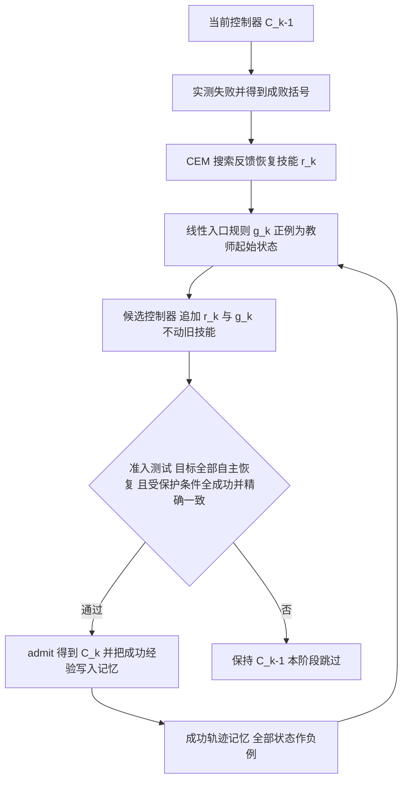

# Sequential Recovery Updates（arXiv:2611.02555）

**Sequential Recovery Updates for Learned Controllers under Successful-Trajectory Preservation**（Zongtan Li、Tianming Liu、Ye Zhao；佐治亚大学、佐治亚理工学院；[arXiv:2611.02555](https://arxiv.org/abs/2611.02555) v1，2026-11-02）。本页依据论文全文（8 页，无附录）整理，原文归档见 [sources 归档](../../sources/papers/sequential-recovery-updates_arxiv_2611_02555.md)。

## 一句话定义

**不改旧技能参数，而是约束「新技能何时被选中」：每次更新在一个实测失败处搜索一个反馈恢复技能，学一个排除全部累计成功轨迹状态的入口规则，并只在复合控制器自主复现新恢复且逐条精确重放受保护轨迹时才准入。**

## 英文缩写速查

| 缩写 / 记号 | 英文全称 | 简要说明 |
|-------------|----------|----------|
| NPMP | Neural Probabilistic Motor Primitives | CMU 流所用的已发布人形跟踪控制器（论文引 [1]、[2]） |
| SONIC | Supersizing Motion Tracking for Natural Humanoid Whole-Body Control | G1 流所用的已发布基座控制器（论文引 [4]） |
| G1 | 论文写作「G1」 | 论文的第二个人形仿真系统（制造商名论文未写，推测为 Unitree G1） |
| CMU | 论文所用 CMU 动作捕捉库中的动作跟踪仿真 | 流 CMU-A、CMU-B |
| CEM | Cross-Entropy Method | 搜索恢复技能的优化器（IV 协议） |
| PPO | Proximal Policy Optimization | 仅用于 G1 继承骨干的准备（22 次 warm-policy 更新），不用于新阶段 |
| 库 / bank | 技能与入口规则的集合 B_k | 第 k 次更新后累计的控制器 |
| 保护条件 | protected conditions | 记入成功轨迹记忆 Q 的任务条件，更新后必须仍成功且轨迹一致 |

## 为什么重要

- **问题：** 一个已能应对多数扰动的学习控制器，补一个新恢复时常顺带破坏旧的成功响应；重训共享参数会让每条轨迹都动一点，下游验证要整体重做（I）。
- **作者的切入：** 冻结参数还不够，因为路由多个冻结技能时，新入口规则会选错技能，改变旧成功轨迹，所以保持是整个闭环（含技能选择）的性质（I）。
- **可检验性：** 把「更新是否破坏旧行为」变成对记录轨迹的精确复现检查，而非训练损失上的软约束（I）。
- **作者自述的贡献：** 序贯恢复机制、有限轨迹保持命题、以及对该保证代价的测量（I 三点贡献）。以上为作者自述，非本页判断。

## 核心机制

### 流程总览

### 论文方法要点（章节 III）

- **运行时（式 2）：** 只在被选中技能的干预窗口内加修正 u_t，窗口外基座 π0 照常动作（a_t = A(π0(x_t) + u_t)）；最近准入且匹配的入口选一个技能，窗口内锁定；技能之间是竞争控制权，不是叠加；所有技能的反馈状态从复位起一直运行，入口不会重置它。
- **技能获取（式 3、4）：** 新技能 = 共享循环反馈骨干输出加一个搜索得到的输出方向偏置 D·θ_k；先做 CEM 找中心条件的恢复，再在邻域评估多个方向，取能恢复中心且覆盖基座与当前控制器共同失败最多的方向；不做新的模仿或强化学习更新（IV）。
- **入口学习（式 5 到 7）：** 线性分类器，正例是教师恢复的起始状态，负例是累计成功轨迹的全部状态，加入前的教师前缀可补充为早触发负例；拟合后阈值取最大负分与最小正分的中点，并要求严格分离间隔。
- **准入（式 8）：** 目标集非空、全部目标自主恢复、全部受保护条件仍成功，且受保护条件上与当前控制器参考轨迹精确一致。
- **保持命题（III.C）：** 在确定性复位 / 转移、旧模块与旧路由不变、新入口在记录状态均为假等前提下，追加新技能精确复现旧轨迹；证明为对时间的归纳。

### 实验设置（章节 IV，表 I）

| 项 | CMU | G1 |
|----|-----|----|
| 基座控制器 | 已发布 NPMP | 已发布 SONIC |
| 特征 / 动作维 | 321 / 56 | 95 / 29 |
| 搜索预算 | 64 + 16 x 5 | 64 + 64 x 7 |
| 干预长度 | 14 tick（0.42 s） | 20 tick（0.4 s）加限幅器尾部 |
| 流 | CMU-A（动作 029_07，625 tick）、CMU-B（026_05，600 tick） | G1-A（dance_in_da_party_001，496 tick）、G1-B（forward_lunge_R_001，398 tick） |

- 每流两个扰动区间，各 24 个随机偏移，共 48 个留出扰动；B 流是未参与调参的动作。CMU 扰动为水平根速度扰动，G1 为 100 ms 水平骨盆力（IV.A、IV.B）。
- 成功判据：CMU 要求完成整段参考且跟踪误差不超 0.3、末 100 tick 最大误差至多 0.08325；G1 在整段 horizon 内不出现非有限位置、根高低于 0.35 m、直立轴余弦低于 0.25（IV.A、IV.B）。

### 主要结果（章节 V，表 II）

| 流 | 基座成功 / 48 | 最终库 / 48 | 相对基座收益 / 损失 | 受保护条件 |
|----|----------------|--------------|----------------------|--------------|
| CMU-A | 5 | 33 | 28 / 0 | 22 |
| CMU-B | 22 | 38 | 16 / 0 | 21 |
| G1-A | 20 | 33 | 13 / 0 | 23 |
| G1-B | 13 | 18 | 5 / 0 | 17 |

- 合计 192 个留出扰动、62 个收益、0 个基座成功损失；V.A 称独立仿真精确复现全部 144 条主面板轨迹（144 = 3 x 48，推测对应 CMU-A 的三个控制器各 48 条或类似口径，论文未逐流说明）。
- 代价（V.C）：去掉成功轨迹负例使四流多恢复 33 个留出条件，同时丢掉最终库独有的 11 个；8 个受保护条件根本不再完成；83 个受保护轨迹里仅 37 个仍精确复现，即 46 个靠约束保持一致。

### 实验与评测解读（作者自述与本页判断分开）

- **作者自述：** 约束让每次更新的增益留在目标区间、不动旧区间（CMU 第二次更新把增益全放在第二个区间，V.A）；minimal exclusion 对照找回 0 个代价，故代价「固有」于该保证（V.C，作者限定为此类入口规则族）。
- **本页判断（推测）：** 排除集合只增不减，故流越长可行入口越少、增益会饱和，论文自己也承认未测（VI）；因此 62 这个数更像四条短流的总和，不宜外推到长期或真机。

## 工程实践

- **代码：** 论文未给出代码或项目页链接，截至 2026-11-09 不可复现；论文称做了工件审计、独立重放与精确算术检查（IV.C），但这些工件未见公开链接。
- **实现细节（论文已给）：** CEM 8 代 x 8 候选、2 精英、均值更新率 0.5；入口拟合 λ = 5e-5、标准化下限 1e-3；入口需观测驱动、热身 4 tick（IV）。
- **接口假设（III.A）：** 需可观测的运行时接口、可复位的评测环境、更新发生在 episode 之间且基座固定。
- **与现有栈的关系：** 在已有控制器之外追加，基座默认动作与动作处理接口不变，零修正等价于基座命令路径（III.A），适合作为已整体验证的控制栈的增量补丁；这一点是论文的设计动机，是否在实际产品栈中成立论文未验证。
- **成本：** CMU 流约 540 次 rollout，G1 流约 1,475 条逻辑轨迹（三分之二复用缓存的确定性前缀）；不含继承控制器准备成本，也非预算匹配比较（IV.C）。

## 局限与风险

**论文自己承认的（VI）：**

- 证据仅限短流、仿真复位、继承反馈骨干、每 episode 一个干预窗口；CMU 只评一个名义有效的整段参考在两个扰动时刻；未显示对未见动作 / 物理分布的广泛鲁棒性。
- 保持仅对受保护轨迹精确成立，入口在记忆之外仍可能泛化不佳（G1-A 的中间损失来自一次晚到的错误入口，由第二个库修复）。
- 继承骨干部分依赖动作：G1-B 增益 5 对 G1-A 的 13；论文称未证明跨对象的技能迁移。
- 资格规则让流看不到自己造成的回退：两次 G1 重复都因此跳过第二阶段；需要「修复型」阶段与「按期望恢复排序」的选择器（VI、VII）。
- 有限任务成功不等于渐近稳定；G1-A 联合成功条件上平均跟踪 RMSE 上升 0.0016 rad；长流内存压缩与真机学习未验证。
- 参考运行初版筛选不允许任何受损条件而失败，后事后放宽为至多两个，再对两次重复固定（IV.C）；Table II 的 G1 数字来自该 reference run。

**本页看到的未验证之处（推测）：**

- 面板 48 个条件是同一学习系统的局部扰动，不是独立试验（论文自己也这么说，故不报显著性，IV.C）；只有两次 G1 重复提供可靠性证据，且各自只准入一个阶段。
- 命题依赖确定性与完全一致的复位，实机噪声下精确复现是否仍可检验论文未讨论。
- 文中结论的分数口径各有「共同失败」「严格阶段收益」等差别，引用时需注意口径（V.A）。
- 论文在致谢中声明 Codex 参与开发与写作，属作者自述的流程信息，不影响数据，但读者若要复核应以论文列出的工件为准（未公开）。

## 关联页面

- [平衡恢复任务页](../tasks/balance-recovery.md)：论文所补的「推扰后恢复」问题所在任务。
- [残差策略学习](../methods/residual-policy-learning.md) 与 [Residual Policy Learning 论文页](./paper-residual-policy-learning.md)：论文相关工作中列为动机，但其恢复区域不约束成功轨迹。
- [SONIC 运动跟踪](../methods/sonic-motion-tracking.md)：G1 流的基座控制器。
- [DeepMimic](../methods/deepmimic.md)：论文引用 [3] 的运动模仿跟踪范式背景。
- [Safe RL](../methods/safe-rl.md) 与 [Safety Filter](../concepts/safety-filter.md)：论文明确声明不把学习入口分类器等同于认证安全过滤器（II）。
- [持续人形动作学习（LoRA-PNN）](./paper-continual-humanoid-motion-learning.md)：同为人形序贯学习，用参数列继承而非入口排除，可对照。

## 参考来源

- [sequential-recovery-updates_arxiv_2611_02555.md](../../sources/papers/sequential-recovery-updates_arxiv_2611_02555.md)
- [arXiv:2611.02555](https://arxiv.org/abs/2611.02555)

## 推荐继续阅读

- [arXiv PDF](https://arxiv.org/pdf/2611.02555)
- [平衡恢复任务页](../tasks/balance-recovery.md)
- [SONIC 运动跟踪方法页](../methods/sonic-motion-tracking.md)
