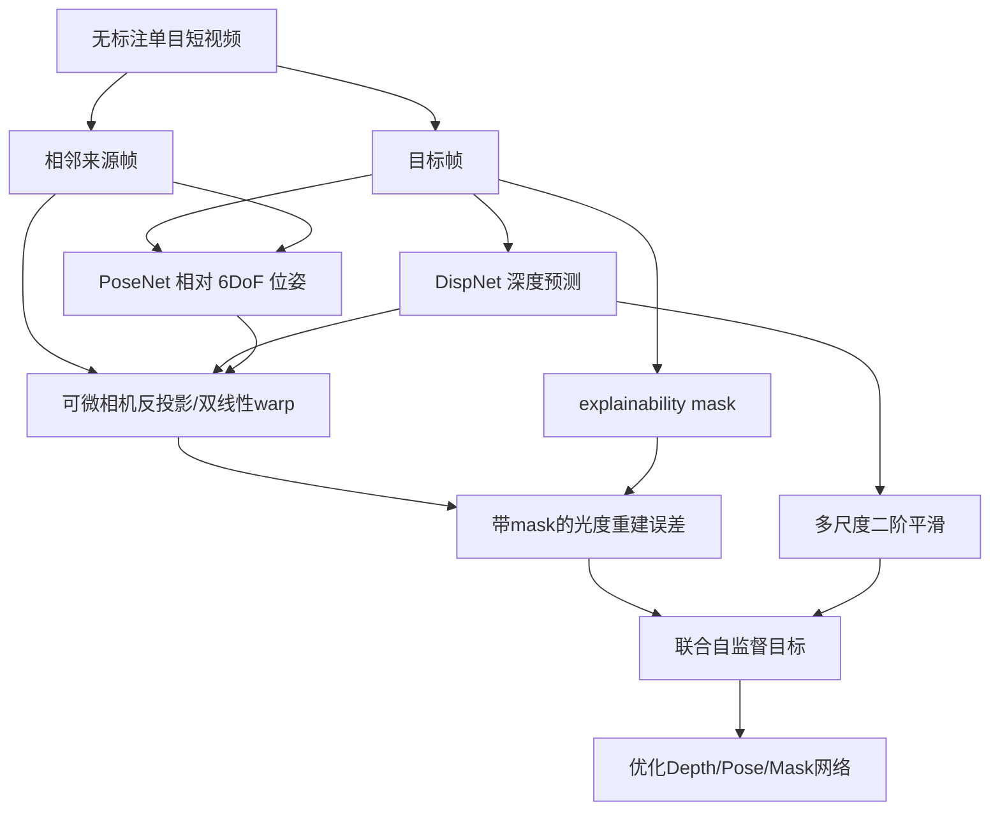
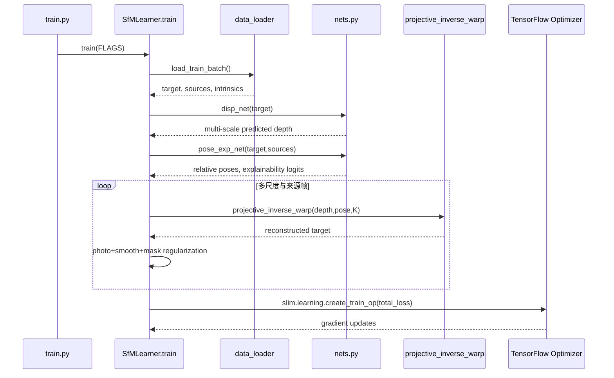

# SfMLearner：无监督学习单目深度与相机自运动 / Unsupervised Learning of Depth and Ego-Motion from Video

## 一句话定义

SfMLearner 通过把源视频帧**重投影到目标帧**获得光度自监督，同时训练单帧深度、连续帧相对位姿和像素级可解释性 mask；推理时可分别使用 depth 和 pose 网络。

## 英文缩写速查

| 缩写 | 英文全称 | 简要说明 |
|---|---|---|
| SfM | Structure from Motion | 图像几何与相机位姿估计 |
| K | Camera Intrinsic Matrix | 已知相机标定内参 |
| CNN | Convolutional Neural Network | 深度/位姿/mask 网络 |
| ATE | Absolute Trajectory Error | 位姿轨迹评价 |
| KITTI | Karlsruhe Institute of Technology and Toyota Technological Institute | 驾驶视频和深度评测 |
| SSIM | Structural Similarity | 后续 Monodepth2 中的重建组件，非 SfMLearner 本文核心 |

## 为什么重要

SfMLearner 把 3D 几何重建从标签依赖改写为视频中**视角合成的一致性目标**：可以用大量没有深度真值/位姿标签的视频学习运动和几何先验。它直接影响后续 Monodepth2、FeatDepth，但**不是端到端完整的闭环 SLAM**。

## 核心原理与方法

- **DepthCNN**：DispNet 样式 encoder-decoder，单目标帧预测正值逆深度/深度，具有跨尺度输出。
- **PoseCNN**：输入目标和相邻来源帧拼接，输出每对 6DoF Euler angles+translation；共同前几层再分支预测 pixel explainability soft mask。
- **可微投影**：对每目标像素以 K 和估计 depth 反投影，按预测 pose 到来源帧，`projective_inverse_warp` 双线性采样，形成合成目标视角。
- **损失**：视角重投影 L1×mask + 多尺度 depth 二阶平滑 + encourage mask non-zero 的正则（Eq. 4）。掩码避免运动物体/遮挡破坏训练，又防止全部屏蔽错误的 trivial solution。
- **假设与尺度**：独立运动、遮挡、漫反射假设可能不成立；单目结果需要 median scaling 评估，训练没有给出绝对世界尺度。

## 流程总览（原论文 Fig2–4）

## 源码运行时序图

官方 TensorFlow1.0 版本 `tinghuiz/SfMLearner`，核对 `train.py`、`SfMLearner.py::build_train_graph`、`nets.py::disp_net/pose_exp_net`、`data_loader.py`、`utils.py`。

## 实验与评测

原文 arXiv v2 Table1，KITTI Eigen 697 张测试图，默认单目无位姿/深度监督；预测深度按每张 median GT rescale：

| 模式 | Abs Rel ↓ | δ1 ↑ |
|---|---:|---:|
| KITTI-only | **0.208** | 0.678 |
| Cityscapes+KITTI | **0.198** | 0.718 |
| KITTI-only 无 explainability | 0.221 | 0.676 |

原论文 Table3，KITTI 5-frame snippet ATE Seq09/10：本法 **0.021/0.020**；完整 ORB-SLAM 使用整段视频为 **0.014/0.012**，后者信息量更大，不能声称深度学习版优于全量 SLAM。README 另一个变更后模型 KITTI-only AbsRel 0.183，与原论文标准配置不同。

## 与其他工作对比

SfMLearner 是这一支自监督单目深度/位姿方法的起点，后续工作多在它的重投影损失上修补遮挡、动态和尺度问题；下表数字均为各论文自报。

| 对照 | 差异 | 论文结果/说明 |
|---|---|---|
| [Monodepth2](./paper-monodepth2.md) | 同为 DepthNet + PoseNet + 可微 warp；Monodepth2 用逐像素最小重投影代替各来源帧误差累加、用 auto-mask 代替学习得到的 explainability mask，光度项加入 SSIM，并在原图分辨率算多尺度损失 | SfMLearner Table1 KITTI-only AbsRel 0.208（416×128）；Monodepth2 Table2 仅单目 AbsRel 0.115（640×192）。分辨率和骨干不同，不是同条件消融 |
| 本文去掉 explainability mask | 同网络、同数据，只关掉 mask | Table1：AbsRel 0.221 vs 0.208、δ1 0.676 vs 0.678，mask 的作用较温和 |
| ORB-SLAM（full） | ORB-SLAM full 使用整段视频做几何优化；SfMLearner 只看 5 帧片段、由网络直接回归位姿 | Table3 ATE Seq09/10：SfMLearner 0.021/0.020，ORB-SLAM full 0.014/0.012；输入信息量不同 |
| [FeatDepth](./paper-featdepth.md) | 后续工作，在光度重投影之外引入特征空间监督，缓解低纹理区域光度损失无约束的问题 | 定性对照，数值见 FeatDepth 页 |

## 结论

**核心贡献是通过已知相机 K、估计深度/相对位姿定义连续图像可微重投影损失，建立无标注单目训练机制。** 这不是一个完整的长序列鲁棒定位系统，也不能恢复可靠公制单目尺度。

## 工程实践

- 数据准备：`python data/prepare_train_data.py --dataset_dir=<raw> --dataset_name=kitti_raw_eigen --dump_root=<out> --seq_length=3 --img_width=416 --img_height=128`。
- 官方训练：`python train.py --dataset_dir=<formatted> --checkpoint_dir=<out> --img_width=416 --img_height=128 --batch_size=4`。
- 原版 TensorFlow 1.0、CUDA8、Ubuntu16.04，不能直接把脚本作为现代环境可运行承诺；深度/位姿评测分别调用 `kitti_eval/eval_depth.py` 和 `eval_pose.py`。

## 局限与风险

- 需要已知/校准相机内参，不适合不知相机模型的随意互联网视频。
- 模型没有显式分离独立物体运动和遮挡；低纹理/动态区域的错误可能被 mask，而非真正建模。
- 单目尺度歧义、领域变化和长序列漂移依然存在；KITTI 5-frame 结果不可类比完整 SLAM。
- 官方代码很老，未执行 GPU/TF 训练；性能数字取自作者论文。

## 关联页面

- [Monodepth2](./paper-monodepth2.md)
- [FeatDepth](./paper-featdepth.md)
- [LVI-SAM](./paper-lvi-sam.md)

## 参考来源

- [SfMLearner 原始论文通读记录](../../sources/papers/vision3d_sfmlearner_20261108.md)
- [SfMLearner 官方源码归档](../../sources/repos/vision3d_sfmlearner_20261108.md)
- [原论文全文](https://arxiv.org/html/1704.07813)
- [原作者 GitHub 代码](https://github.com/tinghuiz/SfMLearner)

## 推荐继续阅读

- [原始 CVPR 论文和参考文献](https://arxiv.org/abs/1704.07813)
